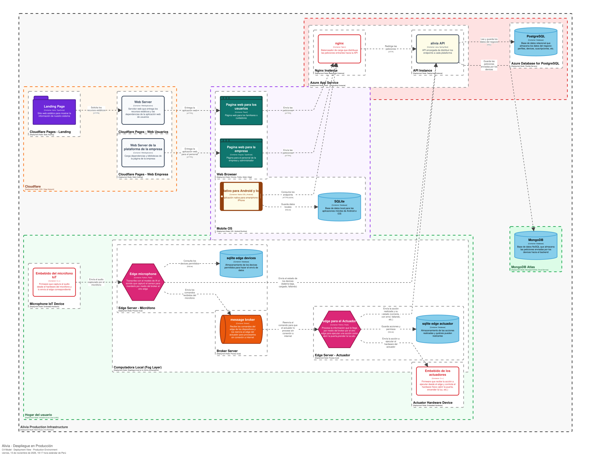

# Capítulo 7: Product Implementation, Validation & Deployment

## 7.1. Software Configuration Management

### 7.1.1. Software Development Environment Configuration

Se describen las herramientas requeridas para el desarrollo del proyecto. Entre las herramientas, se separan por categorías relacionadas con diversas actividades como la gestión del proyecto, diseño del producto, desarrollo de software, testing de software y el despliegue de los productos de software.

<table style="max-width: 100%;">
  <tr>
    <th style="text-align:center;">Actividad</th>
    <th style="text-align:center;">Herramienta</th>
    <th style="text-align:center;">Propósito</th>
    <th style="text-align:center;">Referencia</th>
  </tr>
  <tr>
    <td rowspan="2">Project Management</td>
    <td>Atlassian Jira</td>
    <td>Gestión del progreso de actividades del equipo mediante asignaciones, Sprint backlogs basados en Kanban Boards y automatizaciones de estados de tareas</td>
    <td>https://www.atlassian.com/es/software/jira</td>
  </tr>
  <tr>
    <td>Notion</td>
    <td>Documentación interna de procesos y gestión de conocimiento compartido del equipo</td>
    <td>https://www.notion.com/es</td>
  </tr>
  <tr>
    <td rowspan="5">Product Design</td>
    <td>Structurizr</td>
    <td>Diseño de los diagramas de arquitectura de software y vistas arquitectónicas en base al enfoque de C4 Model</td>
    <td>https://playground.structurizr.com/</td>
  </tr>
  <tr>
    <td>PlantUML</td>
    <td>Diseño de la arquitectura de bajo nivel del software incluyendo diagramas de clase para la capa de dominio</td>
    <td>https://plantuml.com/</td>
  </tr>
  <tr>
    <td>Google Stitch</td>
    <td>Diseño de wireframes y mockups para las aplicaciones cliente: aplicaciones web y móvil de la solución</td>
    <td>https://stitch.google.com/</td>
  </tr>
  <tr>
    <td>Figma</td>
    <td>Refinamiento de mockups de las aplicaciones cliente y creación de prototipos para flujos de usuario</td>
    <td>https://figma.com/</td>
  </tr>
  <tr>
    <td>Wokwi</td>
    <td>Diseño del prototipo funcional y físico del dispositivo IoT integrando el hardware y software necesario</td>
    <td>https://wokwi.com/</td>
  </tr>
  <tr>
    <td rowspan="11">Software Development</td>
    <td>Git & GitHub</td>
    <td>Control de versiones de los productos de software y trazabilidad del desarrollo de software</td>
    <td>https://github.com/</td>
  </tr>
  <tr>
    <td>JetBrains WebStorm</td>
    <td>IDE para el desarrollo del sitio web estático y las aplicaciones web para administradores y usuarios</td>
    <td>https://www.jetbrains.com/es-es/webstorm/</td>
  </tr>
  <tr>
    <td>Node.js & Node Package Manager (NPM)</td>
    <td>Entorno de ejecución de sitio web estático y aplicaciones web. También provee de un gestor de dependencias para las mismas aplicaciones</td>
    <td>https://nodejs.org/es/download/current</td>
  </tr>
  <tr>
    <td>JetBrains IntelliJ IDEA</td>
    <td>IDE para el desarrollo de la aplicación backend (API REST)</td>
    <td>https://www.jetbrains.com/idea/</td>
  </tr>
  <tr>
    <td>Java</td>
    <td>Lenguaje de programación para el desarrollo del API</td>
    <td>https://www.java.com/es/download/manual.jsp</td>
  </tr>
  <tr>
    <td>Android Studio</td>
    <td>IDE para el desarrollo de la aplicación móvil para dispositivos Android</td>
    <td>https://developer.android.com/studio?hl=es-419</td>
  </tr>
  <tr>
    <td>JetBrains PyCharm</td>
    <td>IDE para el desarrollo de los servicios en el borde de la solución</td>
    <td>https://www.jetbrains.com/es-es/pycharm/</td>
  </tr>
  <tr>
    <td>Python</td>
    <td>Lenguaje de programación utilizado para el desarrollo de los servicios en el borde</td>
    <td>https://www.python.org/downloads/</td>
  </tr>
  <tr>
    <td>Arduino IDE</td>
    <td>IDE para el desarrollo de las aplicaciones embebidas en los dispositivos IoT</td>
    <td>https://www.arduino.cc/en/software</td>
  </tr>
  <tr>
    <td>MongoDB Compass</td>
    <td>Gestor de base de datos para gestionar la base de datos de telemetría</td>
    <td>https://www.mongodb.com/products/tools/compass</td>
  </tr>
  <tr>
    <td>pgAdmin4</td>
    <td>Herramienta gráfica para gestionar la base de datos operacional del sistema</td>
    <td>https://www.pgadmin.org/download/pgadmin-4-windows/</td>
  </tr>
  <tr>
    <td rowspan="3">Software Testing</td>
    <td>jUnit, Mockito</td>
    <td>Integración de pruebas de código (jUnit) y simulación de acceso a la persistencia (Mockito)</td>
    <td>https://junit.org/ / https://site.mockito.org/</td>
  </tr>
  <tr>
    <td>pytest</td>
    <td>Integración de pruebas de código para Python</td>
    <td>https://docs.pytest.org/</td>
  </tr>
  <tr>
    <td>Postman</td>
    <td>Herramienta para realizar tests de los endpoints REST del API y verificar su comportamiento ante varios escenarios</td>
    <td>https://www.postman.com/downloads/</td>
  </tr>
  <tr>
    <td rowspan="7">Software Deployment</td>
    <td>Cloudflare Pages</td>
    <td>Servicio en la nube para desplegar el sitio web estático y de las aplicaciones web (administrativa y de usuarios)</td>
    <td>https://www.cloudflare.com/es-es/developer-platform/products/pages/</td>
  </tr>
  <tr>
    <td>Terraform</td>
    <td>Herramienta para preparar la infraestructura del despliegue de la aplicación mediante archivos redactados con código</td>
    <td>https://developer.hashicorp.com/terraform/install</td>
  </tr>
  <tr>
    <td>Azure Container Registry</td>
    <td>Servicio en la nube para alojar las imágenes en contenedores del API generadas por Docker previo despliegue</td>
    <td>https://azure.microsoft.com/en-us/products/container-registry</td>
  </tr>
  <tr>
    <td>Azure App Service</td>
    <td>Servicio en la nube para realizar el proceso de despliegue del API</td>
    <td>https://azure.microsoft.com/es-es/products/app-service</td>
  </tr>
  <tr>
    <td>Azure Database for PostgreSQL (Servidores flexibles)</td>
    <td>Servicio en la nube para alojar la base de datos principal del servidor</td>
    <td>https://azure.microsoft.com/es-es/products/postgresql</td>
  </tr>
  <tr>
    <td>MongoDB Atlas</td>
    <td>Servicio en la nube para el despliegue de la base de datos de telemetría en MongoDB</td>
    <td>https://www.mongodb.com/products/platform/atlas-database</td>
  </tr>
  <tr>
    <td>Firebase App Distribution</td>
    <td>Plataforma para gestionar los lanzamientos de las versiones de la aplicación para dispositivos Android</td>
    <td>https://firebase.google.com/docs/cli?hl=es-419#install_the_firebase_cli</td>
  </tr>
</table>

### 7.1.2. Source Code Management

El control de versiones del código fuente de los productos de software para el proyecto se gestiona siguiendo un esquema orientado al trabajo efectivo. Para ello, se utiliza GitHub como plataforma en la nube para el almacenamiento del código de los productos en repositorios asignados para cada uno. Por otro lado, se usa Git Flow como flujo de trabajo para el desarrollo de las funcionalidades de las aplicaciones y la creación de ramas para el trabajo en paralelo del proyecto. A su vez, para un mejor entendimiento del trabajo implementado en cada confirmación (commit), se utiliza Conventional Commits como norma general para cada entrega de avance en los repositorios. Finalmente, se aplica SemVer para el nombrado de versiones de los productos de software.

**Repositorios de los productos de software**

| Producto de software                | URL del repositorio en Github                            |
| ----------------------------------- | -------------------------------------------------------- |
| Sitio web estático                  | https://github.com/resolum/alivia-landing-page           |
| Aplicación web - Usuarios           | https://github.com/resolum/alivia-users-web-application  |
| Aplicación web - Administrativa     | https://github.com/resolum/alivia-admin-web-application  |
| Aplicación móvil - Android          | https://github.com/resolum/alivia-android-application    |
| Aplicación móvil - iOS              | https://github.com/resolum/alivia-ios-application        |
| Servicios Web - REST API            | https://github.com/resolum/alivia-web-services           |
| Servicios en el borde - Controlador | https://github.com/resolum/alivia-control-edge-service   |
| Servicios en el borde - Actuadores  | https://github.com/resolum/alivia-actuators-edge-service |
| Aplicación embebida - Controlador   | https://github.com/resolum/embebido                      |
| Aplicación embebida - Actuadores    |                                                          |

**Aplicación de Git Flow**

A continuación, se realiza una explicación más detallada sobre el uso de Git Flow en el proyecto. A su vez, se describen las principales reglas que aplican a cada tipo de rama.

<table style="max-width: 100%;">
  <tr>
    <th style="text-align:center;">Rama</th>
    <th style="text-align:center;">Objetivo</th>
    <th style="text-align:center;">Reglas</th>
  </tr>
  <tr>
    <td>main</td>
    <td>Se almacena la última versión más estable del producto lista para fase de producción.</td>
    <td>
      <ul>
        <li>No se realizan commits a esta rama.</li>
        <li>Esta rama solo puede aceptar Pull Requests que provengan desde alguna rama de tipo release.</li>
      </ul>
    </td>
  </tr>
  <tr>
    <td>develop</td>
    <td>Esta rama sirve como integradora de todos los cambios realizados relacionados a nuevas funciones o correcciones.</td>
    <td>
      <ul>
        <li>No se realizan commits a esta rama.</li>
        <li>Esta rama solo puede aceptar Pull Requests que provengan desde alguna rama de tipo feature o bugfix.</li>
      </ul>
    </td>
  </tr>
  <tr>
    <td>release</td>
    <td>El conjunto de estas ramas facilitan el versionamiento y lanzamiento de nuevas versiones del producto de software.</td>
    <td>
      <ul>
        <li>No se realizan commits a esta rama.</li>
        <li>Esta rama solo puede aceptar Pull Requests que provengan desde alguna rama de tipo bugfix.</li>
      </ul>
    </td>
  </tr>
  <tr>
    <td>feature</td>
    <td>El conjunto de estas ramas permiten el desarrollo de nuevas funcionalidades o correcciones previas a la fase de staging</td>
    <td>
      <ul>
        <li>Solo se deben realizar commits acorde a la rama creada.</li>
        <li>Cada rama debe ser nombrada según la funcionalidad que se va a implementar.</li>
      </ul>
    </td>
  </tr>
  <tr>
    <td>bugfix</td>
    <td>El conjunto de estas ramas permiten las correcciones de bugs o errores encontrados en la rama release</td>
    <td>
      <ul>
        <li>Los cambios hechos en esta rama deben verse reflejados tanto en la rama develop como en release.</li>
        <li>Cada rama debe ser nombrada según el bug a corregir.</li>
      </ul>
    </td>
  </tr>
</table>

**Uso de Semantic Versioning**

En esta sección, se explica brevemente la forma de aplicación de Semantic Versioning (SemVer). Para ello, se describen los principales componentes que dan forma a la versión de un producto de software.


<table style="max-width: 100%;">
  <tr>
    <th style="text-align:center;">Componente</th>
    <th style="text-align:center;">Objetivo</th>
    <th style="text-align:center;">Reglas</th>
  </tr>
  <tr>
    <td>MAJOR</td>
    <td>Indica la implementación de un cambio que rompe las versiones anteriores</td>
    <td>En Alivia, se utiliza esta versión para el lanzamiento de versiones que incluyan un conjunto sólido de funcionalidades.</td>
  </tr>
  <tr>
    <td>MINOR</td>
    <td>Indica la implementación cambios menores que no afectan la integridad del producto</td>
    <td>En Alivia, se utiliza esta versión cuando se finaliza el desarrollo de un componente que forma parte de un conjunto de funcionalidades.</td>
  </tr>
  <tr>
    <td>PATCH</td>
    <td>Indica la implementación de correcciones pequeñas en el producto</td>
    <td>En Alivia, se utiliza esta versión para indicar que se ha realizado una corrección de un bug ya sea en una rama feature o bugfix.</td>
  </tr>
</table>

**Aplicación de Conventional Commits**

Los commits son necesarios para dar una descripción breve al equipo acerca del contenido agregado o modificado dentro del código de los productos de software. Por ello, se debe seguir un estándar interno que facilite la lectura de estos mensajes y dejen clara qué se ha implementado. A continuación, se explica el estándar definido para los commits dentro de la organización:

<table style="max-width: 100%;">
  <tr>
    <th style="text-align:center;">Tipo de commit</th>
    <th style="text-align:center;">Objetivo</th>
    <th style="text-align:center;">Ejemplo</th>
  </tr>
  <tr>
    <td>feat</td>
    <td>Indica la implementación de un componente nuevo de funcionalidad.</td>
    <td>feat(sign-in): add login page.</td>
  </tr>
  <tr>
    <td>fix</td>
    <td>Indica la corrección de un error o bug encontrado en el producto.</td>
    <td>fix: remove hard-coded database password.</td>
  </tr>
  <tr>
    <td>docs</td>
    <td>Indica que se añadió documentación referida al producto de software.</td>
    <td>docs: add iam context domain class diagram.</td>
  </tr>
  <tr>
    <td>ci</td>
    <td>Indica la implementación de componentes de integración continua al repositorio.</td>
    <td>ci: add static code analysis workflow.</td>
  </tr>
  <tr>
    <td>refactor</td>
    <td>Indica la modificación de la estructura de un componente de código sin modificar su comportamiento externo.</td>
    <td>refactor: extract verification logic into a new independent service.</td>
  </tr>
  <tr>
    <td>test</td>
    <td>Indica la implementación de algún tipo de prueba en código dentro del producto de software.</td>
    <td>test(sign-in): add password secure storage validation</td>
  </tr>
  <tr>
    <td>chore</td>
    <td>Indica la actualización de dependencias o tareas de mantenimiento del código.</td>
    <td>chore: update mongodb driver dependency.</td>
  </tr>
  <tr>
    <td>build</td>
    <td>Indica la modificación del sistema de compilación y ejecución del producto asociado</td>
    <td>build: update java version to 26.</td>
  </tr>
</table>

### 7.1.3. Source Code Style Guide & Conventions

A continuación, se definen las convenciones de estilo de código que el equipo de desarrollo adoptará para el desarrollo de los productos de software del proyecto. El objetivo de esta guía es mantener la uniformidad del código desarrollado, que sea legible y se alinee con estándares y guías oficiales ofrecidas por las empresas encargadas del mantenimiento de los lenguajes de programación utilizados.

<table style="max-width: 100%;">
  <tr>
    <th style="text-align:center;">Lenguaje de programación</th>
    <th style="text-align:center;">Producto de software</th>
    <th style="text-align:center;">Referencia adoptada</th>
  </tr>
  <tr>
    <td>TypeScript</td>
    <td>Sitio web estático, Aplicación web - Usuarios y Administrativa</td>
    <td>Google TypeScript Style Guide - https://google.github.io/styleguide/tsguide.html</td>
  </tr>
  <tr>
    <td>Astro.js</td>
    <td>Sitio web estático</td>
    <td>Astro Project Structure - https://docs.astro.build/en/basics/project-structure/</td>
  </tr>
  <tr>
    <td>HTML & CSS</td>
    <td>Aplicación web - Usuarios y Administrativa</td>
    <td>Google HTML/CSS Style Guide - https://google.github.io/styleguide/htmlcssguide.html</td>
  </tr>
  <tr>
    <td>React.js</td>
    <td>Aplicación web - Usuarios</td>
    <td>Rules of React - https://react.dev/reference/rules</td>
  </tr>
  <tr>
    <td>Angular.js</td>
    <td>Aplicación web - Administrativa</td>
    <td>Angular Coding Style Guide - https://v19.angular.dev/style-guide</td>
  </tr>
  <tr>
    <td>Kotlin</td>
    <td>Aplicación móvil Android</td>
    <td>Kotlin Coding Conventions - https://kotlinlang.org/docs/coding-conventions.html</td>
  </tr>
  <tr>
    <td>Jetpack Compose</td>
    <td>Aplicación móvil Android</td>
    <td>Guía oficial de Android Developers sobre Jetpack Compose - https://developer.android.com/develop/ui/compose</td>
  </tr>
  <tr>
    <td>Swift</td>
    <td>Aplicación móvil iOS</td>
    <td>Swift API Guidelines - https://swift.org/documentation/api-design-guidelines/</td>
  </tr>
  <tr>
    <td>Swift</td>
    <td>Aplicación móvil iOS</td>
    <td>Google Swift Style Guide - https://google.github.io/swift/</td>
  </tr>
  <tr>
    <td>Java</td>
    <td>Servicios web (API)</td>
    <td>Google Java Style Guide - https://google.github.io/styleguide/javaguide.html</td>
  </tr>
  <tr>
    <td>Spring Boot</td>
    <td>Servicios web (API)</td>
    <td>Documentación oficial de Spring Boot - https://docs.spring.io/spring-boot/index.html</td>
  </tr>
  <tr>
    <td>Python</td>
    <td>Servicios en el borde</td>
    <td>PEP8: Pÿthon Coding Style Guide - https://peps.python.org/pep-0008/</td>
  </tr>
  <tr>
    <td>Python</td>
    <td>Servicios en el borde</td>
    <td>PEP 257: Docstring Conventions - https://peps.python.org/pep-0257/</td>
  </tr>
  <tr>
    <td>Flask</td>
    <td>Servicios en el borde</td>
    <td>Documentación oficial de Flask - https://flask.palletsprojects.com/</td>
  </tr>
  <tr>
    <td>C++</td>
    <td>Aplicaciones embebidas</td>
    <td>Google C++ Style Guide - https://google.github.io/styleguide/cppguide.html</td>
  </tr>
  <tr>
    <td>C++</td>
    <td>Aplicaciones embebidas</td>
    <td>Documentación de CMake - https://cmake.org/cmake/help/latest/</td>
  </tr>
</table>

#### Sitio web estático — Astro + TypeScript

**Referencias adoptadas:**

- [Astro Project Structure](https://docs.astro.build/en/basics/project-structure/).
- [Google TypeScript Style Guide](https://google.github.io/styleguide/tsguide.html).
- [Google HTML/CSS Style Guide](https://google.github.io/styleguide/htmlcssguide.html).

**Convenciones generales**

- Extensiones principales: `.astro`, `.ts`, `.js`, `.html`, `.css` y `.md`/`.mdx`, según el tipo de contenido.
- Indentación de 2 espacios para TypeScript, HTML, CSS y archivos Astro.
- Organizar el proyecto en `src/components/`, `src/layouts/`, `src/pages/`, `src/styles/` y `src/scripts/`, cuando corresponda.
- Utilizar `src/pages/` para definir las rutas del sitio mediante archivos y directorios.
- Utilizar componentes Astro para encapsular estructuras de interfaz reutilizables.
- Reservar los layouts para estructuras compartidas entre páginas, como encabezados, pies de página y plantillas.
- Utilizar TypeScript para la lógica, los datos estructurados y las interfaces de configuración.
- Mantener separados el contenido, la presentación y la lógica de interacción.
- Priorizar el renderizado estático de Astro y añadir JavaScript del lado del cliente únicamente cuando sea necesario.
- Utilizar etiquetas HTML semánticas, atributos accesibles y selectores CSS descriptivos.
- Evitar estilos en línea y duplicación de reglas CSS cuando se puedan reutilizar clases o estilos compartidos.

**Convenciones de nomenclatura**

| Elemento | Convención | Ejemplo |
|---|---|---|
| Componentes Astro | PascalCase | `ProductCard.astro` |
| Layouts | PascalCase | `MainLayout.astro` |
| Páginas y rutas | kebab-case | `product-details.astro` |
| Archivos TypeScript | kebab-case | `product-service.ts` |
| Interfaces y tipos | PascalCase | `Product`, `ProductResponse` |
| Variables | camelCase | `productList` |
| Funciones | camelCase | `getProductDetails()` |
| Constantes globales | UPPER_SNAKE_CASE | `MAX_ITEMS_PER_PAGE` |
| Clases CSS | kebab-case | `.product-card` |
| Variables CSS | kebab-case con prefijo `--` | `--primary-color` |
| Propiedades de componentes | camelCase | `productName` |
| Directorios de features | kebab-case | `product-catalog/` |

**Estructura de referencia**

```text
alivia-landing-page/
├── public/
│   ├── device/
│   ├── hero/
│   ├── favicon.ico
│   └── favicon.svg
├── src/
│   ├── assets/
│   ├── components/
│   │   ├── ui/
│   │   ├── legal/
│   │   ├── devices/
│   │   ├── plans/
│   │   └── sections/
│   ├── data/
│   │   ├── legal/
│   │   ├── plans.ts
│   │   ├── team.ts
│   │   ├── testimonials.ts
│   │   └── faq.ts
│   ├── i18n/
│   │   ├── locales/
│   │   │   ├── en/
│   │   │   └── es/
│   │   ├── ui.ts
│   │   └── utils.ts
│   ├── layouts/
│   │   └── Layout.astro
│   ├── pages/
│   │   ├── en/
│   │   ├── es/
│   │   ├── index.astro
│   │   ├── privacy-policy.astro
│   │   └── terms-and-conditions.astro
│   ├── scripts/
│   └── styles/
│       └── global.css
├── .github/workflows/
├── astro.config.mjs
├── package.json
├── pnpm-lock.yaml
└── README.md
```

#### Aplicación web — Usuarios (React + TypeScript)

**Referencias adoptadas:**

- [Rules of React](https://react.dev/reference/rules).
- [Google TypeScript Style Guide](https://google.github.io/styleguide/tsguide.html).
- [Google HTML/CSS Style Guide](https://google.github.io/styleguide/htmlcssguide.html).

**Convenciones generales**

- Extensiones principales: `.tsx` para componentes React con JSX, `.ts` para lógica y tipos, y `.css` para estilos.
- Indentación de 2 espacios.
- Los componentes funcionales deben encargarse de la representación de la interfaz y de la lógica propia de presentación.
- Extraer a hooks personalizados la lógica reutilizable relacionada con el estado y el ciclo de vida de la interfaz.
- Centralizar la comunicación con APIs en módulos de servicios o clientes HTTP, evitando llamadas duplicadas en los componentes.
- Definir interfaces o tipos para las propiedades de componentes, las respuestas de API y los datos del dominio.
- Respetar las reglas de los Hooks: invocarlos únicamente en componentes funcionales o hooks personalizados y en el nivel superior de su ejecución.
- Mantener puros los componentes y hooks durante el renderizado; realizar los efectos secundarios en los mecanismos apropiados.
- Tratar las propiedades y el estado como datos inmutables.
- Preferir componentes pequeños, reutilizables y con responsabilidades claras.
- Utilizar `key` estables en listas y evitar índices como claves cuando los elementos puedan cambiar de orden.
- Evitar el uso indiscriminado de `any`; preferir tipos explícitos, uniones y `unknown` cuando corresponda.

**Convenciones de nomenclatura**

| Elemento | Convención | Ejemplo |
|---|---|---|
| Componentes React | PascalCase | `InventoryDashboard` |
| Archivos de componentes | PascalCase | `InventoryDashboard.tsx` |
| Hooks personalizados | camelCase con prefijo `use` | `useInventory.ts` |
| Funciones de componentes | PascalCase para componentes | `InventoryDashboard` |
| Funciones auxiliares | camelCase | `formatStockQuantity()` |
| Servicios | camelCase | `inventoryService.ts` |
| Interfaces y tipos | PascalCase | `InventoryItem`, `InventoryResponse` |
| Props de componentes | PascalCase para el tipo; camelCase para sus propiedades | `InventoryCardProps`, `productName` |
| Variables y estados | camelCase | `selectedProduct` |
| Constantes globales | UPPER_SNAKE_CASE | `DEFAULT_PAGE_SIZE` |
| Contextos | PascalCase con sufijo `Context` | `AuthContext` |
| Proveedores de contexto | PascalCase con sufijo `Provider` | `AuthProvider` |
| Funciones de actualización de estado | Prefijo `set` | `setSelectedProduct` |
| Clases CSS | kebab-case | `.inventory-card` |
| Rutas | kebab-case | `/inventory-history` |
| Pruebas | Nombre del elemento + `.test` o `.spec` | `InventoryDashboard.test.tsx` |

**Estructura de referencia**

```text
alivia-users-web-application/
├── public/
├── src/
│   ├── app/
│   │   ├── router.tsx
│   │   ├── providers.tsx
│   │   └── RequireAccess.tsx
│   ├── shared/
│   │   ├── domain/
│   │   │   └── model/
│   │   ├── infrastructure/
│   │   │   ├── base-api.ts
│   │   │   ├── base-api-endpoint.ts
│   │   │   ├── base-assembler.ts
│   │   │   └── base-response.ts
│   │   └── presentation/
│   │       ├── components/
│   │       ├── hooks/
│   │       ├── session/
│   │       └── i18n/
│   ├── iam/
│   │   ├── domain/
│   │   │   └── model/
│   │   ├── application/
│   │   │   ├── commands/
│   │   │   ├── queries/
│   │   │   └── services/
│   │   ├── infrastructure/
│   │   │   ├── endpoints/
│   │   │   └── assemblers/
│   │   └── presentation/
│   │       ├── components/
│   │       ├── hooks/
│   │       └── views/
│   ├── profiles/
│   │   ├── domain/
│   │   ├── application/
│   │   ├── infrastructure/
│   │   └── presentation/
│   ├── care/
│   │   ├── domain/
│   │   ├── application/
│   │   ├── infrastructure/
│   │   └── presentation/
│   ├── subscriptions/
│   ├── support/
│   ├── communications/
│   ├── telemetry/
│   ├── analytics/
│   ├── App.tsx
│   ├── main.tsx
│   └── index.css
├── tests/
├── package.json
├── pnpm-lock.yaml
├── vite.config.ts
└── README.md
```
#### Aplicación web — Administrativa (Angular + TypeScript)

**Referencias adoptadas:**

- [Angular Coding Style Guide](https://v19.angular.dev/style-guide).
- [Google TypeScript Style Guide](https://google.github.io/styleguide/tsguide.html).
- [Google HTML/CSS Style Guide](https://google.github.io/styleguide/htmlcssguide.html).

**Convenciones generales**

- Extensiones principales: `.ts`, `.html` y `.css`; se permite `.scss` si se adopta como estándar del proyecto.
- Indentación de 2 espacios.
- Utilizar componentes para gestionar la presentación y la interacción de la interfaz.
- Centralizar las llamadas HTTP y la lógica de acceso a datos en servicios inyectables.
- Aplicar inyección de dependencias mediante los mecanismos de Angular.
- Utilizar interfaces y tipos para representar las estructuras de datos intercambiadas con la API.
- Preferir formularios reactivos cuando se requiera validación estructurada y control explícito del estado.
- Declarar rutas de manera centralizada o por funcionalidad, según la arquitectura adoptada.
- Utilizar `Observable` y los mecanismos de RxJS cuando corresponda al flujo asíncrono.
- Limitar las suscripciones manuales y gestionar correctamente su ciclo de vida.
- Evitar componentes excesivamente grandes; extraer responsabilidades reutilizables a servicios, pipes, directivas o componentes específicos.
- Mantener consistencia con la estructura de nombres recomendada por Angular: `feature.type.ts`.

**Convenciones de nomenclatura**

| Elemento | Convención | Ejemplo |
|---|---|---|
| Componentes | PascalCase con sufijo `Component` | `InventoryDashboardComponent` |
| Archivos de componentes | kebab-case + `.component` | `inventory-dashboard.component.ts` |
| Servicios | PascalCase con sufijo `Service` | `InventoryService` |
| Archivos de servicios | kebab-case + `.service` | `inventory.service.ts` |
| Interfaces | PascalCase | `InventoryItem` |
| Clases | PascalCase | `StockRecord` |
| Directivas | PascalCase con sufijo `Directive` | `HighlightDirective` |
| Pipes | PascalCase con sufijo `Pipe` | `CurrencyFormatPipe` |
| Guards | PascalCase con sufijo `Guard` | `AuthGuard` |
| Modelos y tipos | PascalCase | `InventoryResponse` |
| Variables y propiedades | camelCase | `currentStock` |
| Métodos | camelCase | `loadInventory()` |
| Constantes globales | UPPER_SNAKE_CASE | `DEFAULT_PAGE_SIZE` |
| Archivos de rutas | kebab-case + `.routes` | `inventory.routes.ts` |
| Selectores de componentes | kebab-case con prefijo del proyecto | `app-inventory-dashboard` |
| Clases CSS | kebab-case | `.inventory-summary` |
| Pruebas | Nombre del elemento + `.spec.ts` | `inventory.service.spec.ts` |

**Estructura de referencia**

```text
alivia-admin-web-application/
├── public/
├── src/
│   ├── app/
│   │   ├── shared/
│   │   │   ├── domain/
│   │   │   ├── infrastructure/
│   │   │   └── presentation/
│   │   ├── domains/
│   │   │   ├── iam/
│   │   │   │   ├── domain/
│   │   │   │   ├── application/
│   │   │   │   ├── infrastructure/
│   │   │   │   └── presentation/
│   │   │   ├── care-management/
│   │   │   │   ├── domain/
│   │   │   │   ├── application/
│   │   │   │   ├── infrastructure/
│   │   │   │   └── presentation/
│   │   │   ├── technical-work/
│   │   │   │   ├── domain/
│   │   │   │   ├── application/
│   │   │   │   ├── infrastructure/
│   │   │   │   └── presentation/
│   │   │   └── support/
│   │   │       ├── domain/
│   │   │       ├── application/
│   │   │       ├── infrastructure/
│   │   │       └── presentation/
│   │   ├── app.config.ts
│   │   └── app.routes.ts
│   ├── styles.css
│   └── main.ts
├── public/
├── angular.json
├── package.json
├── tsconfig.json
└── README.md
```

**Nota:** el sufijo `Component` en el nombre de la clase es una convención explícita del proyecto. Angular utiliza el sufijo `.component.ts` para los archivos, pero no exige universalmente que el nombre de cada clase termine en `Component`.

#### API REST — Spring Boot + Java

**Referencias adoptadas:**

- [Google Java Style Guide](https://google.github.io/styleguide/javaguide.html).
- [Documentación oficial de Spring Boot](https://docs.spring.io/spring-boot/index.html)

**Convenciones generales**

- Extensión principal: `.java`.
- Indentación de 2 espacios, conforme a Google Java Style Guide.
- Organizar los paquetes por funcionalidad o contexto de dominio, manteniendo separadas las responsabilidades de presentación, aplicación, dominio e infraestructura cuando se adopte una arquitectura por capas.
- Los controladores REST deben gestionar las solicitudes HTTP y delegar la lógica de aplicación.
- Los servicios de aplicación deben coordinar los casos de uso y las operaciones del dominio.
- Los repositorios deben encapsular el acceso a datos y evitar que los controladores dependan directamente de la persistencia.
- Utilizar DTO (*Data Transfer Objects*) para definir las estructuras de entrada y salida de la API cuando corresponda.
- Validar los datos recibidos mediante mecanismos como Jakarta Bean Validation.
- Mantener una gestión centralizada y consistente de errores HTTP.
- Utilizar inyección de dependencias de Spring, preferentemente mediante constructores.
- Evitar imports comodín; importar explícitamente las clases utilizadas.
- Documentar las clases y métodos públicos cuando la intención o el contrato no sean evidentes, mediante Javadoc cuando corresponda.
- Evitar la exposición directa de entidades de persistencia como contratos públicos de la API.
- Escribir pruebas unitarias para la lógica aislada y pruebas de integración para los límites entre componentes, la API y la persistencia.

**Convenciones de nomenclatura**

| Elemento | Convención | Ejemplo |
|---|---|---|
| Paquetes | minúsculas, sin guiones ni guiones bajos | `com.example.inventory.service` |
| Clases | PascalCase | `InventoryService` |
| Interfaces | PascalCase, sin prefijo `I` | `InventoryRepository` |
| Implementaciones | PascalCase con sufijo descriptivo | `InventoryRepositoryImpl` |
| Controladores | PascalCase + `Controller` | `InventoryController` |
| Servicios | PascalCase + `Service` | `InventoryService` |
| Repositorios | PascalCase + `Repository` | `InventoryRepository` |
| DTO de entrada | PascalCase + `Request` | `CreateProductRequest` |
| DTO de salida | PascalCase + `Response` | `ProductResponse` |
| Entidades | PascalCase | `InventoryItem` |
| Enumeraciones | PascalCase | `InventoryStatus` |
| Excepciones | PascalCase + `Exception` | `ProductNotFoundException` |
| Métodos | camelCase | `findProductById()` |
| Variables y atributos | camelCase | `currentStock` |
| Constantes `static final` | UPPER_SNAKE_CASE | `MAX_PAGE_SIZE` |
| Archivos Java | Nombre de la clase pública | `InventoryController.java` |
| Métodos de prueba | camelCase descriptivo | `shouldReturnProductWhenIdExists()` |

**Organización recomendada por capas**

```text
alivia-web-services/
├── src/
│   ├── main/
│   │   ├── java/<paquete-base>/
│   │   │   ├── iam/
│   │   │   │   ├── domain/
│   │   │   │   │   ├── model/
│   │   │   │   │   ├── services/
│   │   │   │   │   └── repositories/
│   │   │   │   ├── application/
│   │   │   │   │   ├── internal/
│   │   │   │   │   └── acl/
│   │   │   │   ├── infrastructure/
│   │   │   │   │   ├── persistence/
│   │   │   │   │   │   ├── jpa/
│   │   │   │   │   │   └── springdata/
│   │   │   │   │   └── adapters/
│   │   │   │   └── interfaces/
│   │   │   │       └── rest/
│   │   │   │           ├── controllers/
│   │   │   │           ├── resources/
│   │   │   │           └── assemblers/
│   │   │   ├── profiles/
│   │   │   ├── care/
│   │   │   ├── subscriptions/
│   │   │   ├── support/
│   │   │   ├── communications/
│   │   │   ├── telemetry/
│   │   │   ├── analytics/
│   │   │   └── configuration/
│   │   └── resources/
│   │       ├── application.yml
│   │       └── db/
│   └── test/
│       └── java/<paquete-base>/
│           ├── iam/
│           │   ├── domain/
│           │   ├── application/
│           │   ├── infrastructure/
│           │   └── interfaces/
│           └── ...
├── docs/
├── compose.yaml
├── pom.xml
├── mvnw
└── README.md
```

#### Aplicación móvil — Android (Jetpack Compose + Kotlin)

**Referencias adoptadas:**

- [Kotlin Coding Conventions](https://kotlinlang.org/docs/coding-conventions.html).
- [Guía oficial de Android Developers sobre Jetpack Compose](https://developer.android.com/develop/ui/compose).

**Convenciones generales**

- Extensión principal: `.kt`.
- Indentación de 4 espacios.
- Organizar el código por funcionalidades, separando interfaz, estado, lógica de aplicación y acceso a datos.
- Utilizar funciones `@Composable` para construir componentes de interfaz.
- Nombrar las funciones `@Composable` que devuelven `Unit` mediante PascalCase, siguiendo la convención especial de Kotlin.
- Mantener los composables enfocados en la representación visual y evitar efectos secundarios durante la composición.
- Gestionar el estado de la interfaz de forma explícita y favorecer el flujo unidireccional de datos.
- Elevar el estado (*state hoisting*) cuando deba compartirse entre componentes o gestionarse desde una capa superior.
- Utilizar `ViewModel` para gestionar el estado de pantalla y coordinar la lógica de presentación cuando corresponda.
- Centralizar las operaciones de acceso a APIs y persistencia en repositorios.
- Preferir `val` sobre `var` cuando no se necesite mutabilidad.
- Utilizar clases `data class` para representar datos y `sealed class` o `sealed interface` para modelar estados o resultados finitos cuando resulte apropiado.
- Evitar operaciones bloqueantes en el hilo principal; utilizar corrutinas y mecanismos asíncronos adecuados.
- Separar los recursos de interfaz, como cadenas, colores e iconos, del código de los composables.
- Mantener los paquetes alineados con la organización de los módulos y funcionalidades.

**Convenciones de nomenclatura**

| Elemento | Convención | Ejemplo |
|---|---|---|
| Paquetes | minúsculas, sin guiones bajos | `com.example.inventory` |
| Composables | PascalCase | `InventoryScreen` |
| ViewModels | PascalCase + `ViewModel` | `InventoryViewModel` |
| Repositorios | PascalCase + `Repository` | `InventoryRepository` |
| Clases de datos | PascalCase | `InventoryItem` |
| Estados de UI | PascalCase descriptivo | `InventoryUiState` |
| Eventos de UI | PascalCase descriptivo | `InventoryUiEvent` |
| Interfaces | PascalCase | `InventoryDataSource` |
| Funciones | camelCase | `loadInventory()` |
| Propiedades y variables | camelCase | `selectedProduct` |
| Constantes inmutables de compilación | UPPER_SNAKE_CASE | `MAX_RETRY_COUNT` |
| Objetos singleton | PascalCase | `InventoryDefaults` |
| Enumeraciones | PascalCase; valores según el estándar del proyecto | `InventoryStatus.AVAILABLE` |
| Archivos con una clase principal | Nombre de la clase | `InventoryViewModel.kt` |
| Archivos de funciones relacionadas | PascalCase descriptivo | `InventoryFormatters.kt` |
| Pruebas | Nombre de la clase o componente + `Test` | `InventoryViewModelTest.kt` |

**Convenciones específicas para Jetpack Compose**

| Elemento | Convención | Ejemplo |
|---|---|---|
| Pantallas | `*Screen` | `InventoryScreen` |
| Componentes visuales | Nombre del elemento visual | `ProductCard` |
| Funciones de vista previa | `Preview` + nombre del componente | `PreviewInventoryScreen` |
| Estado de pantalla | `*UiState` | `InventoryUiState` |
| Eventos de pantalla | `*UiEvent` | `InventoryUiEvent` |
| Funciones de callbacks | Verbos o acciones en camelCase | `onProductSelected` |
| Parámetros de modificador | `modifier` | `modifier: Modifier = Modifier` |

**Estructura de referencia**

```text
alivia-android-application/
├── app/
│   ├── src/
│   │   ├── main/
│   │   │   ├── java/<paquete-base>/
│   │   │   │   ├── core/
│   │   │   │   │   ├── network/
│   │   │   │   │   ├── database/
│   │   │   │   │   ├── notifications/
│   │   │   │   │   └── di/
│   │   │   │   ├── shared/
│   │   │   │   │   └── presentation/
│   │   │   │   ├── features/
│   │   │   │   │   ├── iam/
│   │   │   │   │   │   ├── domain/
│   │   │   │   │   │   ├── data/
│   │   │   │   │   │   └── presentation/
│   │   │   │   │   ├── care/
│   │   │   │   │   ├── telemetry/
│   │   │   │   │   ├── communications/
│   │   │   │   │   ├── subscriptions/
│   │   │   │   │   └── profiles/
│   │   │   │   ├── navigation/
│   │   │   │   └── MainActivity.kt
│   │   │   └── res/
│   │   ├── test/
│   │   └── androidTest/
│   └── build.gradle.kts
├── gradle/
├── build.gradle.kts
├── settings.gradle.kts
└── README.md
```

```text
care/
├── domain/
│   ├── model/
│   ├── repository/
│   └── usecase/
├── data/
│   ├── remote/
│   ├── local/
│   ├── mapper/
│   └── repository/
└── presentation/
    ├── screens/
    ├── components/
    ├── viewmodel/
    └── state/
```

#### Aplicación móvil — iOS (Swift)

**Referencias adoptadas:**

- [Swift API Design Guidelines](https://swift.org/documentation/api-design-guidelines/).
- [Google Swift Style Guide](https://google.github.io/swift/).

**Convenciones generales**

- Extensión principal: `.swift`.
- Indentación de 4 espacios como estándar adoptado por el proyecto; mantener la configuración de formato consistente en Xcode y las herramientas elegidas.
- Organizar el código por funcionalidades, separando vistas, modelos, servicios y lógica de presentación.
- Utilizar `struct` para modelos de datos y vistas de SwiftUI cuando corresponda, y `class` cuando se requiera identidad de referencia o semántica de referencia.
- Mantener las vistas enfocadas en la presentación; trasladar las operaciones de negocio y acceso a datos a componentes apropiados.
- Utilizar `Observable` o `ObservableObject`, según las tecnologías y versiones adoptadas, para gestionar el estado observable.
- Preferir `let` sobre `var` cuando el valor no deba cambiar.
- Definir protocolos para abstraer dependencias y facilitar las pruebas.
- Utilizar `async`/`await` para operaciones asíncronas cuando corresponda.
- Nombrar los métodos de manera que su uso resulte claro y natural.
- Evitar abreviaturas innecesarias y nombres que repitan información ya evidente en el contexto.
- Documentar las declaraciones públicas relevantes mediante comentarios de documentación con `///`.
- Gestionar errores explícitamente y evitar el uso indiscriminado de valores opcionales forzados (`!`).
- Mantener separadas las responsabilidades de las vistas, los modelos de presentación y los servicios.

**Convenciones de nomenclatura**

| Elemento | Convención | Ejemplo |
|---|---|---|
| Tipos y clases | UpperCamelCase | `InventoryItem` |
| Estructuras | UpperCamelCase | `InventoryViewState` |
| Protocolos | UpperCamelCase | `InventoryRepository` |
| Enumeraciones | UpperCamelCase | `InventoryStatus` |
| Casos de enumeración | lowerCamelCase | `.available` |
| Vistas SwiftUI | PascalCase + `View` | `InventoryView` |
| ViewModels | PascalCase + `ViewModel` | `InventoryViewModel` |
| Servicios | PascalCase + `Service` | `InventoryService` |
| Métodos | lowerCamelCase | `loadInventory()` |
| Variables y propiedades | lowerCamelCase | `currentStock` |
| Constantes | lowerCamelCase | `maximumRetryCount` |
| Funciones de creación | Prefijo `make` | `makeInventoryView()` |
| Tipos de error | PascalCase + `Error` | `InventoryError` |
| Archivos Swift | PascalCase descriptivo | `InventoryView.swift` |
| Pruebas | Nombre del tipo + `Tests` | `InventoryViewModelTests.swift` |

**Estructura de referencia**

```text
alivia-ios-application/
├── Alivia.xcodeproj/
├── Alivia/
│   ├── App/
│   │   ├── AliviaApp.swift
│   │   ├── AppConfiguration.swift
│   │   └── DependencyContainer.swift
│   ├── Core/
│   │   ├── Networking/
│   │   ├── Persistence/
│   │   ├── Notifications/
│   │   └── Utilities/
│   ├── Shared/
│   │   └── Presentation/
│   ├── Features/
│   │   ├── IAM/
│   │   │   ├── Domain/
│   │   │   ├── Data/
│   │   │   └── Presentation/
│   │   ├── Care/
│   │   │   ├── Domain/
│   │   │   ├── Data/
│   │   │   └── Presentation/
│   │   ├── Telemetry/
│   │   ├── Communications/
│   │   ├── Profiles/
│   │   └── Subscriptions/
│   ├── Resources/
│   └── Info.plist
└── AliviaTests/
    ├── Domain/
    ├── Application/
    └── Data/
```

```
Care/
├── Domain/
│   ├── Models/
│   ├── ValueObjects/
│   ├── Repositories/
│   └── UseCases/
├── Data/
│   ├── Remote/
│   ├── Local/
│   ├── DTOs/
│   └── Repositories/
└── Presentation/
    ├── Views/
    ├── ViewModels/
    └── Components/
```

#### Servicios en el borde — Flask + Python

**Referencias adoptadas:**

- [PEP 8 — Style Guide for Python Code](https://peps.python.org/pep-0008/).
- [PEP 257 — Docstring Conventions](https://peps.python.org/pep-0257/).
- [Documentación oficial de Flask](https://flask.palletsprojects.com/).

**Convenciones generales**

- Extensión principal: `.py`.
- Indentación de 4 espacios, sin tabulaciones para la indentación.
- Organizar el proyecto por módulos y paquetes, separando rutas HTTP, lógica de procesamiento, acceso a datos y configuración.
- Utilizar Blueprints de Flask para agrupar rutas relacionadas cuando la aplicación tenga varios módulos funcionales.
- Mantener las funciones de los endpoints enfocadas en recibir solicitudes, validar entradas y devolver respuestas.
- Separar la lógica de procesamiento de telemetría de los controladores HTTP.
- Centralizar las operaciones de acceso a servicios externos, brokers MQTT y almacenamiento en módulos específicos.
- Utilizar type hints en parámetros, retornos y estructuras de datos relevantes.
- Definir clases o estructuras de datos explícitas para representar mensajes de telemetría y resultados de procesamiento.
- Utilizar docstrings para documentar módulos, clases y funciones públicas.
- Gestionar las excepciones y los errores de comunicación de forma explícita, evitando capturar excepciones genéricas sin tratamiento adecuado.
- Mantener las credenciales y la configuración sensible fuera del código fuente.
- Evitar variables globales mutables para almacenar el estado de ejecución.
- Escribir pruebas unitarias para los algoritmos de procesamiento y pruebas de integración para endpoints, MQTT y dependencias externas.
- Utilizar un entorno virtual y un archivo de dependencias versionado.

**Convenciones de nomenclatura**

| Elemento | Convención | Ejemplo |
|---|---|---|
| Paquetes | Minúsculas | `telemetry` |
| Módulos y archivos | `snake_case` | `telemetry_processor.py` |
| Clases | PascalCase | `TelemetryProcessor` |
| Blueprints | `snake_case` | `telemetry_bp` |
| Funciones | `snake_case` | `process_telemetry()` |
| Métodos | `snake_case` | `validate_reading()` |
| Variables | `snake_case` | `current_temperature` |
| Constantes | UPPER_SNAKE_CASE | `MAX_RETRY_COUNT` |
| Excepciones propias | PascalCase + `Error` | `TelemetryValidationError` |
| Modelos de datos | PascalCase | `TelemetryReading` |
| Esquemas de validación | PascalCase + `Schema` | `TelemetryReadingSchema` |
| Funciones de rutas | `snake_case` descriptivo | `get_telemetry_history()` |
| Pruebas | Prefijo `test_` | `test_process_telemetry.py` |
| Funciones de prueba | Prefijo `test_` | `test_invalid_reading_is_rejected()` |

**Organización recomendada**

```text
alivia-actuators-edge-service/
├── app/
│   ├── __init__.py
│   ├── domain/
│   │   ├── actuators/
│   │   │   ├── entities.py
│   │   │   ├── value_objects.py
│   │   │   ├── policies.py
│   │   │   └── events.py
│   │   ├── commands/
│   │   └── exceptions.py
│   ├── application/
│   │   ├── commands/
│   │   │   └── execute_actuator_command.py
│   │   ├── queries/
│   │   ├── ports/
│   │   │   ├── actuator_controller.py
│   │   │   └── actuator_repository.py
│   │   └── dto/
│   ├── infrastructure/
│   │   ├── persistence/
│   │   │   ├── models.py
│   │   │   └── repositories.py
│   │   ├── mqtt/
│   │   ├── hardware/
│   │   └── configuration/
│   └── interfaces/
│       ├── http/
│       │   ├── routes.py
│       │   └── schemas.py
│       └── messaging/
│           └── mqtt_handlers.py
├── tests/
│   ├── unit/
│   │   ├── domain/
│   │   └── application/
│   └── integration/
│       ├── http/
│       ├── mqtt/
│       └── persistence/
├── app.py
├── requirements.txt
└── README.md
```

#### Aplicaciones embebidas — C++

**Referencias adoptadas:**

- [Google C++ Style Guide](https://google.github.io/styleguide/cppguide.html).
- [Documentación de CMake](https://cmake.org/cmake/help/latest/).

**Convenciones generales**

- Extensiones principales: `.h` para cabeceras y `.cc` para archivos de implementación, siguiendo Google C++ Style Guide.
- Indentación de 2 espacios.
- Organizar el código en módulos, con separación entre controladores de hardware, lógica de negocio, comunicaciones y configuración.
- Mantener las cabeceras autocontenidas e incluir únicamente las dependencias necesarias.
- Ordenar los `#include` según la guía adoptada: cabecera asociada, cabeceras del sistema C, biblioteca estándar de C++, bibliotecas externas y cabeceras propias.
- Utilizar clases y estructuras para encapsular el estado y el comportamiento de los componentes.
- Preferir la gestión segura de recursos mediante RAII y tipos de la biblioteca estándar cuando sean compatibles con las restricciones del dispositivo.
- Evitar asignaciones dinámicas innecesarias en rutas críticas o sistemas con memoria limitada.
- Utilizar tipos de tamaño explícito, como `std::uint32_t`, cuando el ancho del dato sea relevante para el hardware o el protocolo.
- Aplicar `const` siempre que ayude a expresar que un dato o parámetro no debe modificarse.
- Evitar macros cuando puedan sustituirse por constantes, funciones o mecanismos de C++ más seguros.
- Documentar las interfaces de hardware y los supuestos relacionados con interrupciones, concurrencia, temporización y recursos.
- Mantener separada la lógica de control de hardware de la lógica que pueda probarse mediante pruebas unitarias.
- Utilizar pruebas unitarias para la lógica aislada y pruebas en hardware o simuladores para validar el comportamiento físico.
- Definir reglas explícitas para el manejo de errores, límites de memoria y tiempos de ejecución.
- No adoptar mecanismos de C++ que no sean compatibles con la versión del estándar o el compilador del dispositivo.

**Convenciones de nomenclatura**

| Elemento | Convención | Ejemplo |
|---|---|---|
| Clases | PascalCase | `TemperatureSensor` |
| Estructuras (`struct`) | PascalCase | `TelemetryReading` |
| Enumeraciones | PascalCase | `SensorStatus` |
| Valores de enumeraciones | PascalCase | `SensorStatus::ReadFailed` |
| Funciones | PascalCase | `ReadTemperature()` |
| Variables locales | `snake_case` | `current_temperature` |
| Parámetros | `snake_case` | `sensor_address` |
| Atributos de clases | `snake_case` con guion bajo final | `temperature_` |
| Miembros de `struct` | `snake_case` sin guion bajo final | `temperature` |
| Constantes de ámbito de clase o espacio de nombres | `k` + PascalCase | `kMaxRetryCount` |
| Macros | UPPER_SNAKE_CASE con prefijo del proyecto | `ALIVIA_MAX_RETRIES` |
| Espacios de nombres | `snake_case` | `alivia::sensors` |
| Alias de tipos | PascalCase | `SensorReading` |
| Archivos de cabecera | Minúsculas con guiones bajos | `temperature_sensor.h` |
| Archivos de implementación | Mismo nombre que la cabecera | `temperature_sensor.cc` |
| Archivos de prueba | Nombre del módulo + `_test.cc` | `temperature_sensor_test.cc` |

**Organización recomendada**

```text
alivia-embedded-controller/
├── include/
├── src/
├── tests/
│   ├── unit/
│   └── integration/
├── CMakeLists.txt
└── README.md
```

### 7.1.4. Software Deployment Configuration

Con los productos digitales desarrollados en cada avance, es necesario alojarlos en un sitio público de modo que se pueda realizar una verificación real en línea, en lugar de una prueba local. Para ello, se despliega cada producto en un proveedor de nube definido en la sección **7.1.1.**. A continuación, se resume en una tabla el proveedor asignado para cada producto a desplegar:

| Producto digital                | Dónde se despliega |
|---------------------------------|--------------------|
| Landing Page                    | Cloudflare Pages   |
| Aplicación web (Usuarios)       | Cloudflare Pages   |
| Aplicación web (Administrativa) | Cloudflare Pages   |
| Servicios web (API)             | Azure App Service  |
| Aplicación embebida             | ESP32 (Hardware)   |

De la misma forma, cada despliegue sigue distintos pasos tanto para configurar, preparar los archivos y ejecutar el despliegue. Así, se explica paso a paso el proceso seguido para el despliegue de los productos digitales que abarca Alivia:

#### Landing Page y Aplicaciones web

El despliegue de una aplicación web en Cloudflare Pages se realiza mediante la integración con un repositorio GitHub, desde donde Cloudflare obtiene el código fuente, instala las dependencias, ejecuta el proceso de compilación y publica los archivos generados.

**Paso 1: Preparación del proyecto**

Primero, se debe preparar el entorno para desplegar. La estrategia aquí consiste en utilizar la carpeta "dist" donde se aloja el archivo html compilado de la aplicación. De esta forma, se debe ejecutar el comando de compilación localmente.

```bash
# 1) Landing Page
astro build  # Compilar la Landing Page
```

```bash
# 2) Aplicación Web de Usuarios
pnpm install    # Instalar las dependencias del proyecto
pnpm build      # Genera la carpeta dist
```

```bash
# 3) Aplicación Web Administrativa
npm install    # Instalar las dependencias del proyecto
npm build      # Genera la carpeta dist
```

**Paso 2: Creación y conexión del proyecto en Cloudflare Pages**

A continuación, lo que sigue es crear el proyecto en el dashboard de Cloudflare. De esta forma, se conecta el repositorio de la aplicación deseada con la página para que los cambios se desplieguen automáticamente al subir cambios a la rama principal.

- Iniciar sesión en el Dashboard de Cloudflare.
- Ingresar a `Workers & Pages`.
- Seleccionar `Create application` y luego `Pages`.
- Seleccionar `Connect to Git`.
- Autorizar la integración con GitHub.
- Seleccionar el repositorio de la aplicación web.
- Hacer clic en `Begin setup`.

**Paso 3: Configuración del proceso de construcción**

Después, se deben establecer los parámetros que Cloudflare utilizará para compilar y publicar la aplicación web. Con ello, Cloudflare podrá iniciar el proceso automático de despliegue tomando la carpeta dist.

- Definir el nombre del proyecto en Cloudflare.
- Seleccionar la rama de producción (main).
- Seleccionar el framework correspondiente (Astro para Landing Page, React para aplicación de usuarios y Angular para administrativa).
- Configurar el comando de construcción (astro build; pnpm build o npm build).
- Configurar el directorio de salida mediante un archivo `wrangler.jsonc`, de esta forma, Cloudflare utilizará `dist` para los despliegues.
- Configurar la variables de entorno que contiene el URL del API desplegado.
- Hacer clic en `Save and Deploy`.

**Paso 4: Ejecución del despliegue**

Finalmente, se ejecuta el proceso de automatización de despliegues. Además, se supervisa que el proceso concluya sin errores.

- Tras realizar cambios en la rama main, se debe esperar la ejecución del proceso de construcción.
- Para verificar que todo haya salido sin errores, se revisan los registros de ejecución (Build Logs).
- Luego, se verifica el resultado del despliegue.

Si estos pasos ocurren sin errores, solo falta acceder a la URL generada por Cloudflare Pages para visualizar la aplicación desplegada.

#### Aplicación móvil

La aplicación móvil de Alivia está desarrollada utilizando Kotlin y el entorno de desarrollo Android. Para su distribución en entornos de prueba, se utiliza Firebase App Distribution, permitiendo compartir versiones APK con testers registrados antes de una publicación formal en Google Play Store.

**Paso 1: Instalación de dependencias**

La administración de dependencias se realiza mediante Gradle. Para preparar el proyecto, se debe abrir en Android Studio y sincronizar las dependencias declaradas en los archivos de configuración del proyecto.

```bash
./gradlew build
```

Con este comando, se instalan las dependencias y se genera el APK para ejecutar la aplicación en modo prueba antes de desplegarla.

**Paso 2: Generar el APK de distribución**

A continuación, se debe generar el APK que será utilizada para el despliegue en el ambiente de Firebase App Distribution.

```bash
./gradlew assembleRelease
```

El archivo generado se ubicará en:

```text
app/build/outputs/apk/release/app-release.apk
```

**Paso 3: Configuración de Firebase App Distribution**

Para distribuir la aplicación móvil mediante Firebase App Distribution, se deben seguir los siguientes pasos:

- Crear o seleccionar un proyecto en Firebase Console.
- Registrar la aplicación Android dentro del proyecto Firebase, utilizando el mismo `applicationId` definido en Gradle.
- Obtener el identificador de la aplicación Firebase (Firebase App ID), necesario para realizar la distribución.
- Descargar el archivo de configuración:

```text
google-services.json
```

Luego, Ubicar el archivo dentro del proyecto Android en:

```text
app/
└── google-services.json
```

- Habilitar Firebase App Distribution.
- Registrar los correos de los testers autorizados.
- Subir el archivo APK generado desde Firebase Console o mediante Firebase CLI.

**Paso 4: Distribución mediante Firebase Console**

- Ingresar a Firebase Console.
- Seleccionar el proyecto de Alivia.
- Entrar a `App Distribution`.
- Seleccionar la aplicación Android.
- Subir el archivo:

```text
app-release.apk
```

- Agregar testers o grupos de testers.
- Añadir notas de versión.
- Publicar la distribución.

**Paso 5: Distribución mediante Firebase CLI**

Para distribuir el APK mediante consola, se puede utilizar Firebase CLI:

```bash
npm install -g firebase-tools
firebase login
```

```bash
firebase appdistribution:distribute app/build/outputs/apk/release/app-release.apk \
  --app <firebase-app-id> \
  --groups "testers" \
  --release-notes "Release version for testing"
```

#### Servicios web

El despliegue de los servicios web se realiza con punto de finalización en Azure App Service, teniendo las bases de datos en Azure Database for PostgreSQL y MongoDB Atlas Cloud. Además, el despliegue se realiza de forma continua mediante workflows de GitHub Actions para agilizar el proceso. De la misma forma, la infraestructura se maneja mediante Terraform para crear los recursos de una manera más sencilla.

**Paso 1: Preparación de la infraestructura**

Para el despliegue de los servicios web, se realiza una gestión de la infraestructura mediante código utilizando Terraform. Por ello, lo primero que se realiza es crear los archivos tanto para los entornos a preparar (como staging y production) y de los módulos (como las bases de datos o la propia plataforma) a utilizar. En este caso, se crean dos carpetas principales: 'modules' y 'environments'. Dentro de la primera, se crean las siguientes subcarpetas:

- 'registry' para preparar el servicio de Azure Container Registry.
- 'platform' para preparar el servicio de Azure App Service.
- 'postgres' para preparar el servicio de Azure Database for PostgreSQL.
- 'mongodb-atlas' para el servicio de MongoDB Atlas Cloud.
- 'deploy-identity' para las credenciales federadas que habilitan al repositorio de GitHub para ejecutar los workflows de GitHub Actions para Continuous Delivery y Continuous Deployment.

Por otro lado, en la carpeta de 'environments' se crean los dos ambientes principales: 'staging' y 'production'. De la misma forma, se crea un ambiente 'shared' para la generación del grupo de recursos en Azure que contendrá todo lo relacionado a Alivia. A continuación, se muestran los comandos para generar estas carpetas

```bash
mkdir -p infrastructure/terraform/modules/{registry,platform,postgres,mongodb-atlas,deploy-identity}
mkdir -p infrastructure/terraform/environments/{shared,staging/tests,production/tests}
```

Luego, se deben crear los archivos con extensión `.tf` para utilizar IaaC con Terraform. Se crean dos archivos: `main.tf` y `terraform.tfvars.example`.

- [`main.tf`](https://github.com/resolum/alivia-web-services/blob/main/infrastructure/terraform/environments/shared/main.tf) contiene la lógica central de infraestructura de cada ambiente. Además, se declaran los recursos que va a crear Terraform.
- [`terraform.tfvars.example`](https://github.com/resolum/alivia-web-services/blob/main/infrastructure/terraform/environments/shared/terraform.tfvars.example) contiene las variables de entrada que recibe el archivo `main.tf` para generar los recursos. Sin embargo, esta versión solo contiene valores de ejemplo, ya que los reales contienen secretos que no se suben a los repositorios.

Finalmente, se debe reemplazar cada valor del archivo de variables con los valores reales de lo que se desee.

**Paso 2:** Levantar la infraestructura**

A continuación, con los archivos de Terraform configurados, se deben ejecutar los siguientes comandos para iniciar el proceso de levantar la infraestructura. Es decir, la creación de los recursos definidos para cada ambiente.

Por otro lado, se requieren algunas variables a configurar en la consola donde se esté ejecutando el proceso para evitar errores:

```bash
$env:MONGODB_ATLAS_PUBLIC_KEY  = "<clave pública>"
$env:MONGODB_ATLAS_PRIVATE_KEY = "<clave privada>"
```

Luego, se ejecuta la siguiente lista de comandos para iniciar lo principal que es el grupo de recursos en Azure y el servicio de Azure Container Registry para almacenar las imágenes de los despliegues del API.

```bash
# 1) shared
cd infrastructure/terraform/environments/shared
terraform init
terraform plan -out tfplan
terraform apply tfplan
terraform output acr_name                 # → acr_name de staging y production
cd -
```

Después, se debe colocar el nombre del contenedor de registros generado por el ambiente compartido en los archivos de variables tanto de `staging` y `production` y ejecutar los mismos comandos

```bash
# 2) cada entorno, en dos pasos la primera vez (repetir con ENV=production)
cd infrastructure/terraform/environments/$ENV
terraform init
terraform apply -target=module.platform
terraform plan -out tfplan
terraform apply tfplan
terraform plan                            # debe decir: No changes
cd -
```

Al finalizar este paso, para cada ambiente se generaron los registros de aplicaciones web para el API, la base de datos en MongoDB y en PostgreSQL y las identidades federadas para permitir al repositorio ejecutar Continuous Delivery y Continuous Deployment.

**Paso 3: Configurar los entornos en GitHub**

Como el nombre del paso indica, a continuación, se configura tanto los ambientes de `staging` como `production` en el repositorio de GitHub del API. Para ello, se ejecutan los siguientes comandos:

```bash
# staging
gh api -X PUT "repos/$R/environments/staging"

# production: revisores y solo la rama main
REVIEWER_LOGIN="<usuario de GitHub de quien aprueba>"
REVIEWER_ID=$(gh api "users/$REVIEWER_LOGIN" --jq .id)
gh api -X PUT "repos/$R/environments/production" --input - <<JSON
{
  "reviewers": [ { "type": "User", "id": $REVIEWER_ID } ],
  "deployment_branch_policy": { "protected_branches": false, "custom_branch_policies": true }
}
JSON
gh api -X POST "repos/$R/environments/production/deployment-branch-policies" -f name=main -f type=branch
```

**Paso 4: Cargar las variables y secretos**

Luego, se debe configurar las variables y secretos de cada entorno configurado. Para ello, la estrategia es asignar variables mediante comandos desde la salida del archivo de variables de Terraform hacia el repositorio de Git con los siguientes comandos:

```bash
export ENV=staging
export TF_DIR=infrastructure/terraform/environments/$ENV
cd "$TF_DIR"
v() { gh variable set "$1" --env "$ENV" --repo "$R" --body "$2"; }

v AZURE_CLIENT_ID            "$(terraform output -raw deploy_identity_client_id)"
v AZURE_TENANT_ID            "$(terraform output -raw azure_tenant_id)"
v AZURE_SUBSCRIPTION_ID      "$(terraform output -raw azure_subscription_id)"
v AZURE_RESOURCE_GROUP       "$(terraform output -raw resource_group_name)"
v AZURE_WEBAPP_NAME          "$(terraform output -raw webapp_name)"
v AZURE_POSTGRES_SERVER_NAME "$(terraform output -raw postgres_server_name)"
v ACR_NAME                   "$(terraform output -raw acr_name)"
v DB_URL                     "$(terraform output -raw postgres_jdbc_url)"
v DB_USERNAME                "$(terraform output -raw postgres_administrator_login)"

terraform output -raw postgres_administrator_password | gh secret set DB_PASSWORD --env "$ENV" --repo "$R"
cd - >/dev/null
```

**Paso 5: Ejecutar el pipeline de despliegue**

Ahora que se tienen configurados los servicios en la nube y los entornos, es momento de realizar el despliegue. Para ello, se utiliza la contenedorización mediante Docker para empaquetar el API y subirlo a la nube. Además, se utiliza GitHub Actions para ejecutar el despliegue de manera automatizada. De modo que, el [pipeline](https://github.com/resolum/alivia-web-services/blob/main/.github/workflows/cd-deploy.yml) verifica la imagen y ejecuta un comando en bash que contiene las operaciones para desplegar el API.

```bash
cp -r <ruta-referencia>/infrastructure/scripts infrastructure/
mkdir -p .github/workflows
cp <ruta-referencia>/.github/workflows/cd-deploy.yml .github/workflows/
```

Con el archivo bash y el workflow creados, se debe realizar un commit en la rama correspondiente y realizar un Pull Request hacia develop para que inicie el pipeline de despliegue.

#### Aplicación embebida

**Paso 1: Preparación del entorno de desarrollo**

Primero, se deben instalar las dependencias del framework ModestIoT para poder ejecutar la aplicación. Para ello, se accede al administrador de bibliotecas de Arduino IDE y se realiza la instalación de las dependencias requeridas por el framework.

**Paso 2: Configuración de parámetros de conexión**

Luego, antes de cargar el firmware, se debe colocar las variables necesarias para configurar la conexión a utilizar. En este caso, la conexión WiFi. Para ello, se siguen los siguientes pasos:

- Ubicar el archivo de configuración del proyecto.
- Configurar las credenciales Wi-Fi.
- Configurar el host del Edge Service.
- Configurar el puerto del Edge Service.
- Configurar el path del Edge Service.
- Configurar el token de autenticación del Edge Service.

**Paso 3: Verificación del código fuente**

Después, se debe comprobar que el código fuente y sus dependencias sean válidos antes de cargar el firmware en el dispositivo ESP32. Para ello, se siguen los siguientes pasos:

- Conectar el ESP32 al equipo mediante un cable USB.
- Seleccionar la placa ESP32 correspondiente.
- Seleccionar el puerto de comunicación.
- Ejecutar la opción Verify (ícono de marca de verificación).
- Revisar el resultado de la compilación.

**Paso 4: Carga del firmware en el ESP32**

Finalmente, se compila y transfiere el firmware generado al dispositivo físico para ejecutar la aplicación embebida.

- Confirmar que el ESP32 permanezca conectado mediante USB.
- Hacer clic en Upload (ícono de flecha hacia la derecha).
- Esperar a que finalice la carga.
- Verificar el resultado en la consola.

#### Diagrama de Despliegue

A continuación, se muestra un diagrama de despliegue que representa la arquitectura de la solución implementada, incluyendo los servicios en la nube, el API y la aplicación embebida.



## 7.2. Solution Implementation

### 7.2.1. Sprint 1

En este sprint se planifica el primer incremento de Alivia, centrado en el control de luces, puertas y ventanas por voz, la consulta del estado de los dispositivos y la validación inicial de la propuesta de valor. Las siguientes secciones reúnen la planificación y las evidencias de desarrollo, pruebas, despliegue y colaboración del equipo.

### 7.2.1.1. Sprint 1 Planning

<table>
  <tbody>
    <tr>
      <th>Sprint #</th>
      <th>Sprint 1</th>
    </tr>
    <tr>
      <th colspan="2">Sprint Planning Background</th>
    </tr>
    <tr>
      <td>Date</td>
      <td>22 de octubre de 2026</td>
    </tr>
    <tr>
      <td>Time</td>
      <td>08:00 AM (GMT-5)</td>
    </tr>
    <tr>
      <td>Location</td>
      <td>Reunión virtual mediante Discord</td>
    </tr>
    <tr>
      <td>Prepared By</td>
      <td>Coronel Espinoza, Farid Sebastian</td>
    </tr>
    <tr>
      <td>Attendees (to planning meeting)</td>
      <td>Oscar Javier Armas Sánchez; Renato Guillermo Calvo Yalan; Farid Sebastian Coronel Espinoza; Matias Sebastian Diaz Quispe; Nicolas Emilio Walter Juarez Leon; Dayro Richard Rios Piñan.</td>
    </tr>
    <tr>
      <th colspan="2">Sprint Goal &amp; User Stories</th>
    </tr>
    <tr>
      <td>Sprint 1 Goal</td>
      <td>
        <p><strong>Nos enfocamos en ofrecer</strong> un primer incremento de Alivia que permita a las personas con discapacidad motora severa controlar las luces, puertas y ventanas mediante comandos de voz, facilite a sus cuidadores la consulta del estado de los dispositivos y permita a nuestro negocio validar la propuesta de valor que sustenta la comercialización de suscripciones y dispositivos.</p>
        <p><strong>Creemos que esto proporciona</strong> mayor autonomía a la persona con discapacidad, una menor carga de asistencia rutinaria y mayor visibilidad del entorno para el cuidador, y evidencia para que nuestro negocio ajuste su oferta y evalúe su aceptación comercial.</p>
        <p><strong>Esto se confirmará cuando</strong>, en las tareas evaluadas durante el sprint, las personas usuarias puedan realizarlas sin ayuda en al menos el <strong>70 % de las ocasiones</strong>, las intervenciones del cuidador disminuyan en un <strong>65 % respecto a la medición inicial</strong>, los cuidadores puedan consultar el estado actualizado de los dispositivos desde la aplicación web y el control local funcione en al menos el <strong>99 % de los escenarios probados sin Internet</strong>. Para el negocio, se evaluará la disposición de los participantes a contratar una suscripción y adquirir los dispositivos, registrando sus motivos de aceptación o rechazo para ajustar la oferta.</p>
      </td>
    </tr>
    <tr>
      <td>Sprint 1 Velocity</td>
      <td>-</td>
    </tr>
    <tr>
      <td>Sum of Story Points</td>
      <td>-</td>
    </tr>
  </tbody>
</table>

### Aspect Leaders and Collaborators

La siguiente matriz muestra la participación de cada integrante en los aspectos del proyecto. **L** identifica al responsable principal, **C** a quien colabora y **—** indica que no tiene una participación asignada en ese aspecto.

| **Team Member**                    | **GitHub Username** | IAM   | Company | Profiles | HCM   | Medical Assistance | Subscriptions | Support | Assets | Tracking | Communications | Analytics | Shared |
|------------------------------------|---------------------|-------|---------|----------|-------|--------------------|---------------|---------|--------|----------|----------------|-----------|--------|
| Armas Sánchez, Oscar Javier        | Racso24k            | C     | —       | —        | —     | C                  | —             | **L**   | —      | —        | C              | —         | **L**  |
| Calvo Yalan, Renato Guillermo      | RenatoCY            | —     | —       | —        | —     | C                  | —             | —       | **L**  | **L**    | —              | C         | C      |
| Coronel Espinoza, Farid Sebastian  | Far14z              | —     | C       | C        | **L** | —                  | **L**         | C       | C      | —        | —              | —         | —      |
| Diaz Quispe, Matías Sebastian      | equinox-1092        | C     | —       | —        | —     | C                  | —             | —       | —      | C        | **L**          | **L**     | C      |
| Juarez Leon, Nicolas Emilio Walter | JuarezLn10          | **L** | —       | C        | —     | **L**              | —             | —       | C      | C        | —              | —         | —      |
| Rios Piñan, Dayro Richard          | Addicted2you        | —     | **L**   | **L**    | C     | —                  | C             | —       | C      | C        | —              | —         | —      |

### 6.2.1.3. Sprint Backlog 1

Como se mencionó previamente en el planeamiento del Sprint 1, el objetivo es desarrollar un primer incremento funcional de Alivia que contribuya a la autonomía de las personas con discapacidad motora severa mediante el control de luces, puertas y ventanas por comandos de voz, complementado con capacidades de supervisión y gestión del servicio. Para ello, el sprint reúne funcionalidades de presentación del producto, contratación, administración de hogares y cuidadores, gestión de empleados, seguimiento del cuidado e integración de los componentes web, móviles, backend, Edge y dispositivos embebidos. Asimismo, contempla el reconocimiento local de voz y la continuidad de las operaciones esenciales sin conexión a Internet.

Luego de definir el objetivo del sprint, se seleccionaron las historias de usuario, historias técnicas y demás elementos correspondientes, y se descompusieron en subtareas relacionadas con su implementación y validación. Para organizar el trabajo, asignar responsables y dar seguimiento al progreso, se utilizó Jira.

Proyecto en Jira: [Alivia-Project](https://resolum-emergentes.atlassian.net/?continue=https%3A%2F%2Fresolum-emergentes.atlassian.net%2Fwelcome%2Fsoftware%3FprojectId%3D10001&atlOrigin=eyJpIjoiMDk5NGFlZWNjYjgxNGJiNDgzNjY3OWZmOTZlMWQwMTUiLCJwIjoiamlyYS1zb2Z0d2FyZSJ9)


A continuación, se presenta la tabla con las tareas necesarias para completar el primer sprint. Cada subtarea se encuentra agrupada bajo su historia correspondiente e incluye su descripción, estimación en horas, responsable y estado actual en Jira.

La tabla contiene exclusivamente las 128 historias y los demás elementos principales asignados a **Alivia - Sprint 1**, junto con sus **436 subtareas**. Los identificadores US, TS, DMS, DUS y SP se conservan según el título de cada elemento, mientras que los títulos se presentan sin ese prefijo. Los estados y nombres de los responsables se reproducen como aparecen en Jira, consultado el **5 de noviembre de 2026**.

| User Story | Título | Work Item/Task | Título | Descripción | Estimation (Hours) | Assigned to | Status |
| --- | --- | --- | --- | --- | --- | --- | --- |
| [US-01](https://resolum-emergentes.atlassian.net/browse/AP-13) | Conocer Alivia y sus beneficios | [AP-149](https://resolum-emergentes.atlassian.net/browse/AP-149) | Landing - Sección del problema y dispositivos incluidos | Sección de la landing que explica el problema que atiende Alivia y muestra los dispositivos incluidos (luz, puerta, ventana, micrófono). | 3 | Matias D. | Finalizada |
|  |  | [AP-150](https://resolum-emergentes.atlassian.net/browse/AP-150) | Landing - Sección de beneficios de autonomía y seguridad | Bloque con los beneficios para la persona asistida: control por voz, autonomía y seguridad en el hogar. | 3 | Matias D. | Finalizada |
|  |  | [AP-151](https://resolum-emergentes.atlassian.net/browse/AP-151) | Landing - Sección de beneficios de supervisión | Bloque con los beneficios para familiares y cuidadores: supervisión remota, alertas y coordinación. | 3 | Matias D. | Finalizada |
| [US-02](https://resolum-emergentes.atlassian.net/browse/AP-14) | Conocer el producto y al equipo mediante contenido audiovisual | [AP-152](https://resolum-emergentes.atlassian.net/browse/AP-152) | Landing - Reproductor del video del producto | Incrustar el video de presentación del producto con controles de reproducción. | 3 | Matias D. | Finalizada |
|  |  | [AP-153](https://resolum-emergentes.atlassian.net/browse/AP-153) | Landing - Reproductor del video del equipo | Incrustar el video de presentación del equipo con controles de reproducción. | 3 | Matias D. | Finalizada |
|  |  | [AP-154](https://resolum-emergentes.atlassian.net/browse/AP-154) | Landing - Mostrar alternativa textual accesible para contenido audiovisual | Mostrar un texto o resumen alternativo cuando el contenido audiovisual no pueda reproducirse. | 3 | Matias D. | Finalizada |
| [US-03](https://resolum-emergentes.atlassian.net/browse/AP-15) | Consultar testimonios y respaldo del servicio | [AP-155](https://resolum-emergentes.atlassian.net/browse/AP-155) | Landing - Sección de testimonios autorizados | Mostrar testimonios de personas relacionadas con Alivia y el beneficio que obtuvieron. | 3 | Matias D. | Finalizada |
|  |  | [AP-156](https://resolum-emergentes.atlassian.net/browse/AP-156) | Landing - Sección del equipo y su respaldo profesional | Presentar al equipo y su respaldo profesional para generar confianza. | 3 | Matias D. | Finalizada |
|  |  | [AP-157](https://resolum-emergentes.atlassian.net/browse/AP-157) | Landing - Anonimizar testimonios sin autorización de identidad completa | Mostrar solo identidad parcial o anónima cuando no hay autorización para publicar el nombre completo. | 4 | Matias D. | Finalizada |
| [US-04](https://resolum-emergentes.atlassian.net/browse/AP-16) | Consultar planes y continuar a la contratación | [AP-158](https://resolum-emergentes.atlassian.net/browse/AP-158) | Landing - Implementar comparativa de planes, precios y dispositivos incluidos | Tabla comparativa de planes con precios y características. | 6 | Matias D. | Finalizada |
|  |  | [AP-159](https://resolum-emergentes.atlassian.net/browse/AP-159) | Landing - Implementar redirección hacia la contratación en la web del cuidador | Botones que llevan a la aplicación web de contratación y muestran la disponibilidad en Android e iOS. | 6 | Matias D. | Finalizada |
|  |  | [AP-160](https://resolum-emergentes.atlassian.net/browse/AP-160) | Landing - Mostrar disponibilidad de la aplicación para Android e iOS | La aplicación web de usuarios lee el plan elegido enviado desde la landing y lo precarga al iniciar la contratación. | 3 | Matias D. | Finalizada |
| [US-05](https://resolum-emergentes.atlassian.net/browse/AP-17) | Registrar y verificar al responsable y crear la cuenta del hogar | [AP-161](https://resolum-emergentes.atlassian.net/browse/AP-161) | Web cuidador - Implementar formulario de registro del responsable | Endpoint de registro del cliente responsable en IAM y envío del código/enlace de verificación por SendGrid. | 6 | Matias D. | Finalizada |
|  |  | [AP-162](https://resolum-emergentes.atlassian.net/browse/AP-162) | Web cuidador - Implementar pantalla de verificación y reenvío del correo | Endpoint para validar el enlace o código, manejar enlaces inválidos o vencidos y reenviar la verificación. | 6 | Matias D. | Finalizada |
|  |  | [AP-163](https://resolum-emergentes.atlassian.net/browse/AP-163) | Web usuarios - Formulario de registro y verificación de correo | Pantallas de registro, aviso de correo enviado, verificación y reenvío. | 4 | Oscar Javier Armas Sanchez | Finalizada |
|  |  | [AP-164](https://resolum-emergentes.atlassian.net/browse/AP-164) | Web usuarios - Creación de la cuenta del hogar | Formulario para crear la cuenta compartida del hogar y validar datos obligatorios. | 4 | Matias D. | Finalizada |
| [US-06](https://resolum-emergentes.atlassian.net/browse/AP-18) | Seleccionar el plan de contratación | [AP-165](https://resolum-emergentes.atlassian.net/browse/AP-165) | Web cuidador - Implementar comparación de planes Base y Personalizado | Registrar el plan y la periodicidad elegidos como preliminares, sin activar suscripción, y validar disponibilidad. | 6 | Dayro Richard Rios Piñan | Finalizada |
|  |  | [AP-166](https://resolum-emergentes.atlassian.net/browse/AP-166) | Web cuidador - Implementar configuración del plan personalizado | Pantalla para elegir plan, periodicidad y cambiarlos antes de confirmar. | 6 | Dayro Richard Rios Piñan | Finalizada |
|  |  | [AP-167](https://resolum-emergentes.atlassian.net/browse/AP-167) | Web cuidador - Gestionar selección preliminar y disponibilidad del plan | Manejar el caso en que el plan elegido ya no está disponible y ofrecer alternativas. | 4 | Dayro Richard Rios Piñan | Finalizada |
| [US-07](https://resolum-emergentes.atlassian.net/browse/AP-19) | Autorizar temporalmente el importe | [AP-168](https://resolum-emergentes.atlassian.net/browse/AP-168) | Web cuidador - Implementar formulario de autorización con Stripe Elements | Formulario de pago con Stripe Elements para autorizar temporalmente el importe sin cobrar la suscripción. | 6 | Dayro Richard Rios Piñan | Finalizada |
|  |  | [AP-169](https://resolum-emergentes.atlassian.net/browse/AP-169) | Web cuidador - Mostrar confirmación de autorización temporal | Crear la suscripción/intención de pago con retención (autorización sin captura) en Stripe. | 3 | Dayro Richard Rios Piñan | Finalizada |
|  |  | [AP-170](https://resolum-emergentes.atlassian.net/browse/AP-170) | Web cuidador - Gestionar autorización rechazada o vencida | Procesar eventos de Stripe para medios de pago que no permiten retención y para autorizaciones vencidas. | 4 | Dayro Richard Rios Piñan | Finalizada |
| [US-08](https://resolum-emergentes.atlassian.net/browse/AP-20) | Seleccionar el horario de la evaluación técnica | [AP-171](https://resolum-emergentes.atlassian.net/browse/AP-171) | Web cuidador - Mostrar bloques disponibles para la evaluación técnica | Consultar bloques con capacidad disponible y reservar descontando capacidad. | 3 | Farid Coronel | Finalizada |
|  |  | [AP-172](https://resolum-emergentes.atlassian.net/browse/AP-172) | Web cuidador - Implementar reserva y reprogramación del horario | Pantalla para ver bloques, reservar y reprogramar una evaluación aún no realizada. | 6 | Farid Coronel | Finalizada |
|  |  | [AP-173](https://resolum-emergentes.atlassian.net/browse/AP-173) | Web cuidador - Gestionar indisponibilidad y visita no completada | Registrar la ausencia del cliente y liberar o reprogramar la capacidad. | 4 | Farid Coronel | Finalizada |
| [US-09](https://resolum-emergentes.atlassian.net/browse/AP-21) | Registrar la evaluación de compatibilidad | [AP-174](https://resolum-emergentes.atlassian.net/browse/AP-174) | Mobile técnico - Implementar revisión y confirmación del dictamen | Registrar resultado de puertas, ventanas, iluminación y conectividad, con dictamen favorable, parcial o desfavorable. | 6 | Farid Coronel | Finalizada |
|  |  | [AP-175](https://resolum-emergentes.atlassian.net/browse/AP-175) | Android técnico - Implementar formulario de evaluación de compatibilidad | Pantalla para que el técnico registre la evaluación en la vivienda. | 6 | Farid Coronel | Finalizada |
|  |  | [AP-176](https://resolum-emergentes.atlassian.net/browse/AP-176) | iOS técnico - Implementar formulario de evaluación de compatibilidad | Pantalla equivalente en iOS para el técnico. | 6 | Farid Coronel | Finalizada |
|  |  | [AP-177](https://resolum-emergentes.atlassian.net/browse/AP-177) | Web empresa - Implementar consulta del dictamen técnico | Vista para que la empresa consulte el dictamen y su detalle. | 6 | Farid Coronel | Finalizada |
| [US-10](https://resolum-emergentes.atlassian.net/browse/AP-22) | Continuar la contratación según el resultado técnico | [AP-178](https://resolum-emergentes.atlassian.net/browse/AP-178) | Web cuidador - Mostrar resultado de la evaluación técnica | Capturar el importe si es viable, ajustarlo en adaptación aceptada o liberarlo si se rechaza o no es viable. | 3 | Farid Coronel | Finalizada |
|  |  | [AP-179](https://resolum-emergentes.atlassian.net/browse/AP-179) | Web cuidador - Implementar revisión de la adaptación propuesta | Registrar la respuesta del cliente a la adaptación y actualizar el plan e importe. | 6 | Farid Coronel | Finalizada |
|  |  | [AP-180](https://resolum-emergentes.atlassian.net/browse/AP-180) | Web cuidador - Permitir aceptar o rechazar la adaptación | Mostrar el resultado de la evaluación, la propuesta de adaptación y los botones de aceptar o rechazar. | 4 | Farid Coronel | Finalizada |
|  |  | [AP-181](https://resolum-emergentes.atlassian.net/browse/AP-181) | Web cuidador - Gestionar autorización vencida o cobro rechazado | Manejar el vencimiento de la autorización o el rechazo de la captura e informar al cliente. | 4 | Farid Coronel | Finalizada |
| [US-11](https://resolum-emergentes.atlassian.net/browse/AP-23) | Instalar y comprobar el servicio | [AP-182](https://resolum-emergentes.atlassian.net/browse/AP-182) | Android técnico - Implementar checklist de instalación y configuración | Registrar la instalación, configuración y resultados de las pruebas por dispositivo. | 6 | Farid Coronel | Finalizada |
|  |  | [AP-183](https://resolum-emergentes.atlassian.net/browse/AP-183) | iOS técnico - Implementar checklist de instalación y configuración | Activar el servicio y la suscripción cuando todas las pruebas pasan y el cliente da su conformidad. | 6 | Farid Coronel | Finalizada |
|  |  | [AP-184](https://resolum-emergentes.atlassian.net/browse/AP-184) | Android técnico - Registrar pruebas, fallas y conformidad del cliente | Pantalla del técnico para configurar y probar cada dispositivo. | 4 | Farid Coronel | Finalizada |
|  |  | [AP-185](https://resolum-emergentes.atlassian.net/browse/AP-185) | iOS técnico - Registrar pruebas, fallas y conformidad del cliente | Pantalla equivalente en iOS. | 4 | Farid Coronel | Finalizada |
|  |  | [AP-186](https://resolum-emergentes.atlassian.net/browse/AP-186) | Web empresa - Consultar avance y resultado de la instalación | Rutina de prueba del edge de micrófono (conexión al broker y captura de voz). | 4 | Farid Coronel | Finalizada |
|  |  | [AP-187](https://resolum-emergentes.atlassian.net/browse/AP-187) | Mobile técnico - Mostrar instalación pendiente por dispositivo con falla | Rutina de prueba del edge de actuadores (movimiento y estado de luz, puerta y ventana). | 3 | Farid Coronel | Finalizada |
| [US-12](https://resolum-emergentes.atlassian.net/browse/AP-24) | Registrar a una persona asistida en el hogar | [AP-188](https://resolum-emergentes.atlassian.net/browse/AP-188) | Web cuidador - Implementar formulario de registro de persona asistida | Comando en profiles/assets para registrar a la persona asistida vinculada a la cuenta del hogar. | 6 | Farid Coronel | To-Do |
|  |  | [AP-189](https://resolum-emergentes.atlassian.net/browse/AP-189) | Web cuidador - Consultar y actualizar a la persona asistida registrada | Pantalla con formulario y validación de campos obligatorios. | 4 | Farid Coronel | To-Do |
|  |  | [AP-190](https://resolum-emergentes.atlassian.net/browse/AP-190) | Web cuidador - Gestionar datos incompletos, duplicados y falta de permisos | Rechazar perfiles duplicados y usuarios sin permiso de administración. | 4 | Farid Coronel | To-Do |
| [US-13](https://resolum-emergentes.atlassian.net/browse/AP-25) | Invitar y gestionar cuidadores vinculados al hogar | [AP-191](https://resolum-emergentes.atlassian.net/browse/AP-191) | Web cuidador - Invitar cuidador y definir responsabilidades | Crear invitación pendiente y enviarla por correo; rechazar si el miembro ya está vinculado. | 4 | Matias D. | Finalizada |
|  |  | [AP-192](https://resolum-emergentes.atlassian.net/browse/AP-192) | Web cuidador - Implementar aceptación o rechazo de la invitación | Aceptar invitación vigente con permisos autorizados; rechazadas o vencidas no crean membresía. | 6 | Matias D. | Finalizada |
|  |  | [AP-193](https://resolum-emergentes.atlassian.net/browse/AP-193) | Web cuidador - Gestionar desvinculación y responsabilidades pendientes | Desvincular cuidador validando que no tenga responsabilidades activas pendientes. | 4 | Matias D. | Finalizada |
|  |  | [AP-194](https://resolum-emergentes.atlassian.net/browse/AP-194) | Web cuidador - Consultar la red de cuidado y estados de invitación | Pantalla para invitar, ver estado y desvincular cuidadores. | 4 | Matias D. | Finalizada |
|  |  | [AP-195](https://resolum-emergentes.atlassian.net/browse/AP-195) | Android cuidador - Aceptar invitación y consultar la red de cuidado | Pantalla móvil para aceptar o rechazar invitaciones y ver cuidadores. | 4 | Oscar Javier Armas Sanchez | To-Do |
|  |  | [AP-196](https://resolum-emergentes.atlassian.net/browse/AP-196) | iOS cuidador - Aceptar invitación y consultar la red de cuidado | Pantalla equivalente en iOS. | 4 | Oscar Javier Armas Sanchez | To-Do |
| [US-14](https://resolum-emergentes.atlassian.net/browse/AP-26) | Actualizar el perfil personal | [AP-197](https://resolum-emergentes.atlassian.net/browse/AP-197) | Web cuidador - Actualizar datos y preferencias del perfil personal | Comando para actualizar datos personales y preferencias de comunicación, sin permitir editar perfiles ajenos ni DNI/correo. | 4 | Nicolás Juárez | In-Progress |
|  |  | [AP-198](https://resolum-emergentes.atlassian.net/browse/AP-198) | Web cuidador - Gestionar cambio y verificación del correo | Flujo de cambio de correo pendiente hasta verificarlo. | 4 | Nicolás Juárez | To-Do |
|  |  | [AP-199](https://resolum-emergentes.atlassian.net/browse/AP-199) | Web cuidador - Gestionar validaciones y estados del perfil | Pantalla para ver y editar el perfil. | 4 | Nicolás Juárez | To-Do |
|  |  | [AP-200](https://resolum-emergentes.atlassian.net/browse/AP-200) | Web empresa - Consultar y actualizar el perfil personal | Pantalla equivalente para el personal de la empresa. | 4 | Nicolás Juárez | To-Do |
|  |  | [AP-201](https://resolum-emergentes.atlassian.net/browse/AP-201) | Android - Consultar y actualizar el perfil personal | Pantalla de perfil en Android. | 4 | Farid Coronel | To-Do |
|  |  | [AP-202](https://resolum-emergentes.atlassian.net/browse/AP-202) | iOS - Consultar y actualizar el perfil personal | Pantalla de perfil en iOS. | 4 | Farid Coronel | To-Do |
| [US-15](https://resolum-emergentes.atlassian.net/browse/AP-27) | Acceder a Alivia | [AP-203](https://resolum-emergentes.atlassian.net/browse/AP-203) | Web cuidador - Implementar pantalla de inicio de sesión | Endpoint de login que emite el token según el rol. | 6 | Matias D. | Finalizada |
|  |  | [AP-204](https://resolum-emergentes.atlassian.net/browse/AP-204) | Web empresa - Implementar pantalla de inicio de sesión | Respuestas claras para datos incorrectos y cuentas suspendidas o pendientes. | 6 | Matias D. | To-Do |
|  |  | [AP-205](https://resolum-emergentes.atlassian.net/browse/AP-205) | Android - Implementar pantalla de inicio de sesión | Formulario de login y manejo de errores. | 6 | Oscar Javier Armas Sanchez | To-Do |
|  |  | [AP-206](https://resolum-emergentes.atlassian.net/browse/AP-206) | iOS - Implementar pantalla de inicio de sesión | Formulario de login para personal de la empresa. | 6 | Oscar Javier Armas Sanchez | To-Do |
|  |  | [AP-207](https://resolum-emergentes.atlassian.net/browse/AP-207) | Web - Gestionar credenciales incorrectas y cuentas no habilitadas | Login en Android con almacenamiento seguro del token. | 4 | Matias D. | Finalizada |
|  |  | [AP-208](https://resolum-emergentes.atlassian.net/browse/AP-208) | Mobile - Gestionar credenciales incorrectas y cuentas no habilitadas | Login en iOS con almacenamiento seguro del token. | 4 | Oscar Javier Armas Sanchez | To-Do |
| [US-16](https://resolum-emergentes.atlassian.net/browse/AP-28) | Recuperar el acceso | [AP-209](https://resolum-emergentes.atlassian.net/browse/AP-209) | Web cuidador - Recuperar contraseña mediante enlace enviado por correo | Enviar instrucciones temporales al correo registrado; respuesta neutra si el contacto no existe. | 4 | Matias D. | Finalizada |
|  |  | [AP-210](https://resolum-emergentes.atlassian.net/browse/AP-210) | Web empresa - Recuperar contraseña mediante enlace enviado por correo | Validar el enlace o código y rechazar los vencidos. | 4 | Matias D. | To-Do |
|  |  | [AP-211](https://resolum-emergentes.atlassian.net/browse/AP-211) | Android - Recuperar contraseña mediante código de seis dígitos | Pantallas de solicitud y restablecimiento. | 4 | Oscar Javier Armas Sanchez | To-Do |
|  |  | [AP-212](https://resolum-emergentes.atlassian.net/browse/AP-212) | iOS - Recuperar contraseña mediante código de seis dígitos | Pantallas de recuperación en Android. | 4 | Oscar Javier Armas Sanchez | To-Do |
|  |  | [AP-213](https://resolum-emergentes.atlassian.net/browse/AP-213) | Web y Mobile - Gestionar instrucciones vencidas y reenvío de recuperación | Pantallas de recuperación en iOS. | 4 | Oscar Javier Armas Sanchez | To-Do |
| [US-17](https://resolum-emergentes.atlassian.net/browse/AP-29) | Autorizar capacidades según responsabilidad | [AP-214](https://resolum-emergentes.atlassian.net/browse/AP-214) | Web empresa - Consultar usuarios y responsabilidades asignadas | Asignar roles (ADMIN, TECH, SUBSCRIPTION_MANAGER, CLEANING, RELATIVE, CAREGIVER) y retirarlos sin afectar otros. | 4 | Matias D. | To-Do |
|  |  | [AP-215](https://resolum-emergentes.atlassian.net/browse/AP-215) | Web empresa - Asignar y retirar responsabilidades autorizadas | Rechazar combinaciones incompatibles y evitar permisos duplicados. | 4 | Matias D. | To-Do |
|  |  | [AP-216](https://resolum-emergentes.atlassian.net/browse/AP-216) | Web empresa - Gestionar responsabilidades incompatibles y permisos duplicados | Rechazar operaciones fuera de los permisos del usuario. | 4 | Matias D. | To-Do |
|  |  | [AP-217](https://resolum-emergentes.atlassian.net/browse/AP-217) | Web empresa - Mostrar capacidades habilitadas según responsabilidad | Pantalla para asignar y retirar roles a usuarios. | 3 | Matias D. | To-Do |
| [US-18](https://resolum-emergentes.atlassian.net/browse/AP-30) | Controlar la iluminación mediante voz | [AP-219](https://resolum-emergentes.atlassian.net/browse/AP-219) | Web cuidador - Consultar el estado y la última acción de iluminación | Detectar la palabra de activación y transcribir localmente el comando para encender y apagar la luz (umbral de confianza 75%). | 4 | Dayro Richard Rios Piñan | To-Do |
|  |  | [AP-221](https://resolum-emergentes.atlassian.net/browse/AP-221) | Android cuidador - Mostrar el estado y los eventos de iluminación | Recibir el comando por MQTT, accionar el relé y confirmar el estado. | 3 | Dayro Richard Rios Piñan | To-Do |
|  |  | [AP-223](https://resolum-emergentes.atlassian.net/browse/AP-223) | iOS cuidador - Mostrar el estado y los eventos de iluminación | Firmware C++ del nodo ESP32 para encender y apagar y leer el sensor de estado. | 3 | Farid Coronel | To-Do |
|  |  | [AP-225](https://resolum-emergentes.atlassian.net/browse/AP-225) | Mobile cuidador - Mostrar alerta ante una falla de iluminación | Registrar la acción en Tracking y generar alerta al cuidador si no hay respuesta o hay bloqueo. | 3 | Farid Coronel | To-Do |
| [US-19](https://resolum-emergentes.atlassian.net/browse/AP-31) | Controlar la puerta mediante voz | [AP-227](https://resolum-emergentes.atlassian.net/browse/AP-227) | Web cuidador - Consultar el estado y la última acción de la puerta | Detectar la palabra de activación y transcribir localmente el comando para abrir y cerrar la puerta (umbral de confianza 75%). | 4 | Dayro Richard Rios Piñan | To-Do |
|  |  | [AP-229](https://resolum-emergentes.atlassian.net/browse/AP-229) | Android cuidador - Mostrar el estado y los eventos de la puerta | Recibir el comando por MQTT, accionar el servo y confirmar el estado. | 3 | Farid Coronel | To-Do |
|  |  | [AP-231](https://resolum-emergentes.atlassian.net/browse/AP-231) | iOS cuidador - Mostrar el estado y los eventos de la puerta | Firmware C++ del nodo ESP32 para abrir y cerrar y leer el sensor de estado. | 3 | Farid Coronel | To-Do |
|  |  | [AP-233](https://resolum-emergentes.atlassian.net/browse/AP-233) | Mobile cuidador - Mostrar alerta ante bloqueo o falla de la puerta | Registrar la acción en Tracking y generar alerta al cuidador si no hay respuesta o hay bloqueo. | 3 | Farid Coronel | To-Do |
| [US-20](https://resolum-emergentes.atlassian.net/browse/AP-32) | Controlar la ventana mediante voz | [AP-235](https://resolum-emergentes.atlassian.net/browse/AP-235) | Web cuidador - Consultar el estado y la última acción de la ventana | Detectar la palabra de activación y transcribir localmente el comando para abrir y cerrar la ventana (umbral de confianza 75%). | 4 | Dayro Richard Rios Piñan | To-Do |
|  |  | [AP-237](https://resolum-emergentes.atlassian.net/browse/AP-237) | Android cuidador - Mostrar el estado y los eventos de la ventana | Recibir el comando por MQTT, accionar el servo y confirmar el estado. | 3 | Dayro Richard Rios Piñan | To-Do |
|  |  | [AP-239](https://resolum-emergentes.atlassian.net/browse/AP-239) | iOS cuidador - Mostrar el estado y los eventos de la ventana | Firmware C++ del nodo ESP32 para abrir y cerrar y leer el sensor de estado. | 3 | Farid Coronel | To-Do |
|  |  | [AP-241](https://resolum-emergentes.atlassian.net/browse/AP-241) | Mobile cuidador - Mostrar alerta ante resistencia o falla de la ventana | Registrar la acción en Tracking y generar alerta al cuidador si no hay respuesta o hay bloqueo. | 3 | Dayro Richard Rios Piñan | To-Do |
| [US-21](https://resolum-emergentes.atlassian.net/browse/AP-33) | Mantener el control esencial sin Internet | [AP-243](https://resolum-emergentes.atlassian.net/browse/AP-243) | Web cuidador - Mostrar indicador de hogar sin conexión | Asegurar que el reconocimiento de voz funciona totalmente en local. | 3 | Dayro Richard Rios Piñan | To-Do |
|  |  | [AP-245](https://resolum-emergentes.atlassian.net/browse/AP-245) | Web cuidador - Mostrar eventos pendientes y última sincronización | Ejecutar acciones en local y guardar eventos en SQLite mientras no hay Internet. | 3 | Dayro Richard Rios Piñan | To-Do |
|  |  | [AP-247](https://resolum-emergentes.atlassian.net/browse/AP-247) | Android cuidador - Mostrar estado de operación sin conexión | Enviar los eventos pendientes al backend con reportId. | 3 | Farid Coronel | To-Do |
|  |  | [AP-249](https://resolum-emergentes.atlassian.net/browse/AP-249) | iOS cuidador - Mostrar estado de operación sin conexión | Aceptar reportId repetidos sin duplicar eventos. | 3 | Farid Coronel | To-Do |
|  |  | [AP-251](https://resolum-emergentes.atlassian.net/browse/AP-251) | Web y Mobile - Mostrar resultado de sincronización sin eventos duplicados | Mostrar que la vivienda está sin conexión y hay eventos pendientes. | 3 | Farid Coronel | To-Do |
| [US-22](https://resolum-emergentes.atlassian.net/browse/AP-34) | Supervisar remotamente a la persona asistida | [AP-254](https://resolum-emergentes.atlassian.net/browse/AP-254) | Web cuidador - Implementar panel de supervisión remota | Endpoints de Tracking para estado, historial de acciones y alertas recientes, solo para cuidadores autorizados. | 6 | Matias D. | Finalizada |
|  |  | [AP-257](https://resolum-emergentes.atlassian.net/browse/AP-257) | Android cuidador - Implementar supervisión remota | Panel con estado de dispositivos, historial y aviso de vivienda sin conexión. | 6 | Oscar Javier Armas Sanchez | To-Do |
|  |  | [AP-260](https://resolum-emergentes.atlassian.net/browse/AP-260) | iOS cuidador - Implementar supervisión remota | Pantalla móvil de estado e historial. | 6 | Oscar Javier Armas Sanchez | To-Do |
|  |  | [AP-263](https://resolum-emergentes.atlassian.net/browse/AP-263) | Web y Mobile - Mostrar último estado, actualización y vivienda desconectada | Pantalla móvil de estado e historial. | 3 | Oscar Javier Armas Sanchez | To-Do |
| [US-23](https://resolum-emergentes.atlassian.net/browse/AP-35) | Recibir alertas escritas de rápida lectura | [AP-218](https://resolum-emergentes.atlassian.net/browse/AP-218) | Web cuidador - Implementar bandeja emergente de alertas | Crear alertas en Communication con prioridad normal o crítica y contenido de rápida lectura. | 6 | Oscar Javier Armas Sanchez | To-Do |
|  |  | [AP-220](https://resolum-emergentes.atlassian.net/browse/AP-220) | Web cuidador - Implementar detalle de alerta escrita | Enviar por Firebase FCM y conservar como pendientes las alertas no entregadas. | 6 | Oscar Javier Armas Sanchez | To-Do |
|  |  | [AP-222](https://resolum-emergentes.atlassian.net/browse/AP-222) | Android cuidador - Implementar notificaciones y centro de alertas | Bandeja de alertas con prioridad diferenciada. | 6 | Oscar Javier Armas Sanchez | To-Do |
|  |  | [AP-224](https://resolum-emergentes.atlassian.net/browse/AP-224) | iOS cuidador - Implementar notificaciones y centro de alertas | Notificación push y pantalla de alertas. | 6 | Oscar Javier Armas Sanchez | To-Do |
|  |  | [AP-226](https://resolum-emergentes.atlassian.net/browse/AP-226) | Mobile cuidador - Mostrar prioridad, estado y confirmación de alertas | Notificación push y pantalla de alertas. | 3 | Oscar Javier Armas Sanchez | To-Do |
| [US-26](https://resolum-emergentes.atlassian.net/browse/AP-38) | Organizar turnos y disponibilidad | [AP-248](https://resolum-emergentes.atlassian.net/browse/AP-248) | Web cuidador - Implementar calendario de turnos | Comandos para asignar un cuidador a un turno y consultar el responsable de un periodo. | 6 | Matias D. | Finalizada |
|  |  | [AP-250](https://resolum-emergentes.atlassian.net/browse/AP-250) | Web cuidador - Crear y editar turnos de cuidado | Validar coincidencias con otra responsabilidad. | 4 | Matias D. | Finalizada |
|  |  | [AP-252](https://resolum-emergentes.atlassian.net/browse/AP-252) | Web cuidador - Mostrar superposiciones de turnos | Vista de turnos y disponibilidad. | 3 | Matias D. | Finalizada |
|  |  | [AP-255](https://resolum-emergentes.atlassian.net/browse/AP-255) | Android cuidador - Consultar turnos asignados | Vista y registro de turnos. | 4 | Oscar Javier Armas Sanchez | To-Do |
|  |  | [AP-258](https://resolum-emergentes.atlassian.net/browse/AP-258) | iOS cuidador - Consultar turnos asignados | Vista y registro de turnos. | 4 | Oscar Javier Armas Sanchez | To-Do |
| [US-27](https://resolum-emergentes.atlassian.net/browse/AP-39) | Transferir la responsabilidad del cuidado | [AP-261](https://resolum-emergentes.atlassian.net/browse/AP-261) | Web cuidador - Iniciar transferencia de responsabilidad | Solicitar, aceptar y registrar el relevo. | 4 | Matias D. | Finalizada |
|  |  | [AP-264](https://resolum-emergentes.atlassian.net/browse/AP-264) | Web cuidador - Mostrar resumen de asuntos atendidos y pendientes | Generar el resumen de asuntos atendidos y pendientes, escalar relevos sin respuesta y asignar sustituto. | 3 | Matias D. | Finalizada |
|  |  | [AP-266](https://resolum-emergentes.atlassian.net/browse/AP-266) | Android cuidador - Aceptar o rechazar el relevo | Solicitar, aceptar y ver el resumen del relevo. | 4 | Oscar Javier Armas Sanchez | To-Do |
|  |  | [AP-268](https://resolum-emergentes.atlassian.net/browse/AP-268) | iOS cuidador - Aceptar o rechazar el relevo | Solicitar y aceptar relevo. | 4 | Oscar Javier Armas Sanchez | To-Do |
|  |  | [AP-271](https://resolum-emergentes.atlassian.net/browse/AP-271) | Web y Mobile - Gestionar relevo pendiente, sustitución y escalamiento | Solicitar y aceptar relevo. | 4 | Oscar Javier Armas Sanchez | To-Do |
| [US-28](https://resolum-emergentes.atlassian.net/browse/AP-40) | Coordinar actividades de cuidado | [AP-272](https://resolum-emergentes.atlassian.net/browse/AP-272) | Web cuidador - Registrar actividades de cuidado | Programar alimentación, higiene y movilización con horario. | 4 | Matias D. | Finalizada |
|  |  | [AP-274](https://resolum-emergentes.atlassian.net/browse/AP-274) | Web cuidador - Mostrar actividades en lista y calendario | Registrar la atención y marcar MISSED con el job de las 00:05 las no confirmadas. | 3 | Matias D. | Finalizada |
|  |  | [AP-276](https://resolum-emergentes.atlassian.net/browse/AP-276) | Web cuidador - Gestionar responsables y estados de actividades | Programar y registrar actividades. | 4 | Matias D. | Finalizada |
|  |  | [AP-278](https://resolum-emergentes.atlassian.net/browse/AP-278) | Android cuidador - Consultar y registrar resultado de actividades | Programar y registrar actividades. | 4 | Oscar Javier Armas Sanchez | To-Do |
|  |  | [AP-280](https://resolum-emergentes.atlassian.net/browse/AP-280) | iOS cuidador - Consultar y registrar resultado de actividades | Programar y registrar actividades. | 4 | Oscar Javier Armas Sanchez | To-Do |
| [US-29](https://resolum-emergentes.atlassian.net/browse/AP-41) | Programar la administración de medicamentos | [AP-282](https://resolum-emergentes.atlassian.net/browse/AP-282) | Web cuidador - Registrar programación de medicamentos | Registrar medicamento, dosis, horario y responsable sin modificar la indicación. | 4 | Matias D. | Finalizada |
|  |  | [AP-284](https://resolum-emergentes.atlassian.net/browse/AP-284) | Web cuidador - Actualizar o suspender programación de medicamentos | Actualizar o suspender con autorización y sustento, conservando el historial. | 4 | Matias D. | Finalizada |
|  |  | [AP-286](https://resolum-emergentes.atlassian.net/browse/AP-286) | Web cuidador - Gestionar validaciones y autorizaciones de medicamentos | Programar y administrar medicamentos. | 4 | Matias D. | Finalizada |
|  |  | [AP-288](https://resolum-emergentes.atlassian.net/browse/AP-288) | Android cuidador - Consultar medicamentos y recordatorios | Programar y administrar medicamentos. | 4 | Oscar Javier Armas Sanchez | To-Do |
|  |  | [AP-290](https://resolum-emergentes.atlassian.net/browse/AP-290) | iOS cuidador - Consultar medicamentos y recordatorios | Programar y administrar medicamentos. | 4 | Oscar Javier Armas Sanchez | To-Do |
| [US-30](https://resolum-emergentes.atlassian.net/browse/AP-42) | Consultar el estado de los dispositivos | [AP-292](https://resolum-emergentes.atlassian.net/browse/AP-292) | Web cuidador - Mostrar dispositivos agrupados por habitación | Enviar heartbeat cada 60 s con conexión, batería y funcionamiento. | 3 | Dayro Richard Rios Piñan | To-Do |
|  |  | [AP-294](https://resolum-emergentes.atlassian.net/browse/AP-294) | Web cuidador - Mostrar detalle del dispositivo | Enviar heartbeat cada 60 s del micrófono. | 3 | Dayro Richard Rios Piñan | To-Do |
|  |  | [AP-296](https://resolum-emergentes.atlassian.net/browse/AP-296) | Android cuidador - Mostrar lista de dispositivos | Guardar último estado y marcar sin conexión tras 5 min sin heartbeat. | 3 | Sin asignar | To-Do |
|  |  | [AP-298](https://resolum-emergentes.atlassian.net/browse/AP-298) | Android cuidador - Mostrar detalle del dispositivo | Generar alerta cuando la batería baja del umbral. | 3 | Sin asignar | To-Do |
|  |  | [AP-300](https://resolum-emergentes.atlassian.net/browse/AP-300) | iOS cuidador - Mostrar lista de dispositivos | Lista con conexión, batería y funcionamiento. | 3 | Sin asignar | To-Do |
|  |  | [AP-302](https://resolum-emergentes.atlassian.net/browse/AP-302) | iOS cuidador - Mostrar detalle del dispositivo | Lista de estado. | 3 | Sin asignar | To-Do |
|  |  | [AP-304](https://resolum-emergentes.atlassian.net/browse/AP-304) | Web y Mobile - Mostrar batería baja, desconexión y último estado conocido | Lista de estado. | 3 | Dayro Richard Rios Piñan | To-Do |
| [US-31](https://resolum-emergentes.atlassian.net/browse/AP-43) | Reportar una falla y coordinar su atención técnica | [AP-306](https://resolum-emergentes.atlassian.net/browse/AP-306) | Web cuidador - Implementar formulario de reporte de incidencia | Crear incidencia y evitar duplicados abiertos para el mismo dispositivo. | 6 | Farid Coronel | Finalizada |
|  |  | [AP-307](https://resolum-emergentes.atlassian.net/browse/AP-307) | Web cuidador - Adjuntar fotografías a la incidencia | Subir fotos a Cloudinary y reservar un bloque disponible. | 4 | Farid Coronel | Finalizada |
|  |  | [AP-309](https://resolum-emergentes.atlassian.net/browse/AP-309) | Web cuidador - Seleccionar horario de atención cuando corresponda | Formulario y seguimiento del estado. | 4 | Farid Coronel | Finalizada |
|  |  | [AP-311](https://resolum-emergentes.atlassian.net/browse/AP-311) | Web cuidador - Consultar seguimiento de la incidencia | Formulario con cámara y seguimiento. | 4 | Farid Coronel | Finalizada |
|  |  | [AP-313](https://resolum-emergentes.atlassian.net/browse/AP-313) | Web cuidador - Mostrar incidencia equivalente actualmente abierta | Formulario con cámara y seguimiento. | 3 | Farid Coronel | Finalizada |
| [US-32](https://resolum-emergentes.atlassian.net/browse/AP-44) | Gestionar mantenimiento y reemplazo | [AP-315](https://resolum-emergentes.atlassian.net/browse/AP-315) | Web empresa - Consultar incidencias técnicas asignadas | Registrar diagnóstico y mantenimiento de un dispositivo y devolverlo a disponible. | 4 | Farid Coronel | Finalizada |
|  |  | [AP-317](https://resolum-emergentes.atlassian.net/browse/AP-317) | Web empresa - Registrar diagnóstico y mantenimiento | Aprobar reemplazo por garantía o informar alternativa si no aplica. | 4 | Farid Coronel | Finalizada |
|  |  | [AP-319](https://resolum-emergentes.atlassian.net/browse/AP-319) | Web empresa - Gestionar garantía y reemplazo de dispositivos | Conservar el historial de mantenimiento y reemplazos. | 4 | Farid Coronel | Finalizada |
|  |  | [AP-321](https://resolum-emergentes.atlassian.net/browse/AP-321) | Android técnico - Registrar atención técnica | Pantalla para el personal de soporte. | 4 | Farid Coronel | Finalizada |
|  |  | [AP-323](https://resolum-emergentes.atlassian.net/browse/AP-323) | iOS técnico - Registrar atención técnica | Pantalla de reemplazo con garantía y alternativa. | 4 | Farid Coronel | Finalizada |
| [US-33](https://resolum-emergentes.atlassian.net/browse/AP-45) | Administrar planes y condiciones comerciales | [AP-325](https://resolum-emergentes.atlassian.net/browse/AP-325) | Web empresa - Listar planes y condiciones comerciales | Crear, habilitar, modificar y retirar planes con condiciones obligatorias. | 4 | Dayro Richard Rios Piñan | Finalizada |
|  |  | [AP-327](https://resolum-emergentes.atlassian.net/browse/AP-327) | Web empresa - Crear o editar planes y condiciones | Alta, edición y retiro de planes. | 4 | Dayro Richard Rios Piñan | Finalizada |
|  |  | [AP-329](https://resolum-emergentes.atlassian.net/browse/AP-329) | Web empresa - Retirar un plan conservando contrataciones vigentes | Aplicar los cambios solo a nuevas contrataciones. | 4 | Dayro Richard Rios Piñan | Finalizada |
| [US-34](https://resolum-emergentes.atlassian.net/browse/AP-46) | Administrar órdenes, técnicos disponibles y dispositivos requeridos | [AP-253](https://resolum-emergentes.atlassian.net/browse/AP-253) | Web empresa - Mostrar listado y calendario de órdenes técnicas | Crear y administrar órdenes de evaluación, instalación e incidencia. | 3 | Farid Coronel | Finalizada |
|  |  | [AP-256](https://resolum-emergentes.atlassian.net/browse/AP-256) | Web empresa - Consultar detalle de la orden técnica | Asignar técnicos elegibles, incluso equivalentes, y reasignar por indisponibilidad. | 4 | Farid Coronel | Finalizada |
|  |  | [AP-259](https://resolum-emergentes.atlassian.net/browse/AP-259) | Web empresa - Asignar o reasignar técnico elegible | Reservar los dispositivos requeridos según disponibilidad. | 4 | Farid Coronel | Finalizada |
|  |  | [AP-262](https://resolum-emergentes.atlassian.net/browse/AP-262) | Web empresa - Reservar dispositivos requeridos por la orden | Pantalla de órdenes con estado. | 4 | Farid Coronel | Finalizada |
|  |  | [AP-265](https://resolum-emergentes.atlassian.net/browse/AP-265) | Web empresa - Mostrar alternativas cuando no exista capacidad | Pantalla para asignar y reservar. | 3 | Farid Coronel | Finalizada |
| [US-35](https://resolum-emergentes.atlassian.net/browse/AP-47) | Consultar la trazabilidad de las operaciones técnicas | [AP-267](https://resolum-emergentes.atlassian.net/browse/AP-267) | Web empresa - Mostrar línea de tiempo de operaciones técnicas | Consulta por periodo, ejecutor, hogar, orden o dispositivo, cronológica. | 3 | Farid Coronel | Finalizada |
|  |  | [AP-269](https://resolum-emergentes.atlassian.net/browse/AP-269) | Web empresa - Filtrar trazabilidad por hogar, orden, dispositivo y técnico | Línea de tiempo con filtros. | 4 | Farid Coronel | Finalizada |
|  |  | [AP-270](https://resolum-emergentes.atlassian.net/browse/AP-270) | Web empresa - Mostrar reasignaciones y estado sin resultados | Filtros y mensaje cuando no hay resultados. | 3 | Farid Coronel | Finalizada |
| [US-37](https://resolum-emergentes.atlassian.net/browse/AP-49) | Registrar el resultado de una administración de medicamento | [AP-283](https://resolum-emergentes.atlassian.net/browse/AP-283) | Web cuidador - Registrar resultado de administración de medicamento | Registrar administración u omisión con motivo, evitando duplicados. | 4 | Matias D. | Finalizada |
|  |  | [AP-285](https://resolum-emergentes.atlassian.net/browse/AP-285) | Web cuidador - Consultar historial de administraciones | Generar alerta si vence sin confirmar y marcar registros tardíos. | 4 | Matias D. | Finalizada |
|  |  | [AP-287](https://resolum-emergentes.atlassian.net/browse/AP-287) | Android cuidador - Registrar administración atendida, omitida o tardía | Consulta del historial solo para usuarios autorizados. | 4 | Oscar Javier Armas Sanchez | To-Do |
|  |  | [AP-289](https://resolum-emergentes.atlassian.net/browse/AP-289) | iOS cuidador - Registrar administración atendida, omitida o tardía | Pantalla de registro y consulta. | 4 | Oscar Javier Armas Sanchez | To-Do |
|  |  | [AP-291](https://resolum-emergentes.atlassian.net/browse/AP-291) | Web y Mobile - Evitar confirmaciones duplicadas de medicamentos | Pantalla de confirmación u omisión. | 4 | Matias D. | To-Do |
|  |  | [AP-293](https://resolum-emergentes.atlassian.net/browse/AP-293) | Web y Mobile - Mostrar falta de permisos o administración vencida | Pantalla de confirmación u omisión. | 3 | Matias D. | To-Do |
| [US-38](https://resolum-emergentes.atlassian.net/browse/AP-50) | Gestionar las suscripciones asociadas con los hogares | [AP-295](https://resolum-emergentes.atlassian.net/browse/AP-295) | Web empresa - Mostrar listado y detalle de suscripciones | Consulta del plan, vigencia y pagos de cada hogar. | 3 | Dayro Richard Rios Piñan | Finalizada |
|  |  | [AP-297](https://resolum-emergentes.atlassian.net/browse/AP-297) | Web empresa - Gestionar solicitud de cambio de plan | Solicitar y aplicar cambio validando condiciones, conservando historial. | 4 | Dayro Richard Rios Piñan | Finalizada |
|  |  | [AP-299](https://resolum-emergentes.atlassian.net/browse/AP-299) | Web empresa - Suspender o reactivar una suscripción | Suspender o reactivar por causa autorizada y rechazar estados incompatibles. | 4 | Dayro Richard Rios Piñan | Finalizada |
|  |  | [AP-301](https://resolum-emergentes.atlassian.net/browse/AP-301) | Web empresa - Mostrar pagos y estado de facturación | Procesar webhooks de Stripe; PAST_DUE termina cancelada si se agotan los reintentos. | 3 | Dayro Richard Rios Piñan | Finalizada |
|  |  | [AP-303](https://resolum-emergentes.atlassian.net/browse/AP-303) | Web empresa - Consultar historial de cambios de suscripción | Pantalla de consulta y acciones. | 4 | Dayro Richard Rios Piñan | Finalizada |
|  |  | [AP-305](https://resolum-emergentes.atlassian.net/browse/AP-305) | Web empresa - Mostrar bloqueos por servicios pendientes o estado incompatible | Pantalla del historial. | 3 | Dayro Richard Rios Piñan | Finalizada |
| [US-39](https://resolum-emergentes.atlassian.net/browse/AP-51) | Consultar métricas de ventas | [AP-308](https://resolum-emergentes.atlassian.net/browse/AP-308) | Web empresa - Implementar dashboard gráfico de ventas | Consulta por periodo con distribución por plan, periodicidad y estado. | 6 | Renato Calvo Yalan | To-Do |
|  |  | [AP-310](https://resolum-emergentes.atlassian.net/browse/AP-310) | Web empresa - Filtrar y comparar periodos de ventas | Gráficos y filtros por periodo. | 4 | Renato Calvo Yalan | To-Do |
|  |  | [AP-312](https://resolum-emergentes.atlassian.net/browse/AP-312) | Web empresa - Mostrar desglose y estado sin resultados | Comparar dos periodos y mostrar estado vacío. | 3 | Renato Calvo Yalan | To-Do |
| [US-40](https://resolum-emergentes.atlassian.net/browse/AP-52) | Consultar métricas globales del negocio | [AP-314](https://resolum-emergentes.atlassian.net/browse/AP-314) | Web empresa - Implementar dashboard global del negocio | Resumen global con filtros por fecha, plan o estado y desglose. | 6 | Renato Calvo Yalan | To-Do |
|  |  | [AP-316](https://resolum-emergentes.atlassian.net/browse/AP-316) | Web empresa - Filtrar métricas y navegar hacia el detalle | Pantalla con indicadores, filtros y hora de última actualización. | 4 | Renato Calvo Yalan | To-Do |
|  |  | [AP-318](https://resolum-emergentes.atlassian.net/browse/AP-318) | Web empresa - Mostrar última actualización, acceso restringido y estado sin datos | Rechazar consultas sin rol de administrador. | 3 | Renato Calvo Yalan | To-Do |
| [US-41](https://resolum-emergentes.atlassian.net/browse/AP-53) | Consultar métricas de autonomía y acciones realizadas | [AP-320](https://resolum-emergentes.atlassian.net/browse/AP-320) | Web cuidador - Implementar dashboard gráfico de autonomía | Calcular resultados por dispositivo y periodo desde Tracking sin exponer audio. | 6 | Renato Calvo Yalan | To-Do |
|  |  | [AP-322](https://resolum-emergentes.atlassian.net/browse/AP-322) | Android cuidador - Mostrar métricas de autonomía | Deduplicar eventos sincronizados desde el Edge. | 3 | Sin asignar | To-Do |
|  |  | [AP-324](https://resolum-emergentes.atlassian.net/browse/AP-324) | iOS cuidador - Mostrar métricas de autonomía | Gráficos y filtros por dispositivo y periodo. | 3 | Sin asignar | To-Do |
|  |  | [AP-326](https://resolum-emergentes.atlassian.net/browse/AP-326) | Web y Mobile - Mostrar última sincronización y proteger la privacidad del audio | Resumen de acciones. | 3 | Matias D. | To-Do |
| [US-42](https://resolum-emergentes.atlassian.net/browse/AP-54) | Gestionar el perfil de la cuenta del hogar | [AP-328](https://resolum-emergentes.atlassian.net/browse/AP-328) | Web cuidador - Registrar datos del hogar y ubicación | Alias, teléfono, correo de contacto y ubicación, solo con permisos. | 4 | Farid Coronel | To-Do |
|  |  | [AP-330](https://resolum-emergentes.atlassian.net/browse/AP-330) | Web cuidador - Consultar y actualizar el perfil del hogar | Formulario con selección de ubicación en Google Maps. | 4 | Farid Coronel | To-Do |
|  |  | [AP-331](https://resolum-emergentes.atlassian.net/browse/AP-331) | Web cuidador - Gestionar ubicación inválida, permisos y órdenes afectadas | Rechazar ubicaciones no válidas o fuera de cobertura y controlar cambios con órdenes activas. | 4 | Farid Coronel | To-Do |
| [US-43](https://resolum-emergentes.atlassian.net/browse/AP-55) | Registrar y administrar empleados | [AP-332](https://resolum-emergentes.atlassian.net/browse/AP-332) | Web empresa - Mostrar listado y detalle de empleados | Alta con identificador único y estado activo, y actualización con trazabilidad. | 3 | Dayro Richard Rios Piñan | Finalizada |
|  |  | [AP-333](https://resolum-emergentes.atlassian.net/browse/AP-333) | Web empresa - Implementar registro de empleados | Rechazar documento o correo duplicado y conservar historial al desactivar. | 6 | Dayro Richard Rios Piñan | Finalizada |
|  |  | [AP-334](https://resolum-emergentes.atlassian.net/browse/AP-334) | Web empresa - Editar información laboral del empleado | Pantallas de listado y alta. | 4 | Dayro Richard Rios Piñan | Finalizada |
|  |  | [AP-335](https://resolum-emergentes.atlassian.net/browse/AP-335) | Web empresa - Gestionar duplicados, desactivación y órdenes pendientes | Pantalla de edición con aviso de órdenes futuras. | 4 | Dayro Richard Rios Piñan | Finalizada |
| [US-44](https://resolum-emergentes.atlassian.net/browse/AP-56) | Gestionar los contratos de los empleados | [AP-336](https://resolum-emergentes.atlassian.net/browse/AP-336) | Web empresa - Mostrar listado y detalle de contratos | Registrar contratos por horas o por servicio, renovar con historial y finalizar. | 3 | Dayro Richard Rios Piñan | Finalizada |
|  |  | [AP-337](https://resolum-emergentes.atlassian.net/browse/AP-337) | Web empresa - Registrar, editar, renovar o finalizar contratos | Alta, renovación y finalización. | 4 | Dayro Richard Rios Piñan | Finalizada |
|  |  | [AP-338](https://resolum-emergentes.atlassian.net/browse/AP-338) | Web empresa - Mostrar contratos incompatibles y servicios futuros afectados | Rechazar solapamientos y controlar finalización con servicios futuros. | 3 | Dayro Richard Rios Piñan | Finalizada |
| [US-45](https://resolum-emergentes.atlassian.net/browse/AP-57) | Configurar los horarios laborales de los empleados | [AP-339](https://resolum-emergentes.atlassian.net/browse/AP-339) | Web empresa - Implementar CRUD y calendario de horarios laborales | Crear horarios con bloques, limitados a vigencia y servicios del contrato. | 6 | Dayro Richard Rios Piñan | Finalizada |
|  |  | [AP-340](https://resolum-emergentes.atlassian.net/browse/AP-340) | Web empresa - Configurar días, bloques y vigencia del horario | Configuración y edición. | 4 | Dayro Richard Rios Piñan | Finalizada |
|  |  | [AP-341](https://resolum-emergentes.atlassian.net/browse/AP-341) | Web empresa - Mostrar superposiciones, límites contractuales y reservas afectadas | Rechazar superposiciones y reducciones con servicios reservados. | 3 | Dayro Richard Rios Piñan | Finalizada |
| [US-46](https://resolum-emergentes.atlassian.net/browse/AP-58) | Consultar la disponibilidad laboral de los empleados | [AP-342](https://resolum-emergentes.atlassian.net/browse/AP-342) | Web empresa - Mostrar disponibilidad semanal y mensual | Bloques disponibles, reservados y fuera de horario. | 3 | Dayro Richard Rios Piñan | Finalizada |
|  |  | [AP-343](https://resolum-emergentes.atlassian.net/browse/AP-343) | Web empresa - Filtrar empleados elegibles | Calendario con filtros. | 4 | Dayro Richard Rios Piñan | Finalizada |
|  |  | [AP-344](https://resolum-emergentes.atlassian.net/browse/AP-344) | Web empresa - Diferenciar disponibilidad, reservas y capacidad conjunta | Excluir inactivos, sin contrato o sin horario y sumar capacidad equivalente. | 4 | Dayro Richard Rios Piñan | Finalizada |
| [TS-01](https://resolum-emergentes.atlassian.net/browse/AP-59) | Registro de cuenta y verificación mediante enlace | [AP-345](https://resolum-emergentes.atlassian.net/browse/AP-345) | Backend IAM - Generar y validar enlace temporal de verificación | Sin descripción registrada en Jira. | 4 | Matias D. | Finalizada |
|  |  | [AP-347](https://resolum-emergentes.atlassian.net/browse/AP-347) | Backend IAM - Exponer endpoint de registro de cuenta | Sin descripción registrada en Jira. | 4 | Matias D. | Finalizada |
|  |  | [AP-348](https://resolum-emergentes.atlassian.net/browse/AP-348) | Backend IAM - Gestionar vencimiento e idempotencia de la verificación | Sin descripción registrada en Jira. | 4 | Matias D. | Finalizada |
| [TS-02](https://resolum-emergentes.atlassian.net/browse/AP-60) | Reenvío del enlace de verificación | [AP-346](https://resolum-emergentes.atlassian.net/browse/AP-346) | Backend IAM - Exponer endpoint de reenvío de verificación | Sin descripción registrada en Jira. | 4 | Matias D. | Finalizada |
|  |  | [AP-349](https://resolum-emergentes.atlassian.net/browse/AP-349) | Backend IAM - Limitar reenvíos sin revelar cuentas existentes | Sin descripción registrada en Jira. | 4 | Matias D. | Finalizada |
|  |  | [AP-352](https://resolum-emergentes.atlassian.net/browse/AP-352) | Backend IAM - Invalidar enlaces anteriores y emitir uno nuevo | Sin descripción registrada en Jira. | 4 | Matias D. | Finalizada |
| [TS-03](https://resolum-emergentes.atlassian.net/browse/AP-61) | Autenticación y emisión de token de acceso | [AP-350](https://resolum-emergentes.atlassian.net/browse/AP-350) | Backend IAM - Exponer endpoint de inicio de sesión | Sin descripción registrada en Jira. | 4 | Matias D. | Finalizada |
|  |  | [AP-351](https://resolum-emergentes.atlassian.net/browse/AP-351) | Backend IAM - Emitir token de acceso con capacidades autorizadas | Sin descripción registrada en Jira. | 4 | Matias D. | Finalizada |
|  |  | [AP-353](https://resolum-emergentes.atlassian.net/browse/AP-353) | Backend IAM - Gestionar rechazo de acceso y cierre de sesión | Sin descripción registrada en Jira. | 4 | Matias D. | Finalizada |
| [TS-04](https://resolum-emergentes.atlassian.net/browse/AP-62) | Gestión de hogares, perfiles y membresías de cuidado | [AP-354](https://resolum-emergentes.atlassian.net/browse/AP-354) | Backend Asistencia Médica - Exponer endpoints de personas asistidas y cuidadores | Sin descripción registrada en Jira. | 4 | Nicolás Juárez | Finalizada |
|  |  | [AP-355](https://resolum-emergentes.atlassian.net/browse/AP-355) | Backend - Aplicar autorización por hogar y responsabilidad | Sin descripción registrada en Jira. | 4 | Nicolás Juárez | Finalizada |
|  |  | [AP-356](https://resolum-emergentes.atlassian.net/browse/AP-356) | Backend Perfiles - Exponer endpoints de perfiles personales y hogares | Sin descripción registrada en Jira. | 4 | Nicolás Juárez | Finalizada |
| [TS-05](https://resolum-emergentes.atlassian.net/browse/AP-63) | Consulta y administración de planes | [AP-357](https://resolum-emergentes.atlassian.net/browse/AP-357) | Backend Suscripciones - Exponer administración de planes y condiciones | Sin descripción registrada en Jira. | 4 | Dayro Richard Rios Piñan | Finalizada |
|  |  | [AP-358](https://resolum-emergentes.atlassian.net/browse/AP-358) | Backend Suscripciones - Retirar planes conservando contrataciones existentes | Sin descripción registrada en Jira. | 4 | Dayro Richard Rios Piñan | Finalizada |
|  |  | [AP-359](https://resolum-emergentes.atlassian.net/browse/AP-359) | Backend Suscripciones - Exponer consulta de planes vigentes | Sin descripción registrada en Jira. | 4 | Dayro Richard Rios Piñan | Finalizada |
| [TS-06](https://resolum-emergentes.atlassian.net/browse/AP-64) | Preautorización de pago y contratación asociada con el hogar | [AP-360](https://resolum-emergentes.atlassian.net/browse/AP-360) | Backend Suscripciones - Crear preautorización asociada al hogar | Sin descripción registrada en Jira. | 4 | Dayro Richard Rios Piñan | Finalizada |
|  |  | [AP-361](https://resolum-emergentes.atlassian.net/browse/AP-361) | Backend Suscripciones - Consultar estado de preautorización y contratación | Sin descripción registrada en Jira. | 4 | Dayro Richard Rios Piñan | Finalizada |
|  |  | [AP-362](https://resolum-emergentes.atlassian.net/browse/AP-362) | Backend Suscripciones - Evitar activación antes de la evaluación técnica | Sin descripción registrada en Jira. | 4 | Dayro Richard Rios Piñan | Finalizada |
| [TS-07](https://resolum-emergentes.atlassian.net/browse/AP-65) | Captura o liberación del importe | [AP-363](https://resolum-emergentes.atlassian.net/browse/AP-363) | Backend Suscripciones - Capturar o ajustar el importe autorizado | Sin descripción registrada en Jira. | 4 | Dayro Richard Rios Piñan | Finalizada |
|  |  | [AP-364](https://resolum-emergentes.atlassian.net/browse/AP-364) | Backend Suscripciones - Liberar el importe retenido | Sin descripción registrada en Jira. | 4 | Dayro Richard Rios Piñan | Finalizada |
|  |  | [AP-368](https://resolum-emergentes.atlassian.net/browse/AP-368) | Backend Suscripciones - Exponer el resultado económico de la contratación | Sin descripción registrada en Jira. | 4 | Dayro Richard Rios Piñan | Finalizada |
| [TS-08](https://resolum-emergentes.atlassian.net/browse/AP-66) | Gestión de órdenes, disponibilidad y asignación técnica | [AP-365](https://resolum-emergentes.atlassian.net/browse/AP-365) | Backend Operaciones Técnicas - Asignar y reasignar técnicos elegibles | Sin descripción registrada en Jira. | 4 | Farid Coronel | Finalizada |
|  |  | [AP-366](https://resolum-emergentes.atlassian.net/browse/AP-366) | Backend Operaciones Técnicas - Exponer disponibilidad y reserva de bloques | Sin descripción registrada en Jira. | 4 | Farid Coronel | Finalizada |
|  |  | [AP-367](https://resolum-emergentes.atlassian.net/browse/AP-367) | Backend Operaciones Técnicas - Crear y gestionar órdenes técnicas | Sin descripción registrada en Jira. | 4 | Farid Coronel | Finalizada |
| [TS-09](https://resolum-emergentes.atlassian.net/browse/AP-67) | Registro y finalización de instalación | [AP-369](https://resolum-emergentes.atlassian.net/browse/AP-369) | Backend Operaciones Técnicas - Registrar inicio y avance de instalación | Sin descripción registrada en Jira. | 4 | Farid Coronel | Finalizada |
|  |  | [AP-370](https://resolum-emergentes.atlassian.net/browse/AP-370) | Backend Operaciones Técnicas - Registrar conformidad y finalizar instalación | Sin descripción registrada en Jira. | 4 | Farid Coronel | Finalizada |
|  |  | [AP-372](https://resolum-emergentes.atlassian.net/browse/AP-372) | Backend Activos - Registrar dispositivos y comprobaciones instaladas | Sin descripción registrada en Jira. | 4 | Farid Coronel | Finalizada |
| [TS-10](https://resolum-emergentes.atlassian.net/browse/AP-68) | Gestión y asignación de dispositivos | [AP-371](https://resolum-emergentes.atlassian.net/browse/AP-371) | Backend Activos - Registrar dispositivos mediante alias y MAC | Sin descripción registrada en Jira. | 4 | Nicolás Juárez | Finalizada |
|  |  | [AP-373](https://resolum-emergentes.atlassian.net/browse/AP-373) | Backend Activos - Desasignar dispositivos conservando trazabilidad | Sin descripción registrada en Jira. | 4 | Nicolás Juárez | Finalizada |
|  |  | [AP-376](https://resolum-emergentes.atlassian.net/browse/AP-376) | Backend Activos - Clasificar y asignar dispositivos al hogar | Sin descripción registrada en Jira. | 4 | Nicolás Juárez | Finalizada |
| [TS-11](https://resolum-emergentes.atlassian.net/browse/AP-69) | Consulta del estado de dispositivos | [AP-374](https://resolum-emergentes.atlassian.net/browse/AP-374) | Backend Seguimiento - Exponer historial de dispositivos | Sin descripción registrada en Jira. | 4 | Dayro Richard Rios Piñan | To-Do |
|  |  | [AP-375](https://resolum-emergentes.atlassian.net/browse/AP-375) | Backend Seguimiento - Exponer estado actual y último estado conocido | Sin descripción registrada en Jira. | 4 | Dayro Richard Rios Piñan | To-Do |
|  |  | [AP-378](https://resolum-emergentes.atlassian.net/browse/AP-378) | Backend Seguimiento - Informar desconexión y fecha de actualización | Sin descripción registrada en Jira. | 4 | Dayro Richard Rios Piñan | To-Do |
| [TS-14](https://resolum-emergentes.atlassian.net/browse/AP-72) | Gestión de agenda, rutinas y tareas | [AP-383](https://resolum-emergentes.atlassian.net/browse/AP-383) | Backend Asistencia Médica - Exponer CRUD de actividades de cuidado | Sin descripción registrada en Jira. | 4 | Dayro Richard Rios Piñan | To-Do |
|  |  | [AP-385](https://resolum-emergentes.atlassian.net/browse/AP-385) | Backend Asistencia Médica - Asignar responsables y consultar agenda | Sin descripción registrada en Jira. | 4 | Dayro Richard Rios Piñan | To-Do |
|  |  | [AP-386](https://resolum-emergentes.atlassian.net/browse/AP-386) | Backend Asistencia Médica - Registrar resultados y actividades vencidas | Sin descripción registrada en Jira. | 4 | Dayro Richard Rios Piñan | To-Do |
| [TS-15](https://resolum-emergentes.atlassian.net/browse/AP-73) | Gestión de medicamentos y recordatorios | [AP-387](https://resolum-emergentes.atlassian.net/browse/AP-387) | Backend Asistencia Médica - Exponer programación de medicamentos | Sin descripción registrada en Jira. | 4 | Dayro Richard Rios Piñan | To-Do |
|  |  | [AP-388](https://resolum-emergentes.atlassian.net/browse/AP-388) | Backend Asistencia Médica - Actualizar o suspender programaciones | Sin descripción registrada en Jira. | 4 | Dayro Richard Rios Piñan | To-Do |
|  |  | [AP-389](https://resolum-emergentes.atlassian.net/browse/AP-389) | Backend Asistencia Médica - Generar recordatorios y registrar administración | Sin descripción registrada en Jira. | 4 | Dayro Richard Rios Piñan | To-Do |
| [TS-16](https://resolum-emergentes.atlassian.net/browse/AP-74) | Gestión de turnos y relevos | [AP-390](https://resolum-emergentes.atlassian.net/browse/AP-390) | Backend Asistencia Médica - Exponer gestión de turnos | Sin descripción registrada en Jira. | 4 | Dayro Richard Rios Piñan | To-Do |
|  |  | [AP-391](https://resolum-emergentes.atlassian.net/browse/AP-391) | Backend Asistencia Médica - Validar superposiciones y responsable activo | Sin descripción registrada en Jira. | 4 | Dayro Richard Rios Piñan | To-Do |
|  |  | [AP-392](https://resolum-emergentes.atlassian.net/browse/AP-392) | Backend Asistencia Médica - Gestionar relevos y sustituciones | Sin descripción registrada en Jira. | 4 | Dayro Richard Rios Piñan | To-Do |
| [TS-17](https://resolum-emergentes.atlassian.net/browse/AP-75) | Notas y resumen de continuidad | [AP-393](https://resolum-emergentes.atlassian.net/browse/AP-393) | Backend Asistencia Médica - Registrar notas de continuidad | Sin descripción registrada en Jira. | 4 | Dayro Richard Rios Piñan | To-Do |
|  |  | [AP-394](https://resolum-emergentes.atlassian.net/browse/AP-394) | Backend Asistencia Médica - Autorizar consulta del resumen por hogar | Sin descripción registrada en Jira. | 4 | Dayro Richard Rios Piñan | To-Do |
|  |  | [AP-396](https://resolum-emergentes.atlassian.net/browse/AP-396) | Backend Asistencia Médica - Generar resumen de atendidos y pendientes | Sin descripción registrada en Jira. | 4 | Dayro Richard Rios Piñan | To-Do |
| [TS-18](https://resolum-emergentes.atlassian.net/browse/AP-76) | Gestión de incidencias, mantenimiento y programación de visitas | [AP-395](https://resolum-emergentes.atlassian.net/browse/AP-395) | Backend Soporte Técnico - Registrar incidencias y evidencias | Sin descripción registrada en Jira. | 4 | Farid Coronel | Finalizada |
|  |  | [AP-397](https://resolum-emergentes.atlassian.net/browse/AP-397) | Backend Soporte Técnico - Evitar incidencias duplicadas y programar visitas | Sin descripción registrada en Jira. | 4 | Farid Coronel | Finalizada |
|  |  | [AP-398](https://resolum-emergentes.atlassian.net/browse/AP-398) | Backend Soporte Técnico - Registrar diagnóstico, mantenimiento y resolución | Sin descripción registrada en Jira. | 4 | Farid Coronel | Finalizada |
| [TS-19](https://resolum-emergentes.atlassian.net/browse/AP-77) | Registro seguro del medio de pago en la aplicación web | [AP-399](https://resolum-emergentes.atlassian.net/browse/AP-399) | Backend Suscripciones - Exponer parámetros para Stripe Elements | Sin descripción registrada en Jira. | 4 | Dayro Richard Rios Piñan | Finalizada |
|  |  | [AP-400](https://resolum-emergentes.atlassian.net/browse/AP-400) | Backend Suscripciones - Preparar autorización segura de pago | Sin descripción registrada en Jira. | 4 | Dayro Richard Rios Piñan | Finalizada |
|  |  | [AP-401](https://resolum-emergentes.atlassian.net/browse/AP-401) | Backend Suscripciones - Evitar almacenamiento de datos sensibles de tarjeta | Sin descripción registrada en Jira. | 4 | Dayro Richard Rios Piñan | Finalizada |
| [TS-20](https://resolum-emergentes.atlassian.net/browse/AP-78) | Orquestación backend de pagos con Stripe | [AP-402](https://resolum-emergentes.atlassian.net/browse/AP-402) | Backend Suscripciones - Crear preautorizaciones mediante Stripe | Sin descripción registrada en Jira. | 4 | Dayro Richard Rios Piñan | Finalizada |
|  |  | [AP-403](https://resolum-emergentes.atlassian.net/browse/AP-403) | Backend Suscripciones - Capturar, ajustar o liberar importes | Sin descripción registrada en Jira. | 4 | Dayro Richard Rios Piñan | Finalizada |
|  |  | [AP-405](https://resolum-emergentes.atlassian.net/browse/AP-405) | Backend Suscripciones - Consultar y registrar operaciones de pago | Sin descripción registrada en Jira. | 4 | Dayro Richard Rios Piñan | Finalizada |
| [TS-21](https://resolum-emergentes.atlassian.net/browse/AP-79) | Procesamiento de webhooks de Stripe | [AP-404](https://resolum-emergentes.atlassian.net/browse/AP-404) | Backend Suscripciones - Exponer webhook seguro de Stripe | Sin descripción registrada en Jira. | 4 | Dayro Richard Rios Piñan | Finalizada |
|  |  | [AP-406](https://resolum-emergentes.atlassian.net/browse/AP-406) | Backend Suscripciones - Validar firma y procesar eventos idempotentemente | Sin descripción registrada en Jira. | 4 | Dayro Richard Rios Piñan | Finalizada |
|  |  | [AP-407](https://resolum-emergentes.atlassian.net/browse/AP-407) | Backend Suscripciones - Sincronizar estados de pagos y suscripciones | Sin descripción registrada en Jira. | 6 | Dayro Richard Rios Piñan | Finalizada |
| [TS-22](https://resolum-emergentes.atlassian.net/browse/AP-80) | Integración web con Google Maps para el perfil del hogar | [AP-408](https://resolum-emergentes.atlassian.net/browse/AP-408) | Backend Perfiles - Entregar datos normalizados para servicios técnicos | Sin descripción registrada en Jira. | 4 | Nicolás Juárez | To-Do |
|  |  | [AP-409](https://resolum-emergentes.atlassian.net/browse/AP-409) | Backend Perfiles - Exponer búsqueda y selección de ubicación verificable | Sin descripción registrada en Jira. | 4 | Nicolás Juárez | To-Do |
|  |  | [AP-410](https://resolum-emergentes.atlassian.net/browse/AP-410) | Backend Perfiles - Exponer configuración de ubicación para la Web | Sin descripción registrada en Jira. | 4 | Nicolás Juárez | To-Do |
| [TS-23](https://resolum-emergentes.atlassian.net/browse/AP-81) | Validación backend de ubicaciones del hogar con Google Maps | [AP-411](https://resolum-emergentes.atlassian.net/browse/AP-411) | Backend Perfiles - Normalizar dirección, distrito y referencia | Sin descripción registrada en Jira. | 4 | Nicolás Juárez | To-Do |
|  |  | [AP-412](https://resolum-emergentes.atlassian.net/browse/AP-412) | Backend Perfiles - Validar placeId y coordenadas con Google Maps | Sin descripción registrada en Jira. | 4 | Nicolás Juárez | To-Do |
|  |  | [AP-413](https://resolum-emergentes.atlassian.net/browse/AP-413) | Backend Perfiles - Verificar cobertura y registrar cambios de ubicación | Sin descripción registrada en Jira. | 4 | Nicolás Juárez | To-Do |
| [TS-27](https://resolum-emergentes.atlassian.net/browse/AP-85) | Integración cliente con Cloudinary | [AP-423](https://resolum-emergentes.atlassian.net/browse/AP-423) | Backend Recursos - Exponer autorización firmada de carga | Sin descripción registrada en Jira. | 4 | Renato Calvo Yalan | Finalizada |
|  |  | [AP-424](https://resolum-emergentes.atlassian.net/browse/AP-424) | Backend Recursos - Registrar referencia de fotografía cargada | Sin descripción registrada en Jira. | 4 | Renato Calvo Yalan | Finalizada |
|  |  | [AP-425](https://resolum-emergentes.atlassian.net/browse/AP-425) | Backend Recursos - Validar tipo, tamaño y propietario del recurso | Sin descripción registrada en Jira. | 4 | Renato Calvo Yalan | Finalizada |
| [TS-28](https://resolum-emergentes.atlassian.net/browse/AP-86) | Consulta de agenda y recordatorios | [AP-426](https://resolum-emergentes.atlassian.net/browse/AP-426) | Backend Asistencia Médica - Exponer agenda por cuidador y periodo | Sin descripción registrada en Jira. | 4 | Matias D. | Finalizada |
|  |  | [AP-427](https://resolum-emergentes.atlassian.net/browse/AP-427) | Backend Asistencia Médica - Filtrar agenda por persona, estado y prioridad | Sin descripción registrada en Jira. | 4 | Matias D. | Finalizada |
|  |  | [AP-429](https://resolum-emergentes.atlassian.net/browse/AP-429) | Backend Asistencia Médica - Exponer recordatorios vigentes | Sin descripción registrada en Jira. | 4 | Matias D. | Finalizada |
| [TS-29](https://resolum-emergentes.atlassian.net/browse/AP-87) | Registro del resultado de una administración de medicamento | [AP-428](https://resolum-emergentes.atlassian.net/browse/AP-428) | Backend Asistencia Médica - Registrar resultado atendido u omitido | Sin descripción registrada en Jira. | 4 | Matias D. | Finalizada |
|  |  | [AP-430](https://resolum-emergentes.atlassian.net/browse/AP-430) | Backend Asistencia Médica - Consultar administración programada | Sin descripción registrada en Jira. | 4 | Matias D. | Finalizada |
|  |  | [AP-434](https://resolum-emergentes.atlassian.net/browse/AP-434) | Backend Asistencia Médica - Evitar duplicados e identificar registro tardío | Sin descripción registrada en Jira. | 4 | Matias D. | Finalizada |
| [TS-30](https://resolum-emergentes.atlassian.net/browse/AP-88) | Consulta y gestión de suscripciones asociadas con hogares | [AP-431](https://resolum-emergentes.atlassian.net/browse/AP-431) | Backend Suscripciones - Exponer detalle y estado de suscripción | Sin descripción registrada en Jira. | 4 | Dayro Richard Rios Piñan | Finalizada |
|  |  | [AP-432](https://resolum-emergentes.atlassian.net/browse/AP-432) | Backend Suscripciones - Gestionar cambio, suspensión y reactivación | Sin descripción registrada en Jira. | 4 | Dayro Richard Rios Piñan | Finalizada |
|  |  | [AP-433](https://resolum-emergentes.atlassian.net/browse/AP-433) | Backend Suscripciones - Exponer pagos e historial de cambios | Sin descripción registrada en Jira. | 4 | Dayro Richard Rios Piñan | Finalizada |
| [TS-31](https://resolum-emergentes.atlassian.net/browse/AP-89) | Consulta de métricas de ventas | [AP-435](https://resolum-emergentes.atlassian.net/browse/AP-435) | Backend Analíticas - Comparar periodos y devolver estado sin resultados | Sin descripción registrada en Jira. | 4 | Renato Calvo Yalan | To-Do |
|  |  | [AP-436](https://resolum-emergentes.atlassian.net/browse/AP-436) | Backend Analíticas - Desglosar ventas por plan y periodicidad | Sin descripción registrada en Jira. | 4 | Renato Calvo Yalan | To-Do |
|  |  | [AP-438](https://resolum-emergentes.atlassian.net/browse/AP-438) | Backend Analíticas - Exponer métricas de ventas por periodo | Sin descripción registrada en Jira. | 4 | Renato Calvo Yalan | To-Do |
| [TS-32](https://resolum-emergentes.atlassian.net/browse/AP-90) | Consulta de métricas globales del negocio | [AP-437](https://resolum-emergentes.atlassian.net/browse/AP-437) | Backend Analíticas - Exponer resumen global del negocio | Sin descripción registrada en Jira. | 4 | Renato Calvo Yalan | To-Do |
|  |  | [AP-440](https://resolum-emergentes.atlassian.net/browse/AP-440) | Backend Analíticas - Aplicar filtros y desglose de indicadores | Sin descripción registrada en Jira. | 4 | Renato Calvo Yalan | To-Do |
|  |  | [AP-441](https://resolum-emergentes.atlassian.net/browse/AP-441) | Backend Analíticas - Restringir consulta al administrador autorizado | Sin descripción registrada en Jira. | 4 | Renato Calvo Yalan | To-Do |
| [TS-33](https://resolum-emergentes.atlassian.net/browse/AP-91) | Consulta de métricas de autonomía y acciones | [AP-439](https://resolum-emergentes.atlassian.net/browse/AP-439) | Backend Analíticas - Exponer métricas de autonomía por dispositivo | Sin descripción registrada en Jira. | 4 | Renato Calvo Yalan | To-Do |
|  |  | [AP-442](https://resolum-emergentes.atlassian.net/browse/AP-442) | Backend Analíticas - Incorporar eventos offline de forma idempotente | Sin descripción registrada en Jira. | 4 | Renato Calvo Yalan | To-Do |
|  |  | [AP-443](https://resolum-emergentes.atlassian.net/browse/AP-443) | Backend Analíticas - Proteger audio y mostrar última sincronización | Sin descripción registrada en Jira. | 3 | Renato Calvo Yalan | To-Do |
| [TS-34](https://resolum-emergentes.atlassian.net/browse/AP-92) | Implementar la gestión de empleados | [AP-444](https://resolum-emergentes.atlassian.net/browse/AP-444) | Backend Capital Humano - Exponer CRUD de empleados | Sin descripción registrada en Jira. | 4 | Dayro Richard Rios Piñan | Finalizada |
|  |  | [AP-445](https://resolum-emergentes.atlassian.net/browse/AP-445) | Backend Capital Humano - Validar documento y correo duplicados | Sin descripción registrada en Jira. | 4 | Dayro Richard Rios Piñan | Finalizada |
|  |  | [AP-446](https://resolum-emergentes.atlassian.net/browse/AP-446) | Backend Capital Humano - Gestionar desactivación y órdenes futuras | Sin descripción registrada en Jira. | 4 | Dayro Richard Rios Piñan | Finalizada |
| [TS-35](https://resolum-emergentes.atlassian.net/browse/AP-93) | Implementar la gestión de contratos laborales | [AP-447](https://resolum-emergentes.atlassian.net/browse/AP-447) | Backend Capital Humano - Validar vigencia y contratos incompatibles | Sin descripción registrada en Jira. | 4 | Dayro Richard Rios Piñan | Finalizada |
|  |  | [AP-448](https://resolum-emergentes.atlassian.net/browse/AP-448) | Backend Capital Humano - Exponer CRUD de contratos laborales | Sin descripción registrada en Jira. | 4 | Dayro Richard Rios Piñan | Finalizada |
|  |  | [AP-450](https://resolum-emergentes.atlassian.net/browse/AP-450) | Backend Capital Humano - Gestionar renovación, finalización e historial | Sin descripción registrada en Jira. | 4 | Dayro Richard Rios Piñan | Finalizada |
| [TS-36](https://resolum-emergentes.atlassian.net/browse/AP-94) | Implementar horarios y disponibilidad laboral | [AP-449](https://resolum-emergentes.atlassian.net/browse/AP-449) | Backend Capital Humano - Exponer CRUD de horarios laborales | Sin descripción registrada en Jira. | 4 | Dayro Richard Rios Piñan | Finalizada |
|  |  | [AP-451](https://resolum-emergentes.atlassian.net/browse/AP-451) | Backend Capital Humano - Calcular disponibilidad descontando reservas | Sin descripción registrada en Jira. | 4 | Dayro Richard Rios Piñan | Finalizada |
|  |  | [AP-452](https://resolum-emergentes.atlassian.net/browse/AP-452) | Backend Capital Humano - Generar bloques y validar superposiciones | Sin descripción registrada en Jira. | 4 | Dayro Richard Rios Piñan | Finalizada |
| [TS-37](https://resolum-emergentes.atlassian.net/browse/AP-95) | Desarrollo móvil nativo para Android e iOS | [AP-453](https://resolum-emergentes.atlassian.net/browse/AP-453) | iOS - Configurar arquitectura nativa con Swift | Sin descripción registrada en Jira. | 4 | Farid Coronel | Finalizada |
|  |  | [AP-454](https://resolum-emergentes.atlassian.net/browse/AP-454) | Mobile - Incorporar accesibilidad y notificaciones nativas | Sin descripción registrada en Jira. | 4 | Oscar Javier Armas Sanchez | Finalizada |
|  |  | [AP-456](https://resolum-emergentes.atlassian.net/browse/AP-456) | Android - Configurar arquitectura nativa con Kotlin | Sin descripción registrada en Jira. | 4 | Oscar Javier Armas Sanchez | Finalizada |
| [TS-38](https://resolum-emergentes.atlassian.net/browse/AP-96) | Integración cliente con Cloudinary | [AP-455](https://resolum-emergentes.atlassian.net/browse/AP-455) | Web y Mobile - Implementar carga firmada hacia Cloudinary | Sin descripción registrada en Jira. | 6 | Renato Calvo Yalan | To-Do |
|  |  | [AP-457](https://resolum-emergentes.atlassian.net/browse/AP-457) | Web y Mobile - Gestionar progreso y errores de carga | Sin descripción registrada en Jira. | 4 | Renato Calvo Yalan | To-Do |
|  |  | [AP-458](https://resolum-emergentes.atlassian.net/browse/AP-458) | Web y Mobile - Registrar la referencia del recurso cargado | Sin descripción registrada en Jira. | 4 | Renato Calvo Yalan | To-Do |
| [TS-39](https://resolum-emergentes.atlassian.net/browse/AP-97) | Administración backend de recursos en Cloudinary | [AP-459](https://resolum-emergentes.atlassian.net/browse/AP-459) | Backend Recursos - Eliminar recursos mediante storageKey | Sin descripción registrada en Jira. | 4 | Renato Calvo Yalan | To-Do |
|  |  | [AP-460](https://resolum-emergentes.atlassian.net/browse/AP-460) | Backend Recursos - Autorizar y registrar recursos de Cloudinary | Sin descripción registrada en Jira. | 4 | Renato Calvo Yalan | To-Do |
|  |  | [AP-462](https://resolum-emergentes.atlassian.net/browse/AP-462) | Backend Recursos - Validar propiedad y referencias activas | Sin descripción registrada en Jira. | 4 | Renato Calvo Yalan | To-Do |
| [TS-40](https://resolum-emergentes.atlassian.net/browse/AP-98) | Adopción de Spring Boot como framework backend sin costo de licenciamiento | [AP-461](https://resolum-emergentes.atlassian.net/browse/AP-461) | Backend - Implementar OpenAPI y manejo global de errores | Sin descripción registrada en Jira. | 6 | Nicolás Juárez | Finalizada |
|  |  | [AP-463](https://resolum-emergentes.atlassian.net/browse/AP-463) | Backend - Configurar pruebas base y observabilidad | Sin descripción registrada en Jira. | 4 | Nicolás Juárez | Finalizada |
|  |  | [AP-464](https://resolum-emergentes.atlassian.net/browse/AP-464) | Backend - Configurar módulos y perfiles de Spring Boot | Sin descripción registrada en Jira. | 4 | Nicolás Juárez | Finalizada |
| [TS-41](https://resolum-emergentes.atlassian.net/browse/AP-99) | Despliegue de servicios y cargas de trabajo en Microsoft Azure | [AP-465](https://resolum-emergentes.atlassian.net/browse/AP-465) | DevOps - Desplegar API y configurar el acceso al servicio en Azure | Sin descripción registrada en Jira. | 4 | Nicolás Juárez | To-Do |
|  |  | [AP-466](https://resolum-emergentes.atlassian.net/browse/AP-466) | DevOps - Gestionar secretos, configuración y verificación del despliegue | Sin descripción registrada en Jira. | 4 | Nicolás Juárez | To-Do |
|  |  | [AP-468](https://resolum-emergentes.atlassian.net/browse/AP-468) | DevOps - Preparar infraestructura en Microsoft Azure | Sin descripción registrada en Jira. | 4 | Nicolás Juárez | To-Do |
| [TS-42](https://resolum-emergentes.atlassian.net/browse/AP-100) | Ajuste arquitectural y cuotas de consumo ante recursos económicos limitados | [AP-467](https://resolum-emergentes.atlassian.net/browse/AP-467) | Arquitectura - Definir cuotas y límites de consumo | Sin descripción registrada en Jira. | 4 | Nicolás Juárez | Finalizada |
|  |  | [AP-469](https://resolum-emergentes.atlassian.net/browse/AP-469) | DevOps - Configurar alertas de recursos y almacenamiento | Sin descripción registrada en Jira. | 4 | Nicolás Juárez | Finalizada |
|  |  | [AP-472](https://resolum-emergentes.atlassian.net/browse/AP-472) | Arquitectura - Documentar estrategia de bajo costo y escalamiento | Sin descripción registrada en Jira. | 3 | Nicolás Juárez | Finalizada |
| [TS-43](https://resolum-emergentes.atlassian.net/browse/AP-101) | Operación offline y cobertura de conectividad Bluetooth para actuadores | [AP-470](https://resolum-emergentes.atlassian.net/browse/AP-470) | Edge - Implementar canal alternativo BLE para actuadores | Sin descripción registrada en Jira. | 6 | Renato Calvo Yalan | To-Do |
|  |  | [AP-471](https://resolum-emergentes.atlassian.net/browse/AP-471) | Edge - Gestionar conmutación y reconexión del canal local | Sin descripción registrada en Jira. | 4 | Renato Calvo Yalan | To-Do |
|  |  | [AP-473](https://resolum-emergentes.atlassian.net/browse/AP-473) | Edge - Validar alcance y cobertura de comunicación BLE | Sin descripción registrada en Jira. | 4 | Renato Calvo Yalan | To-Do |
| [TS-44](https://resolum-emergentes.atlassian.net/browse/AP-102) | Alcance de hardware acotado a prototipo funcional de dispositivo IoT | [AP-474](https://resolum-emergentes.atlassian.net/browse/AP-474) | Hardware - Seleccionar placas y componentes del prototipo | Sin descripción registrada en Jira. | 4 | Renato Calvo Yalan | To-Do |
|  |  | [AP-475](https://resolum-emergentes.atlassian.net/browse/AP-475) | Hardware - Validar funciones y documentar exclusiones de producción | Sin descripción registrada en Jira. | 3 | Renato Calvo Yalan | To-Do |
|  |  | [AP-476](https://resolum-emergentes.atlassian.net/browse/AP-476) | Hardware - Ensamblar y documentar conexiones del prototipo | Sin descripción registrada en Jira. | 3 | Renato Calvo Yalan | To-Do |
| [TS-45](https://resolum-emergentes.atlassian.net/browse/AP-103) | Reconocimiento de voz calibrado para espacio acústicamente controlado | [AP-477](https://resolum-emergentes.atlassian.net/browse/AP-477) | Edge IA - Calibrar captura y umbrales de voz | Sin descripción registrada en Jira. | 4 | Renato Calvo Yalan | To-Do |
|  |  | [AP-478](https://resolum-emergentes.atlassian.net/browse/AP-478) | Edge IA - Definir condiciones acústicas de prueba | Sin descripción registrada en Jira. | 4 | Renato Calvo Yalan | To-Do |
|  |  | [AP-479](https://resolum-emergentes.atlassian.net/browse/AP-479) | Edge IA - Medir precisión y documentar limitaciones ambientales | Sin descripción registrada en Jira. | 3 | Renato Calvo Yalan | To-Do |
| [TS-46](https://resolum-emergentes.atlassian.net/browse/AP-104) | Persistencia transaccional y relacional de datos en PostgreSQL | [AP-480](https://resolum-emergentes.atlassian.net/browse/AP-480) | Backend - Configurar PostgreSQL y migraciones versionadas | Sin descripción registrada en Jira. | 4 | Nicolás Juárez | Finalizada |
|  |  | [AP-482](https://resolum-emergentes.atlassian.net/browse/AP-482) | Backend - Definir constraints, índices y transacciones | Sin descripción registrada en Jira. | 4 | Nicolás Juárez | Finalizada |
|  |  | [AP-483](https://resolum-emergentes.atlassian.net/browse/AP-483) | DevOps - Implementar respaldo y restauración de PostgreSQL | Sin descripción registrada en Jira. | 6 | Nicolás Juárez | Finalizada |
| [TS-47](https://resolum-emergentes.atlassian.net/browse/AP-105) | Persistencia de telemetría y datos no estructurados en MongoDB | [AP-481](https://resolum-emergentes.atlassian.net/browse/AP-481) | Backend Seguimiento - Definir colecciones e índices MongoDB | Sin descripción registrada en Jira. | 4 | Nicolás Juárez | To-Do |
|  |  | [AP-484](https://resolum-emergentes.atlassian.net/browse/AP-484) | Backend Seguimiento - Persistir telemetría y eventos IoT | Sin descripción registrada en Jira. | 4 | Nicolás Juárez | To-Do |
|  |  | [AP-485](https://resolum-emergentes.atlassian.net/browse/AP-485) | Backend Seguimiento - Consultar telemetría por dispositivo y periodo | Sin descripción registrada en Jira. | 4 | Nicolás Juárez | To-Do |
| [TS-48](https://resolum-emergentes.atlassian.net/browse/AP-106) | Reconocimiento local de comandos de voz integrado en el Edge | [AP-486](https://resolum-emergentes.atlassian.net/browse/AP-486) | Edge IA - Validar latencia y consumo durante la inferencia | Sin descripción registrada en Jira. | 4 | Nicolás Juárez | To-Do |
|  |  | [AP-487](https://resolum-emergentes.atlassian.net/browse/AP-487) | Edge IA - Comprobar reconocimiento sin Internet ni servicio externo | Sin descripción registrada en Jira. | 4 | Nicolás Juárez | To-Do |
|  |  | [AP-488](https://resolum-emergentes.atlassian.net/browse/AP-488) | Edge IA - Integrar inferencia local en el Edge de voz | Sin descripción registrada en Jira. | 6 | Nicolás Juárez | To-Do |
| [TS-49](https://resolum-emergentes.atlassian.net/browse/AP-107) | Asociación de intenciones con acciones físicas | [AP-489](https://resolum-emergentes.atlassian.net/browse/AP-489) | Edge voz - Resolver dispositivo objetivo y validar disponibilidad | Sin descripción registrada en Jira. | 4 | Dayro Richard Rios Piñan | To-Do |
|  |  | [AP-490](https://resolum-emergentes.atlassian.net/browse/AP-490) | Edge voz - Definir catálogo de intenciones y acciones soportadas | Sin descripción registrada en Jira. | 4 | Dayro Richard Rios Piñan | To-Do |
|  |  | [AP-491](https://resolum-emergentes.atlassian.net/browse/AP-491) | Edge voz - Rechazar intenciones ambiguas o no autorizadas | Sin descripción registrada en Jira. | 4 | Dayro Richard Rios Piñan | To-Do |
| [TS-50](https://resolum-emergentes.atlassian.net/browse/AP-108) | Publicación de comandos en el broker MQTT local | [AP-492](https://resolum-emergentes.atlassian.net/browse/AP-492) | Edge voz - Definir payload MQTT con commandId | Sin descripción registrada en Jira. | 4 | Dayro Richard Rios Piñan | To-Do |
|  |  | [AP-493](https://resolum-emergentes.atlassian.net/browse/AP-493) | Edge voz - Publicar comandos en topics locales autorizados | Sin descripción registrada en Jira. | 4 | Dayro Richard Rios Piñan | To-Do |
|  |  | [AP-494](https://resolum-emergentes.atlassian.net/browse/AP-494) | Edge voz - Gestionar confirmación, timeout y error de publicación | Sin descripción registrada en Jira. | 4 | Dayro Richard Rios Piñan | To-Do |
| [TS-51](https://resolum-emergentes.atlassian.net/browse/AP-109) | Recepción de resultados y estados mediante el broker MQTT | [AP-495](https://resolum-emergentes.atlassian.net/browse/AP-495) | Edge voz - Suscribirse a resultados y estados MQTT | Sin descripción registrada en Jira. | 4 | Dayro Richard Rios Piñan | To-Do |
|  |  | [AP-496](https://resolum-emergentes.atlassian.net/browse/AP-496) | Edge voz - Correlacionar resultados mediante commandId | Sin descripción registrada en Jira. | 4 | Dayro Richard Rios Piñan | To-Do |
|  |  | [AP-498](https://resolum-emergentes.atlassian.net/browse/AP-498) | Edge voz - Actualizar estado e informar éxito o falla | Sin descripción registrada en Jira. | 4 | Dayro Richard Rios Piñan | To-Do |
| [TS-52](https://resolum-emergentes.atlassian.net/browse/AP-110) | Retroalimentación audible de las solicitudes de voz | [AP-497](https://resolum-emergentes.atlassian.net/browse/AP-497) | Edge voz - Definir mensajes audibles del sistema | Sin descripción registrada en Jira. | 4 | Dayro Richard Rios Piñan | To-Do |
|  |  | [AP-499](https://resolum-emergentes.atlassian.net/browse/AP-499) | Edge voz - Reproducir confirmación después del resultado físico | Sin descripción registrada en Jira. | 4 | Dayro Richard Rios Piñan | To-Do |
|  |  | [AP-500](https://resolum-emergentes.atlassian.net/browse/AP-500) | Edge voz - Comunicar fallas y solicitudes de repetición | Sin descripción registrada en Jira. | 4 | Dayro Richard Rios Piñan | To-Do |
| [TS-53](https://resolum-emergentes.atlassian.net/browse/AP-111) | Operación local y almacenamiento de eventos sin Internet | [AP-501](https://resolum-emergentes.atlassian.net/browse/AP-501) | Edge voz - Configurar persistencia local SQLite | Sin descripción registrada en Jira. | 4 | Dayro Richard Rios Piñan | To-Do |
|  |  | [AP-502](https://resolum-emergentes.atlassian.net/browse/AP-502) | Edge voz - Aplicar límites y limpieza controlada del almacenamiento | Sin descripción registrada en Jira. | 4 | Dayro Richard Rios Piñan | To-Do |
|  |  | [AP-504](https://resolum-emergentes.atlassian.net/browse/AP-504) | Edge voz - Mantener cola de eventos pendientes sin Internet | Sin descripción registrada en Jira. | 4 | Dayro Richard Rios Piñan | To-Do |
| [TS-54](https://resolum-emergentes.atlassian.net/browse/AP-112) | Sincronización de eventos pendientes con el backend | [AP-503](https://resolum-emergentes.atlassian.net/browse/AP-503) | Edge voz - Enviar eventos pendientes en lotes al backend | Sin descripción registrada en Jira. | 4 | Dayro Richard Rios Piñan | To-Do |
|  |  | [AP-505](https://resolum-emergentes.atlassian.net/browse/AP-505) | Edge voz - Marcar eventos confirmados como sincronizados | Sin descripción registrada en Jira. | 6 | Dayro Richard Rios Piñan | To-Do |
|  |  | [AP-508](https://resolum-emergentes.atlassian.net/browse/AP-508) | Edge voz - Gestionar idempotencia y reintentos de sincronización | Sin descripción registrada en Jira. | 6 | Dayro Richard Rios Piñan | To-Do |
| [TS-55](https://resolum-emergentes.atlassian.net/browse/AP-113) | Sincronización de estados y diagnósticos | [AP-506](https://resolum-emergentes.atlassian.net/browse/AP-506) | Edge voz - Generar heartbeat y reporte periódico | Sin descripción registrada en Jira. | 4 | Dayro Richard Rios Piñan | To-Do |
|  |  | [AP-507](https://resolum-emergentes.atlassian.net/browse/AP-507) | Edge voz - Recopilar estados y diagnósticos locales | Sin descripción registrada en Jira. | 4 | Dayro Richard Rios Piñan | To-Do |
|  |  | [AP-509](https://resolum-emergentes.atlassian.net/browse/AP-509) | Edge voz - Sincronizar batería, conectividad y fallas con backend | Sin descripción registrada en Jira. | 6 | Dayro Richard Rios Piñan | To-Do |
| [TS-56](https://resolum-emergentes.atlassian.net/browse/AP-114) | Gestión local de fallas y recuperación controlada | [AP-510](https://resolum-emergentes.atlassian.net/browse/AP-510) | Edge voz - Clasificar errores locales por componente | Sin descripción registrada en Jira. | 4 | Dayro Richard Rios Piñan | To-Do |
|  |  | [AP-511](https://resolum-emergentes.atlassian.net/browse/AP-511) | Edge voz - Aislar fallas y ejecutar recuperación controlada | Sin descripción registrada en Jira. | 4 | Dayro Richard Rios Piñan | To-Do |
|  |  | [AP-512](https://resolum-emergentes.atlassian.net/browse/AP-512) | Edge voz - Conservar diagnóstico trazable sin detener otras funciones | Sin descripción registrada en Jira. | 4 | Dayro Richard Rios Piñan | To-Do |
| [TS-57](https://resolum-emergentes.atlassian.net/browse/AP-115) | Recepción local de audio desde el dispositivo embebido | [AP-513](https://resolum-emergentes.atlassian.net/browse/AP-513) | Edge voz - Exponer POST /edge/v1/audio-captures | Sin descripción registrada en Jira. | 4 | Dayro Richard Rios Piñan | To-Do |
|  |  | [AP-514](https://resolum-emergentes.atlassian.net/browse/AP-514) | Edge voz - Validar formato, tamaño y origen de la captura | Sin descripción registrada en Jira. | 4 | Dayro Richard Rios Piñan | To-Do |
|  |  | [AP-515](https://resolum-emergentes.atlassian.net/browse/AP-515) | Edge voz - Entregar audio temporal al pipeline de inferencia | Sin descripción registrada en Jira. | 4 | Dayro Richard Rios Piñan | To-Do |
| [TS-58](https://resolum-emergentes.atlassian.net/browse/AP-116) | Integración local del modelo seleccionado en el Edge | [AP-516](https://resolum-emergentes.atlassian.net/browse/AP-516) | Edge IA - Cargar e integrar el artefacto del modelo | Sin descripción registrada en Jira. | 6 | Dayro Richard Rios Piñan | To-Do |
|  |  | [AP-517](https://resolum-emergentes.atlassian.net/browse/AP-517) | Edge IA - Controlar consumo y fallas durante la inferencia | Sin descripción registrada en Jira. | 4 | Dayro Richard Rios Piñan | To-Do |
|  |  | [AP-520](https://resolum-emergentes.atlassian.net/browse/AP-520) | Edge IA - Implementar inferencia local y mapear su salida | Sin descripción registrada en Jira. | 6 | Dayro Richard Rios Piñan | To-Do |
| [TS-59](https://resolum-emergentes.atlassian.net/browse/AP-117) | Captura y preprocesamiento local del audio | [AP-518](https://resolum-emergentes.atlassian.net/browse/AP-518) | Edge IA - Normalizar y convertir el formato de audio | Sin descripción registrada en Jira. | 4 | Dayro Richard Rios Piñan | To-Do |
|  |  | [AP-519](https://resolum-emergentes.atlassian.net/browse/AP-519) | Edge IA - Eliminar silencios y reducir ruido | Sin descripción registrada en Jira. | 4 | Dayro Richard Rios Piñan | To-Do |
|  |  | [AP-521](https://resolum-emergentes.atlassian.net/browse/AP-521) | Edge IA - Rechazar muestras incompatibles o de baja calidad | Sin descripción registrada en Jira. | 4 | Dayro Richard Rios Piñan | To-Do |
| [TS-60](https://resolum-emergentes.atlassian.net/browse/AP-118) | Validación segura de la predicción del modelo | [AP-522](https://resolum-emergentes.atlassian.net/browse/AP-522) | Edge IA - Bloquear predicciones ambiguas y solicitar repetición | Sin descripción registrada en Jira. | 4 | Dayro Richard Rios Piñan | To-Do |
|  |  | [AP-523](https://resolum-emergentes.atlassian.net/browse/AP-523) | Edge IA - Definir umbral de confianza por intención | Sin descripción registrada en Jira. | 4 | Dayro Richard Rios Piñan | To-Do |
|  |  | [AP-524](https://resolum-emergentes.atlassian.net/browse/AP-524) | Edge IA - Validar intención soportada y dispositivo objetivo | Sin descripción registrada en Jira. | 4 | Dayro Richard Rios Piñan | To-Do |
| [TS-61](https://resolum-emergentes.atlassian.net/browse/AP-119) | Instalación del modelo seleccionado en el Edge | [AP-525](https://resolum-emergentes.atlassian.net/browse/AP-525) | Edge IA - Empaquetar y versionar el modelo seleccionado | Sin descripción registrada en Jira. | 6 | Dayro Richard Rios Piñan | To-Do |
|  |  | [AP-526](https://resolum-emergentes.atlassian.net/browse/AP-526) | Edge IA - Instalar y verificar checksum del modelo | Sin descripción registrada en Jira. | 6 | Dayro Richard Rios Piñan | To-Do |
|  |  | [AP-527](https://resolum-emergentes.atlassian.net/browse/AP-527) | Edge IA - Implementar rollback ante instalación fallida | Sin descripción registrada en Jira. | 6 | Dayro Richard Rios Piñan | To-Do |
| [TS-62](https://resolum-emergentes.atlassian.net/browse/AP-120) | Validación del modelo seleccionado en el Edge | [AP-528](https://resolum-emergentes.atlassian.net/browse/AP-528) | Edge IA - Medir precisión global y por clase | Sin descripción registrada en Jira. | 4 | Dayro Richard Rios Piñan | To-Do |
|  |  | [AP-529](https://resolum-emergentes.atlassian.net/browse/AP-529) | Edge IA - Documentar falsos positivos y criterios de aceptación | Sin descripción registrada en Jira. | 3 | Dayro Richard Rios Piñan | To-Do |
|  |  | [AP-530](https://resolum-emergentes.atlassian.net/browse/AP-530) | Edge IA - Medir latencia y consumo en el Edge | Sin descripción registrada en Jira. | 4 | Dayro Richard Rios Piñan | To-Do |
| [TS-63](https://resolum-emergentes.atlassian.net/browse/AP-121) | Recepción y validación de comandos desde el broker MQTT local | [AP-531](https://resolum-emergentes.atlassian.net/browse/AP-531) | Edge actuadores - Suscribirse a topics de comandos | Sin descripción registrada en Jira. | 4 | Nicolás Juárez | To-Do |
|  |  | [AP-532](https://resolum-emergentes.atlassian.net/browse/AP-532) | Edge actuadores - Validar credenciales, payload y dispositivo | Sin descripción registrada en Jira. | 4 | Nicolás Juárez | To-Do |
|  |  | [AP-533](https://resolum-emergentes.atlassian.net/browse/AP-533) | Edge actuadores - Rechazar comandos inválidos o no autorizados | Sin descripción registrada en Jira. | 4 | Nicolás Juárez | To-Do |
| [TS-64](https://resolum-emergentes.atlassian.net/browse/AP-122) | Ejecución segura de acciones físicas en actuadores | [AP-534](https://resolum-emergentes.atlassian.net/browse/AP-534) | Edge actuadores - Traducir comandos a instrucciones físicas | Sin descripción registrada en Jira. | 4 | Nicolás Juárez | To-Do |
|  |  | [AP-535](https://resolum-emergentes.atlassian.net/browse/AP-535) | Edge actuadores - Enviar instrucción al controlador embebido | Sin descripción registrada en Jira. | 4 | Nicolás Juárez | To-Do |
|  |  | [AP-536](https://resolum-emergentes.atlassian.net/browse/AP-536) | Edge actuadores - Aplicar timeout y mantener condición segura | Sin descripción registrada en Jira. | 4 | Nicolás Juárez | To-Do |
| [TS-65](https://resolum-emergentes.atlassian.net/browse/AP-123) | Publicación del resultado de comandos físicos | [AP-537](https://resolum-emergentes.atlassian.net/browse/AP-537) | Edge actuadores - Construir resultado de ejecución | Sin descripción registrada en Jira. | 4 | Nicolás Juárez | To-Do |
|  |  | [AP-538](https://resolum-emergentes.atlassian.net/browse/AP-538) | Edge actuadores - Correlacionar resultado mediante commandId | Sin descripción registrada en Jira. | 4 | Nicolás Juárez | To-Do |
|  |  | [AP-539](https://resolum-emergentes.atlassian.net/browse/AP-539) | Edge actuadores - Publicar estado confirmado o diagnóstico de falla | Sin descripción registrada en Jira. | 4 | Nicolás Juárez | To-Do |
| [TS-66](https://resolum-emergentes.atlassian.net/browse/AP-124) | Prevención de ejecuciones duplicadas | [AP-540](https://resolum-emergentes.atlassian.net/browse/AP-540) | Edge actuadores - Registrar commandId procesados | Sin descripción registrada en Jira. | 4 | Nicolás Juárez | To-Do |
|  |  | [AP-541](https://resolum-emergentes.atlassian.net/browse/AP-541) | Edge actuadores - Depurar registros de idempotencia vencidos | Sin descripción registrada en Jira. | 4 | Nicolás Juárez | To-Do |
|  |  | [AP-544](https://resolum-emergentes.atlassian.net/browse/AP-544) | Edge actuadores - Detectar reintentos y devolver resultado previo | Sin descripción registrada en Jira. | 4 | Nicolás Juárez | To-Do |
| [TS-67](https://resolum-emergentes.atlassian.net/browse/AP-125) | Publicación local del estado y disponibilidad de actuadores | [AP-542](https://resolum-emergentes.atlassian.net/browse/AP-542) | Edge actuadores - Recopilar disponibilidad de controladores | Sin descripción registrada en Jira. | 4 | Nicolás Juárez | To-Do |
|  |  | [AP-543](https://resolum-emergentes.atlassian.net/browse/AP-543) | Edge actuadores - Publicar heartbeat y último estado confirmado | Sin descripción registrada en Jira. | 4 | Nicolás Juárez | To-Do |
|  |  | [AP-545](https://resolum-emergentes.atlassian.net/browse/AP-545) | Edge actuadores - Informar dispositivo desconocido o desconectado | Sin descripción registrada en Jira. | 4 | Nicolás Juárez | To-Do |
| [TS-68](https://resolum-emergentes.atlassian.net/browse/AP-126) | Detección, aislamiento y recuperación de fallas de actuadores | [AP-546](https://resolum-emergentes.atlassian.net/browse/AP-546) | Edge actuadores - Aislar el actuador con falla | Sin descripción registrada en Jira. | 4 | Nicolás Juárez | To-Do |
|  |  | [AP-547](https://resolum-emergentes.atlassian.net/browse/AP-547) | Edge actuadores - Detectar timeout, desconexión y error físico | Sin descripción registrada en Jira. | 4 | Nicolás Juárez | To-Do |
|  |  | [AP-548](https://resolum-emergentes.atlassian.net/browse/AP-548) | Edge actuadores - Recuperar disponibles y publicar diagnóstico | Sin descripción registrada en Jira. | 4 | Nicolás Juárez | To-Do |
| [TS-69](https://resolum-emergentes.atlassian.net/browse/AP-127) | Disponibilidad local del broker MQTT | [AP-549](https://resolum-emergentes.atlassian.net/browse/AP-549) | Broker - Configurar persistencia, inicio automático y healthcheck | Sin descripción registrada en Jira. | 4 | Renato Calvo Yalan | To-Do |
|  |  | [AP-550](https://resolum-emergentes.atlassian.net/browse/AP-550) | Broker - Instalar y configurar Mosquitto en la red local | Sin descripción registrada en Jira. | 4 | Renato Calvo Yalan | To-Do |
|  |  | [AP-551](https://resolum-emergentes.atlassian.net/browse/AP-551) | Broker - Validar funcionamiento local sin Internet | Sin descripción registrada en Jira. | 4 | Renato Calvo Yalan | To-Do |
| [TS-70](https://resolum-emergentes.atlassian.net/browse/AP-128) | Enrutamiento local de comandos hacia el Edge de actuadores | [AP-552](https://resolum-emergentes.atlassian.net/browse/AP-552) | Broker - Definir jerarquía de topics para comandos | Sin descripción registrada en Jira. | 4 | Renato Calvo Yalan | To-Do |
|  |  | [AP-555](https://resolum-emergentes.atlassian.net/browse/AP-555) | Broker - Enrutar comandos del Edge de voz al Edge actuador | Sin descripción registrada en Jira. | 4 | Renato Calvo Yalan | To-Do |
|  |  | [AP-556](https://resolum-emergentes.atlassian.net/browse/AP-556) | Broker - Configurar QoS, retención y reglas de entrega | Sin descripción registrada en Jira. | 4 | Renato Calvo Yalan | To-Do |
| [TS-71](https://resolum-emergentes.atlassian.net/browse/AP-129) | Enrutamiento de resultados y estados de actuadores | [AP-553](https://resolum-emergentes.atlassian.net/browse/AP-553) | Broker - Definir topics de resultados, estados y diagnósticos | Sin descripción registrada en Jira. | 4 | Renato Calvo Yalan | To-Do |
|  |  | [AP-554](https://resolum-emergentes.atlassian.net/browse/AP-554) | Broker - Configurar QoS y correlación de respuestas | Sin descripción registrada en Jira. | 4 | Renato Calvo Yalan | To-Do |
|  |  | [AP-558](https://resolum-emergentes.atlassian.net/browse/AP-558) | Broker - Enrutar respuestas sin comunicación directa entre Edges | Sin descripción registrada en Jira. | 4 | Renato Calvo Yalan | To-Do |
| [TS-72](https://resolum-emergentes.atlassian.net/browse/AP-130) | Provisión segura de credenciales MQTT para los Edge | [AP-557](https://resolum-emergentes.atlassian.net/browse/AP-557) | Backend IAM - Exponer endpoint de aprovisionamiento MQTT | Sin descripción registrada en Jira. | 4 | Renato Calvo Yalan | To-Do |
|  |  | [AP-559](https://resolum-emergentes.atlassian.net/browse/AP-559) | Broker - Generar credenciales y ACL específicas por Edge | Sin descripción registrada en Jira. | 4 | Renato Calvo Yalan | To-Do |
|  |  | [AP-560](https://resolum-emergentes.atlassian.net/browse/AP-560) | Broker - Implementar rotación y revocación de credenciales | Sin descripción registrada en Jira. | 6 | Renato Calvo Yalan | To-Do |
| [DMS-01](https://resolum-emergentes.atlassian.net/browse/AP-131) | Inicialización y autodiagnóstico del módulo de interacción por voz | [AP-561](https://resolum-emergentes.atlassian.net/browse/AP-561) | Firmware voz - Inicializar microcontrolador y periféricos | Sin descripción registrada en Jira. | 4 | Dayro Richard Rios Piñan | To-Do |
|  |  | [AP-562](https://resolum-emergentes.atlassian.net/browse/AP-562) | Firmware voz - Ejecutar autodiagnóstico de micrófono, altavoz y alimentación | Sin descripción registrada en Jira. | 4 | Dayro Richard Rios Piñan | To-Do |
|  |  | [AP-563](https://resolum-emergentes.atlassian.net/browse/AP-563) | Firmware voz - Reportar fallas de arranque y conservar un estado seguro | Sin descripción registrada en Jira. | 4 | Dayro Richard Rios Piñan | To-Do |
| [DMS-02](https://resolum-emergentes.atlassian.net/browse/AP-132) | Captura de audio mediante micrófono | [AP-564](https://resolum-emergentes.atlassian.net/browse/AP-564) | Firmware voz - Configurar adquisición de audio del micrófono | Sin descripción registrada en Jira. | 4 | Dayro Richard Rios Piñan | To-Do |
|  |  | [AP-565](https://resolum-emergentes.atlassian.net/browse/AP-565) | Firmware voz - Implementar muestreo y almacenamiento en búfer | Sin descripción registrada en Jira. | 6 | Dayro Richard Rios Piñan | To-Do |
|  |  | [AP-566](https://resolum-emergentes.atlassian.net/browse/AP-566) | Firmware voz - Entregar capturas estables al Edge de interacción | Sin descripción registrada en Jira. | 4 | Dayro Richard Rios Piñan | To-Do |
| [DMS-03](https://resolum-emergentes.atlassian.net/browse/AP-133) | Reproducción de audio y comunicación de estados | [AP-567](https://resolum-emergentes.atlassian.net/browse/AP-567) | Firmware voz - Configurar salida de audio y amplificación | Sin descripción registrada en Jira. | 4 | Dayro Richard Rios Piñan | To-Do |
|  |  | [AP-568](https://resolum-emergentes.atlassian.net/browse/AP-568) | Firmware voz - Reproducir confirmaciones y advertencias recibidas | Sin descripción registrada en Jira. | 4 | Dayro Richard Rios Piñan | To-Do |
|  |  | [AP-569](https://resolum-emergentes.atlassian.net/browse/AP-569) | Firmware voz - Gestionar errores y estados de reproducción | Sin descripción registrada en Jira. | 4 | Dayro Richard Rios Piñan | To-Do |
| [DMS-04](https://resolum-emergentes.atlassian.net/browse/AP-134) | Comunicación del módulo de interacción con el componente Edge | [AP-570](https://resolum-emergentes.atlassian.net/browse/AP-570) | Firmware voz - Implementar interfaz local de comunicación con el Edge | Sin descripción registrada en Jira. | 6 | Dayro Richard Rios Piñan | To-Do |
|  |  | [AP-571](https://resolum-emergentes.atlassian.net/browse/AP-571) | Firmware voz - Enviar capturas y eventos mediante el contrato definido | Sin descripción registrada en Jira. | 4 | Dayro Richard Rios Piñan | To-Do |
|  |  | [AP-572](https://resolum-emergentes.atlassian.net/browse/AP-572) | Firmware voz - Recibir instrucciones y recuperar interrupciones de comunicación | Sin descripción registrada en Jira. | 4 | Dayro Richard Rios Piñan | To-Do |
| [DMS-05](https://resolum-emergentes.atlassian.net/browse/AP-135) | Supervisión de alimentación y batería de respaldo | [AP-573](https://resolum-emergentes.atlassian.net/browse/AP-573) | Firmware voz - Medir tensión y nivel de batería de respaldo | Sin descripción registrada en Jira. | 4 | Dayro Richard Rios Piñan | To-Do |
|  |  | [AP-574](https://resolum-emergentes.atlassian.net/browse/AP-574) | Firmware voz - Reportar batería baja y estado de alimentación | Sin descripción registrada en Jira. | 4 | Dayro Richard Rios Piñan | To-Do |
|  |  | [AP-575](https://resolum-emergentes.atlassian.net/browse/AP-575) | Firmware voz - Gestionar transición entre alimentación principal y batería | Sin descripción registrada en Jira. | 4 | Dayro Richard Rios Piñan | To-Do |
| [DMS-06](https://resolum-emergentes.atlassian.net/browse/AP-136) | Inicialización y comunicación del controlador de actuadores domésticos | [AP-576](https://resolum-emergentes.atlassian.net/browse/AP-576) | Firmware actuador - Inicializar GPIO, PWM, sensores y circuitos de potencia | Sin descripción registrada en Jira. | 4 | Nicolás Juárez | To-Do |
|  |  | [AP-577](https://resolum-emergentes.atlassian.net/browse/AP-577) | Firmware actuador - Recibir y validar instrucciones locales del Edge | Implementar en C++ la recepción de instrucciones del Edge de actuadores mediante el contrato HTTP local de DMS-06. Validar dispositivo y acción antes de dirigir la instrucción al controlador físico y devolver su resultado. Hecho cuando: una instrucción válida alcanza el actuador correspondiente; una acción o dispositivo no reconocido se rechaza con INVALID_DEVICE_COMMAND sin activar salidas. | 4 | Nicolás Juárez | To-Do |
|  |  | [AP-578](https://resolum-emergentes.atlassian.net/browse/AP-578) | Firmware actuador - Implementar watchdog y reinicio con salidas desactivadas | Implementar la supervisión del firmware C++ y la recuperación ante rutinas bloqueadas del controlador de actuadores. Hecho cuando: al vencer el watchdog se desactivan las salidas de potencia, se reinicia en condición segura y se registra WATCHDOG_RESET; el arranque conserva los actuadores desactivados y registra STARTUP_OK. | 6 | Nicolás Juárez | To-Do |
| [DMS-07](https://resolum-emergentes.atlassian.net/browse/AP-137) | Control eléctrico de la iluminación | [AP-579](https://resolum-emergentes.atlassian.net/browse/AP-579) | Firmware actuador - Implementar encendido y apagado de iluminación mediante GPIO | Implementar en C++ la conmutación del canal de iluminación mediante GPIO y el circuito de potencia definido para el prototipo. Hecho cuando: una instrucción de encendido activa la salida y una de apagado la desactiva, respetando la integridad eléctrica del ESP32. | 6 | Nicolás Juárez | To-Do |
|  |  | [AP-580](https://resolum-emergentes.atlassian.net/browse/AP-580) | Firmware actuador - Verificar y reportar el estado real de iluminación | Implementar la verificación del estado esperado del actuador de iluminación y su respuesta al Edge de actuadores. Hecho cuando: se reporta ACTION_COMPLETED únicamente al confirmar el estado; una instrucción que solicita el estado actual devuelve ese estado sin conmutar innecesariamente. | 4 | Nicolás Juárez | To-Do |
|  |  | [AP-581](https://resolum-emergentes.atlassian.net/browse/AP-581) | Firmware actuador - Detectar fallas de iluminación y aislar el canal | Implementar el temporizador de verificación y la gestión de discrepancias entre la salida GPIO y el estado esperado de iluminación. Hecho cuando: si vence el tiempo sin confirmación, se aísla el canal, se registra LIGHT_ACTUATOR_FAILURE y se informa al Edge sin confirmar falsamente la ejecución. | 4 | Nicolás Juárez | To-Do |
| [DMS-08](https://resolum-emergentes.atlassian.net/browse/AP-138) | Accionamiento seguro de la puerta | [AP-582](https://resolum-emergentes.atlassian.net/browse/AP-582) | Firmware actuador - Implementar apertura y cierre controlados de la puerta | Implementar en C++ el control del servo o actuador de la puerta y la supervisión de su posición durante el movimiento. Hecho cuando: con posición conocida y sensores operativos, una instrucción de apertura o cierre inicia el movimiento y lo detiene en el límite solicitado. | 6 | Nicolás Juárez | To-Do |
|  |  | [AP-583](https://resolum-emergentes.atlassian.net/browse/AP-583) | Firmware actuador - Gestionar finales de carrera y validar sensores de la puerta | Implementar la lectura de sensores y las interrupciones de final de carrera de la puerta. Hecho cuando: el final de carrera desactiva el servo y actualiza la posición confirmada; posiciones incompatibles bloquean acciones, conservan la condición segura y registran DOOR_POSITION_SENSOR_FAILURE. | 4 | Nicolás Juárez | To-Do |
|  |  | [AP-584](https://resolum-emergentes.atlassian.net/browse/AP-584) | Firmware actuador - Detectar atascos de la puerta y detener el movimiento | Implementar el temporizador de movimiento y la respuesta ante una puerta que no alcanza la posición solicitada. Hecho cuando: al vencer el tiempo configurado se detiene el actuador, se aplica la condición segura, se registra DOOR_OBSTRUCTION y se comunica el fallo al Edge de actuadores. | 4 | Nicolás Juárez | To-Do |
| [DMS-09](https://resolum-emergentes.atlassian.net/browse/AP-139) | Accionamiento seguro de la ventana | [AP-585](https://resolum-emergentes.atlassian.net/browse/AP-585) | Firmware actuador - Implementar apertura y cierre de la ventana con límites de posición | Implementar en C++ el movimiento del servo o actuador de la ventana y la supervisión de los sensores de límite. Hecho cuando: la ventana se desplaza hasta la posición solicitada; al activarse el límite se interrumpe la alimentación del actuador y se actualiza el estado confirmado. | 6 | Nicolás Juárez | To-Do |
|  |  | [AP-586](https://resolum-emergentes.atlassian.net/browse/AP-586) | Firmware actuador - Detectar bloqueo o sobrecarga de la ventana y cortar potencia | Implementar la supervisión del consumo y del cambio de posición de la ventana según los umbrales seguros definidos para el hardware. Hecho cuando: un consumo excesivo o la ausencia de cambio de posición interrumpe la potencia, registra WINDOW_OBSTRUCTION y comunica el fallo al Edge de actuadores. | 4 | Nicolás Juárez | To-Do |
|  |  | [AP-587](https://resolum-emergentes.atlassian.net/browse/AP-587) | Firmware actuador - Proteger la inversión de movimiento de la ventana | Implementar el cambio seguro de sentido cuando la ventana recibe una instrucción contraria mientras está en movimiento. Hecho cuando: primero se detiene el actuador, se aplica el intervalo de protección configurado y después se inicia el nuevo sentido, evitando alimentación continua o inversión inmediata. | 4 | Nicolás Juárez | To-Do |
| [DUS-01](https://resolum-emergentes.atlassian.net/browse/AP-140) | Emisión de comandos mediante la voz | [AP-588](https://resolum-emergentes.atlassian.net/browse/AP-588) | Integración voz - Conectar el comando hablado con la acción doméstica | Integrar el flujo existente de captura, reconocimiento local, envío entre Edge y ejecución en el controlador para comandos de luz, puerta y ventana. Reutilizar las implementaciones TS/DMS correspondientes. | 4 | Dayro Richard Rios Piñan | To-Do |
|  |  | [AP-589](https://resolum-emergentes.atlassian.net/browse/AP-589) | Experiencia de voz - Solicitar repetición de comandos no comprendidos | Integrar las salidas de reconocimiento incierto o afectado por ruido con la respuesta audible del dispositivo. | 4 | Dayro Richard Rios Piñan | To-Do |
|  |  | [AP-590](https://resolum-emergentes.atlassian.net/browse/AP-590) | Integración voz - Informar acciones no disponibles y dispositivos sin respuesta | Validar el flujo de voz cuando la acción no corresponde a un dispositivo instalado o el elemento solicitado no puede responder. | 4 | Dayro Richard Rios Piñan | To-Do |
| [DUS-02](https://resolum-emergentes.atlassian.net/browse/AP-141) | Confirmación perceptible de acciones solicitadas | [AP-591](https://resolum-emergentes.atlassian.net/browse/AP-591) | Experiencia de voz - Comunicar el avance y la finalización de acciones | Integrar los resultados del Edge de actuadores con las respuestas del Edge de voz y el altavoz, reutilizando las TS/DMS de ejecución y reproducción. | 4 | Dayro Richard Rios Piñan | To-Do |
|  |  | [AP-592](https://resolum-emergentes.atlassian.net/browse/AP-592) | Experiencia de voz - Advertir la detención por resistencia u obstáculo | Integrar el resultado de detención segura de puerta o ventana con la advertencia perceptible del dispositivo. | 4 | Dayro Richard Rios Piñan | To-Do |
|  |  | [AP-593](https://resolum-emergentes.atlassian.net/browse/AP-593) | Experiencia de voz - Avisar cuando una acción no pudo confirmarse | Integrar el vencimiento del tiempo previsto de respuesta con el mensaje de resultado no confirmado y validar el flujo completo. | 4 | Dayro Richard Rios Piñan | To-Do |
| [DUS-03](https://resolum-emergentes.atlassian.net/browse/AP-142) | Solicitud de auxilio mediante la voz | [AP-594](https://resolum-emergentes.atlassian.net/browse/AP-594) | Integración auxilio - Conectar la solicitud por voz con la alerta al cuidador | Integrar la intención de auxilio reconocida localmente con el flujo existente de alertas del backend y su respuesta al dispositivo. Reutilizar las TS y los canales de notificación existentes. | 4 | Dayro Richard Rios Piñan | To-Do |
|  |  | [AP-595](https://resolum-emergentes.atlassian.net/browse/AP-595) | Integración auxilio - Comunicar la atención y comprobar la insistencia de alertas | Integrar el estado de atención confirmado por el cuidador con el aviso al dispositivo y validar las reglas existentes de insistencia. | 4 | Dayro Richard Rios Piñan | To-Do |
|  |  | [AP-596](https://resolum-emergentes.atlassian.net/browse/AP-596) | Experiencia de auxilio - Mantener una señal local cuando falla el aviso remoto | Integrar el caso de falta de conexión con una advertencia audible de envío remoto fallido y una señal local de atención. | 4 | Dayro Richard Rios Piñan | To-Do |
| [DUS-04](https://resolum-emergentes.atlassian.net/browse/AP-143) | Percepción del estado del módulo de interacción | [AP-597](https://resolum-emergentes.atlassian.net/browse/AP-597) | Experiencia del dispositivo - Diferenciar las señales de disponibilidad y escucha | Integrar los estados de arranque correcto y captura de una instrucción con las señales perceptibles del módulo de interacción. | 4 | Dayro Richard Rios Piñan | To-Do |
|  |  | [AP-598](https://resolum-emergentes.atlassian.net/browse/AP-598) | Integración de estado - Advertir batería baja a la persona y al cuidador | Conectar el evento de batería baja producido por el firmware con el aviso perceptible local y el flujo existente de notificación al cuidador principal. | 4 | Dayro Richard Rios Piñan | To-Do |
|  |  | [AP-599](https://resolum-emergentes.atlassian.net/browse/AP-599) | Integración de estado - Comunicar fallas y desconexiones del módulo | Integrar la indisponibilidad de funciones necesarias para captar o responder con la señal de falla y el aviso al cuidador principal. Validar las señales ante las fallas previstas en las TS/DMS. | 4 | Dayro Richard Rios Piñan | To-Do |
| [DUS-05](https://resolum-emergentes.atlassian.net/browse/AP-144) | Continuidad durante un corte de energía | [AP-600](https://resolum-emergentes.atlassian.net/browse/AP-600) | Integración de energía - Comunicar la transición al respaldo durante un corte | Validar e integrar la conmutación existente a batería del módulo de interacción con el anuncio de continuidad de servicio. | 4 | Dayro Richard Rios Piñan | To-Do |
|  |  | [AP-601](https://resolum-emergentes.atlassian.net/browse/AP-601) | Integración de energía - Verificar solicitudes esenciales durante el respaldo | Validar el recorrido de voz y respuesta de las funciones esenciales disponibles mientras el módulo funciona con respaldo, utilizando los componentes existentes. | 4 | Dayro Richard Rios Piñan | To-Do |
|  |  | [AP-602](https://resolum-emergentes.atlassian.net/browse/AP-602) | Experiencia de energía - Advertir nivel crítico y apagado próximo | Integrar los estados de respaldo crítico y agotado con los avisos a la persona y al cuidador mediante los canales existentes. | 4 | Dayro Richard Rios Piñan | To-Do |
| [DUS-06](https://resolum-emergentes.atlassian.net/browse/AP-145) | Control accesible de la iluminación | [AP-603](https://resolum-emergentes.atlassian.net/browse/AP-603) | Integración de iluminación - Verificar encendido y apagado mediante voz | Integrar y validar el recorrido desde el comando hablado hasta el cambio físico de la luz y la respuesta audible, reutilizando las TS de ambos Edge y DMS-07. | 4 | Nicolás Juárez | To-Do |
|  |  | [AP-604](https://resolum-emergentes.atlassian.net/browse/AP-604) | Experiencia de iluminación - Informar el estado actual ante órdenes repetidas | Integrar el resultado de una orden que solicita el estado actual de iluminación con el mensaje audible correspondiente. | 4 | Nicolás Juárez | To-Do |
|  |  | [AP-605](https://resolum-emergentes.atlassian.net/browse/AP-605) | Integración de iluminación - Informar fallas y mantener los demás dispositivos | Validar el recorrido de fallo de iluminación desde el actuador hasta el aviso local y el canal existente de alerta al cuidador. | 4 | Nicolás Juárez | To-Do |
| [DUS-07](https://resolum-emergentes.atlassian.net/browse/AP-146) | Apertura y cierre seguro de la puerta | [AP-606](https://resolum-emergentes.atlassian.net/browse/AP-606) | Integración de puerta - Verificar apertura y cierre por voz con confirmación | Integrar y validar el comando hablado, el recorrido entre Edge, DMS-08 y la respuesta audible para apertura y cierre de la puerta. | 4 | Nicolás Juárez | To-Do |
|  |  | [AP-607](https://resolum-emergentes.atlassian.net/browse/AP-607) | Integración de puerta - Verificar detención y advertencia ante obstáculos | Validar que la protección de movimiento implementada en el controlador se refleje en el comportamiento completo de la puerta y en la advertencia a la persona. | 4 | Nicolás Juárez | To-Do |
|  |  | [AP-608](https://resolum-emergentes.atlassian.net/browse/AP-608) | Integración de puerta - Validar condición segura y aviso de asistencia ante atasco | Comprobar en el prototipo la respuesta ante atasco o ausencia de respuesta de la puerta, usando las protecciones existentes y el canal de alerta al cuidador principal. | 4 | Nicolás Juárez | To-Do |
| [DUS-08](https://resolum-emergentes.atlassian.net/browse/AP-147) | Apertura y cierre seguro de la ventana | [AP-609](https://resolum-emergentes.atlassian.net/browse/AP-609) | Integración de ventana - Verificar apertura y cierre mediante voz | Integrar y validar el recorrido del comando hablado hasta DMS-09 y el retorno del resultado al módulo de interacción. | 4 | Nicolás Juárez | To-Do |
|  |  | [AP-610](https://resolum-emergentes.atlassian.net/browse/AP-610) | Integración de ventana - Verificar detención y advertencia ante resistencia | Validar la respuesta conjunta del controlador y del módulo de interacción cuando la ventana encuentra un obstáculo. | 4 | Nicolás Juárez | To-Do |
|  |  | [AP-611](https://resolum-emergentes.atlassian.net/browse/AP-611) | Integración de ventana - Avisar falta de resultado y solicitar revisión al cuidador | Integrar la falta de resultado de una acción de ventana con el mensaje de indisponibilidad y la notificación existente al cuidador. | 4 | Nicolás Juárez | To-Do |
| [SP-01](https://resolum-emergentes.atlassian.net/browse/AP-148) | Evaluación y benchmarking de modelos open source para reconocimiento local de voz en Edge | [AP-612](https://resolum-emergentes.atlassian.net/browse/AP-612) | Spike voz - Comparar al menos tres modelos locales con un benchmark reproducible | Seleccionar un mínimo de tres modelos open source con español, licencia compatible y viabilidad en el hardware Edge. Preparar un conjunto reproducible e independiente con comandos de luz, puerta, ventana y auxilio, y ejecutar la comparación dentro del timebox total de SP-01. | 6 | Dayro Richard Rios Piñan | To-Do |
|  |  | [AP-613](https://resolum-emergentes.atlassian.net/browse/AP-613) | Spike voz - Prototipar el mejor candidato sin Internet en el hardware Edge | Instalar y ejecutar el candidato con mejores resultados en el hardware Edge de voz, capturando y procesando comandos localmente como prueba de concepto de investigación. | 4 | Dayro Richard Rios Piñan | To-Do |
|  |  | [AP-614](https://resolum-emergentes.atlassian.net/browse/AP-614) | Spike voz - Entregar reporte reproducible y ADR de selección o descarte | Consolidar metodología, datos de evaluación, versiones, configuración, resultados, licencias, riesgos y límites del hardware. Redactar el ADR y las historias de integración, calibración, versionado y validación que se deriven de la investigación. | 4 | Dayro Richard Rios Piñan | To-Do |

#### 7.2.1.3. Development Evidence for Sprint 1 Review

En esta sección, se describen los principales avances de implementación realizados en este primer sprint. Se tienen como principales avances la implementación de la primera versión del backend de Alivia (API REST), la aplicación web para usuarios, la aplicación web administrativa y las aplicaciones móviles para técnicos en Android e iOS.

Cada miembro del equipo avanzó progresivamente en las diferentes áreas del proyecto: en el backend (Spring Boot con PostgreSQL), se implementó el registro de cuentas con verificación por enlace, la autenticación y emisión de tokens de acceso, la gestión de hogares, perfiles y membresías de cuidado, la gestión de empleados, contratos laborales, horarios y disponibilidad, la consulta y administración de planes, la preautorización de pagos con Stripe y el procesamiento de sus webhooks, la gestión y asignación de dispositivos con almacenamiento de imágenes en Cloudinary, y la gestión de órdenes técnicas, incidencias, mantenimiento y programación de visitas. En la aplicación web para usuarios, se implementó el inicio de sesión y la recuperación del acceso, las vistas de inicio del cuidador principal e invitado, el perfil personal, la comparación y configuración de planes, el flujo de contratación con selección del horario de la evaluación técnica y su seguimiento, la coordinación de cuidados (turnos, relevos y medicamentos) y el reporte de fallas. En la aplicación web administrativa, se implementó el acceso y la gestión de roles, el registro y administración de empleados, sus contratos y horarios laborales, la gestión de suscripciones de los hogares y las vistas de operaciones técnicas. En las aplicaciones móviles, se implementó el flujo del técnico: inicio de sesión, listado y detalle de órdenes, registro de la evaluación de compatibilidad, instalación de dispositivos y atención de incidencias, primero en Android y luego replicado en iOS.

A continuación, se muestra una tabla que contiene la información sobre los **commits** realizados en los repositorios **alivia-web-services** (307), **alivia-users-web-application** (38), **alivia-admin-web-application** (44), **alivia-android-application** (21) y **alivia-ios-application** (6), que contienen las funcionalidades implementadas para completar el primer sprint. No se incluyen los commits de merge.

| Repository | Branch | Commit Id | Commit Message | Commited On |
| --- | --- | --- | --- | --- |
| alivia-web-services | develop | 09e758c3c21f4a088e78ad9fbc972b2101df16eb | chore: initial commit. | 08/10/26 |
| alivia-web-services | feature/project-structure | 45c1940cdb36e0d48ef1eca8ef0df43056d2b4e0 | ci: add workflow for checking maven build packaging. | 09/10/26 |
| alivia-web-services | feature/project-structure | 90d2a7e5f25eff901da952c5771e045c230dba50 | ci: add workflow for static code analysis. | 09/10/26 |
| alivia-web-services | feature/project-structure | b84ab765ed1a3225017fac130972b8f73aab1c10 | ci: add workflow for running automated tests. | 09/10/26 |
| alivia-web-services | feature/project-structure | 8f6fabbc0c69874399283125cb432b9538b25868 | feat: add project base structure. | 09/10/26 |
| alivia-web-services | feature/jira-subtask-review | 53d7009175b7257a61e5718aa5b65bdb3ed985d8 | ci: agregar workflow jira-subtask-review | 20/10/26 |
| alivia-web-services | feature/jira-subtask-review | 9b810824602d84a3b95e7a101ae4c6501737d9b1 | chore: update dependency versions. | 21/10/26 |
| alivia-web-services | feature/jira-subtask-review | b51fd0bbd3a7d49fbfa8b90c2110b11dde7e3e8e | chore: add develop and production environments. | 21/10/26 |
| alivia-web-services | feature/jira-subtask-review | ad81a5fc5b832acd8ae18368d8902f886e9bdffe | refactor: unite three ci workflows in one file. | 21/10/26 |
| alivia-web-services | feature/jira-subtask-review | 75dd27e8f3a293e2948de88aa63d3a4cf42fbc09 | test: add placeholder test for check analysis. | 21/10/26 |
| alivia-web-services | feature/AP-63-Consulta-y-administración-de-planes | d0623fda350e09a9642df857fc696d3b664df890 | feat(AP-357): precargar planes y condiciones de suscripción | 23/10/26 |
| alivia-web-services | feature/AP-63-Consulta-y-administración-de-planes | 924ce4cc8f47bc469290755fcd5e7ced47424763 | feat(AP-358): refactor account repository and implement query services for plans. | 23/10/26 |
| alivia-web-services | feature/AP-63-Consulta-y-administración-de-planes | db02b8ceee299d7a34bd15d5f495e5ecf0d2c5b1 | feat(AP-359): add actuator quantities and plan resource models with query capabilities. | 23/10/26 |
| alivia-web-services | feature/AP-63-Consulta-y-administración-de-planes | e433842e542846c2e4e24adf4622f0a9b13a6c13 | feat(AP-63): update application properties and dependencies for improved configuration. | 23/10/26 |
| alivia-web-services | copilot/fix-static-code-analysis-job | f0d8fb540674d10c3d302248188a371ade36e7cd | Initial plan | 23/10/26 |
| alivia-web-services | feature/AP-63-Consulta-y-administración-de-planes | 6dff991b08737f8159972d0c067665bce7a8dd5d | feat(AR-63): update sonarqube analysis step to use maven wrapper and specific plugin version. | 23/10/26 |
| alivia-web-services | feature/AP-63-Consulta-y-administración-de-planes | 927c1d137606ef17dbb159b88250ce5cef97e904 | feat(AP-63): add jacoco plugin for code coverage reporting and update ci workflow to run tests with coverage. | 23/10/26 |
| alivia-web-services | feature/AP-63-Consulta-y-administración-de-planes | 09af58a901b94187aa592614e3878851ba7dbdd0 | test(AP-63): cover plan catalog and monthly pricing rules | 23/10/26 |
| alivia-web-services | feature/AP-77-Registro-seguro-del-medio-de-pago-en-la-aplicación-web | 4ed57926b9c5067affb41261a155713569fe3934 | feat(AP-399): implement payment setup functionality with stripe integration. | 23/10/26 |
| alivia-web-services | feature/AP-77-Registro-seguro-del-medio-de-pago-en-la-aplicación-web | a280f3297a4c09fe2ee5865010fadaa63264aa84 | feat(ap-400): add payment setup status resource and related assembler with unit tests. | 23/10/26 |
| alivia-web-services | feature/AP-77-Registro-seguro-del-medio-de-pago-en-la-aplicación-web | 1a1b58c5e3d3c53ff470235b673c1155f692f1f9 | feat(AP-401): implement payment setup domain model and service integration with Stripe. | 23/10/26 |
| alivia-web-services | feature/AP-85-TS-27-Integración-cliente-con-Cloudinary | 35e540a11e815abc48a411debe14a7f20d9845e6 | feat(shared): add auditable base classes for JPA and MongoDB aggregates | 23/10/26 |
| alivia-web-services | feature/AP-85-TS-27-Integración-cliente-con-Cloudinary | 1fc6b5fef151f4020cfd04950d70a33c1198eadf | feat(shared): add value object records for BusinessId, DeviceId, EdgeId, EmailAddress, EmployeeId, PersonProfileId, Photo, TimeRange, UserId, and WeeklyPeriod | 23/10/26 |
| alivia-web-services | feature/AP-79-Procesamiento-de-webhooks-de-Stripe | e72293100c51bb91ec425082df331c8819057a87 | feat(AP-404): add webhook secret configuration and enhance global exception handling for stripe webhooks. | 23/10/26 |
| alivia-web-services | feature/AP-79-Procesamiento-de-webhooks-de-Stripe | 32842bd180520d541f3e72068624106369fcb1d8 | feat(AP-406): implement Stripe webhook handling with event storage and verification. | 23/10/26 |
| alivia-web-services | feature/AP-79-Procesamiento-de-webhooks-de-Stripe | 6636dabaaeb152cdd09976819a768ba714c26bc1 | feat(AP-407): refactor stripe webhook handling by introducing a new event handler and verifier implementation. | 23/10/26 |
| alivia-web-services | feature/AP-85-TS-27-Integración-cliente-con-Cloudinary | ec24cb7d70791e12e3d9977f43e16e16a26a1671 | feat(shared): implement value object records for BusinessId, DeviceId, EdgeId, EmployeeId, InstallationId, PersonProfileId, StaffProfileId, and UserId with validation | 23/10/26 |
| alivia-web-services | feature/AP-85-TS-27-Integración-cliente-con-Cloudinary | fbd290b1483ea872105b33d3fe32af818f70ac5b | feat(shared): add PhoneNumber value object with validation and country calling code retrieval | 23/10/26 |
| alivia-web-services | feature/AP-85-TS-27-Integración-cliente-con-Cloudinary | 15e74c69fb32095ab4fe26b0200c16fce54685f1 | feat(shared): add TimeRange and WeeklyPeriod value objects with validation and overlap checks | 23/10/26 |
| alivia-web-services | feature/AP-85-TS-27-Integración-cliente-con-Cloudinary | 3146f275c6fc6cbfb15e95893d76cc2e3d5f5fef | feat(shared): add Address, EmailAddress, and Photo value objects with validation | 23/10/26 |
| alivia-web-services | feature/AP-62-TS-04-Gestión-de-hogares-perfiles-y-membresías-de-cuidado | 8cab1a96b7073300e812a10c3b9c6fcefe34ff97 | feat(AP-62): add domain models and value objects for profiles | 23/10/26 |
| alivia-web-services | feature/AP-62-TS-04-Gestión-de-hogares-perfiles-y-membresías-de-cuidado | 07e3be1ea19d77ec6df71829f12f2cbd2d5f31c7 | feat(AP-62): add shared value objects | 23/10/26 |
| alivia-web-services | feature/AP-85-TS-27-Integración-cliente-con-Cloudinary | 434a5cbc03ae1e1b88806e8fc10b13849a4defcd | feat(shared): add unit tests for AuditableAbstractAggregateRoot, AuditableModel, and AuditableMongoAggregateRoot | 24/10/26 |
| alivia-web-services | feature/AP-64-Preautorización-de-pago-y-contratación-asociada-con-el-hogar | 6a4eb7fddee7837d3b9dd4ba1f006cf620999294 | feat(AP-360): implement preauthorization handling with new value objects and exception management. | 24/10/26 |
| alivia-web-services | feature/AP-64-Preautorización-de-pago-y-contratación-asociada-con-el-hogar | 670f78c3d861af6f528469b5a3a8a310e10134fb | feat(AP-361): implement preauthorization query service with result handling and exception management. | 24/10/26 |
| alivia-web-services | feature/AP-64-Preautorización-de-pago-y-contratación-asociada-con-el-hogar | dd130127bc937b773ff840b429a1d646b9e7c06b | feat(AP-362): add unit tests for preauthorization flow and Stripe payment authorization gateway. | 24/10/26 |
| alivia-web-services | feature/AP-64-Preautorización-de-pago-y-contratación-asociada-con-el-hogar | da1f3e1fc88ba6d69ef94aff0dc5aab07c2edac0 | test(AP-64): cover preauthorization PR paths | 24/10/26 |
| alivia-web-services | feature/AP-85-TS-27-Integración-cliente-con-Cloudinary | 39fff242fbae93088ad0f3e290e31f784d406736 | feat(shared): add unit tests for Address, EmailAddress, PhoneNumber, Photo, TimeRange, and WeeklyPeriod value objects | 24/10/26 |
| alivia-web-services | feature/AP-85-TS-27-Integración-cliente-con-Cloudinary | 1e06ffae3f55b3f28b6b3e468df82b964cf85ea7 | feat(shared):AP-424 implement Cloudinary storage service with upload and delete functionality | 24/10/26 |
| alivia-web-services | feature/AP-85-TS-27-Integración-cliente-con-Cloudinary | 63c1d0dd4793c2cd59255d371ed4d09ec587f8df | feat(shared):AP-423 implement Cloudinary storage service with upload and delete functionality | 24/10/26 |
| alivia-web-services | feature/AP-85-TS-27-Integración-cliente-con-Cloudinary | c2576150e55b2d68681190d696f1bdcf21091fbf | feat(shared):AP-424 implement Cloudinary storage service with upload and delete functionality | 24/10/26 |
| alivia-web-services | feature/AP-85-TS-27-Integración-cliente-con-Cloudinary | 54e985964d0b51c2621528b140fcf49068f84504 | test(shared): add integration and unit tests for CloudinaryServiceImpl | 24/10/26 |
| alivia-web-services | feature/AP-59-TS-01-Registro-de-cuenta-y-verificación-mediante-enlace | 2b9848944fb6611f5724ce5b655f7b7544acd5a8 | feat(iam): add user aggregate, value objects and domain exceptions | 24/10/26 |
| alivia-web-services | feature/AP-59-TS-01-Registro-de-cuenta-y-verificación-mediante-enlace | 3b9e3711347294465c5b3e18824baa6a9bac7994 | feat(iam): add user aggregate, value objects and domain exceptions | 24/10/26 |
| alivia-web-services | feature/AP-85-TS-27-Integración-cliente-con-Cloudinary | a757bc64a8caaa9d42e1d4de11278dbbc8efd829 | test(shared): add unit tests for CloudinaryStorageService and OpenApiConfiguration | 24/10/26 |
| alivia-web-services | feature/AP-62-TS-04-Gestión-de-hogares-perfiles-y-membresías-de-cuidado | 8bd6197e42da1de169fa3807509a776a89c26003 | feat(AP-62): add profile domain models | 24/10/26 |
| alivia-web-services | feature/AP-59-TS-01-Registro-de-cuenta-y-verificación-mediante-enlace | c14ce62430e6381ddfa8b0c4e7aaa1bc4298c413 | feat(iam): implement user registration and email verification | 24/10/26 |
| alivia-web-services | feature/AP-62-TS-04-Gestión-de-hogares-perfiles-y-membresías-de-cuidado | ae202d509879465cfdfd735ecedf3e0e97f270cf | feat(AP-62): add BusinessProfile and update domain aggregates | 24/10/26 |
| alivia-web-services | feature/AP-62-TS-04-Gestión-de-hogares-perfiles-y-membresías-de-cuidado | ff84cb92235138fbf788b8c618b0910562a841f5 | feat(AP-62): update BirthDate, BusinessHours, BusinessName, and Dni value objects | 24/10/26 |
| alivia-web-services | feature/AP-62-TS-04-Gestión-de-hogares-perfiles-y-membresías-de-cuidado | bad8e375ccd03aa7d6e29a005343f1795a306605 | feat(AP-62): update LegalName, PersonName, and Ruc value objects | 24/10/26 |
| alivia-web-services | feature/AP-62-TS-04-Gestión-de-hogares-perfiles-y-membresías-de-cuidado | 4870e40430482d7cb00548c528d81e573e780662 | feat(AP-62): add domain exceptions for business profile, dni, and email address | 24/10/26 |
| alivia-web-services | feature/AP-62-TS-04-Gestión-de-hogares-perfiles-y-membresías-de-cuidado | d589f912f8db53e5421c508e070d81c658594c2f | feat(AP-62): add domain exceptions for business hours, legal name, person profile, and ruc | 24/10/26 |
| alivia-web-services | feature/AP-62-TS-04-Gestión-de-hogares-perfiles-y-membresías-de-cuidado | d0029cca3c9a9c4f58398b42d728701226b5a6e4 | feat(AP-62): add StaffProfileNotFoundException domain exception | 24/10/26 |
| alivia-web-services | feature/AP-62-TS-04-Gestión-de-hogares-perfiles-y-membresías-de-cuidado | d000d2a5dbffaed1f3dc2153a79a666a439be01b | feat(AP-62): add create profile commands in domain model | 24/10/26 |
| alivia-web-services | feature/AP-62-TS-04-Gestión-de-hogares-perfiles-y-membresías-de-cuidado | d4172a2a04d3cca9b74410db01185ee51b212bab | feat(AP-62): add update profile commands in domain model | 24/10/26 |
| alivia-web-services | feature/AP-62-TS-04-Gestión-de-hogares-perfiles-y-membresías-de-cuidado | 0ace2e782c7a46baa461992e4cd8a64bbadbb98e | feat(AP-62): add exists profile domain queries for business, person, and staff | 24/10/26 |
| alivia-web-services | feature/AP-62-TS-04-Gestión-de-hogares-perfiles-y-membresías-de-cuidado | 39d5875814ff5ee5832d2429dd88aa99e923caae | feat(AP-62): add get by id and exists by email profile domain queries | 24/10/26 |
| alivia-web-services | feature/AP-62-TS-04-Gestión-de-hogares-perfiles-y-membresías-de-cuidado | 70353fe85b75b43fa3f8e19431c19fd832a723da | feat(AP-62): add profile command service interfaces in domain | 24/10/26 |
| alivia-web-services | feature/AP-62-TS-04-Gestión-de-hogares-perfiles-y-membresías-de-cuidado | 521765bef8a77ac5e0b43a556ca97a2a4729dc6e | feat(AP-62): add profile query service interfaces in domain | 24/10/26 |
| alivia-web-services | feature/AP-62-TS-04-Gestión-de-hogares-perfiles-y-membresías-de-cuidado | 4fa55c3f66699f29af65b47362705b259f93f67f | feat(AP-62): add profile JPA repositories in infrastructure | 24/10/26 |
| alivia-web-services | feature/AP-62-TS-04-Gestión-de-hogares-perfiles-y-membresías-de-cuidado | ebd74f77fa8397b1102a21dca3251629097dd3b1 | feat(AP-62): implement profile command services in application layer | 24/10/26 |
| alivia-web-services | feature/AP-62-TS-04-Gestión-de-hogares-perfiles-y-membresías-de-cuidado | 12242399b2374579c1c609c90ebb5e9060c86f49 | feat(AP-62): implement profile query services in application layer | 24/10/26 |
| alivia-web-services | feature/AP-59-TS-01-Registro-de-cuenta-y-verificación-mediante-enlace | fcd4209948984b587074ee125415373f8bfd37b5 | feat(iam): unify sign-up command and expose registration via acl facade | 24/10/26 |
| alivia-web-services | feature/AP-62-TS-04-Gestión-de-hogares-perfiles-y-membresías-de-cuidado | 37f3a9a54110d2a02019857f64da57d9ebd832ea | feat(AP-62): add create profile REST resources | 24/10/26 |
| alivia-web-services | feature/AP-62-TS-04-Gestión-de-hogares-perfiles-y-membresías-de-cuidado | 391d1823a0eb0092d148f03a4578f679b19a906a | feat(AP-62): add update profile REST resources | 24/10/26 |
| alivia-web-services | feature/AP-62-TS-04-Gestión-de-hogares-perfiles-y-membresías-de-cuidado | 82f00e1fc5f2005f0136e7fb87b8e1b817c25268 | feat(AP-62): add profile response REST resources | 24/10/26 |
| alivia-web-services | feature/AP-62-TS-04-Gestión-de-hogares-perfiles-y-membresías-de-cuidado | 7ea8dd3c1d61519c5eed896d5e364b2f470e962f | feat(AP-62): add create command from resource assemblers | 24/10/26 |
| alivia-web-services | feature/AP-62-TS-04-Gestión-de-hogares-perfiles-y-membresías-de-cuidado | f8606aea0e75faf74449b52402daf7b43dffbb27 | feat(AP-62): add update command from resource assemblers | 24/10/26 |
| alivia-web-services | feature/AP-62-TS-04-Gestión-de-hogares-perfiles-y-membresías-de-cuidado | 0d17582427c3b5ea43c68ae661fe804231e00b97 | feat(AP-62): add profile resource from entity assemblers | 24/10/26 |
| alivia-web-services | feature/AP-62-TS-04-Gestión-de-hogares-perfiles-y-membresías-de-cuidado | e9b9f26b96ff3d73a00542c729ae70aec8268dd2 | feat(AP-62): add REST controllers for business, person, and staff profiles | 24/10/26 |
| alivia-web-services | feature/AP-59-TS-01-Registro-de-cuenta-y-verificación-mediante-enlace | 3c105188a7f4f552490419d1f0204dcf59b5b4c7 | feat(iam): unify sign-up command and expose registration via acl facade | 24/10/26 |
| alivia-web-services | feature/AP-59-TS-01-Registro-de-cuenta-y-verificación-mediante-enlace | 7a803923cbc132adf349f08b0f9a8435e047e303 | feat(iam): unify sign-up command and expose registration via acl facade | 25/10/26 |
| alivia-web-services | feature/AP-59-TS-01-Registro-de-cuenta-y-verificación-mediante-enlace | 241b2710e93d7c3600f41fe770fc7ec20f036782 | feat(iam): unify sign-up command and expose registration via acl facade | 25/10/26 |
| alivia-web-services | feature/AP-59-TS-01-Registro-de-cuenta-y-verificación-mediante-enlace | 93b58d4abd614aac0377d1bd5305c6f10bb4d804 | refactor(iam): reduce code duplication and increase test coverage for sonar | 25/10/26 |
| alivia-web-services | feature/AP-59-TS-01-Registro-de-cuenta-y-verificación-mediante-enlace | fc06aa5ad8280b9389a0415e4ab838b3976e5879 | refactor(iam): reduce code duplication and increase test coverage for sonar | 25/10/26 |
| alivia-web-services | feature/AP-61-Autenticación-y-emisión-de-token-de-acceso | f7f6ba00ac9236f9b060adc4f2429d8e4d29261c | feat(ap-61): implement authentication, session management, and verification link resend | 25/10/26 |
| alivia-web-services | feature/AP-61-Autenticación-y-emisión-de-token-de-acceso | 444d2fb7dadcb91c5619ab596c48a32985ef024f | feat(ap-61): implement authentication, session management, and verification link resend | 25/10/26 |
| alivia-web-services | feature/AP-61-Autenticación-y-emisión-de-token-de-acceso | 1b88a0f116ca4295ceda2030ee26dcece42dfbaf | refactor(AP-61): delegate notifications to communications through an acl | 25/10/26 |
| alivia-web-services | feature/AP-61-Autenticación-y-emisión-de-token-de-acceso | 0d2e39e7dbaa4163ff564a5d99688b4207c88e2d | refactor(AP-61): expose a single sendEmail method in the communications facade | 25/10/26 |
| alivia-web-services | feature/AP-62-TS-04-Gestión-de-hogares-perfiles-y-membresías-de-cuidado | de60b7a5e4c0651c7d5508fb4cb65fecfc074243 | test(profiles): add unit tests for profile assemblers, services, aggregates, and controllers | 25/10/26 |
| alivia-web-services | feature/AP-62-TS-04-Gestión-de-hogares-perfiles-y-membresías-de-cuidado | a6dfe7e1be74c6a7a5d98d22de72cfe5eec95dab | refactor(profiles): extract ProfileCommandValidator to eliminate code duplication for SonarCloud | 25/10/26 |
| alivia-web-services | feature/AP-98-TS-40-Adopcion-de-Spring-Boot | 4a08ab91d6840e05307c156008d2b2b47207ea09 | feat(ap-461): complete global error contract. | 25/10/26 |
| alivia-web-services | feature/AP-98-TS-40-Adopcion-de-Spring-Boot | e5a8eb5bc3afbe932da356fe1c96f4f4548464d7 | test(ap-461): verify exception handler behaviour. | 25/10/26 |
| alivia-web-services | feature/AP-98-TS-40-Adopcion-de-Spring-Boot | a8e5c2bfbae68946bb9fad3181c2853d003da1de | chore: add test profile. | 26/10/26 |
| alivia-web-services | feature/AP-98-TS-40-Adopcion-de-Spring-Boot | 80779b89a1397b914e39b991d8c2ac0f9ac2e5aa | feat(ap-463): add correlation id configuration. | 26/10/26 |
| alivia-web-services | feature/AP-98-TS-40-Adopcion-de-Spring-Boot | 5ccdf61344498a55a31f7055239755d2c728a269 | test: add verification of correlation id behaviour. | 26/10/26 |
| alivia-web-services | feature/AP-98-TS-40-Adopcion-de-Spring-Boot | a17cc1b0c2dece27c29bcecf127eec8bb485dd2f | feat(ap-463): add health check config. | 26/10/26 |
| alivia-web-services | feature/AP-98-TS-40-Adopcion-de-Spring-Boot | 28cb34bed9f5a78d6a32b17822c27214e6ef41a5 | test: add health check config verification. | 26/10/26 |
| alivia-web-services | feature/AP-98-TS-40-Adopcion-de-Spring-Boot | a4234bf7b8348dcfa222f54edd0a934999637dd9 | chore: add correlation id and health check properties. | 26/10/26 |
| alivia-web-services | feature/AP-98-TS-40-Adopcion-de-Spring-Boot | a8e61f1597691c52821e84d3cc43e25756a08374 | fix(ap-464): align local compose file with app configuration. | 26/10/26 |
| alivia-web-services | feature/AP-86-Consulta-de-agenda-y-recordatorios | 5c09075e48a1d36abd490d6f6688c42332585362 | feat(AP-86): implement care agenda query and medication administration reminders | 26/10/26 |
| alivia-web-services | feature/AP-64-Preautorización-de-pago-y-contratación-asociada-con-el-hogar | 73d2c822b65270ff1f439991e8859f7ddeb3f522 | refactor(AP-64): remove unused authenticated payment flow | 26/10/26 |
| alivia-web-services | feature/AP-64-Preautorización-de-pago-y-contratación-asociada-con-el-hogar | d5d0da932c6ddea539649995b254b87f067e5706 | refactor(AP-64): remove unused authenticated payment flow | 26/10/26 |
| alivia-web-services | feature/AP-64-Preautorización-de-pago-y-contratación-asociada-con-el-hogar | 085a446403542e9edde49bd5ed4418077f69b2e7 | feat(AP-64): add configuration drafts with draft-based payment preauthorization | 26/10/26 |
| alivia-web-services | feature/AP-64-Preautorización-de-pago-y-contratación-asociada-con-el-hogar | 739aa5c79ace6ad697438a94ceb74c996d2ca7a2 | feat(AP-64): add configuration drafts with draft-based payment preauthorization | 26/10/26 |
| alivia-web-services | feature/AP-64-Preautorización-de-pago-y-contratación-asociada-con-el-hogar | 311924977bc2c5ce61487c997070eefbe82abdad | feat(exception-handling): add handlers for PaymentSetupNotFound and PaymentSetupUnauthorized exceptions. | 26/10/26 |
| alivia-web-services | feature/AP-64-Preautorización-de-pago-y-contratación-asociada-con-el-hogar | 83497ddb68479909fb078e4103ed82532cd51e32 | fix(AP-64): align GlobalExceptionHandler with develop | 26/10/26 |
| alivia-web-services | feature/AP-62-TS-04-Gestión-de-hogares-perfiles-y-membresías-de-cuidado | b57ed30c991c65513795d52e72d911565438f905 | test(AP-62): implement test for profiles | 26/10/26 |
| alivia-web-services | feature/AP-62-TS-04-Gestión-de-hogares-perfiles-y-membresías-de-cuidado | 12ef0aa319e4e8069c66cabf09e293a82d5732a6 | feat: add business profile domain model, queries, and ACL facade for profile management | 26/10/26 |
| alivia-web-services | feature/AP-64-Preautorización-de-pago-y-contratación-asociada-con-el-hogar | f24482c5daa05d4166189eb41ba3eee754edcf06 | test(AP-64): cover configuration draft payment flow | 26/10/26 |
| alivia-web-services | feature/AP-92-Implementar-la-gestión-de-empleados | f39a6e9303db91e82ebc89b4983678c6a4aa3f74 | feat(AP-444): implement employee CRUD | 26/10/26 |
| alivia-web-services | feature/AP-93-Implementar-la-gestión-de-contratos-laborales | 9cf8e1d25cac1907371edecdff9356e6a5c13aa8 | feat(AP-444): implement employee CRUD | 26/10/26 |
| alivia-web-services | feature/AP-86-Consulta-de-agenda-y-recordatorios | 861b79c43742851ac074782132f7d55b9756a26f | feat(AP-86): extend sign-up profile data, batch profile lookups and seed super admin | 26/10/26 |
| alivia-web-services | feature/AP-86-Consulta-de-agenda-y-recordatorios | f6262d457164816375b1e9c8ce03ec110f330083 | feat(AP-86): extend sign-up profile data, batch profile lookups and seed super admin | 26/10/26 |
| alivia-web-services | feature/AP-86-Consulta-de-agenda-y-recordatorios | 19b80bfc8b4d46510492cc25b25fe67fd48e3d9c | fix(AP-86): compare photo array by content in signupcommand and profiledata | 26/10/26 |
| alivia-web-services | feature/AP-68-TS-10-Gestión-y-asignación-de-dispositivos | b36cb3af897f05067a20600d5688a67fdc12c045 | feat(devices): AP-371 implement Device and Edge command/query services with registration and update functionality | 26/10/26 |
| alivia-web-services | feature/AP-68-TS-10-Gestión-y-asignación-de-dispositivos | 80cc9d4c0fe358dc3a22477e8a4c2adc7f1689d4 | feat(services): implement Device and Edge command/query services interfaces | 26/10/26 |
| alivia-web-services | feature/AP-68-TS-10-Gestión-y-asignación-de-dispositivos | 04b2e1f0fe09f0ea7b08c651f4892288dc9cf616 | feat(assets): add Asset, Device, and Edge aggregates with command/query support | 26/10/26 |
| alivia-web-services | feature/AP-68-TS-10-Gestión-y-asignación-de-dispositivos | 89152ef90d8db69f389c2a53d89f69641d880249 | feat(controllers): add BusinessDevicesController and BusinessEdgeController; implement DevicesController and EdgesController with update functionality | 26/10/26 |
| alivia-web-services | feature/AP-68-TS-10-Gestión-y-asignación-de-dispositivos | 34f0b70f1da4386720a913d60787980b8a9c0f96 | feat(repositories): replace DeviceRepositoryImpl with DeviceRepository and rename DevicePersistenceRepository to EdgeRepository | 26/10/26 |
| alivia-web-services | feature/AP-68-TS-10-Gestión-y-asignación-de-dispositivos | e746ada64ab73778bb826596de25909737b4fcde | feat(exceptions): add custom exceptions for Business, Device, Edge, Invalid MAC Address, and existing MAC Address | 26/10/26 |
| alivia-web-services | develop | fee884d0d84034f3775b9deeba7f4c4b1b6f8e80 | Release/0.1.0 (#18) | 26/10/26 |
| alivia-web-services | feature/AP-93-Implementar-la-gestión-de-contratos-laborales | 4c8a64c1cc4bf11c8a0f312454af4d9fdf6648bb | feat(AP-447): validar vigencia y contratos incompatibles | 27/10/26 |
| alivia-web-services | feature/AP-93-Implementar-la-gestión-de-contratos-laborales | 82f779f5e15f2558636db806d058e29489637c86 | feat(AP-448): exponer CRUD de contratos laborales | 27/10/26 |
| alivia-web-services | feature/AP-93-Implementar-la-gestión-de-contratos-laborales | cf93d74b1ff0fb7f2f3621eaa46f138b2899c6df | feat(AP-450): gestionar renovacion finalizacion e historial | 27/10/26 |
| alivia-web-services | feature/AP-93-Implementar-la-gestión-de-contratos-laborales | b60bff1850e8bf4f0e17a3cbced16b1dd8fb1d23 | feat(AP-93): add unit tests for employee services. | 27/10/26 |
| alivia-web-services | feature/AP-93-Implementar-la-gestión-de-contratos-laborales | 31bb5438b2606cce8900ba3997dca2becd653307 | feat(AP-93): update employee registration to include dni and birth date. | 27/10/26 |
| alivia-web-services | feature/AP-98-TS-40-Adopcion-de-Spring-Boot | c85a32d324b9d84f811a0253803fc2956d607aac | fix(ap-464): readd exception handler rules. | 27/10/26 |
| alivia-web-services | feature/AP-98-TS-40-Adopcion-de-Spring-Boot | e6f303a73be3c22d3fa9c7bed7b152147d4fa4cb | test(ap-464): complete test profile. | 27/10/26 |
| alivia-web-services | feature/AP-98-TS-40-Adopcion-de-Spring-Boot | e91b65da6e8a3d69eab64fe97c8671f4fcb0e809 | fix(ap-464): add profile exceptions to 409 and 404 http codes. | 27/10/26 |
| alivia-web-services | featue/AP-94-Implementar-horarios-y-disponibilidad-laboral | 06e16a67ea580571a0c0bd25058d8ed1aebd4740 | feat(AP-452): generate schedule blocks and validate overlaps | 27/10/26 |
| alivia-web-services | featue/AP-94-Implementar-horarios-y-disponibilidad-laboral | 799832908bbb2315419d24d56b4aa3f7c693450a | feat(AP-451): summarize schedules and weekly availability | 27/10/26 |
| alivia-web-services | featue/AP-94-Implementar-horarios-y-disponibilidad-laboral | 165653da3869fbf174d93a0ea7fe70840c34155f | feat(AP-449): expose work schedules CRUD | 27/10/26 |
| alivia-web-services | featue/AP-94-Implementar-horarios-y-disponibilidad-laboral | f9ddac0dbfcada0d7f2a0104f9b3bf029e729cab | fix: correct syntax error in application.properties for super-admin email. | 27/10/26 |
| alivia-web-services | feature/AP-98-TS-40-Adopcion-de-Spring-Boot | a5741b5f16473cc26725e7de68e87cc16bbd2b7e | fix(ap-464): add codes tu nursing and employee errors. | 27/10/26 |
| alivia-web-services | feature/AP-98-TS-40-Adopcion-de-Spring-Boot | 7eeffd62b6ad532dd30c7eeaf644a2d5116d3128 | feat(ap-464): complete error code contract and problem details. | 27/10/26 |
| alivia-web-services | feature/AP-98-TS-40-Adopcion-de-Spring-Boot | 22d29ea53b852230787cf8821c91bf3b056f8fd3 | fix(ap-464): add problem details for profile write failures. | 27/10/26 |
| alivia-web-services | featue/AP-94-Implementar-horarios-y-disponibilidad-laboral | a1ebba2e15bcd78c3c82ba57691f5ff03a752638 | test(AP-449): meet the SonarCloud quality gate for work schedules | 27/10/26 |
| alivia-web-services | featue/AP-94-Implementar-horarios-y-disponibilidad-laboral | dc21ab7648014d90f3f6397aacfa5d90bb986415 | fix(AP-452): compare shift days with equals | 27/10/26 |
| alivia-web-services | feature/AP-98-TS-40-Adopcion-de-Spring-Boot | 18523d5742795260298a105862bccb6b2125a72c | chore(ap-464): add hardening production profile. | 27/10/26 |
| alivia-web-services | feature/AP-98-TS-40-Adopcion-de-Spring-Boot | aa0177bbf4ccb557c3a7012f1312a5f6c5e3bcf4 | test(ap-464): cover global exception handler additions. | 27/10/26 |
| alivia-web-services | feature/AP-104-TS-46-Implementar-PostgreSQL | 3a30b63acd79a70c0f97507a3e4946cb922a0d6e | chore(ap-480): add flyway migration in configuration. | 27/10/26 |
| alivia-web-services | feature/AP-104-TS-46-Implementar-PostgreSQL | 90ed90c2806769f0bfdf4ab77e01a90f0b30e3ab | chore(ap-480): add flyway dependency. | 27/10/26 |
| alivia-web-services | feature/AP-104-TS-46-Implementar-PostgreSQL | 551a79232f9700ad234b86d7e1b089184fb6eb78 | test(ap-480): add flyway use in prod profile. | 27/10/26 |
| alivia-web-services | feature/AP-104-TS-46-Implementar-PostgreSQL | cddf6ce183cc21df5d2fd631b40e43fd99b33780 | test(ap-480): evaluate flyway migration integration. | 27/10/26 |
| alivia-web-services | feature/AP-104-TS-46-Implementar-PostgreSQL | ad84759ccc1514522b02a3fbf855ec559d3705cf | feat(ap-480): add flyway migrations baseline. | 27/10/26 |
| alivia-web-services | feature/AP-92-Implementar-la-gestión-de-empleados | 9bb743c11863ac72ec606bbfc99c62e043e084ca | feat(AP-92): make the business optional in HCM requests | 27/10/26 |
| alivia-web-services | feature/AP-92-Implementar-la-gestión-de-empleados | e2e20b3a6b43a26a29652ddf25cba63773122538 | feat(AP-92): register employees without a photo | 27/10/26 |
| alivia-web-services | feature/AP-92-Implementar-la-gestión-de-empleados | 01e953f9e9db99c8d034cf0be3386c04bfa06708 | feat(AP-92): register employees by invitation | 27/10/26 |
| alivia-web-services | feature/AP-92-Implementar-la-gestión-de-empleados | df399fcf0d404cd97547a0d22e31d53cf6c86d8f | feat(AP-92): invite staff accounts and activate them from the email link | 27/10/26 |
| alivia-web-services | feature/AP-92-Implementar-la-gestión-de-empleados | 71238a571e0c5f40b1cd1e3f41b9206731eb646e | feat(AP-92): send emails through SendGrid | 27/10/26 |
| alivia-web-services | feature/AP-104-TS-46-Implementar-PostgreSQL | 0911ed6fbe54c4c9b09d7ea9e5a3cad9a9b18a12 | chore(ap-480): add flyway migrations schema configuration. | 27/10/26 |
| alivia-web-services | feature/AP-104-TS-46-Implementar-PostgreSQL | 45e5e3c5491fe359e654f3339dbd7b11766a0d81 | test(ap-480): verify flyway migrations schema configuration. | 27/10/26 |
| alivia-web-services | feature/AP-104-TS-46-Implementar-PostgreSQL | 39e738e7d687d8e45d3a9c255600189bc5754394 | feat(ap-480): capture full schema in flyway baseline migration. | 27/10/26 |
| alivia-web-services | feature/AP-104-TS-46-Implementar-PostgreSQL | ab025ab0a1b6db264b64f11d4d8513ee63bbc6a2 | docs(ap-480): document database migration workflow for new aggregates. | 27/10/26 |
| alivia-web-services | feature/AP-104-TS-46-Implementar-PostgreSQL | d163c1ac5cc33ffee62ea5b6d1603cd7732a6b71 | docs(ap-480): document database migration workflow for new aggregates. | 27/10/26 |
| alivia-web-services | feature/AP-104-TS-46-Implementar-PostgreSQL | 4c65b935100a5157232d03382434f732c388f5aa | chore(ap-480): validate the schema in the production profile. | 27/10/26 |
| alivia-web-services | feature/AP-60-Reenvío-del-enlace-de-verificación | 0fc35c00b22a92902fda06e670109d9c1273135f | feat(AP-60): include profileId in sign-in response | 27/10/26 |
| alivia-web-services | feature/AP-104-TS-46-Implementar-PostgreSQL | 2b585c1b15f3d7b6e0440d712019bd5982703fbf | docs(ap-482): add documentation about migration and index creation. | 27/10/26 |
| alivia-web-services | feature/AP-104-TS-46-Implementar-PostgreSQL | 6595b4e40f2d4e9c45cffb375afd4119869e72bb | test(ap-482): verify index creation version behaviour. | 27/10/26 |
| alivia-web-services | feature/AP-104-TS-46-Implementar-PostgreSQL | 30154a3bdbd385c4fd925b60aa83df2b3ed90717 | feat(ap-482): add constraints and indexes migration. | 27/10/26 |
| alivia-web-services | feature/AP-104-TS-46-Implementar-PostgreSQL | a99144b72215cbf3d9f62145d192febc5192c433 | feat(ap-482): enforce transactional boundaries. | 27/10/26 |
| alivia-web-services | feature/AP-104-TS-46-Implementar-PostgreSQL | add51435382da2af877ab107ee984178ea4c68f1 | test(ap-482): verify use of transactional boundaries. | 27/10/26 |
| alivia-web-services | feature/AP-104-TS-46-Implementar-PostgreSQL | b194d00454297c063bd9b5049eb72f0090945d5a | chore(ap-483): add postgres backup and restore strategies. | 27/10/26 |
| alivia-web-services | feature/AP-104-TS-46-Implementar-PostgreSQL | 44966008aaf4f80fe533054686af6fad8fe5f5d7 | docs(ap-483): add record about restore drill. | 27/10/26 |
| alivia-web-services | feature/AP-92-Implementar-la-gestión-de-empleados | da2fe7aaec34c55de57774a64e787e5fea6ffb5f | feat(AP-92): activate pending contracts | 27/10/26 |
| alivia-web-services | feature/AP-92-Implementar-la-gestión-de-empleados | 9bc1ab003f73c120b43e9e3b58ba284360d7ef6f | feat(AP-92): keep enum check constraints in step with the enums | 27/10/26 |
| alivia-web-services | feature/AP-92-Implementar-la-gestión-de-empleados | e7cf52dc186d9986d20448f9d7f046abfcbdbc5a | feat(AP-92): send emails through Resend | 27/10/26 |
| alivia-web-services | feature/AP-92-Implementar-la-gestión-de-empleados | 1990d1921aa3cf9549835a1a04d67fa4b2e173ae | fix(AP-92): allow the activation token lock when reading an invitation | 27/10/26 |
| alivia-web-services | feature/AP-92-Implementar-la-gestión-de-empleados | 19ef5c7a2d653def7b3371f189fb97eefc4b3857 | refactor(AP-92): drop the SendGrid email sender in favor of Resend | 27/10/26 |
| alivia-web-services | feature/AP-62-TS-04-Gestión-de-hogares-perfiles-y-membresías-de-cuidado | 3e409f1287a492729ceadae68c702430441fc37e | feat(AP-62): update business hours value object in profiles domain | 28/10/26 |
| alivia-web-services | feature/AP-62-TS-04-Gestión-de-hogares-perfiles-y-membresías-de-cuidado | d51b27d91dc780982aaaa9b71198beba63bd4f26 | feat(AP-62): add business and administrator exception handlers in global exception handler | 28/10/26 |
| alivia-web-services | feature/AP-62-TS-04-Gestión-de-hogares-perfiles-y-membresías-de-cuidado | 94363bfcf56a5dbddf8251961bf81336cd8a794f | feat(AP-62): update time range, weekly period, and add business profile id value objects | 28/10/26 |
| alivia-web-services | feature/AP-62-TS-04-Gestión-de-hogares-perfiles-y-membresías-de-cuidado | 46ec79854b6baed7c4c2a986b4693f7c60e1608e | feat(AP-62): update address, email address, and phone number shared value objects | 28/10/26 |
| alivia-web-services | feature/AP-62-TS-04-Gestión-de-hogares-perfiles-y-membresías-de-cuidado | 27d1408beb3bc1e4434ec86acf71261733ace87b | feat(AP-62): update profile response REST resources | 28/10/26 |
| alivia-web-services | feature/AP-62-TS-04-Gestión-de-hogares-perfiles-y-membresías-de-cuidado | caaa1f9cb38c5bec3e35e13fb638557c07fe86f1 | feat(AP-62): update update profile REST resources | 28/10/26 |
| alivia-web-services | feature/AP-62-TS-04-Gestión-de-hogares-perfiles-y-membresías-de-cuidado | 9279e3b1d53b51b11cb6d10a7d6bc33ca98858f7 | feat(AP-62): update create profile REST resources | 28/10/26 |
| alivia-web-services | feature/AP-62-TS-04-Gestión-de-hogares-perfiles-y-membresías-de-cuidado | 48389405d61b060b1c2e1973d51b205aa263766c | feat(AP-62): update profile command service implementations in application layer | 28/10/26 |
| alivia-web-services | feature/AP-62-TS-04-Gestión-de-hogares-perfiles-y-membresías-de-cuidado | ddd11ed5844957a4da902fe00c38a3b0fb9bc2e2 | feat(AP-62): update profiles context ACL facade interface and implementation | 28/10/26 |
| alivia-web-services | feature/AP-62-TS-04-Gestión-de-hogares-perfiles-y-membresías-de-cuidado | 27d70962d3c704694540576eb66965b61cf3a958 | feat(AP-62): update update profile commands in profiles domain | 28/10/26 |
| alivia-web-services | feature/AP-62-TS-04-Gestión-de-hogares-perfiles-y-membresías-de-cuidado | 964e33277d1d067e5eaa2d8980a3077beef877a4 | feat(AP-62): update create profile commands and validator in profiles domain | 28/10/26 |
| alivia-web-services | feature/AP-62-TS-04-Gestión-de-hogares-perfiles-y-membresías-de-cuidado | 6c0fcc7085c0b3c667fd007043a04b19b688a3d3 | feat(AP-62): add business not found, dni and email domain exceptions | 28/10/26 |
| alivia-web-services | feature/AP-62-TS-04-Gestión-de-hogares-perfiles-y-membresías-de-cuidado | 179d7efd555cf80c5b39595f204c584e7fe8ead2 | feat(AP-62): add domain exceptions for business and administrator | 28/10/26 |
| alivia-web-services | feature/AP-62-TS-04-Gestión-de-hogares-perfiles-y-membresías-de-cuidado | fa66b7639d0729dc0adae4cd51f8bb252e768ca0 | feat(AP-62): update REST controllers for business, person, and staff profiles | 28/10/26 |
| alivia-web-services | feature/AP-62-TS-04-Gestión-de-hogares-perfiles-y-membresías-de-cuidado | c51657b343483ba238f61c3a0859112491ebf00b | feat(AP-62): add string to business hours converter in profiles transform | 28/10/26 |
| alivia-web-services | feature/AP-62-TS-04-Gestión-de-hogares-perfiles-y-membresías-de-cuidado | f7d16ad684b4f5c8fe358a15ea77ea780541da97 | feat(AP-62): update update command from resource assemblers in profiles | 28/10/26 |
| alivia-web-services | feature/AP-62-TS-04-Gestión-de-hogares-perfiles-y-membresías-de-cuidado | af90932422aaa96f910708bb47a831f06d262fee | feat(AP-62): update create command from resource assemblers in profiles | 28/10/26 |
| alivia-web-services | feature/AP-62-TS-04-Gestión-de-hogares-perfiles-y-membresías-de-cuidado | 8afb9472c9b3945fd34b3b3f1b84d5595ff40808 | feat(AP-62): add administrator and business repository interfaces in domain | 28/10/26 |
| alivia-web-services | feature/AP-62-TS-04-Gestión-de-hogares-perfiles-y-membresías-de-cuidado | 1a640ca9d3e537f94d422b59511c8bb8e3bcd185 | feat(AP-62): add administrator and business queries in domain | 28/10/26 |
| alivia-web-services | feature/AP-62-TS-04-Gestión-de-hogares-perfiles-y-membresías-de-cuidado | 48959750e06ccfaee4d1fedc1338144d9a5dc562 | feat(AP-62): add administrator and business commands in domain | 28/10/26 |
| alivia-web-services | feature/AP-62-TS-04-Gestión-de-hogares-perfiles-y-membresías-de-cuidado | e8391b6f95eb86234c5e1f64d688762672b3572e | feat(AP-62): update business aggregate and add administrator aggregate in domain | 28/10/26 |
| alivia-web-services | feature/AP-62-TS-04-Gestión-de-hogares-perfiles-y-membresías-de-cuidado | aac3f6e923d67709a9f0e9dbb4374a09822fefe7 | feat(AP-62): add legal name, ruc, and unauthorized administrator domain exceptions | 28/10/26 |
| alivia-web-services | feature/AP-62-TS-04-Gestión-de-hogares-perfiles-y-membresías-de-cuidado | 6555e5fd17d28917afdb74c81db04871efa3e417 | feat(AP-62): implement administrator and business query services in application layer | 28/10/26 |
| alivia-web-services | feature/AP-62-TS-04-Gestión-de-hogares-perfiles-y-membresías-de-cuidado | a36c997476a24391ef424e8b1418ac64a4855196 | feat(AP-62): implement administrator and update business command services in application layer | 28/10/26 |
| alivia-web-services | feature/AP-62-TS-04-Gestión-de-hogares-perfiles-y-membresías-de-cuidado | 4b97dcd968f43de91c1b279f2bbe2c86fa14d8a9 | feat(AP-62): add external profiles service and update external iam service outbound acl | 28/10/26 |
| alivia-web-services | feature/AP-62-TS-04-Gestión-de-hogares-perfiles-y-membresías-de-cuidado | 8eb84850ee48de3292896cba25adf105460fe8fb | feat(AP-62): add administrator and update business repository adapters | 28/10/26 |
| alivia-web-services | feature/AP-62-TS-04-Gestión-de-hogares-perfiles-y-membresías-de-cuidado | fa3a56f8fc70ddf7632f7c5545196d294089c38c | feat(AP-62): add administrator and update business persistence repositories | 28/10/26 |
| alivia-web-services | feature/AP-62-TS-04-Gestión-de-hogares-perfiles-y-membresías-de-cuidado | c8b59b0a9b1d0769df9fbf8fba5af1d1364a594e | feat(AP-62): add administrator and business domain service interfaces | 28/10/26 |
| alivia-web-services | feature/AP-62-TS-04-Gestión-de-hogares-perfiles-y-membresías-de-cuidado | 4d4cd556c356656e55397c699229c1bc98a2076d | test(AP-62): update unit tests for profile assemblers, commands, command services, and controllers | 28/10/26 |
| alivia-web-services | feature/AP-62-TS-04-Gestión-de-hogares-perfiles-y-membresías-de-cuidado | df554d7aad3b046d04276ce299e6640d115f858e | feat(AP-62): add administrators and update businesses REST controllers | 28/10/26 |
| alivia-web-services | feature/AP-62-TS-04-Gestión-de-hogares-perfiles-y-membresías-de-cuidado | e0af0864df555908eb256e5251bcc2352bb9fcea | feat(AP-62): add administrator and business REST resource assemblers | 28/10/26 |
| alivia-web-services | feature/AP-62-TS-04-Gestión-de-hogares-perfiles-y-membresías-de-cuidado | d1c653e0883d4d62172ab1631c19daebcc6a940e | feat(AP-62): add administrator and business response REST resources | 28/10/26 |
| alivia-web-services | feature/AP-62-TS-04-Gestión-de-hogares-perfiles-y-membresías-de-cuidado | 0c8e16bfc3fe9de193d26b91b6ae503c21e84fdd | feat(AP-62): add administrator and business request REST resources | 28/10/26 |
| alivia-web-services | feature/AP-62-TS-04-Gestión-de-hogares-perfiles-y-membresías-de-cuidado | 239ec27df0c39060c47acea70b4b36a4d7e7b582 | feat(AP-62): add business context ACL facade interface and implementation | 28/10/26 |
| alivia-web-services | feature/AP-62-TS-04-Gestión-de-hogares-perfiles-y-membresías-de-cuidado | 341f5495d760b0fb38f59aaebfd8c4a6c715d2dc | fix(shared): restore EmailAddress normalization and validation while retaining @Embeddable | 28/10/26 |
| alivia-web-services | feature/AP-58-Consultar-la-disponibilidad-laboral-de-los-empleados | bf1e8bf4fbb6cd69289d8024ad53dea3eceaa828 | feat(AP-58): expose technician availability and appointment scheduling | 28/10/26 |
| alivia-web-services | feature/AP-58-Consultar-la-disponibilidad-laboral-de-los-empleados | 325412d595aa5627f63909aac5c2921a3a66840b | refactor(AP-58): move appointment scheduling into operations | 28/10/26 |
| alivia-web-services | feature/AP-68-TS-10-Gestión-y-asignación-de-dispositivos | d0ce0a27e08751f5e50687765270cce8f63f8353 | feat(commands): add command records for device and edge status changes, assigned device management, and device count queries | 28/10/26 |
| alivia-web-services | feature/AP-68-TS-10-Gestión-y-asignación-de-dispositivos | 3e8f1d8f52b71ec60e1e8e732131eaacbcad9871 | feat(services): add query handling for device and edge counts by business ID | 28/10/26 |
| alivia-web-services | feature/AP-68-TS-10-Gestión-y-asignación-de-dispositivos | 4367c0bbfa3b6859e1fe51af6e880b914ce93548 | feat(services): implement AssetsContextFacade for device and edge queries by MAC address and business ID | 28/10/26 |
| alivia-web-services | feature/AP-68-TS-10-Gestión-y-asignación-de-dispositivos | fba5492eaf5c0f892b768daf86606708bca44d7b | feat(repositories): add countByBusinessId method to DeviceRepository and EdgeRepository | 28/10/26 |
| alivia-web-services | feature/AP-68-TS-10-Gestión-y-asignación-de-dispositivos | a742b0564eb3a78ccf274a661eed9cb179ebc70b | feat(interfaces): add AssetsContextFacade interface for device and edge queries by MAC address and business ID | 28/10/26 |
| alivia-web-services | feature/AP-62-TS-04-Gestión-de-hogares-perfiles-y-membresías-de-cuidado | 38ec1090d4bd77706eb5d2f1d95bdaf5b50b2bc1 | feat(AP-62): added tests and update administrator resource for creation and external profiles service for bc business | 28/10/26 |
| alivia-web-services | develop | 5de983130e29369250b765c58b7a15f502db6075 | Release/0.1.0 (#18) (#28) | 28/10/26 |
| alivia-web-services | develop | cd4f74a2aac3626d87755239650309a7eb996efe | feat(AP-60): include profileId in sign-in response | 28/10/26 |
| alivia-web-services | bugfix/avoid-null-pointer-exception | c132bd33f16a29deade2fee23e2dd919f28ed911 | Develop (#29) | 28/10/26 |
| alivia-web-services | feature/AP-62-TS-04-Gestión-de-hogares-perfiles-y-membresías-de-cuidado | 2d42927335f9a5f952449b18458514d9c3e2c5a3 | fix(business): add SonarCloud exclusions in pom and fix error code assertions in controller tests | 28/10/26 |
| alivia-web-services | feature/AP-62-TS-04-Gestión-de-hogares-perfiles-y-membresías-de-cuidado | 730422e4e6786860d5592a5f134d65e7dec1c5d9 | fix(business): resolve SonarCloud S6218 reliability and S2068 security issues, boost coverage | 28/10/26 |
| alivia-web-services | feature/AP-62-TS-04-Gestión-de-hogares-perfiles-y-membresías-de-cuidado | af3aeafbe99e548a79901676e9e72bcc844cde4b | test(business): split facade exception test cases into separate tests in ExternalProfilesServiceTest | 28/10/26 |
| alivia-web-services | feature/AP-50-Gestionar-las-suscripciones-asociadas-con-los-hogares | 56e11a662b1446e4756cd1c8acc990416c09e4fb | feat(AP-50): list the hiring requests of the request and payment stage | 29/10/26 |
| alivia-web-services | feature/AP-62-TS-04-Gestión-de-hogares-perfiles-y-membresías-de-cuidado | cddbb6d6ec678db6a364b52a54ec6016d6541179 | cd: add dockerfile for building image. | 01/11/26 |
| alivia-web-services | feature/AP-62-TS-04-Gestión-de-hogares-perfiles-y-membresías-de-cuidado | c3fd61f41bbbf66414afe0b38d6576d2ba38a499 | feat(ap-356): add value objects. | 01/11/26 |
| alivia-web-services | feature/AP-62-TS-04-Gestión-de-hogares-perfiles-y-membresías-de-cuidado | 249442e128fb97c5cd2d3967edc12c5dd130c4a7 | feat(ap-356): add household and household member. | 01/11/26 |
| alivia-web-services | feature/AP-62-TS-04-Gestión-de-hogares-perfiles-y-membresías-de-cuidado | 1bb551552252be05f6f95ba20ab1e4de61b98f5d | feat(ap-356): add link to user aggregate and preferences type. | 01/11/26 |
| alivia-web-services | feature/AP-62-TS-04-Gestión-de-hogares-perfiles-y-membresías-de-cuidado | 37369db7633574ca2ec71f4516e23ca2cb331ae9 | test(ap-356): verify new changes in profile aggregate. | 01/11/26 |
| alivia-web-services | feature/AP-62-TS-04-Gestión-de-hogares-perfiles-y-membresías-de-cuidado | b44d2c0b7ba247a1060f8ff279ad9cf95b14f65d | test(ap-356): verify behaviour of household entity. | 01/11/26 |
| alivia-web-services | feature/AP-62-TS-04-Gestión-de-hogares-perfiles-y-membresías-de-cuidado | 4ff019626f83e6a49ead3415f68cc41930aa097d | feat(ap-356): add exception for members already registered. | 01/11/26 |
| alivia-web-services | feature/AP-62-TS-04-Gestión-de-hogares-perfiles-y-membresías-de-cuidado | e31b4c8a6052794253a873fdd460a6794b6a8244 | feat(ap-356): add repository contracts. | 01/11/26 |
| alivia-web-services | feature/AP-62-TS-04-Gestión-de-hogares-perfiles-y-membresías-de-cuidado | d1e623935695e5ffa5f36a29b197d676d5860499 | feat(ap-356): add repository adapter for household. | 01/11/26 |
| alivia-web-services | feature/AP-62-TS-04-Gestión-de-hogares-perfiles-y-membresías-de-cuidado | e172263e9d108e2fb1b61bfc3042f33d96857591 | feat(ap-356): register migration with links to user and preferences. | 01/11/26 |
| alivia-web-services | feature/AP-62-TS-04-Gestión-de-hogares-perfiles-y-membresías-de-cuidado | 1f5267808f6fcb0d639ce4f65941870b5e50441d | feat(ap-356): add migration with business and appointment tables. | 02/11/26 |
| alivia-web-services | feature/AP-62-TS-04-Gestión-de-hogares-perfiles-y-membresías-de-cuidado | a4c004f5527031283bca40447d496cd78d246a48 | feat(ap-356): add exceptions related to profile and household. | 02/11/26 |
| alivia-web-services | feature/AP-62-TS-04-Gestión-de-hogares-perfiles-y-membresías-de-cuidado | 35904aa3f77599283380adefef6faf394b1a0549 | feat(ap-356): add household retrieval queries. | 02/11/26 |
| alivia-web-services | feature/AP-62-TS-04-Gestión-de-hogares-perfiles-y-membresías-de-cuidado | 0e9c4bc7c57dc58cd5587ea2b00e427d49526a93 | feat(ap-356): add profile update command. | 02/11/26 |
| alivia-web-services | feature/AP-62-TS-04-Gestión-de-hogares-perfiles-y-membresías-de-cuidado | bbbb9d04e44463a929867d327ccc43307e062b42 | feat(ap-356): register profile exceptions in global handler. | 02/11/26 |
| alivia-web-services | feature/AP-62-TS-04-Gestión-de-hogares-perfiles-y-membresías-de-cuidado | 9a7bfad6a60eb5a6a9a901f2e091e44957f9c6bf | feat(ap-356): add command and query handlers interfaces. | 02/11/26 |
| alivia-web-services | feature/AP-62-TS-04-Gestión-de-hogares-perfiles-y-membresías-de-cuidado | d7caab9e3a55edefa42ad637d9d761b635732cba | feat(ap-356): add command and query handlers implementations. | 02/11/26 |
| alivia-web-services | feature/AP-62-TS-04-Gestión-de-hogares-perfiles-y-membresías-de-cuidado | cfe9ca4c650c3a46964332a2955c9c43f3e373ea | test(ap-356): verify behaviour of household and profile handlers. | 02/11/26 |
| alivia-web-services | feature/AP-62-TS-04-Gestión-de-hogares-perfiles-y-membresías-de-cuidado | 1e096a6c45e4605409fdcdb10b60194f2abedb3a | feat(ap-356): add profile service facade interface. | 02/11/26 |
| alivia-web-services | feature/AP-62-TS-04-Gestión-de-hogares-perfiles-y-membresías-de-cuidado | 8e6733b9eed79bf442c2b458027c9c7e6a2199b2 | test(ap-356): verify flow of profile anticorruption layer. | 02/11/26 |
| alivia-web-services | feature/AP-62-TS-04-Gestión-de-hogares-perfiles-y-membresías-de-cuidado | d3497d82eebf758850d2b95d32a4ffc91916a18c | feat(ap-356): add resources. | 02/11/26 |
| alivia-web-services | feature/AP-62-TS-04-Gestión-de-hogares-perfiles-y-membresías-de-cuidado | a0481992571b84a45d22938367988bc756b97914 | feat(ap-356): add assemblers. | 02/11/26 |
| alivia-web-services | feature/AP-62-TS-04-Gestión-de-hogares-perfiles-y-membresías-de-cuidado | b30a38e308fad66158dbccc69cb35e717ec492da | feat(ap-356): add household controller. | 02/11/26 |
| alivia-web-services | feature/AP-62-TS-04-Gestión-de-hogares-perfiles-y-membresías-de-cuidado | 7618d161517b5bd3ad0cf86cac09dce6b0e643f4 | feat(ap-356): add edit own profile endpoint. | 02/11/26 |
| alivia-web-services | feature/AP-62-TS-04-Gestión-de-hogares-perfiles-y-membresías-de-cuidado | b2d30c5afe48bcc0b386ac92603624b036b91e78 | test(ap-356): verify integrity of added endpoints. | 02/11/26 |
| alivia-web-services | feature/AP-66-Gestión-de-órdenes-disponibilidad-y-asignación-técnica | 5af43a3224433d5eb8e0e206d500621021aeb68a | feat(AP-66): move hiring requests to the stage of their technical order | 02/11/26 |
| alivia-web-services | feature/AP-66-Gestión-de-órdenes-disponibilidad-y-asignación-técnica | b912e2a6ec4fd4156949700dfbca00e2d51527d1 | feat(AP-66): expose technical availability and technical orders endpoints | 02/11/26 |
| alivia-web-services | feature/AP-66-Gestión-de-órdenes-disponibilidad-y-asignación-técnica | 09708a697eb6a3f81d96060900dbcc72f8557095 | feat(AP-66): schedule evaluation and installation orders by technician availability | 02/11/26 |
| alivia-web-services | feature/AP-76-Gestión-de-incidencias-mantenimiento-y-programación-de-visitas | ae37c5b75318bc9a40e640801bfbfbb26325fb80 | feat(AP-398): record diagnosis, maintenance and resolution of visits | 02/11/26 |
| alivia-web-services | feature/AP-76-Gestión-de-incidencias-mantenimiento-y-programación-de-visitas | dc69c8a963f448835b8b999259289d53298fd3e8 | feat(AP-397): avoid duplicate incidents and schedule maintenance visits | 02/11/26 |
| alivia-web-services | feature/AP-76-Gestión-de-incidencias-mantenimiento-y-programación-de-visitas | b02b8c7d4c1f7b9aa39846085ae3e1054d9db0f3 | feat(AP-395): register support incidents and their photo evidence | 02/11/26 |
| alivia-web-services | feature/AP-76-Gestión-de-incidencias-mantenimiento-y-programación-de-visitas | 9c0088947b7b484951ba0e0d3585f13ccde2afee | feat(AP-395): keep the dated status history of support incidents | 02/11/26 |
| alivia-web-services | feature/AP-76-Gestión-de-incidencias-mantenimiento-y-programación-de-visitas | 937bfc6027bde2861c64a4d379d62a33ac8f1cb5 | feat(AP-397): show the maintenance visits of each support incident | 02/11/26 |
| alivia-web-services | feature/AP-76-Gestión-de-incidencias-mantenimiento-y-programación-de-visitas | e0955418ab7308f341ef9e4b7ed9a2a09afcae31 | feat(AP-398): mark support incidents in progress when the technician starts the visit | 02/11/26 |
| alivia-web-services | feature/AP-76-Gestión-de-incidencias-mantenimiento-y-programación-de-visitas | 5c86ee4c9f0020bbc357f79324783abd0da28614 | test(AP-398): cover support incident rules and endpoints | 02/11/26 |
| alivia-web-services | feature/AP-68-TS-10-Gestión-y-asignación-de-dispositivos | 1b37708c84af7abc0712db82f0e55fdf3a7b5995 | feat(network): enhance device network management with new commands and status handling | 02/11/26 |
| alivia-web-services | feature/AP-76-Gestión-de-incidencias-mantenimiento-y-programación-de-visitas | 6006013030a4baefe46d2a5217102a1d3b82e83f | feat(AP-171): list each evaluation window once per free technician | 03/11/26 |
| alivia-web-services | feature/AP-76-Gestión-de-incidencias-mantenimiento-y-programación-de-visitas | 516384f9207fe76c17fa7be51471c1f017cc1760 | feat(AP-172): hold the evaluation window while the caregiver pays | 03/11/26 |
| alivia-web-services | feature/AP-76-Gestión-de-incidencias-mantenimiento-y-programación-de-visitas | c5731889e3b4711cba5de0fed27460eb5ebcbb47 | feat(AP-173): record the visit result and track the contracting request | 03/11/26 |
| alivia-web-services | feature/AP-62-TS-04-Gestión-de-hogares-perfiles-y-membresías-de-cuidado | 60cf26a84992bea4027ccbdd919f1f03af28d0d1 | feat(ap-355): add responsibility levels for household. | 03/11/26 |
| alivia-web-services | feature/AP-62-TS-04-Gestión-de-hogares-perfiles-y-membresías-de-cuidado | 3618bf1c43d889f18456e207c03d1a52daea0b72 | feat(ap-355): add access service for household protection. | 03/11/26 |
| alivia-web-services | feature/AP-62-TS-04-Gestión-de-hogares-perfiles-y-membresías-de-cuidado | 05688d9a5356a5aadda8dee342596a02e9d7d443 | feat(ap-355): implement access service for household. | 03/11/26 |
| alivia-web-services | feature/AP-62-TS-04-Gestión-de-hogares-perfiles-y-membresías-de-cuidado | eb21228638c2b0716d45f6b1bbaa51f36ef89278 | feat(ap-355): add acl for nursing authority checking. | 03/11/26 |
| alivia-web-services | feature/AP-62-TS-04-Gestión-de-hogares-perfiles-y-membresías-de-cuidado | a821a6a97699ee145558ffc07d2e5e9881d29b85 | test(ap-355): verify behaviour of acl and access service. | 03/11/26 |
| alivia-web-services | feature/AP-62-TS-04-Gestión-de-hogares-perfiles-y-membresías-de-cuidado | 6c1811a47c03dee4ecad0454e5ee5abbec1b2c7c | feat(ap-355): enforce household authorization. | 03/11/26 |
| alivia-web-services | feature/AP-62-TS-04-Gestión-de-hogares-perfiles-y-membresías-de-cuidado | c8446d110b27eaaa5c709c3b8d0d94db52bf27ad | test(ap-355): verify enforcement of household authorization. | 03/11/26 |
| alivia-web-services | feature/AP-62-TS-04-Gestión-de-hogares-perfiles-y-membresías-de-cuidado | 2e3adfa9dcb0e1ed5b0db628ff9d5e01383aea97 | feat(ap-354): add value objects. | 03/11/26 |
| alivia-web-services | feature/AP-62-TS-04-Gestión-de-hogares-perfiles-y-membresías-de-cuidado | 0a8f2c74f43dd5c823f82743345efb7f9e6b7381 | feat(ap-354): add commands and queries. | 03/11/26 |
| alivia-web-services | feature/AP-62-TS-04-Gestión-de-hogares-perfiles-y-membresías-de-cuidado | 3704e53273747a5bbd7638b5b982f11f3f29bd27 | feat(ap-354): add exceptions. | 03/11/26 |
| alivia-web-services | feature/AP-62-TS-04-Gestión-de-hogares-perfiles-y-membresías-de-cuidado | 135ce184bd2fc4f4a775da29b1b323ef6d61f8ae | feat(ap-354): add command handler interfaces. | 03/11/26 |
| alivia-web-services | feature/AP-62-TS-04-Gestión-de-hogares-perfiles-y-membresías-de-cuidado | 28c77a4031decd63a2cc9e4dea510d7f1fac3ad6 | feat(ap-354): add verification of existence of care user. | 03/11/26 |
| alivia-web-services | feature/AP-62-TS-04-Gestión-de-hogares-perfiles-y-membresías-de-cuidado | fd04d738d0975c8cd85059edd1894d3cc9c29784 | feat(ap-354): add acl for checking user membership and role. | 03/11/26 |
| alivia-web-services | feature/AP-62-TS-04-Gestión-de-hogares-perfiles-y-membresías-de-cuidado | 7d3625eb019c2c4a0a79e4fa48ba5490337e9de5 | test(ap-354): verify integrity of acl flow. | 03/11/26 |
| alivia-web-services | feature/AP-62-TS-04-Gestión-de-hogares-perfiles-y-membresías-de-cuidado | 7422e658bbe5eef72eb6e041af005affe2f60fd9 | feat(ap-354): implement command and query handlers. | 03/11/26 |
| alivia-web-services | feature/AP-62-TS-04-Gestión-de-hogares-perfiles-y-membresías-de-cuidado | ad9f420ca9029a188d2999b11ad3c0e91b67ede2 | test(ap-354): verify behaviour of command and query services. | 03/11/26 |
| alivia-web-services | feature/AP-62-TS-04-Gestión-de-hogares-perfiles-y-membresías-de-cuidado | 7bf09b1eb28fa21be4c98793284879f70f0c3d5d | feat(ap-354): add resources. | 03/11/26 |
| alivia-web-services | feature/AP-62-TS-04-Gestión-de-hogares-perfiles-y-membresías-de-cuidado | 18bfde0adb64942bb70d71c4a14c67692e2a4db3 | feat(ap-354): add assemblers. | 03/11/26 |
| alivia-web-services | feature/AP-62-TS-04-Gestión-de-hogares-perfiles-y-membresías-de-cuidado | 894cf6c712b671b3dda1d3ce5106785461ca3049 | feat(ap-354): implement household endpoints. | 03/11/26 |
| alivia-web-services | feature/AP-62-TS-04-Gestión-de-hogares-perfiles-y-membresías-de-cuidado | 82a22207b832876106f310a4346958726053c495 | test(ap-354): verify implementation of care network endpoints. | 03/11/26 |
| alivia-web-services | feature/AP-62-TS-04-Gestión-de-hogares-perfiles-y-membresías-de-cuidado | 1578b2e18a22a3c1b36f5a3b061c22d2716f80a9 | fix(ap-354): hide caregiver emails from members who cannot manage the household. | 03/11/26 |
| alivia-web-services | feature/AP-62-TS-04-Gestión-de-hogares-perfiles-y-membresías-de-cuidado | 8a90592cbc2678d71a0eb8d4f825a1793adc4967 | fix(ap-354): implement restrictions to caregiver emails. | 03/11/26 |
| alivia-web-services | feature/AP-62-TS-04-Gestión-de-hogares-perfiles-y-membresías-de-cuidado | 7bf600b3358c06504ce4b3460c952c0984318925 | test(ap-354): add verification for checking caregiver emails. | 03/11/26 |
| alivia-web-services | feature/AP-68-TS-10-Gestión-y-asignación-de-dispositivos | 807329f17c4c2266206930e1c950d4e02f325222 | feat(network): implement DeviceNetwork command and query services with basic command handling | 03/11/26 |
| alivia-web-services | bugfix/avoid-null-pointer-exception | 5d577c403beddc16142a8c3a618ff7b43778d437 | fix: add null validation for create and update command handlers. | 03/11/26 |
| alivia-web-services | bugfix/avoid-null-pointer-exception | 5b3bc634a36e56a1e508a79ceff4932eee19155e | fix: use requiere non null method for command null checks. | 03/11/26 |
| alivia-web-services | bugfix/avoid-null-pointer-exception | 3dd64e373d0922b015d3dd3f62e11eaabd8e26f3 | test: cover null command validation in profile handlers. | 03/11/26 |
| alivia-web-services | main | c34f794a4ba81c1c3c7d969f5908ebd58a97ccad | Release/0.2.0 (#40) | 03/11/26 |
| alivia-web-services | feature/AP-76-flujo-tecnico-y-contratacion | cd4f429f164212c900d30423108d937b6623fc16 | feat(AP-76): technician field orders and the evaluation-to-installation flow | 04/11/26 |
| alivia-web-services | feature/AP-76-flujo-tecnico-y-contratacion | 816752a73fd7c06ca3fcb74a0448d56ea744bba5 | feat(AP-76): open the family's session when the email is verified | 04/11/26 |
| alivia-web-services | feature/AP-76-flujo-tecnico-y-contratacion | 899fa11e3df5031eb5c746a5b48a5f33f8079919 | feat(AP-76): link contracting requests to the family's account and settle payments on capture | 04/11/26 |
| alivia-web-services | feature/AP-68-TS-10-Gestión-y-asignación-de-dispositivos | d6428085ca440bf84d90a8bc2a18d223c8047d98 | feat(ap-371): add exceptions and value objects. | 04/11/26 |
| alivia-web-services | feature/AP-68-TS-10-Gestión-y-asignación-de-dispositivos | a2b0ab4936cbc59cfbd1a441f5a7c7cd416685dd | feat(ap-371): add device network aggregates. | 04/11/26 |
| alivia-web-services | feature/AP-68-TS-10-Gestión-y-asignación-de-dispositivos | 887336bfa4c47a9a4b2ba7c5c8616bd39bea8f13 | test(ap-371): verify integrity of device operations. | 04/11/26 |
| alivia-web-services | feature/AP-68-TS-10-Gestión-y-asignación-de-dispositivos | 2f8631bc0dc555bf65b30b66a635fec16c9424bb | fix(ap-371): add device network operations. | 04/11/26 |
| alivia-web-services | feature/AP-68-TS-10-Gestión-y-asignación-de-dispositivos | f1300fcea6ac17ddb5ac2f8f6fc9b289df825080 | test(ap-371): verify persistence of devices. | 04/11/26 |
| alivia-web-services | feature/AP-43-Reportar-una-falla-y-coordinar-su-atención-técnica | abe8bb4fc7d5a19fe9f5e0210481de9225a4c8a7 | feat(AP-43): incident reports with a chosen visit and technician-driven steps | 04/11/26 |
| alivia-web-services | feature/AP-68-TS-10-Gestión-y-asignación-de-dispositivos | 22abcc4cbcf7b5820cd77655a29d237beaeb0485 | chore(ap-371): add assets migration file. | 04/11/26 |
| alivia-web-services | feature/AP-68-TS-10-Gestión-y-asignación-de-dispositivos | e20937e0c8049dde2816c6a71a40d499da89c122 | feat(ap-371): implement device registration endpoint. | 04/11/26 |
| alivia-web-services | feature/AP-68-TS-10-Gestión-y-asignación-de-dispositivos | 51bf308a56d5ae77d6aac3d91f3228a5d6903517 | refactor(ap-371): restrict inventory access and harden edge handling. | 04/11/26 |
| alivia-web-services | feature/AP-68-TS-10-Gestión-y-asignación-de-dispositivos | d2f16419a294a923a6875d42c9b6d0216b959144 | test(ap-371): verify edge handling hardening. | 04/11/26 |
| alivia-web-services | feature/AP-68-TS-10-Gestión-y-asignación-de-dispositivos | 04ffb622e292fdd6f8f97bd86f4bfe0a02512a65 | feat(ap-376): add device assignment rules. | 04/11/26 |
| alivia-web-services | feature/AP-68-TS-10-Gestión-y-asignación-de-dispositivos | 42e0d065c823fe93f21a8c4ff45879c1952ea121 | test(ap-376): verify device assignment rules. | 04/11/26 |
| alivia-web-services | feature/AP-68-TS-10-Gestión-y-asignación-de-dispositivos | dfc90e0732eb6a55e871f521468a2c0d0d853c43 | feat(ap-376): add device assignment endpoint. | 04/11/26 |
| alivia-web-services | feature/AP-68-TS-10-Gestión-y-asignación-de-dispositivos | fd9c02d7019d2524491c871cec58c616b31c78eb | test(ap-376): verify behaviour of device assignment endpoint. | 04/11/26 |
| alivia-web-services | feature/AP-68-TS-10-Gestión-y-asignación-de-dispositivos | 0c9b7fb14d4688218c191221d69bbdb00e29db62 | feat(ap-373): add device assignment history. | 04/11/26 |
| alivia-web-services | feature/AP-68-TS-10-Gestión-y-asignación-de-dispositivos | f307c77bdea4d91faf6b5862f9e1d6751eb52efd | test(ap-373): verify device assignment history. | 04/11/26 |
| alivia-web-services | feature/AP-68-TS-10-Gestión-y-asignación-de-dispositivos | 97cc3a4a1975b8fb76412c7219165e53638f7b7b | feat(ap-373): add device unassignment endpoint. | 05/11/26 |
| alivia-web-services | feature/AP-68-TS-10-Gestión-y-asignación-de-dispositivos | f8398e69a4d030f355bb89a767f0b95fa492e27a | test(ap-373): verify device unassignment endpoint. | 05/11/26 |
| alivia-web-services | feature/AP-68-TS-10-Gestión-y-asignación-de-dispositivos | 7337600b0ece07dff66e1dfca806d03a57b67330 | feat(ap-373): add edge synchronization events for inventory changes. | 05/11/26 |
| alivia-web-services | feature/AP-46-Administrar-órdenes-técnicos-disponibles-y-dispositivos-requeridos | b0ee03c49bbc8cc87441f5e1b2f428547f228f8f | feat(AP-46): expose technician schedules and serviced homes | 05/11/26 |
| alivia-web-services | feature/AP-68-TS-10-Gestión-y-asignación-de-dispositivos | 95d3273015f4c4351a92e65dd130145ee0b67478 | feat(ap-373): add household device table send. | 05/11/26 |
| alivia-web-services | feature/AP-68-TS-10-Gestión-y-asignación-de-dispositivos | acc805593638eb7e960bd2e0e326e22bffcf56c8 | feat(ap-373): add inventory changes process. | 05/11/26 |
| alivia-web-services | feature/AP-68-TS-10-Gestión-y-asignación-de-dispositivos | fdda2f2c44d43c5ca06217a6cd24b73c0b9875f4 | feat(ap-373): add asset facade for operations use. | 05/11/26 |
| alivia-web-services | feature/AP-68-TS-10-Gestión-y-asignación-de-dispositivos | 09433f9989f2444f2603627a02d7f665864e5d5f | feat(ap-373): replace device network with household device registry. | 05/11/26 |
| alivia-web-services | feature/AP-68-TS-10-Gestión-y-asignación-de-dispositivos | c501d55bebded36b0392ccbb60717830d51c8026 | fix: add deleted methods when merging from develop. | 05/11/26 |
| alivia-web-services | feature/AP-68-TS-10-Gestión-y-asignación-de-dispositivos | aeb75b0065a7640e45acd79832ce574874b0d549 | fix(ap-68): align schema with merged entities. | 05/11/26 |
| alivia-web-services | feature/AP-68-TS-10-Gestión-y-asignación-de-dispositivos | 773b30bd1eb37f06d0a35b8bef786b29ff32dc1e | test(ap-68): verify modifications made to device flow. | 05/11/26 |
| alivia-users-web-application | develop | 79bb286417d35e4e80b22067af385cd80b333f74 | chore: initial commit. | 08/10/26 |
| alivia-users-web-application | feature/project-structure | 1857674fc116c88aab6d568767dbcf93f86eb1b8 | ci: add workflow for checking build status. | 09/10/26 |
| alivia-users-web-application | feature/project-structure | 285908c2e9340ee37c1bee4fc80c1af70bb521f4 | ci: add workflow for static code analysis. | 09/10/26 |
| alivia-users-web-application | feature/project-structure | fcd8461864ec7d583bcdedd1a9fa0beb61730928 | chore: add configuration for sonar project. | 09/10/26 |
| alivia-users-web-application | chore/base-setup | a12fb6c47b6393d0d8711af62f1bf2712d99baa1 | chore: set up project architecture and development foundation | 19/10/26 |
| alivia-users-web-application | chore/base-setup | 38d04de5d9c5db12a22bafd0fc4ef85557567c33 | chore: set up project architecture and development foundation | 19/10/26 |
| alivia-users-web-application | chore/base-setup | 40bd41818838eddddd7a6e0bb0a1c9b335859ce1 | chore: set up project architecture and development foundation | 19/10/26 |
| alivia-users-web-application | chore/base-setup | 94dacf160470741ef7a330d8a6c32c7b022a5c54 | chore: set up project architecture and development foundation | 19/10/26 |
| alivia-users-web-application | main | c935d4b92d173fe790ec1daec70b6b5adf54e2c2 | Release/0.1.0 (#6) | 19/10/26 |
| alivia-users-web-application | feature/jira-subtask-review | 29be0ddf28a9a148ae40bc47fd2a341aadbe5ecd | ci: agregar workflow jira-subtask-review | 20/10/26 |
| alivia-users-web-application | develop | 4823aa540dfcc21d22f4236b4d8dfd33c977e8a2 | Feature/sign in (#8) | 21/10/26 |
| alivia-users-web-application | feature/home | 20e62ab4bab279ed8b81e1510be843c52bb1d32b | feat(home): add principal and invited caregiver home views aligned with the backend model | 22/10/26 |
| alivia-users-web-application | feature/AP-18-Seleccionar-el-plan-de-contratación | 2bd555521353ee95a5d22fc9f58ec1020aa166d5 | feat(AP-165): implement Base and Custom plan comparison | 26/10/26 |
| alivia-users-web-application | feature/AP-18-Seleccionar-el-plan-de-contratación | 86058f5161edba5eaa37f210484b14f9f105cbdf | feat(AP-166): implement custom plan configuration | 26/10/26 |
| alivia-users-web-application | feature/AP-18-Seleccionar-el-plan-de-contratación | 48f0dcbbbbed17ec157f56e2e9bb2a40659f237f | feat(AP-167): manage preliminary plan selection and availability | 26/10/26 |
| alivia-users-web-application | feature/AP-18-Seleccionar-el-plan-de-contratación | 97882fce48536f3faaf6afa4eb4271bd7b314c56 | feat(AP-18): update payment form labels to use span elements and ensure navigation is handled correctly. | 26/10/26 |
| alivia-users-web-application | feature/AP-58-Consultar-la-disponibilidad-laboral-de-los-empleados | f49f6c2ede4b87f697166321036399ee89385035 | feat(AP-342, AP-343, AP-344): present eligible technician availability and booking capacity | 28/10/26 |
| alivia-users-web-application | feature/AP-58-Consultar-la-disponibilidad-laboral-de-los-empleados | 5caa67115078fe902462bcb80d93371bd168c125 | refactor(AP-342, AP-343, AP-344): move technician scheduling into operations | 28/10/26 |
| alivia-users-web-application | develop | 187041234ba4082534c0289693f588e3071990ba | feat(AP-17): implement personal profile view connected to person-prof… (#12) | 28/10/26 |
| alivia-users-web-application | main | b9f98f43fe4767bf02b129edd6d10e6bfc4a8bf4 | Release/0.1.2 (#14) | 28/10/26 |
| alivia-users-web-application | feature/AP-28-US-16-Recuperar-el-acceso | 8361bb05817d1d881c163da3fd130fe168a60c8f | feat(AP-28): complete missing caregiver screens, skeleton loaders and branding | 29/10/26 |
| alivia-users-web-application | feature/AP-28-US-16-Recuperar-el-acceso | a533612e0dd371a10493acfd8fbf6b12ed68ab48 | fix(AP-28): resolve static analysis findings in validation and navigation | 29/10/26 |
| alivia-users-web-application | feature/AP-28-US-16-Recuperar-el-acceso | 040be945e7554c4c3c2e64f75f608f5eedc88961 | feat(AP-28): add care coordination for shifts, handovers and medications | 30/10/26 |
| alivia-users-web-application | feature/AP-28-US-16-Recuperar-el-acceso | 7f65bbc520f9d829242ef4e01643672dcd7c5bbd | fix(AP-28): use localecompare in sort calls to fix static analysis findings | 30/10/26 |
| alivia-users-web-application | feature/AP-28-US-16-Recuperar-el-acceso | 5e1e6f9b36ec68146b5b70cdd62f073a99abd650 | feat(AP-28): add guest agenda and loading motion across caregiver screens | 30/10/26 |
| alivia-users-web-application | feature/AP-28-US-16-Recuperar-el-acceso | da5838b2faa8f978c0a4de398f694a3a41f9dd02 | fix(AP-28): resolve missing scoping root in reveal-stagger styles | 30/10/26 |
| alivia-users-web-application | feature/AP-20-Seleccionar-el-horario-de-la-evaluación-técnica | b8d1196b7f4dda1302622926cda9547a14fc110a | feat(AP-171): show evaluation blocks split by technician | 03/11/26 |
| alivia-users-web-application | feature/AP-20-Seleccionar-el-horario-de-la-evaluación-técnica | 6228a704e1f99910895c39146f4badcf6e3899c8 | feat(AP-173): track the request after the visit, including unviable homes | 03/11/26 |
| alivia-users-web-application | feature/AP-20-Seleccionar-el-horario-de-la-evaluación-técnica | d11b91ee6d4ad8018af3a675f98e5452d890baff | feat(AP-172): hold the chosen slot before paying and book it on authorization | 03/11/26 |
| alivia-users-web-application | fix/endpoint | ec84e3059509f78bfd8cfeac05359909a1e4d64e | fix(api): connect care agenda, medication doses and support incidents to the backend | 03/11/26 |
| alivia-users-web-application | feature/AP-20-flujo-de-contratacion-y-seguimiento | cb29a72b61d2b0491a3751099380e26f0dc28aa4 | feat(AP-20): gate the caregiver panel until activation and restart the contracting on sign-out | 04/11/26 |
| alivia-users-web-application | feature/AP-20-flujo-de-contratacion-y-seguimiento | d0ec6696317e312d931ffdb1123e17bb52845c90 | fix(AP-20): send the evaluation booking and the payment setup only once | 04/11/26 |
| alivia-users-web-application | feature/AP-20-flujo-de-contratacion-y-seguimiento | 25cc98377c72b54d508013e4f9659d66f1669120 | feat(AP-20): unify the contracting stepper into five steps | 04/11/26 |
| alivia-users-web-application | feature/AP-43-Reportar-una-falla-y-coordinar-su-atención-técnica | b2b47f736f548813d1da6bc0ebb23e8ba04967f7 | feat(AP-311): follow the incident with an 'Actualizar estado' button | 04/11/26 |
| alivia-users-web-application | feature/AP-43-Reportar-una-falla-y-coordinar-su-atención-técnica | f5bd5c539526909a2bafa728c99c4e15f8d6b69e | feat(AP-309): choose the day, window and technician of the incident visit | 04/11/26 |
| alivia-users-web-application | feature/AP-43-Reportar-una-falla-y-coordinar-su-atención-técnica | 838ea10329b03ee2009b7eeff2706afde9360501 | feat(AP-306): report incidents to the backend from the caregiver web | 04/11/26 |
| alivia-users-web-application | feature/AP-43-Reportar-una-falla-y-coordinar-su-atención-técnica | 5ba26b5247571ab2325574a38fc4eae0e1f73344 | feat(AP-313): show the open incident of the device instead of a duplicate | 04/11/26 |
| alivia-users-web-application | feature/AP-43-Reportar-una-falla-y-coordinar-su-atención-técnica | a59b129d500845d61d4af8dcfe3fed668c46940c | feat(AP-307): tell the family when the photo could not be attached | 04/11/26 |
| alivia-admin-web-application | develop | f1142982a797c867db58e926aceda3e359669a3c | chore: initial commit. | 08/10/26 |
| alivia-admin-web-application | feature/configure-project | 1e686d1aed63aad13e2e99df47e487513dc6a27c | ci: add workflows for automated verification. | 08/10/26 |
| alivia-admin-web-application | feature/configure-project | c300431f86a30b4ff05009e3ca5bc5f2c9025a33 | chore: add ddd basic structure for project. | 08/10/26 |
| alivia-admin-web-application | feature/configure-project | 414e71a0b39ec4913259549ba38fe4c72287aaab | docs: add license file. | 08/10/26 |
| alivia-admin-web-application | feature/configure-project | eed4ab12f8fc7eba7fc46cbb70f29b50c09ecc8e | feat: add base home file for shared. | 08/10/26 |
| alivia-admin-web-application | ci/add-main-to-workflows | ef68299a980ba7ec88b64631a19e25b554ece2a2 | fix: add main develop to workflow. | 08/10/26 |
| alivia-admin-web-application | ci/add-main-to-workflows | 8ea82cb74fa12d62e2b7d1ee4fc70bffc7286878 | fix: add main branch to workflow. | 08/10/26 |
| alivia-admin-web-application | ci/add-main-to-workflows | 8843eaa1ea06cfc6daa56410e200e5fa0cc811bf | fix: delete requirement from feature branches to activate workflow. | 08/10/26 |
| alivia-admin-web-application | feature/jira-subtask-review | 0a5808ce751d100714028d7a3a64efd559662db6 | ci: agregar workflow jira-subtask-review | 20/10/26 |
| alivia-admin-web-application | feature/jira-subtask-review | b42dcc87d40e8a16b2895452e46c2a5f0bdd463c | fix: update static code analysis workflow. | 21/10/26 |
| alivia-admin-web-application | feature/jira-subtask-review | a0e914c0aa0c98495a962cfdddc2993a640795ad | fix: delete push case execution of this workflow. | 21/10/26 |
| alivia-admin-web-application | feature/AP-56-Gestionar-los-contratos-de-los-empleados | 03fd9d763461e8a99f49ba1086e16621cf914639 | feat(AP-336): mostrar listado y detalle de contratos | 27/10/26 |
| alivia-admin-web-application | feature/AP-56-Gestionar-los-contratos-de-los-empleados | ada0b9d7de70e962497d2feed6092c0d8ad599dd | feat(AP-337): registrar y editar contratos laborales | 27/10/26 |
| alivia-admin-web-application | feature/AP-56-Gestionar-los-contratos-de-los-empleados | 08bc894676488ed0e6b9084afb1e465c652f202e | feat(AP-338): mostrar conflictos y asignaciones afectadas | 27/10/26 |
| alivia-admin-web-application | feature/AP-56-Gestionar-los-contratos-de-los-empleados | b6005adea062a247880fa3f7f74361766155be27 | test(AP-338): cumplir quality gate de SonarCloud | 27/10/26 |
| alivia-admin-web-application | feature/AP-57-Configurar-los-horarios-laborales-de-los-empleados | 5e5dd6a0a6ca38e7860046d483305736aa986423 | feat(AP-340): configure days, blocks and validity of a schedule | 27/10/26 |
| alivia-admin-web-application | feature/AP-57-Configurar-los-horarios-laborales-de-los-empleados | 72b4c3838a5208ca37592e6b6470022912114f42 | feat(AP-341): show contract limits for work schedules | 27/10/26 |
| alivia-admin-web-application | feature/AP-57-Configurar-los-horarios-laborales-de-los-empleados | 4977a25585578ed90c5811fb5521c0065aea9953 | feat(AP-339): list and manage work schedules | 27/10/26 |
| alivia-admin-web-application | feature/AP-57-Configurar-los-horarios-laborales-de-los-empleados | 3fedc54de16db55e7725be0f3e1ced3168a14eee | test(AP-341): meet the SonarCloud quality gate for work schedules | 27/10/26 |
| alivia-admin-web-application | feature/AP-55-Registrar-y-administrar-empleados | 6b722d8b0bb22a8d4de24cfb4f7af7dc304b2ccb | feat(AP-55): name the technician role Soporte tecnico | 27/10/26 |
| alivia-admin-web-application | feature/AP-55-Registrar-y-administrar-empleados | 1c360b9e3af95d7ddfbb07104f40e837b53beab4 | feat(AP-55): register employees in a four-step wizard | 27/10/26 |
| alivia-admin-web-application | feature/AP-55-Registrar-y-administrar-empleados | b5a2c49804380c18f10c5b6af54c4bf17fda9b97 | feat(AP-55): list employees with their contract, schedule and availability | 27/10/26 |
| alivia-admin-web-application | feature/AP-55-Registrar-y-administrar-empleados | 5eec9bcc06af8eb9d0ccdadafb56d940ecebcf39 | feat(AP-55): preview the invitation email when registering employees | 27/10/26 |
| alivia-admin-web-application | feature/AP-55-Registrar-y-administrar-empleados | 3b5622dba033c2de0395dbd597b3afd6d639a9a3 | feat(AP-55): activate invited accounts from the admin | 27/10/26 |
| alivia-admin-web-application | feature/AP-55-Registrar-y-administrar-empleados | cb3d1ebb8b1a50eabbaf1ec8009be4525d27e254 | feat(AP-55): match the account activation page to the design | 27/10/26 |
| alivia-admin-web-application | feature/AP-55-Registrar-y-administrar-empleados | 087ce127d5c70c9e40efaf9440f17444b18b79b5 | feat(AP-92): add the field technicians portal | 27/10/26 |
| alivia-admin-web-application | feature/AP-55-Registrar-y-administrar-empleados | 55890264ee248c097cf8929b8bb6183f81018653 | refactor(AP-92): split the HCM API by resource | 27/10/26 |
| alivia-admin-web-application | feature/AP-55-Registrar-y-administrar-empleados | 09a58f4583c738ebde0beeedfb0f13d0ea81f8c7 | feat(AP-92): default the work schedule end date to the contract end | 27/10/26 |
| alivia-admin-web-application | feature/AP-55-Registrar-y-administrar-empleados | 81d31f61664247af4758f52fb5427464532ac532 | style(AP-92): align schedule dates and space out the schedule summary | 27/10/26 |
| alivia-admin-web-application | feature/AP-55-Registrar-y-administrar-empleados | a539b7c4db1f2f67c5093459a5fe204f654b7576 | feat(AP-92): name the missing schedule fields and highlight them | 27/10/26 |
| alivia-admin-web-application | feature/AP-55-Registrar-y-administrar-empleados | 2485ede382f569b6dab97908b0eb81863b9803e4 | feat(AP-92): activate pending contracts from the admin | 27/10/26 |
| alivia-admin-web-application | feature/AP-55-Registrar-y-administrar-empleados | c50ab628fc41e65bf9296ea200210cc6398efcc8 | style(AP-92): redesign the admin sidebar navigation | 27/10/26 |
| alivia-admin-web-application | feature/AP-55-Registrar-y-administrar-empleados | 11a9c7d61afa21f35c00e21a34b66879dc618583 | style(AP-92): show the page breadcrumb in the admin top bar | 27/10/26 |
| alivia-admin-web-application | feature/AP-55-Registrar-y-administrar-empleados | e76041ac5ef92342711d7db7eb0f2a135cb74646 | feat(AP-92): show employee details and availability requirements in a drawer | 27/10/26 |
| alivia-admin-web-application | feature/AP-55-Registrar-y-administrar-empleados | aba0865534e15abbdc318aeb8d614bd335e2ad44 | fix(AP-92): show the whole working span of split shifts in the employees list | 27/10/26 |
| alivia-admin-web-application | feature/AP-55-Registrar-y-administrar-empleados | 9ad35313da61b8d0f8a61b5cbb15757b5a3ac51d | fix(AP-92): sort shift times with localeCompare and label the birth date group | 27/10/26 |
| alivia-admin-web-application | main | 2cf2b49ffea757ec7253de43b10ed7f827a43b87 | release: develop a main (incluye workflow jira-subtask-review) (#4) | 29/10/26 |
| alivia-admin-web-application | develop | 4047950f059bd88b831d189376185dec43d6ae9b | Feature/ap 50 gestionar las suscripciones asociadas con los hogares (#9) | 02/11/26 |
| alivia-admin-web-application | feature/AP-27-US-15-Acceder-a-Alivia | 595671c05fa2b6a8c8753521267d0104adf50a72 | feat(AP-27): add iam access, password recovery and role management | 04/11/26 |
| alivia-admin-web-application | feature/AP-27-US-15-Acceder-a-Alivia | 65dfe352516421630978a9a0b40d3fe66b20640b | feat(AP-27): add iam access, password recovery and role management | 04/11/26 |
| alivia-admin-web-application | feature/AP-27-US-15-Acceder-a-Alivia | 1b89cc696465c28601a2503edd0d46fe8603e246 | build: restore npm and add missing iam env paths | 04/11/26 |
| alivia-admin-web-application | feature/AP-27-US-15-Acceder-a-Alivia | 07ac42a8a2b753e5f354cc0d73164543c4c6c376 | test(subscriptions): make the hiring board spec independent of the current date | 04/11/26 |
| alivia-admin-web-application | feature/AP-27-US-15-Acceder-a-Alivia | f10504cd80b7ec01313e5572824a688f8ff2b29f | test(iam): cover the roles, access denied and shell toggle views | 04/11/26 |
| alivia-admin-web-application | develop | 3c7f2a331d6cb36c0896f842855859f1307d20cb | feat(AP-46): add technical operations and serviced homes views (#11) | 05/11/26 |
| alivia-android-application | develop | b6967c5aff59984c4f988a802f245bebb2971867 | chore: initial commit. | 08/10/26 |
| alivia-android-application | feature/project-structure | 722edaf91f57cdcc23a276539691f03cd2d0d9a2 | ci: add workflow for checking gradle app building process. | 10/10/26 |
| alivia-android-application | feature/project-structure | 0255b8626dbc684d08aafb1e7dee84823a0e9bee | ci: add workflow for static code analysis. | 10/10/26 |
| alivia-android-application | feature/project-structure | 9cce6d805659fa56541f1ca04074e5ed3408da3c | build: add sonarqube dependency and configuration. | 10/10/26 |
| alivia-android-application | feature/project-structure | c55e12af29f628aa43a13a1dc31d797ef8e21826 | ci: add workflow for lint and test analysis. | 10/10/26 |
| alivia-android-application | feature/project-structure | a6f45e159451453f677b802be239639ca57f195c | build: reduce corektx version to match current sdk version. | 10/10/26 |
| alivia-android-application | feature/project-structure | bc0b6669341120d5d7811f9708a866f381c52d95 | feat: add project base structure. | 10/10/26 |
| alivia-android-application | feature/jira-subtask-review | a4fbdc62c47194bc18b10b38abca767e35e506de | ci: agregar workflow jira-subtask-review | 20/10/26 |
| alivia-android-application | feature/jira-subtask-review | 15bed975f95128d407cd3e6b4588b93528c7f2f6 | fix: add full hash for the gradle workflow dependency. | 21/10/26 |
| alivia-android-application | feature/jira-subtask-review | eb32bcaf83470ef08fb1df2e5d3a61343a49251a | chore: add gradle dependency verification metadata. | 21/10/26 |
| alivia-android-application | feature/jira-subtask-review | 819aca72547247b1feed33f81d4a4761b8953e32 | fix: add agp marker pom to fix workflow. | 21/10/26 |
| alivia-android-application | feature/jira-subtask-review | 4ad236d0c2fafb70274901efe94e5281a73498d6 | fix: add agp version marker pom to fix workflow errors. | 21/10/26 |
| alivia-android-application | feature/jira-subtask-review | e2bb067de84f995f7a7ae21ff9c32732a50b7121 | fix: add foojay resolver marker to fix workflow errors. | 21/10/26 |
| alivia-android-application | feature/jira-subtask-review | 05f9b703d3e2cd7c730a17c44120259b6f47e7f7 | feat: add step to generate build and debug reports. | 21/10/26 |
| alivia-android-application | feature/jira-subtask-review | abbd24a9784060c2f2f90df55fa8239042d9450d | fix: update verification metadata xml file. | 21/10/26 |
| alivia-android-application | feature/jira-subtask-review | ee7e0fa50d8ebee65d2dd802d7e827292e411e6f | chore: add keyring file for verification tasks. | 21/10/26 |
| alivia-android-application | feature/jira-subtask-review | 71e554a54bf6ade55424bd28892c11bfe62e2b71 | chore: add aditional properties for static analysis tasks. | 21/10/26 |
| alivia-android-application | feature/jira-subtask-review | 1647709a690749a5e664497d25409c1465c12231 | refactor: unite four ci app workflows into one file. | 21/10/26 |
| alivia-android-application | main | 380be3ec669d0a434ecb39bbc78777973b0e6b0d | Feature/ap 21  registrar la evaluación de compatibilidad (#7) | 04/11/26 |
| alivia-android-application | develop | 23898c49ba1a4eda5b70c257bf03977bb6f3d80b | Feature/ap 21  registrar la evaluación de compatibilidad (#8) | 04/11/26 |
| alivia-android-application | develop | c172df2868bd2bb77352ecac88584d2248eec9d8 | Feature/ap 43 reportar una falla y coordinar su atención técnica (#9) | 04/11/26 |
| alivia-ios-application | develop | 3ccd9693ce10c4d6d33bf9e1fa73b0745787dd7c | chore: initial commit. | 08/10/26 |
| alivia-ios-application | feature/jira-subtask-review | 7d62070c68842b44380441445b378760f63e2cde | ci: agregar workflow jira-subtask-review | 20/10/26 |
| alivia-ios-application | feature/AP-21-Registrar-la-evaluación-de-compatibilidad | 88bf7a485fdec8d61d2f8373d26cd60760bdbb2f | test(AP-21): add the unit test target with the sign-in and order rules | 04/11/26 |
| alivia-ios-application | feature/AP-21-Registrar-la-evaluación-de-compatibilidad | bc677d13701002647f23d2900789c834e74d88f0 | feat(AP-21): technician app for iOS at parity with Android | 04/11/26 |
| alivia-ios-application | feature/AP-43-Reportar-una-falla-y-coordinar-su-atención-técnica | 07d4e0e266d726437ec770413e3d97dbb5af3cf6 | feat(AP-43): technician incident flow in the order screens | 04/11/26 |
| alivia-ios-application | feature/AP-43-Reportar-una-falla-y-coordinar-su-atención-técnica | bdf6e08642080766cd78634f2640f6dd357fe250 | feat(AP-43): incident steps and resolution in the technical orders data layer | 04/11/26 |

#### 7.2.1.4. Testing Suite Evidence for Sprint 1 Review

En esta sección se presenta el conjunto de pruebas automatizadas implementadas durante el Sprint 1 para los Web Services de Alivia y las aplicaciones que los consumen. Las pruebas se organizaron en Unit Tests e Integration Tests, tomando como base los User Stories y Technical Stories priorizados para el Sprint.

A continuación, se presenta la tabla con los commits relacionados con testing realizados en los repositorios **alivia-web-services** (140), **alivia-users-web-application** (19), **alivia-admin-web-application** (30), **alivia-android-application** (4) y **alivia-ios-application** (4) durante el primer sprint. No se incluyen los commits de merge.

| Repository | Branch | Commit Id | Commit Message | Commit Message Body | Commited on (Date) |
| --- | --- | --- | --- | --- | --- |
| alivia-web-services | develop | 09e758c3c21f4a088e78ad9fbc972b2101df16eb | chore: initial commit. | — | 08/10/26 |
| alivia-web-services | feature/jira-subtask-review | 75dd27e8f3a293e2948de88aa63d3a4cf42fbc09 | test: add placeholder test for check analysis. | — | 21/10/26 |
| alivia-web-services | feature/AP-63-Consulta-y-administración-de-planes | 09af58a901b94187aa592614e3878851ba7dbdd0 | test(AP-63): cover plan catalog and monthly pricing rules | — | 23/10/26 |
| alivia-web-services | feature/AP-77-Registro-seguro-del-medio-de-pago-en-la-aplicación-web | a280f3297a4c09fe2ee5865010fadaa63264aa84 | feat(ap-400): add payment setup status resource and related assembler with unit tests. | — | 23/10/26 |
| alivia-web-services | feature/AP-79-Procesamiento-de-webhooks-de-Stripe | 32842bd180520d541f3e72068624106369fcb1d8 | feat(AP-406): implement Stripe webhook handling with event storage and verification. | — | 23/10/26 |
| alivia-web-services | feature/AP-79-Procesamiento-de-webhooks-de-Stripe | 6636dabaaeb152cdd09976819a768ba714c26bc1 | feat(AP-407): refactor stripe webhook handling by introducing a new event handler and verifier implementation. | — | 23/10/26 |
| alivia-web-services | feature/AP-85-TS-27-Integración-cliente-con-Cloudinary | 434a5cbc03ae1e1b88806e8fc10b13849a4defcd | feat(shared): add unit tests for AuditableAbstractAggregateRoot, AuditableModel, and AuditableMongoAggregateRoot | — | 24/10/26 |
| alivia-web-services | feature/AP-64-Preautorización-de-pago-y-contratación-asociada-con-el-hogar | 6a4eb7fddee7837d3b9dd4ba1f006cf620999294 | feat(AP-360): implement preauthorization handling with new value objects and exception management. | — | 24/10/26 |
| alivia-web-services | feature/AP-64-Preautorización-de-pago-y-contratación-asociada-con-el-hogar | dd130127bc937b773ff840b429a1d646b9e7c06b | feat(AP-362): add unit tests for preauthorization flow and Stripe payment authorization gateway. | — | 24/10/26 |
| alivia-web-services | feature/AP-64-Preautorización-de-pago-y-contratación-asociada-con-el-hogar | da1f3e1fc88ba6d69ef94aff0dc5aab07c2edac0 | test(AP-64): cover preauthorization PR paths | — | 24/10/26 |
| alivia-web-services | feature/AP-85-TS-27-Integración-cliente-con-Cloudinary | 39fff242fbae93088ad0f3e290e31f784d406736 | feat(shared): add unit tests for Address, EmailAddress, PhoneNumber, Photo, TimeRange, and WeeklyPeriod value objects | — | 24/10/26 |
| alivia-web-services | feature/AP-85-TS-27-Integración-cliente-con-Cloudinary | 63c1d0dd4793c2cd59255d371ed4d09ec587f8df | feat(shared):AP-423 implement Cloudinary storage service with upload and delete functionality | — | 24/10/26 |
| alivia-web-services | feature/AP-85-TS-27-Integración-cliente-con-Cloudinary | 54e985964d0b51c2621528b140fcf49068f84504 | test(shared): add integration and unit tests for CloudinaryServiceImpl | — | 24/10/26 |
| alivia-web-services | feature/AP-59-TS-01-Registro-de-cuenta-y-verificación-mediante-enlace | 2b9848944fb6611f5724ce5b655f7b7544acd5a8 | feat(iam): add user aggregate, value objects and domain exceptions | — | 24/10/26 |
| alivia-web-services | feature/AP-85-TS-27-Integración-cliente-con-Cloudinary | a757bc64a8caaa9d42e1d4de11278dbbc8efd829 | test(shared): add unit tests for CloudinaryStorageService and OpenApiConfiguration | — | 24/10/26 |
| alivia-web-services | feature/AP-59-TS-01-Registro-de-cuenta-y-verificación-mediante-enlace | c14ce62430e6381ddfa8b0c4e7aaa1bc4298c413 | feat(iam): implement user registration and email verification | — | 24/10/26 |
| alivia-web-services | feature/AP-59-TS-01-Registro-de-cuenta-y-verificación-mediante-enlace | fcd4209948984b587074ee125415373f8bfd37b5 | feat(iam): unify sign-up command and expose registration via acl facade | — | 24/10/26 |
| alivia-web-services | feature/AP-59-TS-01-Registro-de-cuenta-y-verificación-mediante-enlace | 241b2710e93d7c3600f41fe770fc7ec20f036782 | feat(iam): unify sign-up command and expose registration via acl facade | — | 25/10/26 |
| alivia-web-services | feature/AP-59-TS-01-Registro-de-cuenta-y-verificación-mediante-enlace | 93b58d4abd614aac0377d1bd5305c6f10bb4d804 | refactor(iam): reduce code duplication and increase test coverage for sonar | — | 25/10/26 |
| alivia-web-services | feature/AP-61-Autenticación-y-emisión-de-token-de-acceso | f7f6ba00ac9236f9b060adc4f2429d8e4d29261c | feat(ap-61): implement authentication, session management, and verification link resend | — | 25/10/26 |
| alivia-web-services | feature/AP-61-Autenticación-y-emisión-de-token-de-acceso | 444d2fb7dadcb91c5619ab596c48a32985ef024f | feat(ap-61): implement authentication, session management, and verification link resend | — | 25/10/26 |
| alivia-web-services | feature/AP-61-Autenticación-y-emisión-de-token-de-acceso | 1b88a0f116ca4295ceda2030ee26dcece42dfbaf | refactor(AP-61): delegate notifications to communications through an acl | — | 25/10/26 |
| alivia-web-services | feature/AP-61-Autenticación-y-emisión-de-token-de-acceso | 0d2e39e7dbaa4163ff564a5d99688b4207c88e2d | refactor(AP-61): expose a single sendEmail method in the communications facade | — | 25/10/26 |
| alivia-web-services | feature/AP-62-TS-04-Gestión-de-hogares-perfiles-y-membresías-de-cuidado | de60b7a5e4c0651c7d5508fb4cb65fecfc074243 | test(profiles): add unit tests for profile assemblers, services, aggregates, and controllers | — | 25/10/26 |
| alivia-web-services | feature/AP-62-TS-04-Gestión-de-hogares-perfiles-y-membresías-de-cuidado | a6dfe7e1be74c6a7a5d98d22de72cfe5eec95dab | refactor(profiles): extract ProfileCommandValidator to eliminate code duplication for SonarCloud | — | 25/10/26 |
| alivia-web-services | feature/AP-98-TS-40-Adopcion-de-Spring-Boot | e5a8eb5bc3afbe932da356fe1c96f4f4548464d7 | test(ap-461): verify exception handler behaviour. | — | 25/10/26 |
| alivia-web-services | feature/AP-98-TS-40-Adopcion-de-Spring-Boot | a8e5c2bfbae68946bb9fad3181c2853d003da1de | chore: add test profile. | — | 26/10/26 |
| alivia-web-services | feature/AP-98-TS-40-Adopcion-de-Spring-Boot | 5ccdf61344498a55a31f7055239755d2c728a269 | test: add verification of correlation id behaviour. | — | 26/10/26 |
| alivia-web-services | feature/AP-98-TS-40-Adopcion-de-Spring-Boot | 28cb34bed9f5a78d6a32b17822c27214e6ef41a5 | test: add health check config verification. | — | 26/10/26 |
| alivia-web-services | feature/AP-86-Consulta-de-agenda-y-recordatorios | 5c09075e48a1d36abd490d6f6688c42332585362 | feat(AP-86): implement care agenda query and medication administration reminders | — | 26/10/26 |
| alivia-web-services | feature/AP-64-Preautorización-de-pago-y-contratación-asociada-con-el-hogar | 739aa5c79ace6ad697438a94ceb74c996d2ca7a2 | feat(AP-64): add configuration drafts with draft-based payment preauthorization | Store the home configuration (plan, rooms and actuators) as a server-side draft, limited to three rooms, and preauthorize its amount with Stripe before the account exists. Expired holds are released automatically. Co-Authored-By: Claude Opus 5.5 (1M context) &lt;noreply@anthropic.com&gt; | 26/10/26 |
| alivia-web-services | feature/AP-64-Preautorización-de-pago-y-contratación-asociada-con-el-hogar | 085a446403542e9edde49bd5ed4418077f69b2e7 | feat(AP-64): add configuration drafts with draft-based payment preauthorization | Store the home configuration (plan, rooms and actuators) as a server-side draft, limited to three rooms, and preauthorize its amount with Stripe before the account exists. Expired holds are released automatically. | 26/10/26 |
| alivia-web-services | feature/AP-64-Preautorización-de-pago-y-contratación-asociada-con-el-hogar | d5d0da932c6ddea539649995b254b87f067e5706 | refactor(AP-64): remove unused authenticated payment flow | Payment happens before the account is created, so the /payments and /subscriptions/preauthorizations endpoints, their services, the UserStripeCustomer mapping and their tests were dead code. Co-Authored-By: Claude Opus 5.5 (1M context) &lt;noreply@anthropic.com&gt; | 26/10/26 |
| alivia-web-services | feature/AP-64-Preautorización-de-pago-y-contratación-asociada-con-el-hogar | 73d2c822b65270ff1f439991e8859f7ddeb3f522 | refactor(AP-64): remove unused authenticated payment flow | Payment happens before the account is created, so the /payments and /subscriptions/preauthorizations endpoints, their services, the UserStripeCustomer mapping and their tests were dead code. | 26/10/26 |
| alivia-web-services | feature/AP-62-TS-04-Gestión-de-hogares-perfiles-y-membresías-de-cuidado | b57ed30c991c65513795d52e72d911565438f905 | test(AP-62): implement test for profiles | — | 26/10/26 |
| alivia-web-services | feature/AP-64-Preautorización-de-pago-y-contratación-asociada-con-el-hogar | f24482c5daa05d4166189eb41ba3eee754edcf06 | test(AP-64): cover configuration draft payment flow | Add unit tests for the draft and payment services, the expired hold releaser, both draft controllers and the ConfigurationDraft and ConfiguredRoom invariants. | 26/10/26 |
| alivia-web-services | feature/AP-92-Implementar-la-gestión-de-empleados | f39a6e9303db91e82ebc89b4983678c6a4aa3f74 | feat(AP-444): implement employee CRUD | — | 26/10/26 |
| alivia-web-services | feature/AP-93-Implementar-la-gestión-de-contratos-laborales | 9cf8e1d25cac1907371edecdff9356e6a5c13aa8 | feat(AP-444): implement employee CRUD | — | 26/10/26 |
| alivia-web-services | feature/AP-86-Consulta-de-agenda-y-recordatorios | 861b79c43742851ac074782132f7d55b9756a26f | feat(AP-86): extend sign-up profile data, batch profile lookups and seed super admin | — | 26/10/26 |
| alivia-web-services | feature/AP-86-Consulta-de-agenda-y-recordatorios | f6262d457164816375b1e9c8ce03ec110f330083 | feat(AP-86): extend sign-up profile data, batch profile lookups and seed super admin | — | 26/10/26 |
| alivia-web-services | feature/AP-93-Implementar-la-gestión-de-contratos-laborales | 4c8a64c1cc4bf11c8a0f312454af4d9fdf6648bb | feat(AP-447): validar vigencia y contratos incompatibles | — | 27/10/26 |
| alivia-web-services | feature/AP-93-Implementar-la-gestión-de-contratos-laborales | cf93d74b1ff0fb7f2f3621eaa46f138b2899c6df | feat(AP-450): gestionar renovacion finalizacion e historial | — | 27/10/26 |
| alivia-web-services | feature/AP-93-Implementar-la-gestión-de-contratos-laborales | b60bff1850e8bf4f0e17a3cbced16b1dd8fb1d23 | feat(AP-93): add unit tests for employee services. | — | 27/10/26 |
| alivia-web-services | feature/AP-93-Implementar-la-gestión-de-contratos-laborales | 31bb5438b2606cce8900ba3997dca2becd653307 | feat(AP-93): update employee registration to include dni and birth date. | — | 27/10/26 |
| alivia-web-services | feature/AP-98-TS-40-Adopcion-de-Spring-Boot | e6f303a73be3c22d3fa9c7bed7b152147d4fa4cb | test(ap-464): complete test profile. | — | 27/10/26 |
| alivia-web-services | feature/AP-98-TS-40-Adopcion-de-Spring-Boot | e91b65da6e8a3d69eab64fe97c8671f4fcb0e809 | fix(ap-464): add profile exceptions to 409 and 404 http codes. | — | 27/10/26 |
| alivia-web-services | featue/AP-94-Implementar-horarios-y-disponibilidad-laboral | 06e16a67ea580571a0c0bd25058d8ed1aebd4740 | feat(AP-452): generate schedule blocks and validate overlaps | Add the WorkSchedule aggregate with per-day work shifts. Shifts cannot cross midnight or overlap on the same day, the validity period fits within a contract, and weekly hours are compared with the hours agreed in the contract. | 27/10/26 |
| alivia-web-services | featue/AP-94-Implementar-horarios-y-disponibilidad-laboral | 165653da3869fbf174d93a0ea7fe70840c34155f | feat(AP-449): expose work schedules CRUD | A schedule is created inside a pending or active contract of the employee (POST /employees/{id}/contracts/{contractId}/work-schedules), can be listed, read, updated, published from draft and deactivated. Publishing rejects schedules outside the contract period or overlapping another active schedule. Also allow the admin web app origin… | 27/10/26 |
| alivia-web-services | feature/AP-98-TS-40-Adopcion-de-Spring-Boot | a5741b5f16473cc26725e7de68e87cc16bbd2b7e | fix(ap-464): add codes tu nursing and employee errors. | — | 27/10/26 |
| alivia-web-services | feature/AP-98-TS-40-Adopcion-de-Spring-Boot | 7eeffd62b6ad532dd30c7eeaf644a2d5116d3128 | feat(ap-464): complete error code contract and problem details. | — | 27/10/26 |
| alivia-web-services | feature/AP-98-TS-40-Adopcion-de-Spring-Boot | 22d29ea53b852230787cf8821c91bf3b056f8fd3 | fix(ap-464): add problem details for profile write failures. | — | 27/10/26 |
| alivia-web-services | featue/AP-94-Implementar-horarios-y-disponibilidad-laboral | a1ebba2e15bcd78c3c82ba57691f5ff03a752638 | test(AP-449): meet the SonarCloud quality gate for work schedules | Cover the work schedules query service (filters, summary, ownership) and the REST controller with its error mapping. | 27/10/26 |
| alivia-web-services | feature/AP-98-TS-40-Adopcion-de-Spring-Boot | 18523d5742795260298a105862bccb6b2125a72c | chore(ap-464): add hardening production profile. | — | 27/10/26 |
| alivia-web-services | feature/AP-98-TS-40-Adopcion-de-Spring-Boot | aa0177bbf4ccb557c3a7012f1312a5f6c5e3bcf4 | test(ap-464): cover global exception handler additions. | — | 27/10/26 |
| alivia-web-services | feature/AP-104-TS-46-Implementar-PostgreSQL | 551a79232f9700ad234b86d7e1b089184fb6eb78 | test(ap-480): add flyway use in prod profile. | — | 27/10/26 |
| alivia-web-services | feature/AP-104-TS-46-Implementar-PostgreSQL | cddf6ce183cc21df5d2fd631b40e43fd99b33780 | test(ap-480): evaluate flyway migration integration. | — | 27/10/26 |
| alivia-web-services | feature/AP-92-Implementar-la-gestión-de-empleados | e2e20b3a6b43a26a29652ddf25cba63773122538 | feat(AP-92): register employees without a photo | When no photo is sent, the staff profile gets the default photo configured in alivia.iam.profiles.default-photo-url. | 27/10/26 |
| alivia-web-services | feature/AP-92-Implementar-la-gestión-de-empleados | 9bb743c11863ac72ec606bbfc99c62e043e084ca | feat(AP-92): make the business optional in HCM requests | Employees, contracts and work schedules endpoints accept requests without businessId and use alivia.hcm.default-business-id (HCM_DEFAULT_BUSINESS_ID, 1 by default) until the session carries the user's business. | 27/10/26 |
| alivia-web-services | feature/AP-92-Implementar-la-gestión-de-empleados | 71238a571e0c5f40b1cd1e3f41b9206731eb646e | feat(AP-92): send emails through SendGrid | Add SendGridEmailSender, a Communications EmailSender over the SendGrid v3 Mail Send API, active with IAM_EMAIL_PROVIDER=sendgrid. The API key comes from SENDGRID_API_KEY and the sender from IAM_EMAIL_FROM, which must be verified in SendGrid. | 27/10/26 |
| alivia-web-services | feature/AP-92-Implementar-la-gestión-de-empleados | df399fcf0d404cd97547a0d22e31d53cf6c86d8f | feat(AP-92): invite staff accounts and activate them from the email link | IAM creates staff accounts without a known password and emails an account-invitation link valid for 48 hours. GET /api/v1/auth/activation shows who the link belongs to and POST /api/v1/auth/activate sets the chosen password and verifies the email. HCM reaches it through the new IamContextFacade.inviteCompanyUser. | 27/10/26 |
| alivia-web-services | feature/AP-92-Implementar-la-gestión-de-empleados | 01e953f9e9db99c8d034cf0be3386c04bfa06708 | feat(AP-92): register employees by invitation | HCM talks to IAM and Profiles through its own ExternalIamService and ExternalProfilesService. A new employee gets a staff profile and an invitation instead of a temporary password, which also stops IAM from creating a second staff profile for technicians. | 27/10/26 |
| alivia-web-services | feature/AP-104-TS-46-Implementar-PostgreSQL | 0911ed6fbe54c4c9b09d7ea9e5a3cad9a9b18a12 | chore(ap-480): add flyway migrations schema configuration. | — | 27/10/26 |
| alivia-web-services | feature/AP-104-TS-46-Implementar-PostgreSQL | 45e5e3c5491fe359e654f3339dbd7b11766a0d81 | test(ap-480): verify flyway migrations schema configuration. | — | 27/10/26 |
| alivia-web-services | feature/AP-104-TS-46-Implementar-PostgreSQL | 4c65b935100a5157232d03382434f732c388f5aa | chore(ap-480): validate the schema in the production profile. | — | 27/10/26 |
| alivia-web-services | feature/AP-104-TS-46-Implementar-PostgreSQL | 6595b4e40f2d4e9c45cffb375afd4119869e72bb | test(ap-482): verify index creation version behaviour. | — | 27/10/26 |
| alivia-web-services | feature/AP-104-TS-46-Implementar-PostgreSQL | add51435382da2af877ab107ee984178ea4c68f1 | test(ap-482): verify use of transactional boundaries. | — | 27/10/26 |
| alivia-web-services | feature/AP-92-Implementar-la-gestión-de-empleados | da2fe7aaec34c55de57774a64e787e5fea6ffb5f | feat(AP-92): activate pending contracts | — | 27/10/26 |
| alivia-web-services | feature/AP-92-Implementar-la-gestión-de-empleados | 9bc1ab003f73c120b43e9e3b58ba284360d7ef6f | feat(AP-92): keep enum check constraints in step with the enums | — | 27/10/26 |
| alivia-web-services | feature/AP-92-Implementar-la-gestión-de-empleados | e7cf52dc186d9986d20448f9d7f046abfcbdbc5a | feat(AP-92): send emails through Resend | — | 27/10/26 |
| alivia-web-services | feature/AP-92-Implementar-la-gestión-de-empleados | 19ef5c7a2d653def7b3371f189fb97eefc4b3857 | refactor(AP-92): drop the SendGrid email sender in favor of Resend | — | 27/10/26 |
| alivia-web-services | feature/AP-92-Implementar-la-gestión-de-empleados | a6ba60bdd440c127bd79e48cb85542406995e749 | refactor(AP-92): drop the enum check synchronizer now that Flyway owns the schema | — | 27/10/26 |
| alivia-web-services | feature/AP-62-TS-04-Gestión-de-hogares-perfiles-y-membresías-de-cuidado | 4d4cd556c356656e55397c699229c1bc98a2076d | test(AP-62): update unit tests for profile assemblers, commands, command services, and controllers | — | 28/10/26 |
| alivia-web-services | feature/AP-58-Consultar-la-disponibilidad-laboral-de-los-empleados | bf1e8bf4fbb6cd69289d8024ad53dea3eceaa828 | feat(AP-58): expose technician availability and appointment scheduling | — | 28/10/26 |
| alivia-web-services | feature/AP-58-Consultar-la-disponibilidad-laboral-de-los-empleados | 325412d595aa5627f63909aac5c2921a3a66840b | refactor(AP-58): move appointment scheduling into operations | — | 28/10/26 |
| alivia-web-services | feature/AP-62-TS-04-Gestión-de-hogares-perfiles-y-membresías-de-cuidado | 38ec1090d4bd77706eb5d2f1d95bdaf5b50b2bc1 | feat(AP-62): added tests and update administrator resource for creation and external profiles service for bc business | — | 28/10/26 |
| alivia-web-services | feature/AP-62-TS-04-Gestión-de-hogares-perfiles-y-membresías-de-cuidado | 2d42927335f9a5f952449b18458514d9c3e2c5a3 | fix(business): add SonarCloud exclusions in pom and fix error code assertions in controller tests | — | 28/10/26 |
| alivia-web-services | feature/AP-62-TS-04-Gestión-de-hogares-perfiles-y-membresías-de-cuidado | 730422e4e6786860d5592a5f134d65e7dec1c5d9 | fix(business): resolve SonarCloud S6218 reliability and S2068 security issues, boost coverage | — | 28/10/26 |
| alivia-web-services | feature/AP-62-TS-04-Gestión-de-hogares-perfiles-y-membresías-de-cuidado | af3aeafbe99e548a79901676e9e72bcc844cde4b | test(business): split facade exception test cases into separate tests in ExternalProfilesServiceTest | — | 28/10/26 |
| alivia-web-services | feature/AP-50-Gestionar-las-suscripciones-asociadas-con-los-hogares | 56e11a662b1446e4756cd1c8acc990416c09e4fb | feat(AP-50): list the hiring requests of the request and payment stage | — | 29/10/26 |
| alivia-web-services | feature/AP-62-TS-04-Gestión-de-hogares-perfiles-y-membresías-de-cuidado | 37369db7633574ca2ec71f4516e23ca2cb331ae9 | test(ap-356): verify new changes in profile aggregate. | — | 01/11/26 |
| alivia-web-services | feature/AP-62-TS-04-Gestión-de-hogares-perfiles-y-membresías-de-cuidado | b44d2c0b7ba247a1060f8ff279ad9cf95b14f65d | test(ap-356): verify behaviour of household entity. | — | 01/11/26 |
| alivia-web-services | feature/AP-62-TS-04-Gestión-de-hogares-perfiles-y-membresías-de-cuidado | cfe9ca4c650c3a46964332a2955c9c43f3e373ea | test(ap-356): verify behaviour of household and profile handlers. | — | 02/11/26 |
| alivia-web-services | feature/AP-62-TS-04-Gestión-de-hogares-perfiles-y-membresías-de-cuidado | 8e6733b9eed79bf442c2b458027c9c7e6a2199b2 | test(ap-356): verify flow of profile anticorruption layer. | — | 02/11/26 |
| alivia-web-services | feature/AP-62-TS-04-Gestión-de-hogares-perfiles-y-membresías-de-cuidado | b2d30c5afe48bcc0b386ac92603624b036b91e78 | test(ap-356): verify integrity of added endpoints. | — | 02/11/26 |
| alivia-web-services | feature/AP-66-Gestión-de-órdenes-disponibilidad-y-asignación-técnica | 09708a697eb6a3f81d96060900dbcc72f8557095 | feat(AP-66): schedule evaluation and installation orders by technician availability | Technical orders now have a service type: evaluations book two-hour blocks within seven days and installations four-hour blocks within fourteen days, after the evaluation of the same request. Creating an order reserves a free technician of the block, so a block never takes more orders than technicians, and a full block answers with the nearest… | 02/11/26 |
| alivia-web-services | feature/AP-66-Gestión-de-órdenes-disponibilidad-y-asignación-técnica | b912e2a6ec4fd4156949700dfbca00e2d51527d1 | feat(AP-66): expose technical availability and technical orders endpoints | GET /api/v1/technical-availability lists blocks with their capacity without the technicians' identity. /api/v1/technical-orders creates, lists and reads orders and assigns or reassigns their technician; a full block answers 409 with the alternatives. | 02/11/26 |
| alivia-web-services | feature/AP-66-Gestión-de-órdenes-disponibilidad-y-asignación-técnica | 5af43a3224433d5eb8e0e206d500621021aeb68a | feat(AP-66): move hiring requests to the stage of their technical order | Operations publishes the scheduled visit of each request through its anti-corruption layer, and Subscriptions reads it to place the request in the technical evaluation or installation stage of the hiring pipeline. | 02/11/26 |
| alivia-web-services | feature/AP-76-Gestión-de-incidencias-mantenimiento-y-programación-de-visitas | b02b8c7d4c1f7b9aa39846085ae3e1054d9db0f3 | feat(AP-395): register support incidents and their photo evidence | Only the account that holds the active subscription of the household, whose installation was approved, can report an incident; Operations checks it through the Subscriptions anti-corruption layer and its own installation result, which installation orders now record. Incidents start OPEN and keep the secure reference of up to five photos confirmed… | 02/11/26 |
| alivia-web-services | feature/AP-76-Gestión-de-incidencias-mantenimiento-y-programación-de-visitas | dc69c8a963f448835b8b999259289d53298fd3e8 | feat(AP-397): avoid duplicate incidents and schedule maintenance visits | An incident of a device that already has one waiting for attention answers 409 with the existing id. Maintenance visits are booked for an incident in a block with technical capacity, like the other technical orders, and mark it SCHEDULED. | 02/11/26 |
| alivia-web-services | feature/AP-76-Gestión-de-incidencias-mantenimiento-y-programación-de-visitas | ae37c5b75318bc9a40e640801bfbfbb26325fb80 | feat(AP-398): record diagnosis, maintenance and resolution of visits | Technicians close a maintenance order with its diagnosis, the work done and the test result; without the result the order stays open (400). A passed test resolves the incident and a failed one opens it again for another visit. | 02/11/26 |
| alivia-web-services | feature/AP-76-Gestión-de-incidencias-mantenimiento-y-programación-de-visitas | 9c0088947b7b484951ba0e0d3585f13ccde2afee | feat(AP-395): keep the dated status history of support incidents | — | 02/11/26 |
| alivia-web-services | feature/AP-76-Gestión-de-incidencias-mantenimiento-y-programación-de-visitas | 937bfc6027bde2861c64a4d379d62a33ac8f1cb5 | feat(AP-397): show the maintenance visits of each support incident | — | 02/11/26 |
| alivia-web-services | feature/AP-76-Gestión-de-incidencias-mantenimiento-y-programación-de-visitas | e0955418ab7308f341ef9e4b7ed9a2a09afcae31 | feat(AP-398): mark support incidents in progress when the technician starts the visit | — | 02/11/26 |
| alivia-web-services | feature/AP-76-Gestión-de-incidencias-mantenimiento-y-programación-de-visitas | 5c86ee4c9f0020bbc357f79324783abd0da28614 | test(AP-398): cover support incident rules and endpoints | — | 02/11/26 |
| alivia-web-services | feature/AP-76-Gestión-de-incidencias-mantenimiento-y-programación-de-visitas | 6006013030a4baefe46d2a5217102a1d3b82e83f | feat(AP-171): list each evaluation window once per free technician | Available slots no longer hide who attends a window behind a count: each window is returned for every technician free in it, least busy first, so the caregiver can pick the technician. | 03/11/26 |
| alivia-web-services | feature/AP-76-Gestión-de-incidencias-mantenimiento-y-programación-de-visitas | 516384f9207fe76c17fa7be51471c1f017cc1760 | feat(AP-172): hold the evaluation window while the caregiver pays | PUT /api/v1/appointments/holds/{draftId} holds the chosen window and technician for 30 minutes (renewed on each call) and DELETE releases it. Held windows are hidden from other requests and count as busy for bookings and technical orders; they come back when released or expired. Booking the evaluation consumes the request's own hold. The visit… | 03/11/26 |
| alivia-web-services | feature/AP-76-Gestión-de-incidencias-mantenimiento-y-programación-de-visitas | c5731889e3b4711cba5de0fed27460eb5ebcbb47 | feat(AP-173): record the visit result and track the contracting request | The technician records the evaluation result at the home (viable, viable with adaptation or not viable) with POST /technical-orders/{id}/evaluation-result. GET /configuration-drafts/{id}/tracking derives the stage of the request (evaluation, confirmation, installation, activation or not viable) from its visits, and POST… | 03/11/26 |
| alivia-web-services | feature/AP-62-TS-04-Gestión-de-hogares-perfiles-y-membresías-de-cuidado | a821a6a97699ee145558ffc07d2e5e9881d29b85 | test(ap-355): verify behaviour of acl and access service. | — | 03/11/26 |
| alivia-web-services | feature/AP-62-TS-04-Gestión-de-hogares-perfiles-y-membresías-de-cuidado | c8446d110b27eaaa5c709c3b8d0d94db52bf27ad | test(ap-355): verify enforcement of household authorization. | — | 03/11/26 |
| alivia-web-services | feature/AP-62-TS-04-Gestión-de-hogares-perfiles-y-membresías-de-cuidado | 7d3625eb019c2c4a0a79e4fa48ba5490337e9de5 | test(ap-354): verify integrity of acl flow. | — | 03/11/26 |
| alivia-web-services | feature/AP-62-TS-04-Gestión-de-hogares-perfiles-y-membresías-de-cuidado | ad9f420ca9029a188d2999b11ad3c0e91b67ede2 | test(ap-354): verify behaviour of command and query services. | — | 03/11/26 |
| alivia-web-services | feature/AP-62-TS-04-Gestión-de-hogares-perfiles-y-membresías-de-cuidado | 82a22207b832876106f310a4346958726053c495 | test(ap-354): verify implementation of care network endpoints. | — | 03/11/26 |
| alivia-web-services | feature/AP-62-TS-04-Gestión-de-hogares-perfiles-y-membresías-de-cuidado | 7bf600b3358c06504ce4b3460c952c0984318925 | test(ap-354): add verification for checking caregiver emails. | — | 03/11/26 |
| alivia-web-services | bugfix/avoid-null-pointer-exception | 3dd64e373d0922b015d3dd3f62e11eaabd8e26f3 | test: cover null command validation in profile handlers. | — | 03/11/26 |
| alivia-web-services | feature/AP-76-Gestión-de-incidencias-mantenimiento-y-programación-de-visitas | 129b55cfa0cc5edd4e450682b1dd82790557da1a | feat(AP-76): open the family's session when the email is verified | POST /auth/verify-email now answers with the same session as sign-in, so the contracting flow continues signed in after the verification link. | 04/11/26 |
| alivia-web-services | feature/AP-76-Gestión-de-incidencias-mantenimiento-y-programación-de-visitas | bc5dceafc1427f1da2950d555916729f6bf96d6d | feat(AP-76): technician field orders and the evaluation-to-installation flow | Technicians list and start their orders (GET /technical-orders/mine, POST /start), register and remove installed devices and close evaluations and installations from the mobile app, only for the orders assigned to them. A viable evaluation waits for the family's confirmation; confirming opens the installation order for the same technician. A home… | 04/11/26 |
| alivia-web-services | feature/AP-76-Gestión-de-incidencias-mantenimiento-y-programación-de-visitas | 6f6bac1c9216adc00c49d70d13bfdf6bc7fd0ed4 | feat(AP-76): link contracting requests to the family's account and settle payments on capture | PUT /configuration-drafts/{id}/owner links a request built before sign-in to the account, and GET /configuration-drafts/mine answers its most advanced request (active, then paid, then the latest draft) so the web can keep the platform closed until Activación. Confirming the configuration opens the installation through the Operations ACL. Capturing… | 04/11/26 |
| alivia-web-services | feature/AP-76-flujo-tecnico-y-contratacion | 816752a73fd7c06ca3fcb74a0448d56ea744bba5 | feat(AP-76): open the family's session when the email is verified | POST /auth/verify-email now answers with the same session as sign-in, so the contracting flow continues signed in after the verification link. | 04/11/26 |
| alivia-web-services | feature/AP-76-flujo-tecnico-y-contratacion | cd4f429f164212c900d30423108d937b6623fc16 | feat(AP-76): technician field orders and the evaluation-to-installation flow | Technicians list and start their orders (GET /technical-orders/mine, POST /start), register and remove installed devices and close evaluations and installations from the mobile app, only for the orders assigned to them. A viable evaluation waits for the family's confirmation; confirming opens the installation order for the same technician. A home… | 04/11/26 |
| alivia-web-services | feature/AP-76-flujo-tecnico-y-contratacion | 899fa11e3df5031eb5c746a5b48a5f33f8079919 | feat(AP-76): link contracting requests to the family's account and settle payments on capture | PUT /configuration-drafts/{id}/owner links a request built before sign-in to the account, and GET /configuration-drafts/mine answers its most advanced request (active, then paid, then the latest draft) so the web can keep the platform closed until Activación. Confirming the configuration opens the installation through the Operations ACL. Capturing… | 04/11/26 |
| alivia-web-services | feature/AP-68-TS-10-Gestión-y-asignación-de-dispositivos | 887336bfa4c47a9a4b2ba7c5c8616bd39bea8f13 | test(ap-371): verify integrity of device operations. | — | 04/11/26 |
| alivia-web-services | feature/AP-68-TS-10-Gestión-y-asignación-de-dispositivos | f1300fcea6ac17ddb5ac2f8f6fc9b289df825080 | test(ap-371): verify persistence of devices. | — | 04/11/26 |
| alivia-web-services | feature/AP-43-Reportar-una-falla-y-coordinar-su-atención-técnica | abe8bb4fc7d5a19fe9f5e0210481de9225a4c8a7 | feat(AP-43): incident reports with a chosen visit and technician-driven steps | - Families report a failure of an installed device from the caregiver web (POST /support-incidents/reports), choosing the day, window and technician of the maintenance visit; the slot is reserved and the incident starts as Registrada (OPEN), with INC-YYYY-NNNN codes and a timestamped status history. - GET /support-incidents/devices lists the… | 04/11/26 |
| alivia-web-services | feature/AP-68-TS-10-Gestión-y-asignación-de-dispositivos | e20937e0c8049dde2816c6a71a40d499da89c122 | feat(ap-371): implement device registration endpoint. | — | 04/11/26 |
| alivia-web-services | feature/AP-68-TS-10-Gestión-y-asignación-de-dispositivos | d2f16419a294a923a6875d42c9b6d0216b959144 | test(ap-371): verify edge handling hardening. | — | 04/11/26 |
| alivia-web-services | feature/AP-68-TS-10-Gestión-y-asignación-de-dispositivos | 42e0d065c823fe93f21a8c4ff45879c1952ea121 | test(ap-376): verify device assignment rules. | — | 04/11/26 |
| alivia-web-services | feature/AP-68-TS-10-Gestión-y-asignación-de-dispositivos | fd9c02d7019d2524491c871cec58c616b31c78eb | test(ap-376): verify behaviour of device assignment endpoint. | — | 04/11/26 |
| alivia-web-services | feature/AP-68-TS-10-Gestión-y-asignación-de-dispositivos | f307c77bdea4d91faf6b5862f9e1d6751eb52efd | test(ap-373): verify device assignment history. | — | 04/11/26 |
| alivia-web-services | feature/AP-68-TS-10-Gestión-y-asignación-de-dispositivos | f8398e69a4d030f355bb89a767f0b95fa492e27a | test(ap-373): verify device unassignment endpoint. | — | 05/11/26 |
| alivia-web-services | feature/AP-46-Administrar-órdenes-técnicos-disponibles-y-dispositivos-requeridos | b0ee03c49bbc8cc87441f5e1b2f428547f228f8f | feat(AP-46): expose technician schedules and serviced homes | — | 05/11/26 |
| alivia-web-services | feature/AP-68-TS-10-Gestión-y-asignación-de-dispositivos | 95d3273015f4c4351a92e65dd130145ee0b67478 | feat(ap-373): add household device table send. | — | 05/11/26 |
| alivia-web-services | feature/AP-68-TS-10-Gestión-y-asignación-de-dispositivos | acc805593638eb7e960bd2e0e326e22bffcf56c8 | feat(ap-373): add inventory changes process. | — | 05/11/26 |
| alivia-web-services | feature/AP-68-TS-10-Gestión-y-asignación-de-dispositivos | fdda2f2c44d43c5ca06217a6cd24b73c0b9875f4 | feat(ap-373): add asset facade for operations use. | — | 05/11/26 |
| alivia-web-services | feature/AP-68-TS-10-Gestión-y-asignación-de-dispositivos | 09433f9989f2444f2603627a02d7f665864e5d5f | feat(ap-373): replace device network with household device registry. | — | 05/11/26 |
| alivia-web-services | feature/AP-68-TS-10-Gestión-y-asignación-de-dispositivos | 773b30bd1eb37f06d0a35b8bef786b29ff32dc1e | test(ap-68): verify modifications made to device flow. | — | 05/11/26 |
| alivia-web-services | feature/add-missing-endpoints | cbc4b1c952600dc8d64f7fa432ca34c42f95628a | test(ap-68): verify flow of edge credential generation. | — | 05/11/26 |
| alivia-web-services | feature/add-missing-endpoints | 9a3667d4f0ad0d61783d5a0320a84beda3fcbeed | test(ap-68): verify security of edge credentials. | — | 05/11/26 |
| alivia-web-services | feature/add-missing-endpoints | 606c31198855803eb441ecff87662a5e282d7c2d | test(ap-68): verify flow of edge credential with acl. | — | 05/11/26 |
| alivia-web-services | feature/add-missing-endpoints | faa0b33399e6507fa6ecd685454c88b2a984c477 | test(ap-68): verify endpoints for installation and credentials. | — | 05/11/26 |
| alivia-web-services | feature/add-missing-endpoints | 2873b019ee951d0a37b6a0030e25fbb943c76e6a | test(ap-68): verify inventory register and status change endpoints. | — | 05/11/26 |
| alivia-web-services | feature/add-missing-endpoints | 50e2606c54c3c3cc42e5c79acce46a0ed61cc168 | test(ap-68): verify serve of household device table. | — | 05/11/26 |
| alivia-web-services | feature/add-missing-endpoints | 6f8a389e13c455b085c640e6370f0e237923163f | feat(ap-68): add track method of device table for each edge service. | — | 05/11/26 |
| alivia-web-services | feature/add-missing-endpoints | 18d58d0c7bcb063873ffd35b26857faf325d4d2e | test(ap-68): verify updating devices table flow. | — | 05/11/26 |
| alivia-web-services | feature/add-missing-endpoints | 52d5cc1a2ff8976da0a699f484737c61633b74b0 | fix(appointments): persist bookings without contact details | — | 05/11/26 |
| alivia-web-services | feature/add-missing-endpoints | 384deda34edac0b9a3f7821ba540b32797c3e403 | feat(assisted-person): register care profile | — | 05/11/26 |
| alivia-web-services | feature/add-missing-endpoints | a695be616beab2dd244e9b998da8890cf90cdb4f | test(ap-68): run the app against a real postgres database. | — | 05/11/26 |
| alivia-web-services | feature/add-missing-endpoints | ac77b24469fa2e00203dc69b0348b9ea6f0f41bc | feat(ap-68): expose status change for devices. | — | 05/11/26 |
| alivia-web-services | feature/add-missing-endpoints | 7ffcbb584595fd9b8d6f3b17dabaf64bd4ba2158 | fix(ap-68): end waiting on credentials and update table tags. | — | 05/11/26 |
| alivia-web-services | feature/add-missing-endpoints | a30ed8c1146dc365894e7ebad06d33b207b4cee7 | feat(ap-68): expose paged inventory for devices. | — | 05/11/26 |
| alivia-web-services | feature/add-missing-endpoints | 4a073c5a875d1af4800a99577074381491afd218 | feat(ap-68): add revoking of edge credentials when reach limit of failed attempts. | — | 05/11/26 |
| alivia-users-web-application | feature/AP-18-Seleccionar-el-plan-de-contratación | 2bd555521353ee95a5d22fc9f58ec1020aa166d5 | feat(AP-165): implement Base and Custom plan comparison | Add the plan catalog model, API client and plan cards for comparing the Base and Custom plans. Set up the subscriptions bounded context, Stripe and lucide-react dependencies, and replace the back-link arrow with an icon. Co-Authored-By: Claude Opus 5.5 (1M context) &lt;noreply@anthropic.com&gt; | 26/10/26 |
| alivia-users-web-application | feature/AP-18-Seleccionar-el-plan-de-contratación | 86058f5161edba5eaa37f210484b14f9f105cbdf | feat(AP-166): implement custom plan configuration | Add the guided configuration flow (rooms up to three, devices, upcoming installation step, summary and payment) backed by server-side drafts, with a Stripe preauthorization form using separate card number, expiry, CVC, cardholder name and billing email fields. Co-Authored-By: Claude Opus 5.5 (1M context) &lt;noreply@anthropic.com&gt; | 26/10/26 |
| alivia-users-web-application | feature/AP-58-Consultar-la-disponibilidad-laboral-de-los-empleados | f49f6c2ede4b87f697166321036399ee89385035 | feat(AP-342, AP-343, AP-344): present eligible technician availability and booking capacity | — | 28/10/26 |
| alivia-users-web-application | feature/AP-58-Consultar-la-disponibilidad-laboral-de-los-empleados | 5caa67115078fe902462bcb80d93371bd168c125 | refactor(AP-342, AP-343, AP-344): move technician scheduling into operations | — | 28/10/26 |
| alivia-users-web-application | feature/AP-28-US-16-Recuperar-el-acceso | 8361bb05817d1d881c163da3fd130fe168a60c8f | feat(AP-28): complete missing caregiver screens, skeleton loaders and branding | — | 29/10/26 |
| alivia-users-web-application | feature/AP-28-US-16-Recuperar-el-acceso | 040be945e7554c4c3c2e64f75f608f5eedc88961 | feat(AP-28): add care coordination for shifts, handovers and medications | — | 30/10/26 |
| alivia-users-web-application | feature/AP-20-Seleccionar-el-horario-de-la-evaluación-técnica | b8d1196b7f4dda1302622926cda9547a14fc110a | feat(AP-171): show evaluation blocks split by technician | The family now picks the day, the arrival window and then the technician who will visit, instead of a window with an unnamed technician count. Days and windows scroll with arrow buttons when they do not fit. | 03/11/26 |
| alivia-users-web-application | feature/AP-20-Seleccionar-el-horario-de-la-evaluación-técnica | d11b91ee6d4ad8018af3a675f98e5452d890baff | feat(AP-172): hold the chosen slot before paying and book it on authorization | Continuing from "Instalación" holds the window and technician for 30 minutes, and the payment step renews the hold before the card is authorized. Once the card is held the visit is booked automatically; a window taken meanwhile asks for another one. The visit receiver contact is no longer requested. | 03/11/26 |
| alivia-users-web-application | feature/AP-20-Seleccionar-el-horario-de-la-evaluación-técnica | 6228a704e1f99910895c39146f4badcf6e3899c8 | feat(AP-173): track the request after the visit, including unviable homes | Adds the contracting tracking page (Evaluación, Confirmación, Instalación, Activación) with the technician's result: viable, viable with adaptations, or not viable, which stops the request. It refreshes while the visit is pending and lets the caregiver confirm. The progress bars now show these stages. | 03/11/26 |
| alivia-users-web-application | fix/endpoint | ec84e3059509f78bfd8cfeac05359909a1e4d64e | fix(api): connect care agenda, medication doses and support incidents to the backend | — | 03/11/26 |
| alivia-users-web-application | feature/AP-20-flujo-de-contratacion-y-seguimiento | d0ec6696317e312d931ffdb1123e17bb52845c90 | fix(AP-20): send the evaluation booking and the payment setup only once | React StrictMode runs the payment effects twice in development: concurrent calls for the same draft now share one request, so the second booking no longer reports the family's own slot as taken. | 04/11/26 |
| alivia-users-web-application | feature/AP-20-flujo-de-contratacion-y-seguimiento | cb29a72b61d2b0491a3751099380e26f0dc28aa4 | feat(AP-20): gate the caregiver panel until activation and restart the contracting on sign-out | RequireActiveService asks the backend (GET /configuration-drafts/mine) where the family's request stands and keeps the panel closed until Activación; invited caregivers go straight in. Sign-in routes through it instead of reopening a stale contracting URL. Signing out now clears the session together with the plan selection, registration progress,… | 04/11/26 |
| alivia-users-web-application | feature/AP-43-Reportar-una-falla-y-coordinar-su-atención-técnica | f5bd5c539526909a2bafa728c99c4e15f8d6b69e | feat(AP-309): choose the day, window and technician of the incident visit | Compact picker for the report panel, reusing the available-slots grouping of the installation step: day chips, arrival windows with the free technicians and a 'Tu elección' summary. | 04/11/26 |
| alivia-users-web-application | feature/AP-43-Reportar-una-falla-y-coordinar-su-atención-técnica | b2b47f736f548813d1da6bc0ebb23e8ba04967f7 | feat(AP-311): follow the incident with an 'Actualizar estado' button | The incident list and detail read the incident again on demand and whenever the family comes back to the tab, without blanking the screen; the visit cannot be rescheduled from the web yet. | 04/11/26 |
| alivia-users-web-application | feature/AP-43-Reportar-una-falla-y-coordinar-su-atención-técnica | 5ba26b5247571ab2325574a38fc4eae0e1f73344 | feat(AP-313): show the open incident of the device instead of a duplicate | Notice with the code and stage of the incident in course and a link to its tracking. | 04/11/26 |
| alivia-users-web-application | feature/AP-43-Reportar-una-falla-y-coordinar-su-atención-técnica | 838ea10329b03ee2009b7eeff2706afde9360501 | feat(AP-306): report incidents to the backend from the caregiver web | - The report panel lists the installed devices of the home, asks for the problem type, description, an optional photo and the visit, and posts it to /support-incidents/reports; the incident starts as Registrada. - Incidents are read from the backend, mapping each status to the five-step tracker with its times, the requested or scheduled visit and… | 04/11/26 |
| alivia-users-web-application | feature/google-maps | f282d45f5cc2b9af162d5a5a96072994b1f6169d | feat(google-maps): take the mobile number as 9 digits after a fixed +51 | — | 05/11/26 |
| alivia-users-web-application | feature/google-maps | 527a3c6ba9c44c586887fc15116243f07bf186a4 | feat(google-maps): pick the household location on a Google Maps map | Search with Places autocomplete limited to Peru, use my location, or click or drag the pin; reverse geocoding fills the address, district and city. Sends formattedAddress, latitude, longitude and placeId. The map is shown only when VITE_GOOGLE_MAPS_API_KEY is set. | 05/11/26 |
| alivia-users-web-application | feature/google-maps | ad87399134e9380fd00b3f8100953e3f36301c4b | feat(assisted-person): add registration flow | — | 05/11/26 |
| alivia-admin-web-application | develop | f1142982a797c867db58e926aceda3e359669a3c | chore: initial commit. | — | 08/10/26 |
| alivia-admin-web-application | feature/configure-project | eed4ab12f8fc7eba7fc46cbb70f29b50c09ecc8e | feat: add base home file for shared. | — | 08/10/26 |
| alivia-admin-web-application | feature/AP-56-Gestionar-los-contratos-de-los-empleados | 03fd9d763461e8a99f49ba1086e16621cf914639 | feat(AP-336): mostrar listado y detalle de contratos | — | 27/10/26 |
| alivia-admin-web-application | feature/AP-56-Gestionar-los-contratos-de-los-empleados | b6005adea062a247880fa3f7f74361766155be27 | test(AP-338): cumplir quality gate de SonarCloud | — | 27/10/26 |
| alivia-admin-web-application | feature/AP-57-Configurar-los-horarios-laborales-de-los-empleados | 4977a25585578ed90c5811fb5521c0065aea9953 | feat(AP-339): list and manage work schedules | Add the work schedules list with totals, filters, weekday chips and a detail drawer, plus the HCM API calls for schedules. Add a minimal sign-in that keeps the access token and the user's business in the session, and read the API paths from .env (documented in .env.example) through the dev server proxy. | 27/10/26 |
| alivia-admin-web-application | feature/AP-57-Configurar-los-horarios-laborales-de-los-empleados | 72b4c3838a5208ca37592e6b6470022912114f42 | feat(AP-341): show contract limits for work schedules | Show the agreed hours against the configured hours, the balance and the legal 48 h warning, and add a work schedule section to the contract detail to configure the schedule from its contract. | 27/10/26 |
| alivia-admin-web-application | feature/AP-57-Configurar-los-horarios-laborales-de-los-empleados | 5e5dd6a0a6ca38e7860046d483305736aa986423 | feat(AP-340): configure days, blocks and validity of a schedule | Add the register and edit forms: pick the pending or active contract first, set the validity within it, and configure per-day blocks with split shifts, copy Monday to weekdays, drafts and deactivation. | 27/10/26 |
| alivia-admin-web-application | feature/AP-57-Configurar-los-horarios-laborales-de-los-empleados | 3fedc54de16db55e7725be0f3e1ced3168a14eee | test(AP-341): meet the SonarCloud quality gate for work schedules | Cover the work schedules list, drawer, summary, form editing, store and API calls, and the sign-in, session store and sign-out. | 27/10/26 |
| alivia-admin-web-application | feature/AP-55-Registrar-y-administrar-empleados | b5a2c49804380c18f10c5b6af54c4bf17fda9b97 | feat(AP-55): list employees with their contract, schedule and availability | Join employees, contracts and work schedules in the employees list, with totals, role tabs, search and row actions to register a contract or configure a schedule. HCM requests send businessId only when the session carries one; otherwise the backend uses its default business. | 27/10/26 |
| alivia-admin-web-application | feature/AP-55-Registrar-y-administrar-empleados | 1c360b9e3af95d7ddfbb07104f40e837b53beab4 | feat(AP-55): register employees in a four-step wizard | Personal data with DNI, a past birth date picked by day, month and year and a validated mobile; role; corporate email; and a review. After registering, the contract form opens with the new employee selected. | 27/10/26 |
| alivia-admin-web-application | feature/AP-55-Registrar-y-administrar-empleados | 6b722d8b0bb22a8d4de24cfb4f7af7dc304b2ccb | feat(AP-55): name the technician role Soporte tecnico | Use the same role name in employees and work schedules. | 27/10/26 |
| alivia-admin-web-application | feature/AP-55-Registrar-y-administrar-empleados | 3b5622dba033c2de0395dbd597b3afd6d639a9a3 | feat(AP-55): activate invited accounts from the admin | Add the /activate-account page opened from the invitation email: it shows who the link belongs to, checks the password against the IAM policy and activates the account. Activation endpoints come from .env like the rest. | 27/10/26 |
| alivia-admin-web-application | feature/AP-55-Registrar-y-administrar-empleados | 5eec9bcc06af8eb9d0ccdadafb56d940ecebcf39 | feat(AP-55): preview the invitation email when registering employees | Step 3 shows a reference preview of the account-invitation email with the name, role and corporate email being registered. | 27/10/26 |
| alivia-admin-web-application | feature/AP-55-Registrar-y-administrar-empleados | 087ce127d5c70c9e40efaf9440f17444b18b79b5 | feat(AP-92): add the field technicians portal | Technicians land in /technician with their own navigation (my day, today's orders, calendar, equipment and mobile warehouse, performance, profile, sign out); everyone else stays in the administration. Sections show a placeholder until their screens exist. | 27/10/26 |
| alivia-admin-web-application | feature/AP-55-Registrar-y-administrar-empleados | 55890264ee248c097cf8929b8bb6183f81018653 | refactor(AP-92): split the HCM API by resource | Replace HcmApi with EmployeesApi, ContractsApi and WorkSchedulesApi over a shared HcmHttpClient (session token, optional business and error messages). Stores use only the APIs they need. | 27/10/26 |
| alivia-admin-web-application | feature/AP-55-Registrar-y-administrar-empleados | 09a58f4583c738ebde0beeedfb0f13d0ea81f8c7 | feat(AP-92): default the work schedule end date to the contract end | — | 27/10/26 |
| alivia-admin-web-application | feature/AP-55-Registrar-y-administrar-empleados | a539b7c4db1f2f67c5093459a5fe204f654b7576 | feat(AP-92): name the missing schedule fields and highlight them | — | 27/10/26 |
| alivia-admin-web-application | feature/AP-55-Registrar-y-administrar-empleados | 2485ede382f569b6dab97908b0eb81863b9803e4 | feat(AP-92): activate pending contracts from the admin | — | 27/10/26 |
| alivia-admin-web-application | feature/AP-55-Registrar-y-administrar-empleados | 11a9c7d61afa21f35c00e21a34b66879dc618583 | style(AP-92): show the page breadcrumb in the admin top bar | — | 27/10/26 |
| alivia-admin-web-application | feature/AP-55-Registrar-y-administrar-empleados | e76041ac5ef92342711d7db7eb0f2a135cb74646 | feat(AP-92): show employee details and availability requirements in a drawer | — | 27/10/26 |
| alivia-admin-web-application | feature/AP-55-Registrar-y-administrar-empleados | aba0865534e15abbdc318aeb8d614bd335e2ad44 | fix(AP-92): show the whole working span of split shifts in the employees list | — | 27/10/26 |
| alivia-admin-web-application | feature/AP-50-Gestionar-las-suscripciones-asociadas-con-los-hogares | 3c833046ce2ad0aa12519de20444ddaf7c51c8ec | feat(AP-50): recognize subscription managers and read the staff profile name | — | 29/10/26 |
| alivia-admin-web-application | feature/AP-50-Gestionar-las-suscripciones-asociadas-con-los-hogares | 3257dcde0ea4313103b1c4ab7a3f4adb0ee9cdc4 | feat(AP-50): share one account block across the portal sidebars | — | 29/10/26 |
| alivia-admin-web-application | feature/AP-50-Gestionar-las-suscripciones-asociadas-con-los-hogares | d5366cce099eef82cfbdabdc7ea0d3d78ef07fcb | feat(AP-50): show the plan catalog to subscription managers | — | 29/10/26 |
| alivia-admin-web-application | feature/AP-50-Gestionar-las-suscripciones-asociadas-con-los-hogares | 61b1b739dfb2c0bb3ffd743b4378a4fab46ec338 | feat(AP-50): follow hiring requests on a stage board | — | 29/10/26 |
| alivia-admin-web-application | feature/AP-50-Gestionar-las-suscripciones-asociadas-con-los-hogares | 79c643acfa60912e28073a1aea81547d60b2ef12 | feat(AP-50): add the commercial portal and redesign the technician one | — | 29/10/26 |
| alivia-admin-web-application | feature/AP-50-Gestionar-las-suscripciones-asociadas-con-los-hogares | 28c1199d7ad86d318e89e827cfd357132defa16f | test(AP-50): move subscription fixtures out of spec files | — | 02/11/26 |
| alivia-admin-web-application | feature/AP-50-Gestionar-las-suscripciones-asociadas-con-los-hogares | 597f24100d95956aa77b8801ddc4cb98fbc97371 | refactor(AP-50): share one layout between the commercial and technician portals | Both portals now render a PortalShell with their own sections, which removes the duplicated sidebar and breadcrumb code flagged by SonarCloud. The account block input is renamed from role to roleLabel so it is no longer read as an ARIA role. | 02/11/26 |
| alivia-admin-web-application | feature/AP-46-Administrar-órdenes-técnicos-disponibles-y-dispositivos-requeridos | 07dbdcbfba24d416c1c2ea6f4462ca2d08eb1b79 | feat(AP-46): add technical operations and serviced homes views | — | 05/11/26 |
| alivia-admin-web-application | feature/AP-46-Administrar-órdenes-técnicos-disponibles-y-dispositivos-requeridos | 2afc71508426dff0057aca5defffcedcfbdb084c | fix(AP-46): keep map links under Angular sanitization | — | 05/11/26 |
| alivia-android-application | develop | b6967c5aff59984c4f988a802f245bebb2971867 | chore: initial commit. | — | 08/10/26 |
| alivia-android-application | feature/AP-21--Registrar-la-evaluación-de-compatibilidad | acc46d0e039bc8ee23132214d111f9ce4bfa3c9e | feat(AP-21): technician orders, evaluation and installation at the home | Órdenes in list and calendar view that reloads every time it is shown, order detail with the start confirmation, the evaluation result that waits for the family's confirmation before opening the installation, the four installation steps and the completed order. | 04/11/26 |
| alivia-android-application | feature/AP-21--Registrar-la-evaluación-de-compatibilidad | 61369f48133fd7baac5388eea0284a251cf4a9c6 | test(AP-21): cover the session, networking and technical order repositories | Error messages of BaseRepository, the token interceptor and renewal, sign-in with the allowed roles and session restore, and every technical order endpoint with its validation limits. | 04/11/26 |
| alivia-android-application | feature/AP-43-Reportar-una-falla-y-coordinar-su-atención-técnica | 24ed2252b649b50b97994594e31ed5c226f13f1d | feat(AP-43): incident steps and resolution in the technical orders data layer | - Technical orders carry the incident summary (code, status, problem, device, description). - Endpoints and use cases to evaluate the incident, confirm its visit and record the resolution (diagnosis and work performed, up to 500 characters each). - IncidentAction tells the next step of a maintenance order: evaluate, confirm visit, start, resolve. | 04/11/26 |
| alivia-ios-application | feature/AP-21-Registrar-la-evaluación-de-compatibilidad | 88bf7a485fdec8d61d2f8373d26cd60760bdbb2f | test(AP-21): add the unit test target with the sign-in and order rules | AliviaTests target and shared Alivia scheme; ports the Android SignInRulesTest and TechnicalOrderRulesTest to XCTest. | 04/11/26 |
| alivia-ios-application | feature/AP-43-Reportar-una-falla-y-coordinar-su-atención-técnica | bdf6e08642080766cd78634f2640f6dd357fe250 | feat(AP-43): incident steps and resolution in the technical orders data layer | Port of the Android data layer: incident summary on technical orders, evaluate/confirm-visit/maintenance-result endpoints, AdvanceIncidentUseCase and ResolveIncidentUseCase, with XCTest coverage of the mapping, the steps and the validations. | 04/11/26 |
| alivia-ios-application | feature/app-features | 71fe47d31eb29c5d91b8039e7c1dcc0626d445d9 | feat(AP-208): sign-in failures in Spanish for wrong credentials and disabled accounts | — | 05/11/26 |
| alivia-ios-application | feature/app-features | 08bdf7fd7ef20461cf8c9a349c1a92a048a0d279 | feat(AP-206): caregiver bottom bar with home, devices, alerts, agenda and profile | — | 05/11/26 |

#### 7.2.1.5. Execution Evidence for Sprint 1 Review

En este sprint se realizó las vistas core y comodity de la aplicación web, que consisten en la gestión de actividades, perfiles de los usuarios, gestión de turnos, gestión de suscripciones, gestión de incidentes y métricas de la aplicación.

Vista de login:


Vista de home:


Vista de perfil de persona asistida:


Vista de red de cuidado:


Vista de actividades:


Vista de turnos:


Vista de ubicacion del hogar:


Vista de suscripciones:


Vista de incidentes:


Vista de métricas:


Vista de perfil de cuidador:


#### 7.2.1.6. Services Documentation Evidence for Sprint 1 Review

En este sprint se completaron los endpoints de la API REST que se encuentran en el siguiente cuadro, los cuales fueron probados y validados para su posterior despliegue en el ambiente de producción:

Captura de pantalla del swagger:


Tabla de endpoints:

| Endpoint | HTTP Method | Sintaxis | Parámetros | Response|
| --- | --- | --- | --- | --- |
| Activación de cuentas |  |  |  |  |
| Consultar a quién pertenece un enlace de activación | GET | `/api/v1/auth/activation` | `token (query)` | `{"email": "string", "fullName": "string", "expiresAt": "2026-06-21T00:00:00Z"}` |
| Activar la cuenta con la contraseña elegida | POST | `/api/v1/auth/activate` | `body: token, password` | Sin contenido (`204 No Content` / `200 OK`) |
| Activity Logs |  |  |  |  |
| completeActivity | POST | `/api/v1/activity-logs/complete` | `body: careActivityId, assignmentId, date, caregiverUserId, notes` | `0` |
| cancelActivity | POST | `/api/v1/activity-logs/cancel` | `body: careActivityId, assignmentId, date, relativeId` | `0` |
| getActivityLogsByAssistedPersonId | GET | `/api/v1/activity-logs/assisted-persons/{assistedPersonId}` | `assistedPersonId, from (query), to (query)` | `[{"id": 0, "assistedPersonId": 0, "careActivityId": 0, "assignmentId": 0, "date": "2026-06-21", "title": "string", "startTime": "00:00:00", "endTime": "00:00:00", "assignedCaregiverId": 0, "status": "string", "completedById": 0, "completedAt": "2026-06-21T00:00:00Z", "notes": "string"}]` |
| getActivityLogsByCaregiverId | GET | `/api/v1/activity-logs/caregivers/{caregiverId}` | `caregiverId, from (query), to (query)` | `[{"id": 0, "assistedPersonId": 0, "careActivityId": 0, "assignmentId": 0, "date": "2026-06-21", "title": "string", "startTime": "00:00:00", "endTime": "00:00:00", "assignedCaregiverId": 0, "status": "string", "completedById": 0, "completedAt": "2026-06-21T00:00:00Z", "notes": "string"}]` |
| Administradores |  |  |  |  |
| Registrar un administrador | POST | `/api/v1/administrators` | `body: corporateEmail, password, photoData, photoFileName, firstName, lastName, dni, birthDate, phoneNumber, backupPersonalEmail` | `{"id": 0, "userId": 0, "staffProfileId": 0, "backupPersonalEmail": "string", "createdAt": "2026-06-21T00:00:00Z", "updatedAt": "2026-06-21T00:00:00Z"}` |
| Actualizar información de un administrador | PUT | `/api/v1/administrators/{administratorId}` | `administratorId, body: photoData, photoFileName, firstName, lastName, birthDate, phoneNumber, backupPersonalEmail` | `{"id": 0, "userId": 0, "staffProfileId": 0, "backupPersonalEmail": "string", "createdAt": "2026-06-21T00:00:00Z", "updatedAt": "2026-06-21T00:00:00Z"}` |
| Obtener administrador por ID | GET | `/api/v1/administrators/{administratorId}` | `administratorId` | `{"id": 0, "userId": 0, "staffProfileId": 0, "backupPersonalEmail": "string", "createdAt": "2026-06-21T00:00:00Z", "updatedAt": "2026-06-21T00:00:00Z"}` |
| Obtener administrador por ID de usuario IAM | GET | `/api/v1/administrators/by-user/{userId}` | `userId` | `{"id": 0, "userId": 0, "staffProfileId": 0, "backupPersonalEmail": "string", "createdAt": "2026-06-21T00:00:00Z", "updatedAt": "2026-06-21T00:00:00Z"}` |
| Agenda |  |  |  |  |
| Get care agenda for period | GET | `/api/v1/care-agenda \| /api/v1/agenda` | `from (query), to (query), assistedPersonId (query), caregiverId (query), status (query), priority (query)` | `[{"activity": {"id": 0, "title": "string", "type": "HYGIENE"}, "assignmentId": 0, "assistedPerson": {"id": 0, "name": "string"}, "date": "2026-06-21", "startTime": "00:00:00", "endTime": "00:00:00", "startsAt": "2026-06-21T00:00:00Z", "endsAt": "2026-06-21T00:00:00Z", "responsible": {"type": "string", "id": 0, "personProfileId": 0, "name": "string", "email": "string"}, "recurring": true, "status": "SCHEDULED", "priority": "HIGH"}]` |
| getAgendaByAssistedPersonId | GET | `/api/v1/agenda/assisted-persons/{assistedPersonId} \| /api/v1/care-agenda/assisted-persons/{assistedPersonId}` | `assistedPersonId, from (query), to (query)` | `[{"activity": {"id": 0, "title": "string", "type": "HYGIENE"}, "assignmentId": 0, "assistedPerson": {"id": 0, "name": "string"}, "date": "2026-06-21", "startTime": "00:00:00", "endTime": "00:00:00", "startsAt": "2026-06-21T00:00:00Z", "endsAt": "2026-06-21T00:00:00Z", "responsible": {"type": "string", "id": 0, "personProfileId": 0, "name": "string", "email": "string"}, "recurring": true, "status": "SCHEDULED", "priority": "HIGH"}]` |
| getAgendaByCaregiverId | GET | `/api/v1/agenda/caregivers/{caregiverId} \| /api/v1/care-agenda/caregivers/{caregiverId}` | `caregiverId, from (query), to (query)` | `[{"activity": {"id": 0, "title": "string", "type": "HYGIENE"}, "assignmentId": 0, "assistedPerson": {"id": 0, "name": "string"}, "date": "2026-06-21", "startTime": "00:00:00", "endTime": "00:00:00", "startsAt": "2026-06-21T00:00:00Z", "endsAt": "2026-06-21T00:00:00Z", "responsible": {"type": "string", "id": 0, "personProfileId": 0, "name": "string", "email": "string"}, "recurring": true, "status": "SCHEDULED", "priority": "HIGH"}]` |
| Alerts |  |  |  |  |
| Get user alerts history | GET | `/api/v1/alerts` | `userId (query)` | `[{"id": 0, "recipientUserId": 0, "helpRequestId": "string", "title": "string", "body": "string", "status": "string", "sentAt": "string", "attempts": 0, "createdAt": "string"}]` |
| Create an emergency alert | POST | `/api/v1/alerts` | `userId (query), helpRequestId (query), title (query), body (query)` | `0` |
| Asignación de un dispositivo |  |  |  |  |
| Desasignar un dispositivo | DELETE | `/api/v1/devices/{deviceId}/assignment` | `deviceId, body: reason, reason (query)` | Sin contenido (`204 No Content` / `200 OK`) |
| Assisted Persons |  |  |  |  |
| createAssistedPerson | POST | `/api/v1/assisted-persons` | `body: relativeId, householdId, emailAddress, phoneNumber, firstName, lastName, dni, documentNumber, documentType, birthDate, kinship, mobilityLevel, emergencyContactName, emergencyContactPhone, consentGiven` | `{"id": 0, "name": "string"}` |
| updateAssistedPerson | PUT | `/api/v1/assisted-persons/{id}` | `id, body: relativeId, householdId, phoneNumber, firstName, lastName, birthDate, kinship, mobilityLevel, emergencyContactName, emergencyContactPhone` | `0` |
| getAssistedPersonById | GET | `/api/v1/assisted-persons/{id}` | `id` | `{"id": 0, "name": "string"}` |
| getAssistedPersons | GET | `/api/v1/assisted-persons` | `relativeId (query)` | `[{"id": 0, "name": "string"}]` |
| Autenticación |  |  |  |  |
| Registrar una cuenta | POST | `/api/v1/auth/sign-up` | `form-data: firstName, lastName, email, phoneNumber, password, acceptedTerms, role, businessId, familiarId, dni, birthDate, photo` | `{"accountId": "string", "maskedEmail": "string", "status": "string"}` |
| Verificar el correo de una cuenta | POST | `/api/v1/auth/verify-email` | `body: email, code` | `{"accessToken": "string", "refreshToken": "string", "tokenType": "string", "expiresIn": 0, "user": {"id": "string", "email": "string", "role": "string", "status": "string", "profileId": 0}, "permissions": ["string"]}` |
| Consultar la verificación del correo | GET | `/api/v1/auth/accounts/{accountId}/verification-status` | `accountId` | `{"accountId": "string", "emailVerified": true, "status": "string"}` |
| Reenviar el enlace de verificación | POST | `/api/v1/auth/resend-verification` | `body: email` | Sin contenido (`204 No Content` / `200 OK`) |
| Enviar un código para restablecer la contraseña | POST | `/api/v1/auth/forgot-password` | `body: email` | Sin contenido (`204 No Content` / `200 OK`) |
| Restablecer la contraseña con el código recibido | POST | `/api/v1/auth/reset-password` | `body: email, code, password` | Sin contenido (`204 No Content` / `200 OK`) |
| Cambiar la contraseña | PATCH | `/api/v1/auth/change-password` | `body: currentPassword, newPassword` | Sin contenido (`204 No Content` / `200 OK`) |
| Iniciar sesión | POST | `/api/v1/auth/sign-in` | `body: email, password` | `{"accessToken": "string", "refreshToken": "string", "tokenType": "string", "expiresIn": 0, "user": {"id": "string", "email": "string", "role": "string", "status": "string", "profileId": 0}, "permissions": ["string"]}` |
| Renovar la sesión | POST | `/api/v1/auth/refresh` | `body: refreshToken` | `{"accessToken": "string", "refreshToken": "string", "tokenType": "string", "expiresIn": 0, "user": {"id": "string", "email": "string", "role": "string", "status": "string", "profileId": 0}, "permissions": ["string"]}` |
| Cerrar sesión | POST | `/api/v1/auth/logout` | `body: refreshToken` | Sin contenido (`204 No Content` / `200 OK`) |
| Business Profiles |  |  |  |  |
| Crear perfil comercial (Multipart/form-data con archivo de logo/foto) | POST | `/api/v1/business-profiles` | `form-data: emailAddress, photo, whatsappNum, ruc, businessName, legalName, description, mainActivity, emergencyPhone, businessHours, slogan, supportEmail, streetAddress, latitude, longitude, placeId` | `{"id": 0, "emailAddress": "string", "photoUrl": "string", "photoPublicId": "string", "whatsappNum": "string", "ruc": "string", "businessName": "string", "legalName": "string", "description": "string", "mainActivity": "string", "businessPhone": "string", "businessHours": {"periods": [{"days": ["string"], "range": {"start": "00:00:00", "end": "00:00:00"}}]}, "slogan": "string", "supportEmail": "string", "address": {"formattedAddress": "string", "latitude": 0.0, "longitude": 0.0, "placeId": "string"}}` |
| Obtener perfil comercial por ID | GET | `/api/v1/business-profiles/{profileId}` | `profileId` | `{"id": 0, "emailAddress": "string", "photoUrl": "string", "photoPublicId": "string", "whatsappNum": "string", "ruc": "string", "businessName": "string", "legalName": "string", "description": "string", "mainActivity": "string", "businessPhone": "string", "businessHours": {"periods": [{"days": ["string"], "range": {"start": "00:00:00", "end": "00:00:00"}}]}, "slogan": "string", "supportEmail": "string", "address": {"formattedAddress": "string", "latitude": 0.0, "longitude": 0.0, "placeId": "string"}}` |
| Actualizar información comercial (Multipart/form-data con archivo de logo/foto) | PUT | `/api/v1/business-profiles/{profileId}` | `profileId, form-data: emailAddress, photo, whatsappNum, ruc, businessName, legalName, description, mainActivity, emergencyPhone, businessHours, slogan, supportEmail, streetAddress, latitude, longitude, placeId` | `{"id": 0, "emailAddress": "string", "photoUrl": "string", "photoPublicId": "string", "whatsappNum": "string", "ruc": "string", "businessName": "string", "legalName": "string", "description": "string", "mainActivity": "string", "businessPhone": "string", "businessHours": {"periods": [{"days": ["string"], "range": {"start": "00:00:00", "end": "00:00:00"}}]}, "slogan": "string", "supportEmail": "string", "address": {"formattedAddress": "string", "latitude": 0.0, "longitude": 0.0, "placeId": "string"}}` |
| Care Activities |  |  |  |  |
| createCareActivity | POST | `/api/v1/activities` | `body: relativeId, assistedPersonId, type, title, description` | `0` |
| updateCareActivity | PUT | `/api/v1/activities/{id}` | `id, body: relativeId, type, title, description` | `0` |
| activateCareActivity | POST | `/api/v1/activities/{id}/activate` | `id, relativeId (query)` | `0` |
| deactivateCareActivity | POST | `/api/v1/activities/{id}/deactivate` | `id, relativeId (query)` | `0` |
| assignCareActivity | POST | `/api/v1/activities/{id}/assignments` | `id, body: relativeId, caregiverId, scheduleType, days, date, startTime, endTime` | `0` |
| updateAssignment | PUT | `/api/v1/activities/{id}/assignments/{assignmentId}` | `id, assignmentId, body: relativeId, caregiverId, scheduleType, days, date, startTime, endTime` | `0` |
| activateAssignment | POST | `/api/v1/activities/{id}/assignments/{assignmentId}/activate` | `id, assignmentId, relativeId (query)` | `0` |
| deactivateAssignment | POST | `/api/v1/activities/{id}/assignments/{assignmentId}/deactivate` | `id, assignmentId, relativeId (query)` | `0` |
| getCareActivityById | GET | `/api/v1/activities/{id}` | `id` | `{"id": 0, "assistedPersonId": 0, "type": "HYGIENE", "title": "string", "description": "string", "status": "string"}` |
| getCareActivitiesByAssistedPersonId | GET | `/api/v1/activities/assisted-person/{assistedPersonId}` | `assistedPersonId` | `[{"id": 0, "assistedPersonId": 0, "type": "HYGIENE", "title": "string", "description": "string", "status": "string"}]` |
| Care Handovers |  |  |  |  |
| Get shift handovers | GET | `/api/v1/handovers \| /api/v1/assisted-persons/{assistedPersonId}/handovers` | `assistedPersonId, assistedPerson (query)` | `[{"id": "string", "fromShiftId": "string", "toShiftId": "string", "fromCaregiverId": "string", "fromCaregiverName": "string", "toCaregiverId": "string", "toCaregiverName": "string", "status": "string", "requestedAt": "string", "respondedAt": "string", "escalatedAt": "string", "attended": ["string"], "pending": ["string"], "substitute": true}]` |
| Request shift handover | POST | `/api/v1/handovers/request` | `body: fromShiftId, toShiftId, attended, pending` | `{"id": "string", "fromShiftId": "string", "toShiftId": "string", "fromCaregiverId": "string", "fromCaregiverName": "string", "toCaregiverId": "string", "toCaregiverName": "string", "status": "string", "requestedAt": "string", "respondedAt": "string", "escalatedAt": "string", "attended": ["string"], "pending": ["string"], "substitute": true}` |
| Answer shift handover (accept or decline) | POST | `/api/v1/handovers/{id}/answer` | `id, body: accept, actorId, actorName, attended, pending` | `{"id": "string", "fromShiftId": "string", "toShiftId": "string", "fromCaregiverId": "string", "fromCaregiverName": "string", "toCaregiverId": "string", "toCaregiverName": "string", "status": "string", "requestedAt": "string", "respondedAt": "string", "escalatedAt": "string", "attended": ["string"], "pending": ["string"], "substitute": true}` |
| Propose substitute for shift handover | POST | `/api/v1/handovers/{id}/substitute` | `id, body: substituteCaregiverId, substituteCaregiverName, actorId` | `{"id": "string", "fromShiftId": "string", "toShiftId": "string", "fromCaregiverId": "string", "fromCaregiverName": "string", "toCaregiverId": "string", "toCaregiverName": "string", "status": "string", "requestedAt": "string", "respondedAt": "string", "escalatedAt": "string", "attended": ["string"], "pending": ["string"], "substitute": true}` |
| Mark shift handover as escalated | POST | `/api/v1/handovers/{id}/escalate` | `id` | `{"id": "string", "fromShiftId": "string", "toShiftId": "string", "fromCaregiverId": "string", "fromCaregiverName": "string", "toCaregiverId": "string", "toCaregiverName": "string", "status": "string", "requestedAt": "string", "respondedAt": "string", "escalatedAt": "string", "attended": ["string"], "pending": ["string"], "substitute": true}` |
| Care Shifts |  |  |  |  |
| Get caregiver shifts | GET | `/api/v1/shifts \| /api/v1/assisted-persons/{assistedPersonId}/shifts` | `assistedPersonId, assistedPerson (query), from (query), to (query)` | `[{"id": "string", "caregiverId": "string", "caregiverName": "string", "startsAt": "string", "endsAt": "string", "notes": "string"}]` |
| Assign or update a caregiver shift | POST | `/api/v1/shifts \| /api/v1/assisted-persons/{assistedPersonId}/shifts` | `assistedPersonId, body: shiftId, assistedPersonId, caregiverId, caregiverName, startsAt, endsAt, notes, allowConflict` | `{"id": "string", "caregiverId": "string", "caregiverName": "string", "startsAt": "string", "endsAt": "string", "notes": "string"}` |
| Delete a caregiver shift | DELETE | `/api/v1/shifts/{shiftId}` | `shiftId` | Sin contenido (`204 No Content` / `200 OK`) |
| Caregivers |  |  |  |  |
| createCaregiver | POST | `/api/v1/caregivers` | `body: assistedPersonId, caregiverUserId` | `0` |
| revokeCaregiver | POST | `/api/v1/caregivers/{id}/revoke` | `id, relativeId (query)` | `0` |
| getCaregivers | GET | `/api/v1/caregivers` | `assistedPersonId (query)` | `[{"id": 0, "userId": 0, "assistedPersonId": 0, "status": "string"}]` |
| getCaregiverById | GET | `/api/v1/caregivers/{id}` | `id` | `{"id": 0, "userId": 0, "assistedPersonId": 0, "status": "string"}` |
| getCaregiversByUserId | GET | `/api/v1/caregivers/user/{userId}` | `userId` | `[{"id": 0, "userId": 0, "assistedPersonId": 0, "status": "string"}]` |
| Configuración de contratación |  |  |  |  |
| Crear un borrador de configuración | POST | `/api/v1/configuration-drafts` | `body: planCode, billingCycle` | `{"id": "string", "planCode": "MINIMUM", "billingCycle": "string", "rooms": [{"key": "string", "name": "string", "lights": 0, "doors": 0, "windows": 0, "curtains": 0, "microphones": 0}], "quote": {"planCode": "MINIMUM", "currency": "string", "billingPeriod": "string", "rooms": 0, "deviceQuantities": {"key": 0}, "baseMonthlyAmount": 0.0, "additionalRoomsMonthlyAmount": 0.0, "devicesMonthlyAmount": 0.0, "totalMonthlyAmount": 0.0}, "updatedAt": "2026-06-21T00:00:00Z"}` |
| Consultar un borrador de configuración | GET | `/api/v1/configuration-drafts/{id}` | `id` | `{"id": "string", "planCode": "MINIMUM", "billingCycle": "string", "rooms": [{"key": "string", "name": "string", "lights": 0, "doors": 0, "windows": 0, "curtains": 0, "microphones": 0}], "quote": {"planCode": "MINIMUM", "currency": "string", "billingPeriod": "string", "rooms": 0, "deviceQuantities": {"key": 0}, "baseMonthlyAmount": 0.0, "additionalRoomsMonthlyAmount": 0.0, "devicesMonthlyAmount": 0.0, "totalMonthlyAmount": 0.0}, "updatedAt": "2026-06-21T00:00:00Z"}` |
| Guardar habitaciones y dispositivos | PUT | `/api/v1/configuration-drafts/{id}/rooms` | `id, body: rooms` | `{"id": "string", "planCode": "MINIMUM", "billingCycle": "string", "rooms": [{"key": "string", "name": "string", "lights": 0, "doors": 0, "windows": 0, "curtains": 0, "microphones": 0}], "quote": {"planCode": "MINIMUM", "currency": "string", "billingPeriod": "string", "rooms": 0, "deviceQuantities": {"key": 0}, "baseMonthlyAmount": 0.0, "additionalRoomsMonthlyAmount": 0.0, "devicesMonthlyAmount": 0.0, "totalMonthlyAmount": 0.0}, "updatedAt": "2026-06-21T00:00:00Z"}` |
| Contrataciones |  |  |  |  |
| Seguimiento de la contratación para la familia | GET | `/api/v1/configuration-drafts/{draftId}/tracking` | `draftId` | `{"draftId": "string", "code": "string", "stage": "string", "planCode": "string", "planName": "string", "rooms": 0, "devices": 0, "monthlyAmount": 0.0, "currency": "string", "evaluation": {"date": "2026-06-21", "startTime": "string", "endTime": "string", "technicianName": "string", "directions": "string", "status": "string", "result": "string", "notes": "string"}, "installation": {"date": "2026-06-21", "startTime": "string", "endTime": "string", "technicianName": "string", "directions": "string", "status": "string", "result": "string", "notes": "string"}, "confirmedAt": "2026-06-21T00:00:00Z"}` |
| Revisar y confirmar la configuración validada por el técnico | POST | `/api/v1/configuration-drafts/{draftId}/confirmation` | `draftId` | `{"draftId": "string", "code": "string", "stage": "string", "planCode": "string", "planName": "string", "rooms": 0, "devices": 0, "monthlyAmount": 0.0, "currency": "string", "evaluation": {"date": "2026-06-21", "startTime": "string", "endTime": "string", "technicianName": "string", "directions": "string", "status": "string", "result": "string", "notes": "string"}, "installation": {"date": "2026-06-21", "startTime": "string", "endTime": "string", "technicianName": "string", "directions": "string", "status": "string", "result": "string", "notes": "string"}, "confirmedAt": "2026-06-21T00:00:00Z"}` |
| Listar las contrataciones en curso, opcionalmente de una etapa | GET | `/api/v1/hiring-requests` | `stage (query)` | `[{"id": "string", "code": "string", "planCode": "string", "planName": "string", "billingCycle": "string", "rooms": 0, "devices": 0, "stage": "string", "paymentStatus": "string", "heldAmount": 0.0, "currency": "string", "preauthorizedAt": "2026-06-21T00:00:00Z", "captureBefore": "2026-06-21T00:00:00Z", "updatedAt": "2026-06-21T00:00:00Z"}]` |
| Solicitud de contratación de la cuenta | GET | `/api/v1/configuration-drafts/mine` | - | `{"draftId": "string", "code": "string", "stage": "string", "active": true, "planCode": "string", "billingCycle": "string"}` |
| Vincular la solicitud a la cuenta | PUT | `/api/v1/configuration-drafts/{draftId}/owner` | `draftId` | `{"draftId": "string", "code": "string", "stage": "string", "active": true, "planCode": "string", "billingCycle": "string"}` |
| Contratos laborales |  |  |  |  |
| Registrar un contrato para un empleado existente | POST | `/api/v1/employees/{employeeId}/contracts` | `employeeId, businessId (query), body: code, businessId, position, modality, weeklyHours, startDate, endDate, initialStatus, notes` | `{"id": 0, "code": "string", "employeeId": 0, "businessId": 0, "position": "string", "modality": "HOURLY", "weeklyHours": 0, "startDate": "2026-06-21", "endDate": "2026-06-21", "status": "PENDING", "eligible": true, "notes": "string", "createdAt": "2026-06-21T00:00:00Z", "updatedAt": "2026-06-21T00:00:00Z"}` |
| Listar contratos con filtros y paginación | GET | `/api/v1/contracts` | `businessId (query), employeeId (query), status (query), modality (query), search (query), page, size, sort (query)` | `{"content": [{"id": 0, "code": "string", "employeeId": 0, "businessId": 0, "position": "string", "modality": "HOURLY", "weeklyHours": 0, "startDate": "2026-06-21", "endDate": "2026-06-21", "status": "PENDING", "eligible": true, "notes": "string", "createdAt": "2026-06-21T00:00:00Z", "updatedAt": "2026-06-21T00:00:00Z"}], "page": 0, "size": 0, "totalElements": 0, "totalPages": 0}` |
| Listar el historial contractual de un empleado | GET | `/api/v1/employees/{employeeId}/contracts` | `employeeId, businessId (query), page, size, sort (query)` | `{"content": [{"id": 0, "code": "string", "employeeId": 0, "businessId": 0, "position": "string", "modality": "HOURLY", "weeklyHours": 0, "startDate": "2026-06-21", "endDate": "2026-06-21", "status": "PENDING", "eligible": true, "notes": "string", "createdAt": "2026-06-21T00:00:00Z", "updatedAt": "2026-06-21T00:00:00Z"}], "page": 0, "size": 0, "totalElements": 0, "totalPages": 0}` |
| Consultar el detalle de un contrato | GET | `/api/v1/employees/{employeeId}/contracts/{contractId}` | `employeeId, contractId, businessId (query)` | `{"id": 0, "code": "string", "employeeId": 0, "businessId": 0, "position": "string", "modality": "HOURLY", "weeklyHours": 0, "startDate": "2026-06-21", "endDate": "2026-06-21", "status": "PENDING", "eligible": true, "notes": "string", "createdAt": "2026-06-21T00:00:00Z", "updatedAt": "2026-06-21T00:00:00Z"}` |
| Modificar las condiciones de un contrato | PATCH | `/api/v1/employees/{employeeId}/contracts/{contractId}` | `employeeId, contractId, businessId (query), body: position, modality, weeklyHours, startDate, endDate, notes` | `{"id": 0, "code": "string", "employeeId": 0, "businessId": 0, "position": "string", "modality": "HOURLY", "weeklyHours": 0, "startDate": "2026-06-21", "endDate": "2026-06-21", "status": "PENDING", "eligible": true, "notes": "string", "createdAt": "2026-06-21T00:00:00Z", "updatedAt": "2026-06-21T00:00:00Z"}` |
| Activar un contrato pendiente | POST | `/api/v1/employees/{employeeId}/contracts/{contractId}/activation` | `employeeId, contractId, businessId (query)` | `{"id": 0, "code": "string", "employeeId": 0, "businessId": 0, "position": "string", "modality": "HOURLY", "weeklyHours": 0, "startDate": "2026-06-21", "endDate": "2026-06-21", "status": "PENDING", "eligible": true, "notes": "string", "createdAt": "2026-06-21T00:00:00Z", "updatedAt": "2026-06-21T00:00:00Z"}` |
| Renovar un contrato | POST | `/api/v1/employees/{employeeId}/contracts/{contractId}/renewals` | `employeeId, contractId, businessId (query), body: startDate, endDate` | `{"id": 0, "code": "string", "employeeId": 0, "businessId": 0, "position": "string", "modality": "HOURLY", "weeklyHours": 0, "startDate": "2026-06-21", "endDate": "2026-06-21", "status": "PENDING", "eligible": true, "notes": "string", "createdAt": "2026-06-21T00:00:00Z", "updatedAt": "2026-06-21T00:00:00Z"}` |
| Finalizar un contrato sin eliminarlo | POST | `/api/v1/employees/{employeeId}/contracts/{contractId}/termination` | `employeeId, contractId, businessId (query)` | `{"id": 0, "code": "string", "employeeId": 0, "businessId": 0, "position": "string", "modality": "HOURLY", "weeklyHours": 0, "startDate": "2026-06-21", "endDate": "2026-06-21", "status": "PENDING", "eligible": true, "notes": "string", "createdAt": "2026-06-21T00:00:00Z", "updatedAt": "2026-06-21T00:00:00Z"}` |
| Consultar las versiones y actores de un contrato | GET | `/api/v1/employees/{employeeId}/contracts/{contractId}/history` | `employeeId, contractId, businessId (query)` | `[{"version": 0, "action": "CREATED", "actorUserId": 0, "snapshot": {"key": "string"}, "createdAt": "2026-06-21T00:00:00Z"}]` |
| Consultar elegibilidad contractual del empleado | GET | `/api/v1/employees/{employeeId}/eligibility` | `employeeId, businessId (query), date (query)` | `{"employeeId": 0, "date": "2026-06-21", "eligible": true}` |
| Credenciales de edge |  |  |  |  |
| Emitir o rotar la credencial de un edge | POST | `/api/v1/edges/{edgeId}/credential` | `edgeId` | `{"edgeId": 0, "edgeType": "string", "credential": "string"}` |
| Revocar la credencial de un edge | DELETE | `/api/v1/edges/{edgeId}/credential` | `edgeId` | Sin contenido (`204 No Content` / `200 OK`) |
| Consultar el estado de la credencial de un edge | GET | `/api/v1/edges/{edgeId}/credential` | `edgeId` | `{"edgeId": 0, "state": "string", "issuedAt": "2026-06-21T00:00:00Z", "issuedBy": 0, "ageDays": 0, "rotationRecommended": true, "lastUsedAt": "2026-06-21T00:00:00Z", "revokedAt": "2026-06-21T00:00:00Z", "revokedBy": 0, "revokedReason": "string"}` |
| Dispositivos |  |  |  |  |
| Registrar un dispositivo | POST | `/api/v1/devices` | `body: macAddress, alias, deviceType` | `{"id": 0, "businessId": 0, "macAddress": "string", "alias": "string", "deviceType": "string", "status": "string"}` |
| Listar el inventario de dispositivos | GET | `/api/v1/devices` | `status (query), type (query), page (query), size (query)` | `{"content": [{"id": 0, "businessId": 0, "macAddress": "string", "alias": "string", "deviceType": "string", "status": "string", "installationId": 0}], "page": 0, "size": 0, "totalElements": 0, "totalPages": 0}` |
| Consultar un dispositivo | GET | `/api/v1/devices/{deviceId}` | `deviceId` | `{"id": 0, "businessId": 0, "macAddress": "string", "alias": "string", "deviceType": "string", "status": "string", "installationId": 0}` |
| Actualizar un dispositivo | PUT | `/api/v1/devices/{deviceId}` | `deviceId, body: macAddress, deviceType` | `{"id": 0, "businessId": 0, "macAddress": "string", "alias": "string", "deviceType": "string", "status": "string"}` |
| Cambiar el estado de un dispositivo | PUT | `/api/v1/devices/{deviceId}/status` | `deviceId, body: status` | `{"id": 0, "businessId": 0, "macAddress": "string", "alias": "string", "deviceType": "string", "status": "string"}` |
| Dispositivos de una instalación |  |  |  |  |
| Asignar un dispositivo a una instalación | POST | `/api/v1/installations/{installationId}/devices` | `installationId, body: deviceId, roomKey, function` | `{"id": 0, "installationId": 0, "householdId": 0, "roomKey": "string", "function": "string", "assignedAt": "2026-06-21T00:00:00Z", "device": {"id": 0, "businessId": 0, "macAddress": "string", "alias": "string", "deviceType": "string", "status": "string"}}` |
| Edge: confirmación de sincronización |  |  |  |  |
| Confirmar la versión de la tabla aplicada | PUT | `/api/v1/edge/sync-state` | `body: appliedVersion` | `{"appliedVersion": 0, "ackedAt": "2026-06-21T00:00:00Z"}` |
| Edge: tabla de dispositivos |  |  |  |  |
| Consultar la tabla de dispositivos del hogar | GET | `/api/v1/edge/device-table` | `ifNoneMatch (header)` | `{"installationId": 0, "householdId": 0, "version": 0, "nodes": [{"deviceId": 0, "macAddress": "string", "deviceType": "string", "status": "string", "roomKey": "string", "function": "string"}]}` |
| Esperar a que cambie la tabla de dispositivos del hogar | GET | `/api/v1/edge/device-table` | `ifNoneMatch (header), wait (query)` | `{"installationId": 0, "householdId": 0, "version": 0, "nodes": [{"deviceId": 0, "macAddress": "string", "deviceType": "string", "status": "string", "roomKey": "string", "function": "string"}]}` |
| Edges |  |  |  |  |
| Registrar un edge en el inventario | POST | `/api/v1/edges` | `body: macAddress, edgeType` | `{"id": 0, "businessId": 0, "macAddress": "string", "status": "string", "edgeType": "string"}` |
| Listar el inventario de edges | GET | `/api/v1/edges` | `status (query), type (query), page (query), size (query)` | `{"content": [{"id": 0, "businessId": 0, "macAddress": "string", "edgeType": "string", "status": "string", "installationId": 0}], "page": 0, "size": 0, "totalElements": 0, "totalPages": 0}` |
| Consultar un edge | GET | `/api/v1/edges/{edgeId}` | `edgeId` | `{"id": 0, "businessId": 0, "macAddress": "string", "edgeType": "string", "status": "string", "installationId": 0}` |
| Actualizar un edge | PUT | `/api/v1/edges/{edgeId}` | `edgeId, body: macAddress, edgeType` | `{"id": 0, "businessId": 0, "macAddress": "string", "status": "string", "edgeType": "string"}` |
| Cambiar el estado de un edge | PUT | `/api/v1/edges/{edgeId}/status` | `edgeId, body: status` | `{"id": 0, "businessId": 0, "macAddress": "string", "status": "string", "edgeType": "string"}` |
| Edges de una instalación |  |  |  |  |
| Asignar un edge a una instalación | PUT | `/api/v1/installations/{installationId}/edges/{edgeId}` | `installationId, edgeId` | `{"installationId": 0, "microphoneEdgeId": 0, "actuatorEdgeId": 0, "replacedEdgeId": 0}` |
| Quitar un edge de una instalación | DELETE | `/api/v1/installations/{installationId}/edges/{edgeId}` | `installationId, edgeId` | `{"installationId": 0, "microphoneEdgeId": 0, "actuatorEdgeId": 0, "replacedEdgeId": 0}` |
| Emails |  |  |  |  |
| Get emails by delivery status | GET | `/api/v1/emails` | `status (query)` | `[{"id": 0, "emailAddress": "string", "template": "string", "status": "string", "sentAt": "string", "failureReason": "string", "createdAt": "string"}]` |
| Empleados |  |  |  |  |
| Registrar un empleado | POST | `/api/v1/employees` | `body: businessId, corporateEmail, photoUrl, photoPublicId, phoneNumber, firstName, lastName, dni, birthDate, role, businessId (query)` | `{"id": 0, "businessId": 0, "userId": 0, "staffProfileId": 0, "corporateEmail": "string", "photoUrl": "string", "photoPublicId": "string", "phoneNumber": "string", "firstName": "string", "lastName": "string", "dni": "string", "birthDate": "2026-06-21", "role": "TECH", "status": "ACTIVE", "createdAt": "2026-06-21T00:00:00Z", "updatedAt": "2026-06-21T00:00:00Z"}` |
| Listar empleados con filtros y paginación | GET | `/api/v1/employees` | `businessId (query), status (query), role (query), page, size, sort (query)` | `{"content": [{"id": 0, "businessId": 0, "userId": 0, "staffProfileId": 0, "corporateEmail": "string", "photoUrl": "string", "photoPublicId": "string", "phoneNumber": "string", "firstName": "string", "lastName": "string", "dni": "string", "birthDate": "2026-06-21", "role": "TECH", "status": "ACTIVE", "createdAt": "2026-06-21T00:00:00Z", "updatedAt": "2026-06-21T00:00:00Z"}], "page": 0, "size": 0, "totalElements": 0, "totalPages": 0}` |
| Consultar un empleado | GET | `/api/v1/employees/{employeeId}` | `employeeId, businessId (query)` | `{"id": 0, "businessId": 0, "userId": 0, "staffProfileId": 0, "corporateEmail": "string", "photoUrl": "string", "photoPublicId": "string", "phoneNumber": "string", "firstName": "string", "lastName": "string", "dni": "string", "birthDate": "2026-06-21", "role": "TECH", "status": "ACTIVE", "createdAt": "2026-06-21T00:00:00Z", "updatedAt": "2026-06-21T00:00:00Z"}` |
| Actualizar parcialmente un empleado | PATCH | `/api/v1/employees/{employeeId}` | `employeeId, businessId (query), body: photoUrl, photoPublicId, phoneNumber, firstName, lastName, birthDate, role` | `{"id": 0, "businessId": 0, "userId": 0, "staffProfileId": 0, "corporateEmail": "string", "photoUrl": "string", "photoPublicId": "string", "phoneNumber": "string", "firstName": "string", "lastName": "string", "dni": "string", "birthDate": "2026-06-21", "role": "TECH", "status": "ACTIVE", "createdAt": "2026-06-21T00:00:00Z", "updatedAt": "2026-06-21T00:00:00Z"}` |
| Evaluación técnica |  |  |  |  |
| Franjas disponibles según los horarios de los técnicos | GET | `/api/v1/appointments/available-slots` | `from (query), days (query), draftId (query)` | `[{"date": "2026-06-21", "startTime": "string", "endTime": "string", "technicianId": 0, "technicianName": "string", "availableTechnicians": 0}]` |
| Separar la franja y el técnico elegidos mientras se completa el pago | PUT | `/api/v1/appointments/holds/{draftId}` | `draftId, body: date, startTime, endTime, technicianId` | `{"draftId": "string", "date": "2026-06-21", "startTime": "string", "endTime": "string", "technicianId": 0, "technicianName": "string", "expiresAt": "2026-06-21T00:00:00Z"}` |
| Liberar la franja separada para que otras familias la vean | DELETE | `/api/v1/appointments/holds/{draftId}` | `draftId` | Sin contenido (`204 No Content` / `200 OK`) |
| Agendar la evaluación técnica con el técnico de la franja elegida | POST | `/api/v1/appointments` | `body: draftId, date, startTime, endTime, technicianId, contactName, contactPhone, directions` | `{"id": 0, "draftId": "string", "date": "2026-06-21", "startTime": "string", "endTime": "string", "technicianId": 0, "technicianName": "string", "contactName": "string", "contactPhone": "string", "directions": "string", "status": "string"}` |
| Hogares |  |  |  |  |
| Listar los hogares en servicio (instalación aprobada) | GET | `/api/v1/serviced-homes` | - | `[{"id": "string", "code": "string", "contactName": "string", "contactPhone": "string", "directions": "string", "installedAt": "2026-06-21T00:00:00Z", "installedBy": "string", "planCode": "string", "planName": "string", "billingCycle": "string", "monthlyAmount": 0.0, "currency": "string", "paymentStatus": "string", "rooms": 0, "devices": [{"alias": "string", "macAddress": "string", "type": "string"}], "orders": [{"id": 0, "code": "string", "serviceType": "string", "status": "string", "date": "2026-06-21", "startTime": "string", "endTime": "string", "technicianName": "string", "startedAt": "2026-06-21T00:00:00Z", "completedAt": "2026-06-21T00:00:00Z", "incidentCode": "string", "incidentStatus": "string"}]}]` |
| Hogares en servicio que el técnico atendió o tiene asignados | GET | `/api/v1/serviced-homes/mine` | - | `[{"id": "string", "code": "string", "contactName": "string", "contactPhone": "string", "directions": "string", "installedAt": "2026-06-21T00:00:00Z", "installedBy": "string", "planCode": "string", "planName": "string", "billingCycle": "string", "monthlyAmount": 0.0, "currency": "string", "paymentStatus": "string", "rooms": 0, "devices": [{"alias": "string", "macAddress": "string", "type": "string"}], "orders": [{"id": 0, "code": "string", "serviceType": "string", "status": "string", "date": "2026-06-21", "startTime": "string", "endTime": "string", "technicianName": "string", "startedAt": "2026-06-21T00:00:00Z", "completedAt": "2026-06-21T00:00:00Z", "incidentCode": "string", "incidentStatus": "string"}]}]` |
| Consultar un hogar en servicio | GET | `/api/v1/serviced-homes/{homeId}` | `homeId` | `{"id": "string", "code": "string", "contactName": "string", "contactPhone": "string", "directions": "string", "installedAt": "2026-06-21T00:00:00Z", "installedBy": "string", "planCode": "string", "planName": "string", "billingCycle": "string", "monthlyAmount": 0.0, "currency": "string", "paymentStatus": "string", "rooms": 0, "devices": [{"alias": "string", "macAddress": "string", "type": "string"}], "orders": [{"id": 0, "code": "string", "serviceType": "string", "status": "string", "date": "2026-06-21", "startTime": "string", "endTime": "string", "technicianName": "string", "startedAt": "2026-06-21T00:00:00Z", "completedAt": "2026-06-21T00:00:00Z", "incidentCode": "string", "incidentStatus": "string"}]}` |
| Horarios laborales |  |  |  |  |
| Configurar el horario laboral dentro de un contrato | POST | `/api/v1/employees/{employeeId}/contracts/{contractId}/work-schedules` | `employeeId, contractId, businessId (query), body: businessId, name, startDate, endDate, shifts, draft` | `{"id": 0, "code": "string", "employeeId": 0, "businessId": 0, "name": "string", "startDate": "2026-06-21", "endDate": "2026-06-21", "status": "DRAFT", "shifts": [{"day": "string", "startTime": "00:00:00", "endTime": "00:00:00"}], "workingDays": ["string"], "weeklyHours": 0.0, "contract": {"id": 0, "code": "string", "modality": "HOURLY", "weeklyHours": 0, "startDate": "2026-06-21", "endDate": "2026-06-21", "status": "PENDING"}, "compliance": "COMPLIANT", "exceedsLegalLimit": true, "lastModifiedBy": 0, "createdAt": "2026-06-21T00:00:00Z", "updatedAt": "2026-06-21T00:00:00Z"}` |
| Listar horarios laborales con filtros y paginación | GET | `/api/v1/work-schedules` | `businessId (query), employeeId (query), contractId (query), role (query), status (query), search (query), page, size, sort (query)` | `{"content": [{"id": 0, "code": "string", "employeeId": 0, "businessId": 0, "name": "string", "startDate": "2026-06-21", "endDate": "2026-06-21", "status": "DRAFT", "shifts": [{"day": "string", "startTime": "00:00:00", "endTime": "00:00:00"}], "workingDays": ["string"], "weeklyHours": 0.0, "contract": {"id": 0, "code": "string", "modality": "HOURLY", "weeklyHours": 0, "startDate": "2026-06-21", "endDate": "2026-06-21", "status": "PENDING"}, "compliance": "COMPLIANT", "exceedsLegalLimit": true, "lastModifiedBy": 0, "createdAt": "2026-06-21T00:00:00Z", "updatedAt": "2026-06-21T00:00:00Z"}], "page": 0, "size": 0, "totalElements": 0, "totalPages": 0}` |
| Consultar los totales de horarios configurados | GET | `/api/v1/work-schedules/summary` | `businessId (query)` | `{"totalSchedules": 0, "employeesWithSchedule": 0, "averageWeeklyHours": 0.0}` |
| Consultar el detalle de un horario laboral | GET | `/api/v1/employees/{employeeId}/work-schedules/{workScheduleId}` | `employeeId, workScheduleId, businessId (query)` | `{"id": 0, "code": "string", "employeeId": 0, "businessId": 0, "name": "string", "startDate": "2026-06-21", "endDate": "2026-06-21", "status": "DRAFT", "shifts": [{"day": "string", "startTime": "00:00:00", "endTime": "00:00:00"}], "workingDays": ["string"], "weeklyHours": 0.0, "contract": {"id": 0, "code": "string", "modality": "HOURLY", "weeklyHours": 0, "startDate": "2026-06-21", "endDate": "2026-06-21", "status": "PENDING"}, "compliance": "COMPLIANT", "exceedsLegalLimit": true, "lastModifiedBy": 0, "createdAt": "2026-06-21T00:00:00Z", "updatedAt": "2026-06-21T00:00:00Z"}` |
| Modificar la vigencia y la jornada semanal de un horario | PATCH | `/api/v1/employees/{employeeId}/work-schedules/{workScheduleId}` | `employeeId, workScheduleId, businessId (query), body: name, startDate, endDate, shifts, draft` | `{"id": 0, "code": "string", "employeeId": 0, "businessId": 0, "name": "string", "startDate": "2026-06-21", "endDate": "2026-06-21", "status": "DRAFT", "shifts": [{"day": "string", "startTime": "00:00:00", "endTime": "00:00:00"}], "workingDays": ["string"], "weeklyHours": 0.0, "contract": {"id": 0, "code": "string", "modality": "HOURLY", "weeklyHours": 0, "startDate": "2026-06-21", "endDate": "2026-06-21", "status": "PENDING"}, "compliance": "COMPLIANT", "exceedsLegalLimit": true, "lastModifiedBy": 0, "createdAt": "2026-06-21T00:00:00Z", "updatedAt": "2026-06-21T00:00:00Z"}` |
| Dar de baja un horario laboral sin eliminarlo | POST | `/api/v1/employees/{employeeId}/work-schedules/{workScheduleId}/deactivation` | `employeeId, workScheduleId, businessId (query)` | `{"id": 0, "code": "string", "employeeId": 0, "businessId": 0, "name": "string", "startDate": "2026-06-21", "endDate": "2026-06-21", "status": "DRAFT", "shifts": [{"day": "string", "startTime": "00:00:00", "endTime": "00:00:00"}], "workingDays": ["string"], "weeklyHours": 0.0, "contract": {"id": 0, "code": "string", "modality": "HOURLY", "weeklyHours": 0, "startDate": "2026-06-21", "endDate": "2026-06-21", "status": "PENDING"}, "compliance": "COMPLIANT", "exceedsLegalLimit": true, "lastModifiedBy": 0, "createdAt": "2026-06-21T00:00:00Z", "updatedAt": "2026-06-21T00:00:00Z"}` |
| Households |  |  |  |  |
| Crear un nuevo hogar | POST | `/api/v1/households` | `body: alias, phoneNumber, contactEmail, address, district, city, formattedAddress, latitude, longitude, placeId, responsibleAccountId` | `{"id": 0, "alias": "string", "formattedAddress": "string", "latitude": 0.0, "longitude": 0.0, "placeId": "string", "contactPhone": "string", "contactEmail": "string", "members": [{"id": 0, "userId": 0, "responsibility": "string", "status": "string", "createdAt": "2026-06-21T00:00:00Z", "updatedAt": "2026-06-21T00:00:00Z", "fullName": "string"}], "createdAt": "2026-06-21T00:00:00Z", "updatedAt": "2026-06-21T00:00:00Z", "responsibleAccountId": 0}` |
| Actualizar información general de un hogar | PUT | `/api/v1/households/{householdId}` | `householdId, body: alias, phoneNumber, contactEmail` | `{"id": 0, "alias": "string", "formattedAddress": "string", "latitude": 0.0, "longitude": 0.0, "placeId": "string", "contactPhone": "string", "contactEmail": "string", "members": [{"id": 0, "userId": 0, "responsibility": "string", "status": "string", "createdAt": "2026-06-21T00:00:00Z", "updatedAt": "2026-06-21T00:00:00Z", "fullName": "string"}], "createdAt": "2026-06-21T00:00:00Z", "updatedAt": "2026-06-21T00:00:00Z", "responsibleAccountId": 0}` |
| Consultar el hogar activo del usuario autenticado | GET | `/api/v1/households/mine` | - | `{"id": 0, "alias": "string", "formattedAddress": "string", "latitude": 0.0, "longitude": 0.0, "placeId": "string", "contactPhone": "string", "contactEmail": "string", "members": [{"id": 0, "userId": 0, "responsibility": "string", "status": "string", "createdAt": "2026-06-21T00:00:00Z", "updatedAt": "2026-06-21T00:00:00Z", "fullName": "string"}], "createdAt": "2026-06-21T00:00:00Z", "updatedAt": "2026-06-21T00:00:00Z", "responsibleAccountId": 0}` |
| Consultar un hogar y sus miembros | GET | `/api/v1/households/{householdId}` | `householdId` | `{"id": 0, "alias": "string", "formattedAddress": "string", "latitude": 0.0, "longitude": 0.0, "placeId": "string", "contactPhone": "string", "contactEmail": "string", "members": [{"id": 0, "userId": 0, "responsibility": "string", "status": "string", "createdAt": "2026-06-21T00:00:00Z", "updatedAt": "2026-06-21T00:00:00Z", "fullName": "string"}], "createdAt": "2026-06-21T00:00:00Z", "updatedAt": "2026-06-21T00:00:00Z", "responsibleAccountId": 0}` |
| Consultar los miembros de un hogar | GET | `/api/v1/households/{householdId}/members` | `householdId` | `[{"id": 0, "userId": 0, "responsibility": "string", "status": "string", "createdAt": "2026-06-21T00:00:00Z", "updatedAt": "2026-06-21T00:00:00Z", "fullName": "string"}]` |
| Invitations |  |  |  |  |
| createInvitation | POST | `/api/v1/invitations` | `body: relativeId, assistedPersonId, inviteeEmail` | `0` |
| acceptInvitation | POST | `/api/v1/invitations/{id}/accept` | `id, body: caregiverUserId, password, firstName, lastName, phoneNumber` | `0` |
| revokeInvitation | POST | `/api/v1/invitations/{id}/revoke` | `id, relativeId (query)` | `0` |
| resendInvitation | POST | `/api/v1/invitations/{id}/resend` | `id, relativeId (query)` | `0` |
| getInvitationById | GET | `/api/v1/invitations/{id}` | `id` | `{"id": 0, "assistedPersonId": 0, "inviterId": 0, "inviteeEmail": "string", "caregiverUserId": 0, "status": "string", "expiresAt": "2026-06-21T00:00:00Z", "isNewUser": true}` |
| getInvitations | GET | `/api/v1/invitations` | `assistedPersonId (query)` | `[{"id": 0, "assistedPersonId": 0, "inviterId": 0, "inviteeEmail": "string", "caregiverUserId": 0, "status": "string", "expiresAt": "2026-06-21T00:00:00Z", "isNewUser": true}]` |
| getPendingInvitations | GET | `/api/v1/invitations/pending` | `caregiverUserId (query)` | `[{"id": 0, "assistedPersonId": 0, "inviterId": 0, "inviteeEmail": "string", "caregiverUserId": 0, "status": "string", "expiresAt": "2026-06-21T00:00:00Z", "isNewUser": true}]` |
| Negocios |  |  |  |  |
| Crear un negocio | POST | `/api/v1/businesses` | `body: photoData, photoFileName, businessName, legalName, ruc, mainActivity, description, emailAddress, phoneNumber, formattedAddress, latitude, longitude, placeId, businessHours, supportEmail, emergencyPhone, whatsappNum, slogan, administratorId` | `{"id": 0, "businessProfileId": 0, "administratorId": 0, "createdAt": "2026-06-21T00:00:00Z", "updatedAt": "2026-06-21T00:00:00Z"}` |
| Actualizar información de un negocio | PUT | `/api/v1/businesses/{businessId}` | `businessId, body: administratorId, photoData, photoFileName, businessName, legalName, mainActivity, description, phoneNumber, businessHours, supportEmail, emergencyPhone, whatsappNum, slogan` | `{"id": 0, "businessProfileId": 0, "administratorId": 0, "createdAt": "2026-06-21T00:00:00Z", "updatedAt": "2026-06-21T00:00:00Z"}` |
| Obtener negocio por ID | GET | `/api/v1/businesses/{businessId}` | `businessId` | `{"id": 0, "businessProfileId": 0, "administratorId": 0, "createdAt": "2026-06-21T00:00:00Z", "updatedAt": "2026-06-21T00:00:00Z"}` |
| Obtener negocio asignado a un administrador | GET | `/api/v1/businesses/by-administrator/{administratorId}` | `administratorId` | `{"id": 0, "businessProfileId": 0, "administratorId": 0, "createdAt": "2026-06-21T00:00:00Z", "updatedAt": "2026-06-21T00:00:00Z"}` |
| Notifications |  |  |  |  |
| Get user notifications | GET | `/api/v1/notifications` | `userId (query), status (query)` | `[{"id": 0, "recipientUserId": 0, "type": "string", "sourceId": "string", "title": "string", "body": "string", "status": "string", "readAt": "string", "pushStatus": "string", "pushAttempts": 0, "createdAt": "string"}]` |
| Get notification by ID | GET | `/api/v1/notifications/{id}` | `id` | `{"id": 0, "recipientUserId": 0, "type": "string", "sourceId": "string", "title": "string", "body": "string", "status": "string", "readAt": "string", "pushStatus": "string", "pushAttempts": 0, "createdAt": "string"}` |
| Mark single notification as read | POST | `/api/v1/notifications/{id}/read` | `id, userId (query)` | `{"id": 0, "recipientUserId": 0, "type": "string", "sourceId": "string", "title": "string", "body": "string", "status": "string", "readAt": "string", "pushStatus": "string", "pushAttempts": 0, "createdAt": "string"}` |
| Batch mark notifications as read | POST | `/api/v1/notifications/read` | `body: ids, userId (query)` | Sin contenido (`204 No Content` / `200 OK`) |
| Create a notification | POST | `/api/v1/notifications` | `body: recipientUserId, type, sourceId, title, body` | `{"id": 0, "recipientUserId": 0, "type": "string", "sourceId": "string", "title": "string", "body": "string", "status": "string", "readAt": "string", "pushStatus": "string", "pushAttempts": 0, "createdAt": "string"}` |
| Pago de contratación |  |  |  |  |
| Preparar el formulario de pago del borrador | POST | `/api/v1/configuration-drafts/{draftId}/payment-setup` | `draftId, Idempotency-Key (header)` | `{"setupIntentId": "string", "clientSecret": "string", "publishableKey": "string"}` |
| Preautorizar el importe del borrador | POST | `/api/v1/configuration-drafts/{draftId}/preauthorization` | `draftId, Idempotency-Key (header), body: paymentMethodId` | `{"draftId": "string", "status": "string", "stripePaymentIntentId": "string", "clientSecret": "string", "captureBefore": "2026-06-21T00:00:00Z"}` |
| Consultar la preautorización del borrador | GET | `/api/v1/configuration-drafts/{draftId}/preauthorization` | `draftId` | `{"draftId": "string", "status": "string", "stripePaymentIntentId": "string", "clientSecret": "string", "captureBefore": "2026-06-21T00:00:00Z"}` |
| Person Profiles |  |  |  |  |
| Crear perfil de persona (Multipart/form-data con archivo de foto) | POST | `/api/v1/person-profiles` | `form-data: emailAddress, photo, phoneNumber, firstName, lastName, dni, birthDate` | `{"id": 0, "emailAddress": "string", "photoUrl": "string", "photoPublicId": "string", "phoneNumber": "string", "firstName": "string", "lastName": "string", "dni": "string", "birthDate": "2026-06-21"}` |
| Obtener el perfil de persona del usuario autenticado | GET | `/api/v1/person-profiles/mine` | - | `{"id": 0, "emailAddress": "string", "photoUrl": "string", "photoPublicId": "string", "phoneNumber": "string", "firstName": "string", "lastName": "string", "dni": "string", "birthDate": "2026-06-21"}` |
| Obtener perfil de persona por ID | GET | `/api/v1/person-profiles/{profileId}` | `profileId` | `{"id": 0, "emailAddress": "string", "photoUrl": "string", "photoPublicId": "string", "phoneNumber": "string", "firstName": "string", "lastName": "string", "dni": "string", "birthDate": "2026-06-21"}` |
| Actualizar información personal (Multipart/form-data con archivo de foto) | PUT | `/api/v1/person-profiles/{profileId}` | `profileId, form-data: firstName, lastName, birthDate, phoneNumber, photo` | `{"id": 0, "emailAddress": "string", "photoUrl": "string", "photoPublicId": "string", "phoneNumber": "string", "firstName": "string", "lastName": "string", "dni": "string", "birthDate": "2026-06-21"}` |
| Planes |  |  |  |  |
| Listar planes activos | GET | `/api/v1/plans` | `status (query)` | `[{"id": 0, "code": "MINIMUM", "name": "string", "description": "string", "status": "ACTIVE", "currency": "string", "billingPeriod": "string", "basePriceAmount": 0.0, "minimumMonthlyAmount": 0.0, "priceQualifier": "FIXED", "additionalRoomMonthlyAmount": 0.0, "minimumRooms": 0, "minActuators": 0, "maxActuators": 0, "includedActuators": 0, "deviceMonthlyPrices": {"key": 0.0}, "features": ["string"], "includedDevices": ["string"]}]` |
| Consultar un plan por código | GET | `/api/v1/plans/{code}` | `code` | `{"id": 0, "code": "MINIMUM", "name": "string", "description": "string", "status": "ACTIVE", "currency": "string", "billingPeriod": "string", "basePriceAmount": 0.0, "minimumMonthlyAmount": 0.0, "priceQualifier": "FIXED", "additionalRoomMonthlyAmount": 0.0, "minimumRooms": 0, "minActuators": 0, "maxActuators": 0, "includedActuators": 0, "deviceMonthlyPrices": {"key": 0.0}, "features": ["string"], "includedDevices": ["string"]}` |
| Calcular el precio mensual de un plan | GET | `/api/v1/plans/{code}/pricing` | `code, rooms (query), lights (query), doors (query), windows (query), curtains (query)` | `{"planCode": "MINIMUM", "currency": "string", "billingPeriod": "string", "rooms": 0, "deviceQuantities": {"key": 0}, "baseMonthlyAmount": 0.0, "additionalRoomsMonthlyAmount": 0.0, "devicesMonthlyAmount": 0.0, "totalMonthlyAmount": 0.0}` |
| Profiles |  |  |  |  |
| Consultar el perfil propio | GET | `/api/v1/profiles/me` | - | `{"id": 0, "type": "string", "emailAddress": "string", "photoUrl": "string", "photoPublicId": "string", "phoneNumber": "string", "firstName": "string", "lastName": "string", "dni": "string", "birthDate": "2026-06-21", "preferences": {"key": {}}, "updatedAt": "2026-06-21T00:00:00Z"}` |
| Actualizar el perfil propio (Multipart/form-data con archivo de foto opcional) | PATCH | `/api/v1/profiles/me` | `form-data: firstName, lastName, phoneNumber, preferences, photo, parameters (query)` | `{"id": 0, "type": "string", "emailAddress": "string", "photoUrl": "string", "photoPublicId": "string", "phoneNumber": "string", "firstName": "string", "lastName": "string", "dni": "string", "birthDate": "2026-06-21", "preferences": {"key": {}}, "updatedAt": "2026-06-21T00:00:00Z"}` |
| Push Devices |  |  |  |  |
| Register or reassign a mobile push token | POST | `/api/v1/push-devices` | `body: userId, token, platform` | `0` |
| Unregister a push device token | DELETE | `/api/v1/push-devices/{token}` | `token, userId (query)` | Sin contenido (`204 No Content` / `200 OK`) |
| Relatives |  |  |  |  |
| createRelative | POST | `/api/v1/relatives` | `body: businessId, emailAddress, password, phoneNumber, firstName, lastName, dni, birthDate` | `0` |
| updateRelative | PUT | `/api/v1/relatives/{id}` | `id, body: phoneNumber, firstName, lastName, birthDate` | `0` |
| getRelativeById | GET | `/api/v1/relatives/{id}` | `id` | `{"id": 0, "userId": 0, "personProfileId": 0, "businessId": 0}` |
| getRelativeByUserId | GET | `/api/v1/relatives/by-user/{userId}` | `userId` | `{"id": 0, "userId": 0, "personProfileId": 0, "businessId": 0}` |
| getRelativesByBusinessId | GET | `/api/v1/relatives` | `businessId (query)` | `[{"id": 0, "userId": 0, "personProfileId": 0, "businessId": 0}]` |
| Sincronización de los edge de una instalación |  |  |  |  |
| Ver el retraso de los edge de una instalación | GET | `/api/v1/installations/{installationId}/edge-sync` | `installationId` | `{"installationId": 0, "currentVersion": 0, "edges": [{"edgeId": 0, "edgeType": "string", "appliedVersion": 0, "ackedAt": "2026-06-21T00:00:00Z", "lastSeenAt": "2026-06-21T00:00:00Z", "behindBy": 0, "upToDate": true}]}` |
| Soporte técnico |  |  |  |  |
| Registrar una incidencia de un dispositivo del hogar | POST | `/api/v1/support-incidents` | `body: householdId, deviceId, description, severity` | `{"id": 0, "householdId": "string", "deviceId": 0, "reportedBy": 0, "description": "string", "severity": "string", "status": "string", "resolution": "string", "evidences": [{"url": "string", "publicId": "string", "attachedAt": "2026-06-21T00:00:00Z"}], "statusHistory": [{"status": "string", "changedAt": "2026-06-21T00:00:00Z"}], "visits": [{"orderId": 0, "scheduledDate": "2026-06-21", "startTime": "00:00:00", "endTime": "00:00:00", "technicianId": 0, "technicianName": "string", "status": "string"}], "createdAt": "2026-06-21T00:00:00Z", "code": "string", "problemType": "string", "occurredAt": "2026-06-21T00:00:00Z", "device": {"alias": "string", "macAddress": "string", "type": "string"}, "directions": "string"}` |
| Reportar una falla de un dispositivo instalado en el hogar (web del cuidador) | POST | `/api/v1/support-incidents/reports` | `body: deviceMac, problemType, description, occurredAt, visitDate, visitStartTime, visitEndTime, technicianId` | `{"id": 0, "householdId": "string", "deviceId": 0, "reportedBy": 0, "description": "string", "severity": "string", "status": "string", "resolution": "string", "evidences": [{"url": "string", "publicId": "string", "attachedAt": "2026-06-21T00:00:00Z"}], "statusHistory": [{"status": "string", "changedAt": "2026-06-21T00:00:00Z"}], "visits": [{"orderId": 0, "scheduledDate": "2026-06-21", "startTime": "00:00:00", "endTime": "00:00:00", "technicianId": 0, "technicianName": "string", "status": "string"}], "createdAt": "2026-06-21T00:00:00Z", "code": "string", "problemType": "string", "occurredAt": "2026-06-21T00:00:00Z", "device": {"alias": "string", "macAddress": "string", "type": "string"}, "directions": "string"}` |
| Dispositivos instalados del hogar de la cuenta, para el formulario de reporte | GET | `/api/v1/support-incidents/devices` | - | `{"draftId": "string", "directions": "string", "contactName": "string", "devices": [{"id": 0, "alias": "string", "macAddress": "string", "type": "string"}], "photoUploadEnabled": true}` |
| Adjuntar una fotografía como evidencia | POST | `/api/v1/support-incidents/{incidentId}/evidences` | `incidentId, body: url, publicId` | `{"id": 0, "householdId": "string", "deviceId": 0, "reportedBy": 0, "description": "string", "severity": "string", "status": "string", "resolution": "string", "evidences": [{"url": "string", "publicId": "string", "attachedAt": "2026-06-21T00:00:00Z"}], "statusHistory": [{"status": "string", "changedAt": "2026-06-21T00:00:00Z"}], "visits": [{"orderId": 0, "scheduledDate": "2026-06-21", "startTime": "00:00:00", "endTime": "00:00:00", "technicianId": 0, "technicianName": "string", "status": "string"}], "createdAt": "2026-06-21T00:00:00Z", "code": "string", "problemType": "string", "occurredAt": "2026-06-21T00:00:00Z", "device": {"alias": "string", "macAddress": "string", "type": "string"}, "directions": "string"}` |
| Subir una foto de la incidencia (JPG o PNG, hasta 2 MB) | POST | `/api/v1/support-incidents/{incidentId}/evidences/photo` | `incidentId, file (query)` | `{"id": 0, "householdId": "string", "deviceId": 0, "reportedBy": 0, "description": "string", "severity": "string", "status": "string", "resolution": "string", "evidences": [{"url": "string", "publicId": "string", "attachedAt": "2026-06-21T00:00:00Z"}], "statusHistory": [{"status": "string", "changedAt": "2026-06-21T00:00:00Z"}], "visits": [{"orderId": 0, "scheduledDate": "2026-06-21", "startTime": "00:00:00", "endTime": "00:00:00", "technicianId": 0, "technicianName": "string", "status": "string"}], "createdAt": "2026-06-21T00:00:00Z", "code": "string", "problemType": "string", "occurredAt": "2026-06-21T00:00:00Z", "device": {"alias": "string", "macAddress": "string", "type": "string"}, "directions": "string"}` |
| Listar las incidencias propias (el administrador ve todas) | GET | `/api/v1/support-incidents` | `status (query)` | `[{"id": 0, "householdId": "string", "deviceId": 0, "reportedBy": 0, "description": "string", "severity": "string", "status": "string", "resolution": "string", "evidences": [{"url": "string", "publicId": "string", "attachedAt": "2026-06-21T00:00:00Z"}], "statusHistory": [{"status": "string", "changedAt": "2026-06-21T00:00:00Z"}], "visits": [{"orderId": 0, "scheduledDate": "2026-06-21", "startTime": "00:00:00", "endTime": "00:00:00", "technicianId": 0, "technicianName": "string", "status": "string"}], "createdAt": "2026-06-21T00:00:00Z", "code": "string", "problemType": "string", "occurredAt": "2026-06-21T00:00:00Z", "device": {"alias": "string", "macAddress": "string", "type": "string"}, "directions": "string"}]` |
| Consultar una incidencia para darle seguimiento | GET | `/api/v1/support-incidents/{incidentId}` | `incidentId` | `{"id": 0, "householdId": "string", "deviceId": 0, "reportedBy": 0, "description": "string", "severity": "string", "status": "string", "resolution": "string", "evidences": [{"url": "string", "publicId": "string", "attachedAt": "2026-06-21T00:00:00Z"}], "statusHistory": [{"status": "string", "changedAt": "2026-06-21T00:00:00Z"}], "visits": [{"orderId": 0, "scheduledDate": "2026-06-21", "startTime": "00:00:00", "endTime": "00:00:00", "technicianId": 0, "technicianName": "string", "status": "string"}], "createdAt": "2026-06-21T00:00:00Z", "code": "string", "problemType": "string", "occurredAt": "2026-06-21T00:00:00Z", "device": {"alias": "string", "macAddress": "string", "type": "string"}, "directions": "string"}` |
| Programar la visita de mantenimiento de una incidencia | POST | `/api/v1/maintenance-orders` | `body: incidentId, slotId` | `{"id": 0, "draftId": "string", "serviceType": "string", "incidentId": 0, "status": "string", "slotId": "string", "date": "2026-06-21", "startTime": "string", "endTime": "string", "technicianId": 0, "technicianName": "string", "contactName": "string", "contactPhone": "string", "directions": "string", "evaluationResult": "string", "installationResult": "string", "completionNotes": "string", "maintenanceReport": {"diagnosis": "string", "maintenancePerformed": "string", "testResult": "string", "resolution": "string"}, "assignments": [{"technicianId": 0, "technicianName": "string", "slotId": "string", "reason": "string", "note": "string", "assignedAt": "2026-06-21T00:00:00Z"}], "code": "string", "startedAt": "2026-06-21T00:00:00Z", "completedAt": "2026-06-21T00:00:00Z", "installedDevices": [{"alias": "string", "macAddress": "string", "type": "string"}], "incident": {"id": 0, "code": "string", "status": "string", "problemType": "string", "description": "string", "occurredAt": "2026-06-21T00:00:00Z", "device": {"alias": "string", "macAddress": "string", "type": "string"}, "evidenceUrls": ["string"]}}` |
| Iniciar la atención de la visita de mantenimiento | POST | `/api/v1/maintenance-orders/{orderId}/start` | `orderId` | `{"id": 0, "draftId": "string", "serviceType": "string", "incidentId": 0, "status": "string", "slotId": "string", "date": "2026-06-21", "startTime": "string", "endTime": "string", "technicianId": 0, "technicianName": "string", "contactName": "string", "contactPhone": "string", "directions": "string", "evaluationResult": "string", "installationResult": "string", "completionNotes": "string", "maintenanceReport": {"diagnosis": "string", "maintenancePerformed": "string", "testResult": "string", "resolution": "string"}, "assignments": [{"technicianId": 0, "technicianName": "string", "slotId": "string", "reason": "string", "note": "string", "assignedAt": "2026-06-21T00:00:00Z"}], "code": "string", "startedAt": "2026-06-21T00:00:00Z", "completedAt": "2026-06-21T00:00:00Z", "installedDevices": [{"alias": "string", "macAddress": "string", "type": "string"}], "incident": {"id": 0, "code": "string", "status": "string", "problemType": "string", "description": "string", "occurredAt": "2026-06-21T00:00:00Z", "device": {"alias": "string", "macAddress": "string", "type": "string"}, "evidenceUrls": ["string"]}}` |
| Registrar diagnóstico, mantenimiento, prueba y resolución | POST | `/api/v1/maintenance-orders/{orderId}/completion` | `orderId, body: diagnosis, maintenancePerformed, testResult, resolution` | `{"id": 0, "draftId": "string", "serviceType": "string", "incidentId": 0, "status": "string", "slotId": "string", "date": "2026-06-21", "startTime": "string", "endTime": "string", "technicianId": 0, "technicianName": "string", "contactName": "string", "contactPhone": "string", "directions": "string", "evaluationResult": "string", "installationResult": "string", "completionNotes": "string", "maintenanceReport": {"diagnosis": "string", "maintenancePerformed": "string", "testResult": "string", "resolution": "string"}, "assignments": [{"technicianId": 0, "technicianName": "string", "slotId": "string", "reason": "string", "note": "string", "assignedAt": "2026-06-21T00:00:00Z"}], "code": "string", "startedAt": "2026-06-21T00:00:00Z", "completedAt": "2026-06-21T00:00:00Z", "installedDevices": [{"alias": "string", "macAddress": "string", "type": "string"}], "incident": {"id": 0, "code": "string", "status": "string", "problemType": "string", "description": "string", "occurredAt": "2026-06-21T00:00:00Z", "device": {"alias": "string", "macAddress": "string", "type": "string"}, "evidenceUrls": ["string"]}}` |
| Staff Profiles |  |  |  |  |
| Crear perfil de staff (Multipart/form-data con archivo de foto) | POST | `/api/v1/staff-profiles` | `form-data: emailAddress, photo, phoneNumber, firstName, lastName, dni, birthDate` | `{"id": 0, "emailAddress": "string", "photoUrl": "string", "photoPublicId": "string", "phoneNumber": "string", "firstName": "string", "lastName": "string", "dni": "string", "birthDate": "2026-06-21"}` |
| Obtener perfil de staff por ID | GET | `/api/v1/staff-profiles/{profileId}` | `profileId` | `{"id": 0, "emailAddress": "string", "photoUrl": "string", "photoPublicId": "string", "phoneNumber": "string", "firstName": "string", "lastName": "string", "dni": "string", "birthDate": "2026-06-21"}` |
| Actualizar información de personal (Multipart/form-data con archivo de foto) | PUT | `/api/v1/staff-profiles/{profileId}` | `profileId, form-data: firstName, lastName, birthDate, phoneNumber, photo` | `{"id": 0, "emailAddress": "string", "photoUrl": "string", "photoPublicId": "string", "phoneNumber": "string", "firstName": "string", "lastName": "string", "dni": "string", "birthDate": "2026-06-21"}` |
| Subscriptions |  |  |  |  |
| Get the active running subscription of the current user | GET | `/api/v1/subscriptions/current` | - | `{"id": "string", "status": "string", "planCode": "string", "planName": "string", "currency": "string", "monthlyAmount": 0.0, "startedOn": "string", "renewsOn": "string", "rooms": 0, "devices": 0, "paymentMethod": {"brand": "string", "last4": "string", "holderName": "string", "autoCharge": true}, "lastPayment": {"id": "string", "amount": 0.0, "paidAt": "string", "status": "string", "receiptUrl": "string"}, "pendingPlanCode": "string"}` |
| Update subscription status (active, suspended, cancelled) | PUT | `/api/v1/subscriptions/{id}/status` | `id, body: status` | `{"id": "string", "status": "string", "planCode": "string", "planName": "string", "currency": "string", "monthlyAmount": 0.0, "startedOn": "string", "renewsOn": "string", "rooms": 0, "devices": 0, "paymentMethod": {"brand": "string", "last4": "string", "holderName": "string", "autoCharge": true}, "lastPayment": {"id": "string", "amount": 0.0, "paidAt": "string", "status": "string", "receiptUrl": "string"}, "pendingPlanCode": "string"}` |
| Request a plan change on next renewal | POST | `/api/v1/subscriptions/{id}/plan-change` | `id, body: planCode` | `{"id": "string", "status": "string", "planCode": "string", "planName": "string", "currency": "string", "monthlyAmount": 0.0, "startedOn": "string", "renewsOn": "string", "rooms": 0, "devices": 0, "paymentMethod": {"brand": "string", "last4": "string", "holderName": "string", "autoCharge": true}, "lastPayment": {"id": "string", "amount": 0.0, "paidAt": "string", "status": "string", "receiptUrl": "string"}, "pendingPlanCode": "string"}` |
| Get latest payment receipt url | GET | `/api/v1/subscriptions/{id}/receipt` | `id` | `{"key": "string"}` |
| Webhooks de Stripe |  |  |  |  |
| Recibir un evento firmado de Stripe | POST | `/api/v1/webhooks/stripe` | `body (String), Stripe-Signature (header)` | Sin contenido (`204 No Content` / `200 OK`) |
| Órdenes técnicas |  |  |  |  |
| Bloques con capacidad técnica disponible | GET | `/api/v1/technical-availability` | `serviceType (query), date (query), days (query)` | `[{"slotId": "string", "serviceType": "string", "date": "2026-06-21", "startTime": "string", "endTime": "string", "capacity": 0}]` |
| Crear una orden de evaluación o instalación en un bloque | POST | `/api/v1/technical-orders` | `body: draftId, serviceType, slotId, contactName, contactPhone, directions` | `{"id": 0, "draftId": "string", "serviceType": "string", "incidentId": 0, "status": "string", "slotId": "string", "date": "2026-06-21", "startTime": "string", "endTime": "string", "technicianId": 0, "technicianName": "string", "contactName": "string", "contactPhone": "string", "directions": "string", "evaluationResult": "string", "installationResult": "string", "completionNotes": "string", "maintenanceReport": {"diagnosis": "string", "maintenancePerformed": "string", "testResult": "string", "resolution": "string"}, "assignments": [{"technicianId": 0, "technicianName": "string", "slotId": "string", "reason": "string", "note": "string", "assignedAt": "2026-06-21T00:00:00Z"}], "code": "string", "startedAt": "2026-06-21T00:00:00Z", "completedAt": "2026-06-21T00:00:00Z", "installedDevices": [{"alias": "string", "macAddress": "string", "type": "string"}], "incident": {"id": 0, "code": "string", "status": "string", "problemType": "string", "description": "string", "occurredAt": "2026-06-21T00:00:00Z", "device": {"alias": "string", "macAddress": "string", "type": "string"}, "evidenceUrls": ["string"]}}` |
| Listar las órdenes técnicas, opcionalmente por tipo, fecha, estado o solicitud | GET | `/api/v1/technical-orders` | `serviceType (query), date (query), status (query), draftId (query)` | `[{"id": 0, "draftId": "string", "serviceType": "string", "incidentId": 0, "status": "string", "slotId": "string", "date": "2026-06-21", "startTime": "string", "endTime": "string", "technicianId": 0, "technicianName": "string", "contactName": "string", "contactPhone": "string", "directions": "string", "evaluationResult": "string", "installationResult": "string", "completionNotes": "string", "maintenanceReport": {"diagnosis": "string", "maintenancePerformed": "string", "testResult": "string", "resolution": "string"}, "assignments": [{"technicianId": 0, "technicianName": "string", "slotId": "string", "reason": "string", "note": "string", "assignedAt": "2026-06-21T00:00:00Z"}], "code": "string", "startedAt": "2026-06-21T00:00:00Z", "completedAt": "2026-06-21T00:00:00Z", "installedDevices": [{"alias": "string", "macAddress": "string", "type": "string"}], "incident": {"id": 0, "code": "string", "status": "string", "problemType": "string", "description": "string", "occurredAt": "2026-06-21T00:00:00Z", "device": {"alias": "string", "macAddress": "string", "type": "string"}, "evidenceUrls": ["string"]}}]` |
| Listar las órdenes asignadas al técnico que inició sesión | GET | `/api/v1/technical-orders/mine` | - | `[{"id": 0, "draftId": "string", "serviceType": "string", "incidentId": 0, "status": "string", "slotId": "string", "date": "2026-06-21", "startTime": "string", "endTime": "string", "technicianId": 0, "technicianName": "string", "contactName": "string", "contactPhone": "string", "directions": "string", "evaluationResult": "string", "installationResult": "string", "completionNotes": "string", "maintenanceReport": {"diagnosis": "string", "maintenancePerformed": "string", "testResult": "string", "resolution": "string"}, "assignments": [{"technicianId": 0, "technicianName": "string", "slotId": "string", "reason": "string", "note": "string", "assignedAt": "2026-06-21T00:00:00Z"}], "code": "string", "startedAt": "2026-06-21T00:00:00Z", "completedAt": "2026-06-21T00:00:00Z", "installedDevices": [{"alias": "string", "macAddress": "string", "type": "string"}], "incident": {"id": 0, "code": "string", "status": "string", "problemType": "string", "description": "string", "occurredAt": "2026-06-21T00:00:00Z", "device": {"alias": "string", "macAddress": "string", "type": "string"}, "evidenceUrls": ["string"]}}]` |
| Horario laboral del técnico que inició sesión | GET | `/api/v1/technical-orders/mine/schedule` | `from (query), to (query)` | `[{"date": "2026-06-21", "shifts": [{"start": "string", "end": "string"}]}]` |
| Consultar una orden con su historial de asignaciones | GET | `/api/v1/technical-orders/{orderId}` | `orderId` | `{"id": 0, "draftId": "string", "serviceType": "string", "incidentId": 0, "status": "string", "slotId": "string", "date": "2026-06-21", "startTime": "string", "endTime": "string", "technicianId": 0, "technicianName": "string", "contactName": "string", "contactPhone": "string", "directions": "string", "evaluationResult": "string", "installationResult": "string", "completionNotes": "string", "maintenanceReport": {"diagnosis": "string", "maintenancePerformed": "string", "testResult": "string", "resolution": "string"}, "assignments": [{"technicianId": 0, "technicianName": "string", "slotId": "string", "reason": "string", "note": "string", "assignedAt": "2026-06-21T00:00:00Z"}], "code": "string", "startedAt": "2026-06-21T00:00:00Z", "completedAt": "2026-06-21T00:00:00Z", "installedDevices": [{"alias": "string", "macAddress": "string", "type": "string"}], "incident": {"id": 0, "code": "string", "status": "string", "problemType": "string", "description": "string", "occurredAt": "2026-06-21T00:00:00Z", "device": {"alias": "string", "macAddress": "string", "type": "string"}, "evidenceUrls": ["string"]}}` |
| Asignar un técnico elegible a la orden programada | PUT | `/api/v1/technical-orders/{orderId}/technician` | `orderId, body: technicianId, note` | `{"id": 0, "draftId": "string", "serviceType": "string", "incidentId": 0, "status": "string", "slotId": "string", "date": "2026-06-21", "startTime": "string", "endTime": "string", "technicianId": 0, "technicianName": "string", "contactName": "string", "contactPhone": "string", "directions": "string", "evaluationResult": "string", "installationResult": "string", "completionNotes": "string", "maintenanceReport": {"diagnosis": "string", "maintenancePerformed": "string", "testResult": "string", "resolution": "string"}, "assignments": [{"technicianId": 0, "technicianName": "string", "slotId": "string", "reason": "string", "note": "string", "assignedAt": "2026-06-21T00:00:00Z"}], "code": "string", "startedAt": "2026-06-21T00:00:00Z", "completedAt": "2026-06-21T00:00:00Z", "installedDevices": [{"alias": "string", "macAddress": "string", "type": "string"}], "incident": {"id": 0, "code": "string", "status": "string", "problemType": "string", "description": "string", "occurredAt": "2026-06-21T00:00:00Z", "device": {"alias": "string", "macAddress": "string", "type": "string"}, "evidenceUrls": ["string"]}}` |
| Reasignar la orden cuando su técnico deja de estar disponible | POST | `/api/v1/technical-orders/{orderId}/reassignment` | `orderId, body: reason` | `{"id": 0, "draftId": "string", "serviceType": "string", "incidentId": 0, "status": "string", "slotId": "string", "date": "2026-06-21", "startTime": "string", "endTime": "string", "technicianId": 0, "technicianName": "string", "contactName": "string", "contactPhone": "string", "directions": "string", "evaluationResult": "string", "installationResult": "string", "completionNotes": "string", "maintenanceReport": {"diagnosis": "string", "maintenancePerformed": "string", "testResult": "string", "resolution": "string"}, "assignments": [{"technicianId": 0, "technicianName": "string", "slotId": "string", "reason": "string", "note": "string", "assignedAt": "2026-06-21T00:00:00Z"}], "code": "string", "startedAt": "2026-06-21T00:00:00Z", "completedAt": "2026-06-21T00:00:00Z", "installedDevices": [{"alias": "string", "macAddress": "string", "type": "string"}], "incident": {"id": 0, "code": "string", "status": "string", "problemType": "string", "description": "string", "occurredAt": "2026-06-21T00:00:00Z", "device": {"alias": "string", "macAddress": "string", "type": "string"}, "evidenceUrls": ["string"]}}` |
| Cerrar la evaluación con la decisión del técnico en el hogar | POST | `/api/v1/technical-orders/{orderId}/evaluation-result` | `orderId, body: result, notes` | `{"id": 0, "draftId": "string", "serviceType": "string", "incidentId": 0, "status": "string", "slotId": "string", "date": "2026-06-21", "startTime": "string", "endTime": "string", "technicianId": 0, "technicianName": "string", "contactName": "string", "contactPhone": "string", "directions": "string", "evaluationResult": "string", "installationResult": "string", "completionNotes": "string", "maintenanceReport": {"diagnosis": "string", "maintenancePerformed": "string", "testResult": "string", "resolution": "string"}, "assignments": [{"technicianId": 0, "technicianName": "string", "slotId": "string", "reason": "string", "note": "string", "assignedAt": "2026-06-21T00:00:00Z"}], "code": "string", "startedAt": "2026-06-21T00:00:00Z", "completedAt": "2026-06-21T00:00:00Z", "installedDevices": [{"alias": "string", "macAddress": "string", "type": "string"}], "incident": {"id": 0, "code": "string", "status": "string", "problemType": "string", "description": "string", "occurredAt": "2026-06-21T00:00:00Z", "device": {"alias": "string", "macAddress": "string", "type": "string"}, "evidenceUrls": ["string"]}}` |
| Cerrar la orden de instalación como aprobada o rechazada | POST | `/api/v1/technical-orders/{orderId}/installation-result` | `orderId, body: result, notes` | `{"id": 0, "draftId": "string", "serviceType": "string", "incidentId": 0, "status": "string", "slotId": "string", "date": "2026-06-21", "startTime": "string", "endTime": "string", "technicianId": 0, "technicianName": "string", "contactName": "string", "contactPhone": "string", "directions": "string", "evaluationResult": "string", "installationResult": "string", "completionNotes": "string", "maintenanceReport": {"diagnosis": "string", "maintenancePerformed": "string", "testResult": "string", "resolution": "string"}, "assignments": [{"technicianId": 0, "technicianName": "string", "slotId": "string", "reason": "string", "note": "string", "assignedAt": "2026-06-21T00:00:00Z"}], "code": "string", "startedAt": "2026-06-21T00:00:00Z", "completedAt": "2026-06-21T00:00:00Z", "installedDevices": [{"alias": "string", "macAddress": "string", "type": "string"}], "incident": {"id": 0, "code": "string", "status": "string", "problemType": "string", "description": "string", "occurredAt": "2026-06-21T00:00:00Z", "device": {"alias": "string", "macAddress": "string", "type": "string"}, "evidenceUrls": ["string"]}}` |
| Iniciar la atención de la orden en el hogar | POST | `/api/v1/technical-orders/{orderId}/start` | `orderId` | `{"id": 0, "draftId": "string", "serviceType": "string", "incidentId": 0, "status": "string", "slotId": "string", "date": "2026-06-21", "startTime": "string", "endTime": "string", "technicianId": 0, "technicianName": "string", "contactName": "string", "contactPhone": "string", "directions": "string", "evaluationResult": "string", "installationResult": "string", "completionNotes": "string", "maintenanceReport": {"diagnosis": "string", "maintenancePerformed": "string", "testResult": "string", "resolution": "string"}, "assignments": [{"technicianId": 0, "technicianName": "string", "slotId": "string", "reason": "string", "note": "string", "assignedAt": "2026-06-21T00:00:00Z"}], "code": "string", "startedAt": "2026-06-21T00:00:00Z", "completedAt": "2026-06-21T00:00:00Z", "installedDevices": [{"alias": "string", "macAddress": "string", "type": "string"}], "incident": {"id": 0, "code": "string", "status": "string", "problemType": "string", "description": "string", "occurredAt": "2026-06-21T00:00:00Z", "device": {"alias": "string", "macAddress": "string", "type": "string"}, "evidenceUrls": ["string"]}}` |
| Registrar un dispositivo instalado en el hogar | POST | `/api/v1/technical-orders/{orderId}/devices` | `orderId, body: alias, macAddress, type` | `{"id": 0, "draftId": "string", "serviceType": "string", "incidentId": 0, "status": "string", "slotId": "string", "date": "2026-06-21", "startTime": "string", "endTime": "string", "technicianId": 0, "technicianName": "string", "contactName": "string", "contactPhone": "string", "directions": "string", "evaluationResult": "string", "installationResult": "string", "completionNotes": "string", "maintenanceReport": {"diagnosis": "string", "maintenancePerformed": "string", "testResult": "string", "resolution": "string"}, "assignments": [{"technicianId": 0, "technicianName": "string", "slotId": "string", "reason": "string", "note": "string", "assignedAt": "2026-06-21T00:00:00Z"}], "code": "string", "startedAt": "2026-06-21T00:00:00Z", "completedAt": "2026-06-21T00:00:00Z", "installedDevices": [{"alias": "string", "macAddress": "string", "type": "string"}], "incident": {"id": 0, "code": "string", "status": "string", "problemType": "string", "description": "string", "occurredAt": "2026-06-21T00:00:00Z", "device": {"alias": "string", "macAddress": "string", "type": "string"}, "evidenceUrls": ["string"]}}` |
| Quitar un dispositivo registrado por error | DELETE | `/api/v1/technical-orders/{orderId}/devices/{macAddress}` | `orderId, macAddress` | `{"id": 0, "draftId": "string", "serviceType": "string", "incidentId": 0, "status": "string", "slotId": "string", "date": "2026-06-21", "startTime": "string", "endTime": "string", "technicianId": 0, "technicianName": "string", "contactName": "string", "contactPhone": "string", "directions": "string", "evaluationResult": "string", "installationResult": "string", "completionNotes": "string", "maintenanceReport": {"diagnosis": "string", "maintenancePerformed": "string", "testResult": "string", "resolution": "string"}, "assignments": [{"technicianId": 0, "technicianName": "string", "slotId": "string", "reason": "string", "note": "string", "assignedAt": "2026-06-21T00:00:00Z"}], "code": "string", "startedAt": "2026-06-21T00:00:00Z", "completedAt": "2026-06-21T00:00:00Z", "installedDevices": [{"alias": "string", "macAddress": "string", "type": "string"}], "incident": {"id": 0, "code": "string", "status": "string", "problemType": "string", "description": "string", "occurredAt": "2026-06-21T00:00:00Z", "device": {"alias": "string", "macAddress": "string", "type": "string"}, "evidenceUrls": ["string"]}}` |
| Resolver la incidencia de una visita de mantenimiento desde la app | POST | `/api/v1/technical-orders/{orderId}/maintenance-result` | `orderId, body: diagnosis, workPerformed` | `{"id": 0, "draftId": "string", "serviceType": "string", "incidentId": 0, "status": "string", "slotId": "string", "date": "2026-06-21", "startTime": "string", "endTime": "string", "technicianId": 0, "technicianName": "string", "contactName": "string", "contactPhone": "string", "directions": "string", "evaluationResult": "string", "installationResult": "string", "completionNotes": "string", "maintenanceReport": {"diagnosis": "string", "maintenancePerformed": "string", "testResult": "string", "resolution": "string"}, "assignments": [{"technicianId": 0, "technicianName": "string", "slotId": "string", "reason": "string", "note": "string", "assignedAt": "2026-06-21T00:00:00Z"}], "code": "string", "startedAt": "2026-06-21T00:00:00Z", "completedAt": "2026-06-21T00:00:00Z", "installedDevices": [{"alias": "string", "macAddress": "string", "type": "string"}], "incident": {"id": 0, "code": "string", "status": "string", "problemType": "string", "description": "string", "occurredAt": "2026-06-21T00:00:00Z", "device": {"alias": "string", "macAddress": "string", "type": "string"}, "evidenceUrls": ["string"]}}` |
| Marcar como evaluada la incidencia de la orden de mantenimiento | POST | `/api/v1/technical-orders/{orderId}/incident-evaluation` | `orderId` | `{"id": 0, "draftId": "string", "serviceType": "string", "incidentId": 0, "status": "string", "slotId": "string", "date": "2026-06-21", "startTime": "string", "endTime": "string", "technicianId": 0, "technicianName": "string", "contactName": "string", "contactPhone": "string", "directions": "string", "evaluationResult": "string", "installationResult": "string", "completionNotes": "string", "maintenanceReport": {"diagnosis": "string", "maintenancePerformed": "string", "testResult": "string", "resolution": "string"}, "assignments": [{"technicianId": 0, "technicianName": "string", "slotId": "string", "reason": "string", "note": "string", "assignedAt": "2026-06-21T00:00:00Z"}], "code": "string", "startedAt": "2026-06-21T00:00:00Z", "completedAt": "2026-06-21T00:00:00Z", "installedDevices": [{"alias": "string", "macAddress": "string", "type": "string"}], "incident": {"id": 0, "code": "string", "status": "string", "problemType": "string", "description": "string", "occurredAt": "2026-06-21T00:00:00Z", "device": {"alias": "string", "macAddress": "string", "type": "string"}, "evidenceUrls": ["string"]}}` |
| Confirmar la visita de mantenimiento de la incidencia evaluada | POST | `/api/v1/technical-orders/{orderId}/visit-confirmation` | `orderId` | `{"id": 0, "draftId": "string", "serviceType": "string", "incidentId": 0, "status": "string", "slotId": "string", "date": "2026-06-21", "startTime": "string", "endTime": "string", "technicianId": 0, "technicianName": "string", "contactName": "string", "contactPhone": "string", "directions": "string", "evaluationResult": "string", "installationResult": "string", "completionNotes": "string", "maintenanceReport": {"diagnosis": "string", "maintenancePerformed": "string", "testResult": "string", "resolution": "string"}, "assignments": [{"technicianId": 0, "technicianName": "string", "slotId": "string", "reason": "string", "note": "string", "assignedAt": "2026-06-21T00:00:00Z"}], "code": "string", "startedAt": "2026-06-21T00:00:00Z", "completedAt": "2026-06-21T00:00:00Z", "installedDevices": [{"alias": "string", "macAddress": "string", "type": "string"}], "incident": {"id": 0, "code": "string", "status": "string", "problemType": "string", "description": "string", "occurredAt": "2026-06-21T00:00:00Z", "device": {"alias": "string", "macAddress": "string", "type": "string"}, "evidenceUrls": ["string"]}}` |

#### 7.2.1.7. Software Deployment Evidence for Sprint 1 Review

Durante el Sprint 1, el equipo ejecutó las primeras actividades de despliegue de los productos web incluidos en el alcance de Alivia. Estas labores formaron parte del proceso de entrega continua y permitieron validar que las soluciones podían publicarse en un entorno real, sincronizadas con los cambios realizados en sus repositorios de código fuente.

En esta iteración, el esfuerzo de deployment se centró en tres productos: la Landing Page institucional, la Web Application de usuarios (familiares y cuidadores) y la Web Application administrativa (administradores y técnicos). Los tres se desplegaron en Cloudflare, proveedor de hosting definido en la arquitectura de despliegue del sistema. Para ello fue necesario configurar en cada repositorio un archivo `wrangler.jsonc`, que indica a Cloudflare el nombre del proyecto, la fecha de compatibilidad y el directorio de archivos compilados que debe publicar.

##### Despliegue de la Landing Page

La Landing Page se desplegó en Cloudflare como sitio institucional de Alivia. El repositorio `alivia-landing-page` se vinculó a Cloudflare y se añadió el siguiente archivo de configuración en la raíz del proyecto:

```jsonc
{
  "name": "resolum-alivia",
  "compatibility_date": "2026-10-01",
  "assets": {
    "directory": "./dist"
  },
  "previews": {}
}
```

En esta configuración, `name` define el nombre del proyecto en Cloudflare, `compatibility_date` fija la versión del entorno de ejecución y `assets.directory` indica que se publica el contenido generado en `./dist` tras el build del sitio estático (Astro).

Los pasos seguidos fueron los siguientes:

1. Se vinculó el repositorio `alivia-landing-page` con la cuenta de Cloudflare.
2. Se creó el archivo `wrangler.jsonc` con la configuración anterior.
3. Se configuró el build para generar el sitio en el directorio `dist`.
4. Se ejecutó el despliegue inicial para obtener la URL pública de acceso.
5. Se comprobó que la versión publicada mostrara correctamente el contenido institucional del proyecto.

<p align="center">
  
</p>

La imagen anterior evidencia la Landing Page publicada en Cloudflare, accesible en línea y con el despliegue continuo funcionando según lo planificado.

##### Despliegue de la Web Application de Usuarios

La aplicación web para familiares y cuidadores (React) se desplegó como un proyecto independiente. Al ser una Single Page Application, su `wrangler.jsonc` incluye además la opción `not_found_handling`, que redirige cualquier ruta no encontrada a la página principal para que el enrutador de la aplicación resuelva la navegación.

```jsonc
{
  "name": "alivia-users",
  "compatibility_date": "2026-10-28",
  "assets": {
    "directory": "./dist",
    "not_found_handling": "single-page-application"
  }
}
```

Los pasos seguidos fueron los siguientes:

1. Se vinculó el repositorio `alivia-users-web-application` con la cuenta de Cloudflare.
2. Se creó el archivo `wrangler.jsonc` con la configuración anterior.
3. Se configuró el build para generar los archivos en el directorio `dist`.
4. Se ejecutó el despliegue inicial y se obtuvo la URL pública.
5. Se comprobó que la navegación y la recarga directa de rutas internas funcionaran en la versión publicada.

<p align="center">
  
</p>

La imagen anterior evidencia la aplicación web de usuarios publicada en Cloudflare con el despliegue completado.

##### Despliegue de la Web Application Administrativa

La aplicación web administrativa (Angular) se desplegó con la misma estrategia, también como proyecto independiente. Su `wrangler.jsonc` usa la misma estructura que la aplicación de usuarios, con el modo `single-page-application` y el directorio `./dist`, cambiando únicamente el nombre del proyecto.

Los pasos seguidos fueron los siguientes:

1. Se vinculó el repositorio `alivia-admin-web-application` con la cuenta de Cloudflare.
2. Se creó el archivo `wrangler.jsonc` con la configuración de SPA.
3. Se configuró el build para generar los archivos en el directorio `dist`.
4. Se ejecutó el despliegue inicial y se obtuvo la URL pública.
5. Se comprobó que las vistas administrativas cargaran correctamente en la versión publicada.

<p align="center">
  
</p>

La imagen anterior evidencia la aplicación web administrativa publicada en Cloudflare con el despliegue finalizado.

##### Despliegue del Backend (Web Services)

Además de los productos web, durante el Sprint 1 se preparó la infraestructura para desplegar el backend de Alivia (`alivia-web-services`) en un entorno de staging. El aprovisionamiento se realizó como infraestructura como código con Terraform, ubicado en el directorio `infrastructure/terraform` del repositorio, con una configuración compartida (`shared`) y otra por ambiente (`environments/staging`). Los recursos se crearon en la suscripción Azure for Students, dentro del grupo de recursos `rg-alivia`, en la región Brazil South, y la base de datos documental en MongoDB Atlas.

Los pasos seguidos fueron los siguientes:

1. Se registraron en Azure los proveedores de recursos necesarios para los servicios a crear (por ejemplo, `Microsoft.ManagedIdentity` y `Microsoft.Web`), verificando que su estado cambiara a *Registered*.
2. Se creó en MongoDB Atlas una API Key a nivel de organización (`resolum`) con el permiso *Organization Project Creator*, destinada al uso del proveedor de Terraform.
3. Se cargaron las credenciales de Atlas (`MONGODB_ATLAS_PUBLIC_KEY` y `MONGODB_ATLAS_PRIVATE_KEY`) y el identificador de la suscripción (`ARM_SUBSCRIPTION_ID`) como variables de entorno, evitando exponerlas en el código.
4. Se ejecutó `terraform plan` y `terraform apply` sobre la configuración compartida, lo que creó el Container Registry `acraliviaiflzl`, donde se almacenarán las imágenes del backend.
5. Se ejecutó `terraform apply` sobre el ambiente de staging, que finalizó con *Apply complete! Resources: 4 added, 0 changed, 0 destroyed* y entregó como salidas el nombre del registro, el grupo de recursos y el hostname `app-alivia-staging-c600b.azurewebsites.net`.
6. Se verificó en el portal de Azure la creación del App Service `app-alivia-staging-c600b` (estado *En ejecución*, plan Básico), la instancia de PostgreSQL `psql-alivia-staging` (versión 18.6, estado *Listo*) y, en MongoDB Atlas, el proyecto `alivia-staging`.

**Registro de proveedores de recursos en Azure**

<p align="center">
  
</p>

**API Key de MongoDB Atlas para Terraform**

<p align="center">
  
</p>

**Carga de credenciales como variables de entorno**

<p align="center">
  
</p>

**Container Registry creado con la configuración compartida**

<p align="center">
  
</p>

**Resultado del terraform apply en staging**

<p align="center">
  
</p>

**App Service de staging**

<p align="center">
  
</p>

**Base de datos PostgreSQL de staging**

<p align="center">
  
</p>

**Proyecto de MongoDB Atlas de staging**

<p align="center">
  
</p>

**Web Services Desplegado**

<p align="center">
  
</p>

Estas evidencias demuestran que la infraestructura del backend quedó aprovisionada de forma reproducible y que el entorno de staging cuenta con el servicio de aplicación, el registro de contenedores y las bases de datos relacional y documental listos para recibir el despliegue de la API.

##### Despliegue de la Aplicación Móvil Android

La aplicación móvil Android (`alivia-android-application`) se distribuyó mediante Firebase App Distribution. Esta herramienta permite publicar el archivo APK de cada versión y compartirlo con el equipo y los evaluadores sin pasar por una tienda de aplicaciones. Así se verificó que el artefacto compilado pudiera instalarse y ejecutarse en un dispositivo real.

Los pasos seguidos para esta distribución fueron los siguientes:

1. Se generó el APK de la aplicación a partir de la rama de trabajo del repositorio `alivia-android-application`.
2. Se subió el APK a Firebase App Distribution, asociado al proyecto de Firebase de Alivia.
3. Se agregó a los testers del equipo para que recibieran la invitación de descarga.
4. Se instaló la aplicación en un dispositivo Android a partir de la versión distribuida.
5. Se comprobó que la aplicación iniciara correctamente y mostrara la pantalla de inicio de sesión.

**Aplicación instalada y en ejecución en un dispositivo Android**

<p align="center">
  
</p>

La captura anterior muestra la aplicación instalada desde la versión distribuida: la pantalla de bienvenida con los campos de correo electrónico y contraseña, el enlace de recuperación de contraseña y el botón de ingreso. Con ello se valida que el APK publicado en Firebase App Distribution es instalable y ejecutable, y que el equipo cuenta con un canal de distribución para las pruebas móviles del Sprint 1.

#### 7.2.1.8. Team Collaboration Insights during Sprint 1

## 7.3. Validation Interviews

### 7.3.1. Diseño de entrevistas de validación

### 7.3.2. Registro de entrevistas de validación

**Segmento 1: Nombre del segmento 1**

<table>
    <tr>
        <th colspan="2" style="text-align:center;">Entrevista #1</th>
    </tr>
    <tr>
        <td><strong>Nombre</strong></td>
        <td>Nombre del entrevistado</td>
    </tr>
    <tr>
        <td><strong>Apellidos</strong></td>
        <td>Apellidos del entrevistado</td>
    </tr>
    <tr>
        <td><strong>Edad</strong></td>
        <td>XX años</td>
    </tr>
    <tr>
        <td><strong>Rol</strong></td>
        <td>Rol o puesto del entrevistado</td>
    </tr>
    <tr>
        <td><strong>Evidencia</strong></td>
        <td>
        <div align="center">
            
        </div>
        </td>
    </tr>
    <tr>
        <td><strong>Link</strong></td>
        <td><a href="https://bit.ly/41kf54H">https://bit.ly/41kf54H</a></td>
    </tr>
    <tr>
        <td><strong>Timing donde inicia la entrevista</strong></td>
        <td>00:08 min</td>
    </tr>
    <tr>
        <td><strong>Duración de la entrevista</strong></td>
        <td>04:31 min</td>
    </tr>
    <tr>
        <td><strong>Resumen</strong></td>
        <td>
        Resumen de la entrevista
        </td>
    </tr>
</table>

**Segmento 2: Nombre del segmento 2**

### 7.3.3. Evaluación según heurísticas

## 7.4. Video About-the-Product

<div style="page-break-after: always;"></div>
